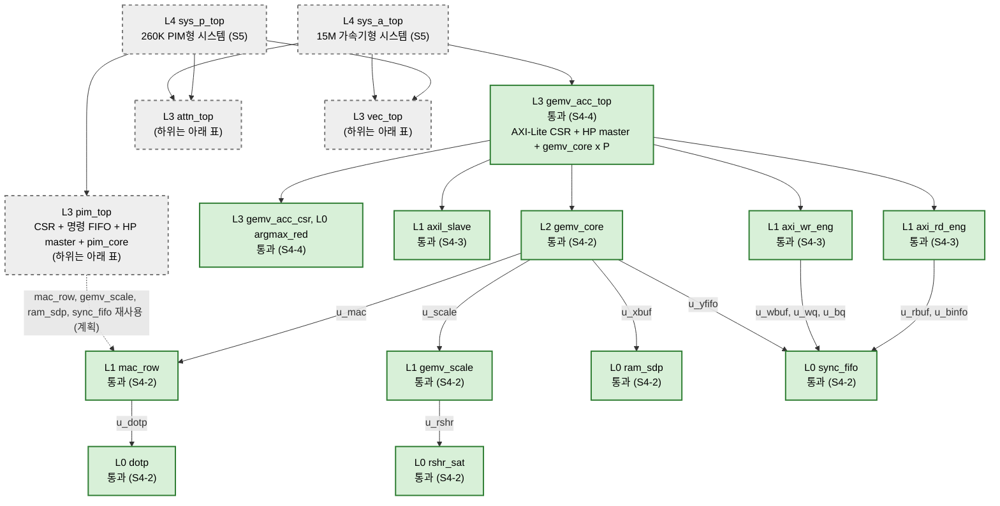

# 계층 트리와 구현 상태 (S4-4 시점)

- S4-4 갱신: `argmax_red`, `gemv_acc_csr`, `gemv_acc_top`을 "통과"로 바꿨다. 근거 `docs/log.md` S4-4, `./sim/run.sh all` 201 run, fails 0 [측정, 수퍼바이저 재실행]. 합성, 타이밍, 보드는 미확인. 아래 첫 항목의 "S4-3 시점" 근거 문장은 S4-3까지의 내용이다.
- 원본과 확인일: 확인일 2026-11-19. 계층과 모듈 목록은 `docs/spec/hierarchy.md` 1절, 상태는 `docs/log.md`의 S4-2 항목과 `docs/plan.md`, RTL 파일 존재(`rtl/pkg/`, `rtl/l0/`, `rtl/l1/`, `rtl/l2/`)로 확인했다.
- 표기:
  - 통과 = S4-2와 S4-3에서 모듈 단독으로 G3(RTL)와 G4(golden 대비 mismatch 0)를 통과한 모듈. 실선 테두리, 초록 계열. 근거는 `docs/log.md`: S4-2 `./sim/run.sh all` 97 run, S4-3 164 run, 둘 다 fails 0 [측정, 수퍼바이저 재실행].
  - 계획 = RTL 미구현(스펙 `hierarchy.md`와 `arch.md` 기준). 점선 테두리, 회색 계열.
- 통과한 모듈은 S4-2의 7개(L0 `rshr_sat`, `dotp`, `sync_fifo`, `ram_sdp`, L1 `mac_row`, `gemv_scale`, L2 `gemv_core`)와 S4-3의 `axi_rd_eng`, `axi_wr_eng`, `axil_slave`(L1)다. L3 `bw_top`(HP 대역폭 측정 top)도 시뮬레이션을 통과했으나 측정 도구이며 GEMV 계층의 모듈이 아니라 트리에는 넣지 않았다(다이어그램 `l3_bw_top.md`). 공통 상수 `rtl/pkg/llm_pkg.sv`도 구현됐다.
- S4-3 근거: `docs/log.md` S4-3, `./sim/run.sh all` 164 run, fails 0 [측정, 수퍼바이저 재실행]. `axil_slave`는 `pqc-ntt-ip`에서 복사(`hierarchy.md` 3.6)한 모듈이고 이 프로젝트의 TB로도 7 run 통과.
- 합성과 타이밍은 확인하지 않았다(`log.md` S4-2, S4-3 한계). irun 교차는 S4-8.

## 1. 계층 트리

`pim_top`, `attn_top`, `vec_top` 계열은 가독성을 위해 L3 아래를 접어 한 박스로 그렸다. 펼친 목록은 아래 표에 있다.

## 2. 모듈별 상태

| 모듈 | 계층 | 구현 | 상태 | 근거 |
|---|---|---|---|---|
| `llm_pkg` | pkg | RTL | 구현 | `rtl/pkg/llm_pkg.sv` |
| `rshr_sat`, `dotp`, `sync_fifo`, `ram_sdp` | L0 | RTL | 통과 (S4-2) | `rtl/l0/*.sv`, `log.md` S4-2 |
| `mac_row`, `gemv_scale` | L1 | RTL | 통과 (S4-2) | `rtl/l1/*.sv`, `log.md` S4-2 |
| `gemv_core` | L2 | RTL | 통과 (S4-2), 260K K_GEMV 432 레코드와 15M 258 레코드에서 y mismatch 0 | `rtl/l2/gemv_core.sv`, `log.md` S4-2 |
| `axi_rd_eng`, `axi_wr_eng` | L1 | RTL | 통과 (S4-3), 다이어그램 `l1_axi_eng.md` | `rtl/l1/*.sv`, `log.md` S4-3 |
| `axil_slave` | L1 | RTL | 통과 (S4-3, `pqc-ntt-ip`에서 복사) | `rtl/l1/axil_slave.sv`, `hierarchy.md` 3.6 |
| `bw_top` | L3 | RTL (측정 top) | 시뮬레이션 통과 (S4-3), 보드 미실행. 다이어그램 `l3_bw_top.md` | `rtl/l3/bw_top.sv`, `log.md` S4-3 |
| `gemv_acc_csr`, `gemv_acc_top`, `argmax_red` | L3, L0 | RTL | 통과 (S4-4), 다이어그램 `l3_gemv_acc_top.md` | `rtl/l3/gemv_acc_csr.sv`, `rtl/l3/gemv_acc_top.sv`, `rtl/l0/argmax_red.sv`, `log.md` S4-4 |
| `pim_bank`, `pim_gb`, `pim_ctrl`, `pim_core`, `pim_csr`, `pim_top` | L1 에서 L3 | RTL | 계획 (S4-5) | 같음 |
| `udiv_seq`, `lut_lerp`, `exp_unit`, `attn_score`, `attn_vacc`, `attn_ctrl`, `attn_core`, `kv_store`, `kv_rd`, `attn_csr`, `attn_top` | L0 에서 L3 | RTL | 계획 (S4-6) | 같음 |
| `rsqrt_nr`, `actq_core`, `rms_front`, `swi_front`, `vec_core`, `vec_top` | L0 에서 L3 | RTL | 계획 (S4-7) | 같음 |
| `sys_p_top`, `sys_a_top` | L4 | RTL | 계획 (S5) | 같음 |

- 트리의 `gemv_core` 내부 인스턴스 이름(`u_xbuf`, `u_mac`, `u_scale`, `u_yfifo`, `u_dotp`, `u_rshr`)은 RTL에서 확인한 이름이다.
- `pim_core` 쪽의 `mac_row`(LANES = 16), `gemv_scale`, `ram_sdp` 재사용은 스펙의 계획이다. 이 문서는 `gemv_core`에서 쓰는 구성(LANES = 8)만 RTL로 확인했다.
