# 계층 트리와 구현 상태 (S4-6b 시점)

- S4-6b 갱신(2026-11-20): `attn_top`, `attn_csr`, `kv_rd`, `kv_store`를 "통과"로 바꿨다(합성 품질 정리: 주소 계산과 descriptor 검사의 runtime 곱셈을 순차 곱 `umul_seq`와 증분 덧셈으로 교체). 새 leaf `umul_seq`(L0)를 추가했다. 근거 `docs/log.md` S4-6b, `./sim/run.sh all` **368 run, fails 0** [측정, 수퍼바이저 재실행](기존 345 + `umul_seq` 13 + `attn_csr` 10). `gemv_acc_csr`, `pim_csr`, `pim_ctrl`, `pim_top`, `gemv_acc_top`도 S4-6b에서 같은 방식으로 바뀌었고 재통과했다(상태 표기는 이미 "통과"). mutation 42/42 검출과 lint 경고 0은 agent 보고(재실행 안 함). 합성, 타이밍, 보드는 미확인. 다이어그램 `l3_attn_top.md`, `l0_umul_seq.md`.

- S4-6 갱신(2026-11-20): `udiv_seq`, `lut_lerp`, `exp_unit`, `attn_score`, `attn_vacc`, `attn_core`를 "통과"로 바꿨다. `attn_top`, `attn_csr`, `kv_rd`, `kv_store`는 "통과 (S4-6b에서 주소 계산 정리 중)"으로 표시한다(기능 시뮬레이션은 통과했고 주소 계산과 descriptor 검사의 곱셈을 순차, 증분 계산으로 바꾸는 작업이 진행 중이라, 그 결과로 RTL과 timing 상수가 바뀔 수 있다). 근거 `docs/log.md` S4-6, `./sim/run.sh all` 345 run, fails 0 [측정, 수퍼바이저 재실행]. 합성, 타이밍, 보드는 미확인. 다이어그램 `l2_attn_core.md`, `l0_l1_attn_leaf.md`. `attn_top` 상세 그림은 S4-6b가 끝난 뒤 `l3_attn_top.md`로 그렸다.
- S4-5 갱신: `pim_gb`, `pim_bank`, `pim_ctrl`, `pim_core`, `pim_csr`, `pim_top`을 "통과"로 바꿨다. 근거 `docs/log.md` S4-5, `./sim/run.sh all` 262 run, fails 0 [측정, 수퍼바이저 재실행]. 합성, 타이밍, 보드는 미확인. 다이어그램 `l2_pim_core.md`, `l3_pim_top.md`, 비교 `pim_vs_accel.md`.
- S4-4 갱신: `argmax_red`, `gemv_acc_csr`, `gemv_acc_top`을 "통과"로 바꿨다. 근거 `docs/log.md` S4-4, `./sim/run.sh all` 201 run, fails 0 [측정, 수퍼바이저 재실행]. 합성, 타이밍, 보드는 미확인. 아래 첫 항목의 "S4-3 시점" 근거 문장은 S4-3까지의 내용이다.
- 원본과 확인일: 확인일 2026-11-19. 계층과 모듈 목록은 `docs/spec/hierarchy.md` 1절, 상태는 `docs/log.md`의 S4-2 항목과 `docs/plan.md`, RTL 파일 존재(`rtl/pkg/`, `rtl/l0/`, `rtl/l1/`, `rtl/l2/`)로 확인했다.
- 표기:
  - 통과 = S4-2와 S4-3에서 모듈 단독으로 G3(RTL)와 G4(golden 대비 mismatch 0)를 통과한 모듈. 실선 테두리, 초록 계열. 근거는 `docs/log.md`: S4-2 `./sim/run.sh all` 97 run, S4-3 164 run, 둘 다 fails 0 [측정, 수퍼바이저 재실행].
  - 통과, 정리 중 = 모듈 단독 G3, G4는 통과했고 합성 품질 정리가 진행 중인 모듈. 실선 테두리, 노랑 계열(`wip`). S4-6b가 끝나 현재 이 상태의 모듈은 없다(범례만 남김).
  - 계획 = RTL 미구현(스펙 `hierarchy.md`와 `arch.md` 기준). 점선 테두리, 회색 계열.
- 통과한 모듈은 S4-2의 7개(L0 `rshr_sat`, `dotp`, `sync_fifo`, `ram_sdp`, L1 `mac_row`, `gemv_scale`, L2 `gemv_core`)와 S4-3의 `axi_rd_eng`, `axi_wr_eng`, `axil_slave`(L1)다. L3 `bw_top`(HP 대역폭 측정 top)도 시뮬레이션을 통과했으나 측정 도구이며 GEMV 계층의 모듈이 아니라 트리에는 넣지 않았다(다이어그램 `l3_bw_top.md`). 공통 상수 `rtl/pkg/llm_pkg.sv`도 구현됐다.
- S4-3 근거: `docs/log.md` S4-3, `./sim/run.sh all` 164 run, fails 0 [측정, 수퍼바이저 재실행]. `axil_slave`는 `pqc-ntt-ip`에서 복사(`hierarchy.md` 3.6)한 모듈이고 이 프로젝트의 TB로도 7 run 통과.
- 합성과 타이밍은 확인하지 않았다(`log.md` S4-2, S4-3 한계). irun 교차는 S4-8.

## 1. 계층 트리

`pim_top`, `attn_top`, `vec_top` 계열은 가독성을 위해 L3 아래를 접어 한 박스로 그렸다. 펼친 목록은 아래 표에 있다.

```mermaid
flowchart TD
    sysp["L4 sys_p_top<br/>260K PIM형 시스템 (S5)"]:::plan
    sysa["L4 sys_a_top<br/>15M 가속기형 시스템 (S5)"]:::plan

    acc["L3 gemv_acc_top<br/>통과 (S4-4)<br/>AXI-Lite CSR + HP master + gemv_core x P"]:::done
    pim["L3 pim_top<br/>통과 (S4-5)<br/>CSR + 명령 FIFO + HP master + pim_core"]:::done
    pimcore["L2 pim_core<br/>통과 (S4-5)"]:::done
    pimsub["L1 pim_ctrl, pim_gb, pim_bank<br/>L3 pim_csr<br/>통과 (S4-5)"]:::done
    attn["L3 attn_top<br/>통과 (S4-6, S4-6b)"]:::done
    vec["L3 vec_top<br/>(하위는 아래 표)"]:::plan

    attncsr["L3 attn_csr<br/>통과 (S4-6b, 단독 TB)"]:::done
    attncore["L2 attn_core<br/>통과 (S4-6)"]:::done
    kvrd["L2 kv_rd<br/>통과 (S4-6b)"]:::done
    kvst["L2 kv_store<br/>통과 (S4-6b)"]:::done
    ascore["L1 attn_score<br/>통과 (S4-6)"]:::done
    aexp["L1 exp_unit<br/>통과 (S4-6)"]:::done
    avacc["L1 attn_vacc<br/>통과 (S4-6)"]:::done
    udiv["L0 udiv_seq<br/>통과 (S4-6)"]:::done
    umul["L0 umul_seq<br/>통과 (S4-6b)"]:::done
    lut["L0 lut_lerp<br/>통과 (S4-6)"]:::done

    accsub["L3 gemv_acc_csr, L0 argmax_red<br/>통과 (S4-4)"]:::done
    axil["L1 axil_slave<br/>통과 (S4-3)"]:::done
    rde["L1 axi_rd_eng<br/>통과 (S4-3)"]:::done
    wre["L1 axi_wr_eng<br/>통과 (S4-3)"]:::done
    core["L2 gemv_core<br/>통과 (S4-2)"]:::done
    mac["L1 mac_row<br/>통과 (S4-2)"]:::done
    scale["L1 gemv_scale<br/>통과 (S4-2)"]:::done
    dotp["L0 dotp<br/>통과 (S4-2)"]:::done
    rshr["L0 rshr_sat<br/>통과 (S4-2)"]:::done
    ram["L0 ram_sdp<br/>통과 (S4-2)"]:::done
    fifo["L0 sync_fifo<br/>통과 (S4-2)"]:::done

    sysp --> pim
    sysp --> attn
    sysp --> vec
    sysa --> acc
    sysa --> attn
    sysa --> vec
    acc --> accsub
    acc --> axil
    acc --> rde
    acc --> wre
    rde -->|"u_rbuf, u_binfo"| fifo
    wre -->|"u_wbuf, u_wq, u_bq"| fifo
    acc --> core
    core -->|"u_xbuf"| ram
    core -->|"u_mac"| mac
    core -->|"u_scale"| scale
    core -->|"u_yfifo"| fifo
    mac -->|"u_dotp"| dotp
    scale -->|"u_rshr"| rshr
    pim --> pimcore
    pim --> pimsub
    pim --> axil
    pim --> rde
    pim --> wre
    pimcore -->|"u_bank의 u_mac"| mac
    pimcore -->|"u_scale"| scale
    pimcore -->|"u_yfifo"| fifo
    pimsub -->|"pim_bank u_ram, pim_gb u_lo u_hi"| ram
    attn -->|"u_axil"| axil
    attn -->|"u_rd"| rde
    attn -->|"u_wr"| wre
    attn -->|"u_csr"| attncsr
    attn -->|"u_core"| attncore
    attn -->|"u_kvr (KV_SRC 1)"| kvrd
    attn -->|"u_kvs (KV_SRC 0)"| kvst
    attncsr -->|"u_div (KV_SRC 1)"| udiv
    attncsr -->|"u_mq, u_mp, u_mw, u_m0, u_mr (KV_SRC 0)<br/>u_mq, u_mp, u_msh, u_mth, u_mks, u_mkh (KV_SRC 1)"| umul
    accsub -->|"gemv_acc_csr의 u_wmul"| umul
    pimsub -->|"pim_csr의 u_bmul, u_lmul<br/>pim_ctrl의 u_lmul"| umul
    attncore -->|"u_score"| ascore
    attncore -->|"u_exp"| aexp
    attncore -->|"u_div"| udiv
    attncore -->|"u_vacc"| avacc
    attncore -->|"u_pbuf, u_vbuf"| ram
    attncore -->|"u_ofifo"| fifo
    ascore -->|"u_dot"| dotp
    ascore -->|"u_rd0, u_rs"| rshr
    aexp -->|"u_rs"| rshr
    aexp -->|"u_lut"| lut
    avacc -->|"u_w, u_o"| rshr
    kvst -->|"u_ram"| ram
    kvst -->|"u_f"| fifo

    classDef done fill:#d8f0d8,stroke:#2e7d32,stroke-width:2px,color:#000
    classDef wip fill:#fff3c4,stroke:#b58900,stroke-width:2px,color:#000
    classDef plan fill:#eeeeee,stroke:#777777,stroke-width:2px,stroke-dasharray:5 5,color:#000
```

## 2. 모듈별 상태

| 모듈 | 계층 | 구현 | 상태 | 근거 |
|---|---|---|---|---|
| `llm_pkg` | pkg | RTL | 구현 | `rtl/pkg/llm_pkg.sv` |
| `rshr_sat`, `dotp`, `sync_fifo`, `ram_sdp` | L0 | RTL | 통과 (S4-2) | `rtl/l0/*.sv`, `log.md` S4-2 |
| `mac_row`, `gemv_scale` | L1 | RTL | 통과 (S4-2) | `rtl/l1/*.sv`, `log.md` S4-2 |
| `gemv_core` | L2 | RTL | 통과 (S4-2), 260K K_GEMV 432 레코드와 15M 258 레코드에서 y mismatch 0 | `rtl/l2/gemv_core.sv`, `log.md` S4-2 |
| `axi_rd_eng`, `axi_wr_eng` | L1 | RTL | 통과 (S4-3), 다이어그램 `l1_axi_eng.md` | `rtl/l1/*.sv`, `log.md` S4-3 |
| `axil_slave` | L1 | RTL | 통과 (S4-3, `pqc-ntt-ip`에서 복사) | `rtl/l1/axil_slave.sv`, `hierarchy.md` 3.6 |
| `bw_top` | L3 | RTL (측정 top) | 시뮬레이션 통과 (S4-3), 보드 미실행. 다이어그램 `l3_bw_top.md` | `rtl/l3/bw_top.sv`, `log.md` S4-3 |
| `gemv_acc_csr`, `gemv_acc_top`, `argmax_red` | L3, L0 | RTL | 통과 (S4-4), 다이어그램 `l3_gemv_acc_top.md` | `rtl/l3/gemv_acc_csr.sv`, `rtl/l3/gemv_acc_top.sv`, `rtl/l0/argmax_red.sv`, `log.md` S4-4 |
| `pim_bank`, `pim_gb`, `pim_ctrl`, `pim_core`, `pim_csr`, `pim_top` | L1 에서 L3 | RTL | 통과 (S4-5), 260K K_GEMV 432 레코드 y mismatch 0. 다이어그램 `l2_pim_core.md`, `l3_pim_top.md` | `rtl/l1/pim_*.sv`, `rtl/l2/pim_core.sv`, `rtl/l3/pim_csr.sv`, `rtl/l3/pim_top.sv`, `log.md` S4-5 |
| `udiv_seq`, `lut_lerp` | L0 | RTL | 통과 (S4-6), 다이어그램 `l0_l1_attn_leaf.md` | `rtl/l0/*.sv`, `log.md` S4-6 |
| `umul_seq` | L0 | RTL | 통과 (S4-6b), 단독 TB 13 run. 다이어그램 `l0_umul_seq.md` | `rtl/l0/umul_seq.sv`, `log.md` S4-6b |
| `exp_unit`, `attn_score`, `attn_vacc` | L1 | RTL | 통과 (S4-6), 다이어그램 `l0_l1_attn_leaf.md` | `rtl/l1/*.sv`, `log.md` S4-6 |
| `attn_core` | L2 | RTL | 통과 (S4-6), 260K 480 레코드와 15M 216 레코드 p, o mismatch 0(agent 보고). 다이어그램 `l2_attn_core.md`. pass FSM이 `attn_core` 안에 있어 `attn_ctrl`은 별도 모듈로 두지 않았다 | `rtl/l2/attn_core.sv`, `log.md` S4-6, `hierarchy.md` 3.9 |
| `kv_store`, `kv_rd` | L2 | RTL | 통과 (S4-6, S4-6b에서 주소 계산 정리 뒤 재통과). 상세는 `l3_attn_top.md`(top 안에서의 사용) | `rtl/l2/kv_store.sv`, `rtl/l2/kv_rd.sv`, `log.md` S4-6, S4-6b |
| `attn_csr`, `attn_top` | L3 | RTL | 통과 (S4-6, S4-6b). `attn_csr` 단독 TB를 S4-6b에서 추가(10 run). 다이어그램 `l3_attn_top.md` | `rtl/l3/attn_csr.sv`, `rtl/l3/attn_top.sv`, `log.md` S4-6, S4-6b |
| `rsqrt_nr`, `actq_core`, `rms_front`, `swi_front`, `vec_core`, `vec_top` | L0 에서 L3 | RTL | 계획 (S4-7) | 같음 |
| `sys_p_top`, `sys_a_top` | L4 | RTL | 계획 (S5) | 같음 |

- 트리의 `gemv_core` 내부 인스턴스 이름(`u_xbuf`, `u_mac`, `u_scale`, `u_yfifo`, `u_dotp`, `u_rshr`)은 RTL에서 확인한 이름이다.
- `pim_core` 쪽 재사용은 RTL로 확인했다: `pim_bank`가 `ram_sdp`와 `mac_row`(LANES = 16), `pim_core`가 `gemv_scale`과 `sync_fifo`(y FIFO), `pim_top`이 `axil_slave`, `axi_rd_eng`, `axi_wr_eng`, `sync_fifo`(명령 FIFO)를 인스턴스한다. `pim_gb`는 `ram_sdp` 두 개를 쓴다.
- 트리의 `attn_top`과 `attn_core`, `kv_store`, `attn_score`, `exp_unit`, `attn_vacc`의 인스턴스 이름(`u_axil`, `u_csr`, `u_rd`, `u_core`, `u_kvr`, `u_kvs`, `u_wr` / `u_score`, `u_exp`, `u_div`, `u_vacc`, `u_pbuf`, `u_vbuf`, `u_ofifo` / `u_ram`, `u_f` / `u_dot`, `u_rd0`, `u_rs` / `u_lut` / `u_w`, `u_o`)은 RTL의 인스턴스 선언에서 확인한 이름이다. `kv_rd`의 하위는 확인하지 않아 그리지 않았다. `u_kvr`는 `KV_SRC` 1, `u_kvs`는 `KV_SRC` 0 구성에서 생성되는 것으로 `attn_top.sv` 헤더 주석과 `KV_SRC` generate 분기에서 확인했다.
