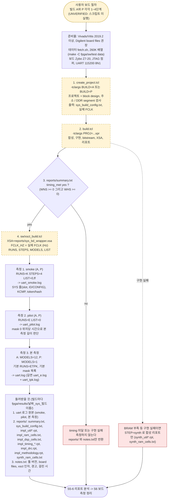

# 사용자 보드 절차 (S5-5, 빌드 A/P)

- 원본과 확인일: 2026-11-23. `fpga/sys/README.md` 4절(4.3 실행 순서, 4.4 측정 순서, 4.5 돌려받을 것), `fpga/sys/create_project.tcl`, `build.tcl`, `sw/xsct_build.tcl`.
- **UNVERIFIED: `create_project.tcl`, `build.tcl`, `xsct_build.tcl`은 Vivado와 XSCT에서 한 번도 실행하지 않았다.** 확인한 것은 Tcl stub 검사(`STUBCHECK runs=43 fail=0`, [측정, 수퍼바이저 재실행])와 shell lint 9구성 경고 0(agent 보고)뿐이다. 속성 이름, module reference 추론, 합성 결과, 100 MHz timing, BRAM parity 매핑은 전부 미확인이다(README 4.10절).
- 이 절차는 사용자가 Vivado와 보드로 수행한다. 이 서버에서는 Vivado를 실행하지 않는다.

- 점선 노랑 박스는 스크립트를 한 번도 실행하지 않은 단계(UNVERIFIED), 빨강 박스는 측정을 하지 않고 리포트만 돌려보내는 경로다.
- 3단계(`xsct_build.tcl`)는 같은 명령에 `RUN=1`을 더하면 4단계(PL 프로그래밍, PS 초기화, ELF와 15M 이미지 다운로드, 실행)까지 한다. 15M 이미지는 DDR 0x1000_0000(checkpoint), 0x1400_0000(tokenizer)에 올리고 리셋하면 다시 올린다(README 4.3절).
- FCLK는 PS PLL이 가까운 값을 고르므로 `FCLK_HZ`에는 그 빌드의 실제 값(`fclk_mhz_actual`)을 Hz로 넣는다.
- timing 미달일 때 대책(IP의 PIPE parameter 추가가 먼저, 낮은 FCLK 빌드는 `FCLK_MHZ=75` 등)은 리포트를 본 뒤 오케스트레이터가 정한다(README 4.5절, `system.md` 1.6).
- 리포트 판정 항목(S5-6): `summary.txt`의 `wns`, `whs`, `timing_met`, BRAM36 <= 140([계산] P 128~129, A 3~3.5), DSP([계산] A 60, P 149), parity 매핑(README 4.6절).
