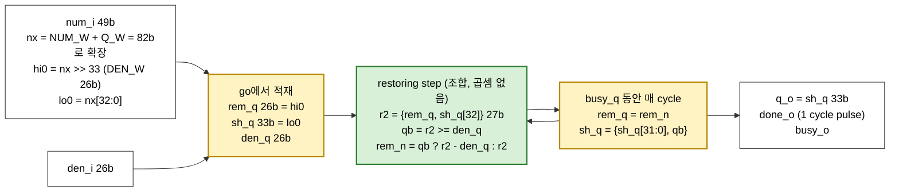
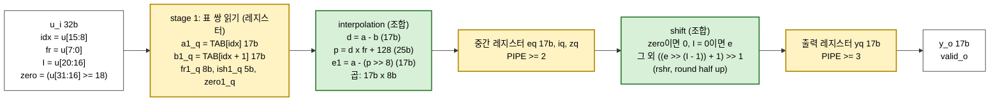
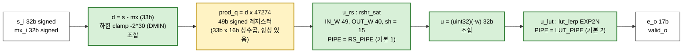

# L0, L1 attention leaf 데이터패스: udiv_seq, lut_lerp, exp_unit, attn_score, attn_vacc

- 원본과 확인일: 확인일 2026-11-20. `rtl/l0/udiv_seq.sv`, `rtl/l0/lut_lerp.sv`, `rtl/l1/exp_unit.sv`, `rtl/l1/attn_score.sv`, `rtl/l1/attn_vacc.sv`, `rtl/pkg/llm_pkg.sv`(`E_W` 8, `SH_W` 10, `AM_W` 17, `T_MAX` 512). 폭과 PIPE 단 위치는 RTL의 `localparam`, 레지스터, generate 조건에서 읽은 것이다. 이 5개를 묶는 `attn_core`는 `l2_attn_core.md`.
- 상태: 5개 모두 S4-6에서 단독 G4 통과(`log.md` S4-6. 모듈별 mutation 검출 포함 agent 보고).
- 폭은 `attn_core`가 쓰는 구성(`attn_score` KL 8, HS_MAX 64, DOT_PIPE 2, SH_PIPE 1 / `exp_unit` RS_PIPE 1, LUT_PIPE 2 / `udiv_seq` NUM_W 49, DEN_W 26, Q_W 33 / `attn_vacc` VL 8, T_MAX 512, ACC_W 60)의 값이다. 폭은 parameter에서 식으로 정해진다.
- 모든 leaf는 `valid`만 있고 backpressure가 없다(`udiv_seq`는 start/busy/done 방식). control(valid)은 `rst_n`으로 reset, datapath 레지스터는 reset 없이 valid로 enable한다.
- **DSP 위치 표시는 [계산]이다**: RTL의 곱셈식과 피연산자 폭에서 DSP48E1(25x18)로 갈 곱을 센 것이고, 합성하지 않았다. 상수곱, 작은 곱은 LUT로 갈 수 있다. 개수는 `attn.md` 8절과 같은 방식으로 센 값이다.
- 파형은 그리지 않았다. PIPE 단 위치는 RTL 구조에서 도출한 것이다.

## 1. udiv_seq (L0)

기능: restoring 나눗셈 `q = floor(num / den)`, cycle당 몫 1비트. attention에서는 `R = 2^48 / sum`(`num_i` = 2^48, `den_i` = `sum_q`, 몫 33비트).

- 제어: `go` = `start_i && !busy_q`. `go` cycle c에서 `busy_q`가 c + 1 에서 c + `Q_W`까지 1, `done_o`는 c + `CYCLES`(= `Q_W` + 1 = 34)에 1 cycle. `cnt_q`(`CNT_W` = clog2(`Q_W` + 1))가 `Q_W`에서 1까지 센다. `q_o`는 `done_o`부터 다음 수락된 start까지 유지된다. busy 중 start는 무시.
- 선행 조건: `den > 0`이고 몫이 `Q_W`비트에 들어감(`num >> Q_W < den`). 위반은 시뮬레이션 검사 `UDIV_ZERO`, `UDIV_OVF`, 중복 start는 `UDIV_START`.
- PIPE 단: 없음(한 cycle에 비교, 감산, 선택 한 단). 비교와 감산은 27비트 덧셈기급 조합 경로.
- DSP: 0(곱셈 없음, 비교기와 감산기만) [계산].

## 2. lut_lerp (L0, FUNC = EXP2N)

기능: `y = 2^(-u/65536)` Q16, `u` unsigned 32비트. golden `k_exp2neg(u, 8, k_exp_lut(8))`. 표 `lut_pkg::EXP2N_TAB`은 257항목, 항목 17비트.

| PIPE | 레지스터 위치 | LATENCY |
|---|---|---|
| 1 | stage 1(표 읽기)만. interpolation과 shift가 한 조합 구간 | 1 |
| 2 (기본, `attn_core`의 `LUT_PIPE`) | stage 1, interpolation 뒤 | 2 |
| 3 | stage 1, interpolation 뒤, shift 뒤(출력) | 3 |

- `FUNC` = 1(SIGM)은 구현하지 않았다(elaboration 오류, S4-7). `PIPE` 범위 1..3.
- `I >= 18`이면 결과 0으로 처리한다(`e` <= 65536 < 2^17이라 `I >= 18`이면 어차피 0. RTL 주석: 이 경계로 `u < 2^21` 전수 검사에서 golden과 일치).
- DSP [계산]: `d x fr`(17비트 x 8비트, 실제 `d` <= 177) 1개 또는 LUT. 표 읽기는 인접 두 항목을 한 번에 읽는 쌍 ROM(257항목 표에서 idx, idx + 1)이고, 구현이 LUT인지 BRAM인지는 합성하지 않아 모른다(`attn.md` 8절은 LUT로 계산).

## 3. exp_unit (L1)

기능: 점수 하나의 softmax 분자 `e`. golden `k_attn_exp(s, mx, 8, k_exp_lut(8))`.

- `LATENCY` = 1 + `RS_PIPE` + `LUT_PIPE`(기본 4). 레지스터: `prod_q`(valid로 enable)와 `vm_q`, 이어서 `rshr_sat`과 `lut_lerp` 내부 레지스터.
- `s > mx`(d > 0)도 golden과 같이 계산한다(-w의 32비트 절단까지 그대로, 모든 32비트 입력쌍에서 `k_attn_exp`와 같도록).
- DSP [계산]: `d x 47274`(33b x 16b 상수곱) 2개(`attn.md` 8절, 상수곱이라 LUT로 갈 수 있음), 하위 `lut_lerp`의 1개 별도.

## 4. attn_score (L1, P1)

기능: 위치마다 K 행을 beat(`KL` lane x 16비트)로 받아 q와 lane별 곱 후 합, beat 누산으로 `dot`. `s = sat32(rshr(rshr(dot, d0) x (qm x km), qe + ke - d0 - 16))`. running max `mx_o`, `vm != 0`인 위치의 `emin_o`, `mmax_o`, `have_o`.

```mermaid
flowchart LR
    kin["k_data_i 128b (16b x 8)<br/>km_i, vm_i 17b<br/>ke_i, ve_i 8b signed"]:::io
    qr["q_r[NG] 레지스터 128b x 8<br/>q_we_i, q_idx_i로 적재<br/>a_i = q_r[g_q]"]:::cut
    mask["kmask<br/>lane >= hs는 0"]:::logic
    dot["u_dot : dotp<br/>LANES 8, AW 16, BW 16<br/>PIPE = DOT_PIPE (기본 2)<br/>sum 35b signed<br/>곱 16b x 16b 8개"]:::logic
    side["side band (side_t 레지스터 DOT_PIPE 단)<br/>first, last, km, vm, ke, ve"]:::cut
    acc["stage A: dot 누산<br/>acc_q 39b (HS_MAX 64)<br/>pa_q = 위치의 dot 완료<br/>km, ke, vm, ve 래치, emin, mmax, have 통계"]:::cut
    rd0["stage B: u_rd0 rshr_sat PIPE 1<br/>IN_W 39, OUT_W 24, sh = d0<br/>r 24b signed<br/>cB = qm x km 34b 레지스터<br/>shB = qe + ke - d0 - 16 (10b)"]:::logic
    prod["stage C: x_q = r x cB<br/>58b signed 레지스터<br/>24b x 34b"]:::cut
    rs["stage D: u_rs rshr_sat<br/>IN_W 58, OUT_W 32, sh = shC<br/>PIPE = SH_PIPE (기본 1)"]:::logic
    s["s_o 32b signed, s_valid_o<br/>s_vm_o, s_ve_o (s와 같은 시점)"]:::io
    mx["running max<br/>mx_q 32b, mxs_q"]:::cut
    stat["mx_o, emin_o 8b, mmax_o 17b, have_o"]:::io

    kin --> mask --> dot
    qr --> dot
    kin --> side
    dot --> acc
    side --> acc
    acc --> rd0 --> prod --> rs --> s
    s --> mx --> stat
    acc --> stat

    classDef io fill:#ffffff,stroke:#333333,color:#000
    classDef logic fill:#d8f0d8,stroke:#2e7d32,stroke-width:2px,color:#000
    classDef cut fill:#fff3c4,stroke:#b58900,stroke-width:2px,color:#000
```

| 단 | 폭 | 레지스터 |
|---|---|---|
| `dotp` 출력 `dsum` | `SW` = 32 + clog2(KL) = 35b | `DOT_PIPE`단(기본 2: 곱 뒤, 출력). side band도 같은 단 수 |
| `acc_q` | `ACC_W` = `SW` + clog2(`NG` + 1) = 39b (HS_MAX 64, `NG` 8), 36b (HS_MAX 8) | 1 |
| `r` | `R_W` = 24b signed | `u_rd0` PIPE 1 |
| `cB` | 34b | 1 (`pa_q`로 enable) |
| `x_q` | 58b signed | 1 |
| `s_o` | 32b signed | `SH_PIPE` |

- `LATENCY` = `DOT_PIPE` + 3 + `SH_PIPE`(기본 6): 위치의 마지막 beat에서 그 위치의 `s_valid_o`까지. `mx_o`, `emin_o`, `mmax_o`, `have_o`는 head의 마지막 beat 뒤 `LATENCY` cycle에 확정된다.
- `clr_i`(1 cycle, 진행 중 beat 없음)로 beat 카운터 `g_q`, 최대값, 통계가 head 단위로 재시작한다. 위치의 scale(`km`, `ke`, `vm`, `ve`)은 그 위치의 마지막 beat에서 가져온다.
- golden 전제 abs(`rshr(dot, d0)`) < 2^22를 넘으면 시뮬레이션 검사 `L1_RANGE`(24비트로 포화).
- DSP [계산]: 16b x 16b 곱 8개(lane당 1, `dotp`), `qm x km`(17b x 17b) 1개, `r x cB`(24b x 34b) 2개 = 11개(`attn.md` 8절 표).

## 5. attn_vacc (L1, P3와 O)

기능: 위치마다 `e`와 R로 `p`, `w`를 만들고 V beat에 곱해 lane별 누산, 끝에서 o를 한 원소씩 읽는다. 호출자(`attn_core`)가 `e`, `vm`, `ve`를 위치의 첫 beat에 정렬해 준다.

```mermaid
flowchart LR
    bin["b_valid_i, b_first_i, b_g_i 3b<br/>b_v_i 128b (16b x 8)<br/>b_e_i 17b, b_vm_i 17b, b_ve_i 8b"]:::io
    s1["stage 1<br/>er1 = e x R<br/>50b (17b x 33b)"]:::cut
    s2["stage 2<br/>p2 = (er1 + 2^31) >> 32<br/>17b<br/>p_valid_o (첫 beat), p_o 32b"]:::cut
    s3["stage 3<br/>pm3 = p x vm 34b<br/>sh3 = ve - emin - G (10b)"]:::cut
    s4["stage 4: u_w rshr_sat<br/>IN_W 35, OUT_W 36, PIPE 1<br/>w4 36b signed<br/>wuse = first ? w4 : wh_q"]:::logic
    s5["stage 5: m5[l] = wuse x V[l]<br/>52b x lane 8 (36b x 16b)<br/>wh_q: 위치의 w를 뒤 beat에 유지"]:::cut
    s6["stage 6: 누산<br/>acc_q[g][l] += m5[l]<br/>ACC_W 60b, NG x VL = 64개<br/>clr_i로 전부 0"]:::cut
    orr["o 읽기<br/>o_rd_i, o_idx_i 7b<br/>acc_q[idx / VL][idx % VL] mux -> oa_q 60b"]:::logic
    ors["u_o : rshr_sat<br/>IN_W 60, OUT_W 32, PIPE 1<br/>sh = emin + G"]:::logic
    o["o_o 32b signed<br/>o_valid_o"]:::io

    bin --> s1 --> s2 --> s3 --> s4 --> s5 --> s6
    s6 --> orr --> ors --> o

    classDef io fill:#ffffff,stroke:#333333,color:#000
    classDef logic fill:#d8f0d8,stroke:#2e7d32,stroke-width:2px,color:#000
    classDef cut fill:#fff3c4,stroke:#b58900,stroke-width:2px,color:#000
```

| 항목 | 값 | 근거 |
|---|---|---|
| `LAT_P` | 2: 첫 beat의 `b_valid_i`에서 `p_valid_o`까지 | `v1`, `v2` 두 단 |
| `LAT_MAC` | 6: beat의 `b_valid_i`에서 acc 반영까지 | stage 1(`er1`), 2, 3, 4(`rshr_sat` PIPE 1), 5(`m5`), 6(`acc_q`) |
| `LAT_O` | 2: `o_rd_i`에서 `o_valid_o`까지 | `oa_q` 레지스터와 `u_o` PIPE 1 |
| `W_W` | 36 (w <= 2^33의 signed container, 범위 밖은 `L1_RANGE`) | 같음 |
| `ACC_W` | 60. elaboration 검사 `ACC_W >= 50 + clog2(T_MAX)` 이고 62 이하 | 같음 |

- vm = 0인 위치는 `p x vm` = 0이라 w = 0, acc에 더해지지 않는다(golden의 skip과 같은 효과).
- 마지막 beat의 lane >= hs도 누산하지만 o 읽기(`o_idx_i < hs`)로 읽지 않는다.
- DSP [계산]: `e x R`(17b x 33b) 2개, `p x vm`(17b x 17b) 1개, `w x V`(36b x 16b) lane당 2개 x 8 = 16개, 합 19개(`attn.md` 8절). 60비트 누산은 DSP 48비트 누산을 넘어 fabric 덧셈기(`attn.md` 8절, `arch.md` 4.3).
- 면적과 타이밍 위험 [추정, 미측정]: `attn_vacc`의 o 읽기 mux(`HS_MAX`:1, 60비트), 60비트 누산 8 lane, `rshr_sat` 60비트(`attn.md` 8절).

## 6. DSP로 갈 곱셈 요약 [계산, 합성 안 함]

| 모듈 | 곱 (폭) | 개수 |
|---|---|---|
| `attn_score` | q x K 16b x 16b | 8 |
| `attn_score` | `qm x km` 17b x 17b | 1 |
| `attn_score` | `r x cB` 24b x 34b | 2 |
| `exp_unit` | `d x 47274` 33b x 16b (상수곱, LUT 가능) | 2 |
| `lut_lerp` | `(a - b) x fr` 17b x 8b (실제 `d` <= 177, LUT 가능) | 1 |
| `attn_vacc` | `e x R` 17b x 33b | 2 |
| `attn_vacc` | `p x vm` 17b x 17b | 1 |
| `attn_vacc` | `w x V` 36b x 16b, lane 8개 | 16 |
| `udiv_seq` | 없음 | 0 |
| 합 (`attn_core` 1개) | | 33 |

- 개수와 합은 `attn.md` 8절의 [계산]과 같고, 이 문서는 RTL의 곱셈식 위치와 폭이 그 표와 맞는지 확인했다. H_PAR 2면 engine 2개라 66개, 상수곱과 `lut_lerp`의 곱을 LUT로 옮기면 줄 수 있으나 어느 쪽이 되는지는 합성하지 않아 알 수 없다.
- 주소 계산과 descriptor 검사의 곱셈(`attn_csr`, `attn_top`, `kv_rd`, `kv_store`)은 이 표에 없다. S4-6b에서 정리 중이며 정리 뒤의 곱셈기 목록은 그 결과를 따른다(`log.md` S4-6의 "문제").
