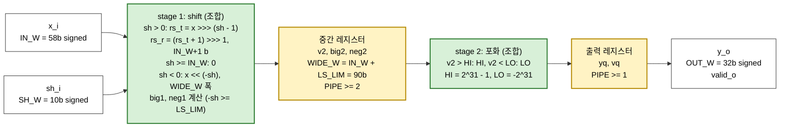
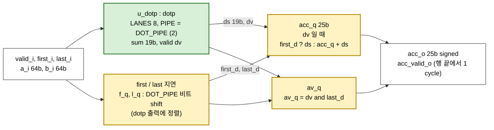
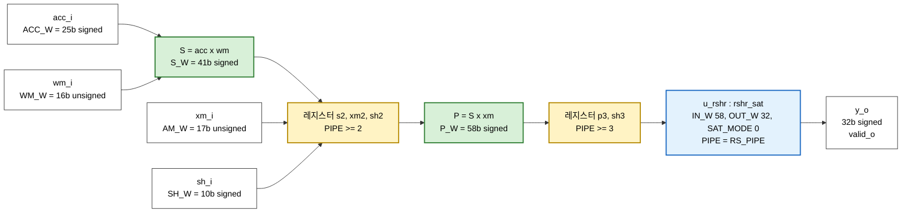

# L0, L1 GEMV leaf 데이터패스: rshr_sat, dotp, mac_row, gemv_scale

- 원본과 확인일: 확인일 2026-11-19. `rtl/l0/rshr_sat.sv`, `rtl/l0/dotp.sv`, `rtl/l1/mac_row.sv`, `rtl/l1/gemv_scale.sv`, `rtl/pkg/llm_pkg.sv`. 폭과 PIPE 단 위치는 RTL의 `localparam`과 `reg_after`/generate 조건에서 읽은 것이다.
- 상태: 4개 모두 S4-2에서 단독 G4 통과(`log.md` S4-2).
- 폭은 `gemv_core`가 쓰는 구성(`dotp` LANES 8 AW 8 BW 8, `mac_row` ACC_W 25, `gemv_scale` ACC_W 25, `rshr_sat` IN_W 58 OUT_W 32 SAT_MODE 0)의 값이다. 기본 PIPE: `dotp` 2, `mac_row` DOT_PIPE 2, `gemv_scale` 3(내부 `rshr_sat` PIPE 1). 폭은 parameter에서 식으로 계산되며 식은 각 절에 적었다.
- 모든 leaf는 `valid`만 있고 backpressure가 없다. latency는 `LATENCY` localparam이다. control(valid)은 `rst_n`으로 reset, datapath 레지스터는 reset 없이 valid로 enable한다.
- 파형은 그리지 않았다. PIPE 단 위치는 RTL 구조에서 도출한 것이다.

## 1. rshr_sat

기능: round-half-up 산술 우shift, `sh < 0`이면 포화 좌shift, 그다음 출력 포화. `SAT_MODE 0`은 `OUT_W` 범위로 포화(OUT_W 32이면 `sat32(k_rshr(x, sh))`).

| PIPE | 레지스터 위치 | LATENCY |
|---|---|---|
| 0 | 없음 (조합) | 0 |
| 1 | 출력 | 1 |
| 2 | stage 1 뒤(중간)와 출력 | 2 |

- `LS_LIM` = `OUT_W`(`SAT_MODE 0`) 또는 62(`SAT_MODE 1`). `WIDE_W` = `IN_W + LS_LIM`. `SAT_MODE 1`은 `OUT_W` 64 필수, 대칭 `+-(2^63-1)`.
- PIPE가 1이면 stage 1과 stage 2가 레지스터 없이 이어진다(`gemv_scale`이 쓰는 구성).
- 중간 레지스터는 `valid_i`로 enable(`dq`, `bq`, `nq`), 출력 레지스터는 `v2_valid`로 enable.
- 범위: `IN_W` 2에서 62(golden 전제 `|x| < 2^61`), `SH_W` 10(`llm_pkg`).

## 2. dotp

기능: LANES개 signed 곱 `a[i] * b[i]`와 adder tree 합. lane i는 `a_i[i*AW +: AW]`, `b_i[i*BW +: BW]`. LANES 8이면 level 0 = 곱 8개, level 1 = 덧셈 4개, level 2 = 2개, level 3 = 1개(`LV` = 3).

```mermaid
flowchart LR
    ab["a_i 64b, b_i 64b<br/>lane 8개, 각 8b signed"]:::io
    l0["level 0: 곱 8개<br/>a x b, 정확한 값 16b 이내<br/>SW = 19b로 부호 확장"]:::logic
    r0["R0<br/>PIPE >= 2"]:::cut
    l1["level 1: 덧셈 4개"]:::logic
    r1["R1<br/>PIPE >= 3"]:::cut
    l2["level 2: 덧셈 2개"]:::logic
    r2["R2<br/>PIPE >= 4"]:::cut
    l3["level 3: 덧셈 1개"]:::logic
    r3["R3 (출력)<br/>PIPE >= 1"]:::cut
    sum["sum_o<br/>SW = AW + BW + clog2(LANES) = 19b signed<br/>valid_o"]:::io

    ab --> l0 --> r0 --> l1 --> r1 --> l2 --> r2 --> l3 --> r3 --> sum

    classDef io fill:#ffffff,stroke:#333333,color:#000
    classDef logic fill:#d8f0d8,stroke:#2e7d32,stroke-width:2px,color:#000
    classDef cut fill:#fff3c4,stroke:#b58900,stroke-width:2px,color:#000
```

| PIPE (LANES 8) | 켜지는 레지스터 | LATENCY |
|---|---|---|
| 0 | 없음 | 0 |
| 1 | R3 (출력) | 1 |
| 2 (기본) | R3, R0 (곱 뒤) | 2 |
| 3 | R3, R0, R1 | 3 |
| 4 (최대 = LV + 1) | R3, R0, R1, R2 | 4 |

- 규칙(`reg_after(j)`): `j == LV`이면 `PIPE >= 1`, `j == 0`이면 `PIPE >= 2`, 그 외 `PIPE >= j + 2`.
- 기본 PIPE 2의 구간: 입력에서 R0까지 곱(level 0), R0에서 R3까지 덧셈 level 1 에서 3(조합 덧셈 3단).
- 합 폭 SW는 모든 lane이 최소값 곱(`-128 x -128`)일 때도 정확하다.
- 각 레지스터 단의 valid는 `rst_n`으로 reset, 데이터는 valid로 enable.

## 3. mac_row

기능: `dotp` 결과를 행(row) 한 개에 걸쳐 누산한다. `first_i`/`last_i`는 행의 첫/끝 beat(한 beat 행이면 둘 다 1).

- `LATENCY = DOT_PIPE + 1` = 3. 마지막 beat 입력 cycle t에서 `acc_valid_o`가 t + 3에 나온다(dotp DOT_PIPE단 + `acc_q`/`av_q` 1단).
- `acc_o`는 `acc_valid_o`가 1인 cycle에만 유효하고, 다음 cycle에 바뀔 수 있다(다음 행이 바로 시작할 수 있다).
- `ACC_W` >= `AW + BW - 1 + clog2(N_MAX)`(25)를 elaboration에서 검사한다. 한쪽 피연산자가 최소값(-128)이 아니라는 전제(gemv 활성은 `|x| <= 127`). 위반은 시뮬레이션 전용 shadow sum이 `L1_RANGE`로 보고한다.
- gap(`valid_i` low)은 어디에든 허용, backpressure 없음.

## 4. gemv_scale

기능: 행 하나의 출력 `y = sat32(rshr(acc * wm * xm, sh))`. `sh = we + xe - fo`는 호출하는 쪽(`gemv_core`의 `sh_q`)에서 만든다.

| PIPE | 레지스터 위치 | LATENCY |
|---|---|---|
| 0 | 없음 | 0 |
| 1 | `rshr_sat` 출력 (`RS_PIPE` 1) | 1 |
| 2 | 위 + `acc x wm` 뒤 | 2 |
| 3 (기본) | 위 + `S x xm` 뒤 | 3 |
| 4 | 위 + `rshr_sat` 중간 레지스터(`RS_PIPE` 2) | 4 |

- 폭: `S_W = ACC_W + WM_W`, `P_W = S_W + AM_W`. 검사 `P_W <= 62`, `ACC_W` 2 이상. 기본 41, 58.
- `RS_PIPE` = `PIPE >= 4`이면 2, `PIPE >= 1`이면 1, 0이면 0. 곱 두 개와 `rshr_sat` 두 stage가 PIPE에 따라 레지스터로 나뉜다.
- 곱셈기의 DSP 배치(41 x 17의 분할 등)와 타이밍은 확인하지 않았다(합성 미실행, `log.md` S4-2 한계).

## 5. gemv_core가 쓰는 나머지 L0 (참고)

| 모듈 | 구성 | 확인 내용 |
|---|---|---|
| `ram_sdp` | W 64, DEPTH 128, RD_LAT 1 (`u_xbuf`) | 쓰기 `we_i`, 읽기 `re_i`일 때만 `rdata_o` 갱신, 같은 주소 동시 접근은 이전 값(read-first). 내용 초기화 없음. 추론형 |
| `sync_fifo` | W 32, DEPTH 16 (`u_yfifo`) | first-word fall-through. `in_ready_o = (level != DEPTH)`로 `out_ready_i`와 조합 경로 없음. `out_valid_o = (level != 0)`. 포인터는 DEPTH - 1에서 wrap |
