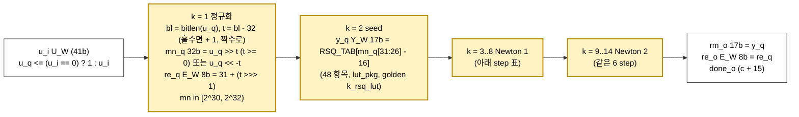
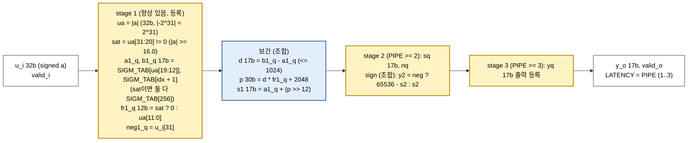
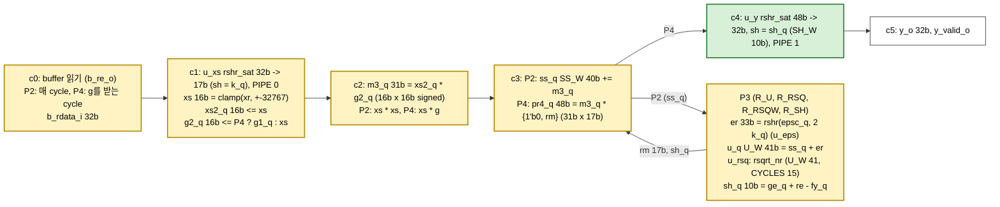

# L0, L1 vec leaf: rsqrt_nr, lut_lerp(SIGM), actq_core, rms_front, swi_front 데이터패스

- 원본과 확인일: 확인일 2026-11-20. `rtl/l0/rsqrt_nr.sv`, `rtl/l0/lut_lerp.sv`, `rtl/l1/actq_core.sv`, `rtl/l1/rms_front.sv`, `rtl/l1/swi_front.sv`(헤더 주석, 포트, 선언 폭, 레지스터 갱신 조건), `rtl/pkg/llm_pkg.sv`(`E_W` 8, `SH_W` 10, `AM_W` 17). 알고리즘 근거와 측정값은 `docs/spec/vec.md` 1, 5, 6, 8절, `docs/spec/arch.md` 5절, `docs/log.md` S4-7. 이 파일들의 FSM과 pass 순서는 `l2_vec_core.md` 3절, 이 문서는 leaf의 데이터패스와 폭이다.
- 상태: 모두 S4-7에서 단독 G4 통과(`./sim/run.sh all` 424 run, fails 0 [측정, 수퍼바이저 재실행]). `rsqrt_nr` 6 run, `lut_lerp` 10 run(EXP2N 6 + SIGM 4), `actq_core` 8, `rms_front` 6, `swi_front` 6(`vec.md` 7절). 합성은 하지 않았다.
- 표기: **DSP 위치는 [계산]**이다. `vec.md` 8절의 규칙(DSP48E1 25 x 18 signed, 크기 비트 a x b의 곱을 ceil(a/24) x ceil(b/17)로 센 값)을 RTL의 곱셈 선언에 적용한 것이고, Vivado 합성으로 매핑을 확인하지 않았다(실제로는 LUT로 갈 수도 있다). 파형은 그리지 않았다.
- 폭의 기준: `rms_front`의 `SS_W` 40, `U_W` 41은 `N_MAX` 1024일 때의 값(`SS_W` = 30 + clog2(`N_MAX`)), `rsqrt_nr`는 vec 구성에서 `U_W` = `rms_front`의 `U_W`다(`vec.md` 5절 표).

## 1. `rsqrt_nr` (L0): 1/sqrt(u) ~= rm x 2^-re

순차 구현: 곱셈기 하나(`ma` 17비트 x `mb` 35비트 unsigned)를 cycle마다 한 번 쓰고, `CYCLES` = 15(`localparam`). start가 cycle c이면 busy는 c + 1 .. c + 14, `done_o`는 c + 15에 1 cycle, `rm_o`/`re_o`는 그 cycle부터 다음 start까지 유지한다(handshake는 `udiv_seq`, `umul_seq`와 같음).

Newton 한 번은 `z = y^2`, `p = (mn (z >> 2)) >> 28`, `p = min(p, 3 2^32 - 1)`, `y = (y (3 2^32 - p)) >> 33`이다. `mn (z >> 2)`는 곱셈기 폭에 맞춰 z >> 2의 상위 16비트(`zh` = z[33:18])와 하위 16비트(`zl` = z[17:2])로 나눠 `(mn zh) 2^16 + mn zl`로 만든다(RTL 헤더 주석). RTL의 step(`ns`, `k_q` = 3 + 6 i + `ns`):

| ns | step | 곱셈기 입력 `ma` x `mb` | 레지스터 갱신 |
|---|---|---|---|
| 0 | A | `y_q` x `y_q` | `prod_q <= ma * mb` (z = y y, 34비트 이하) |
| 1 | B | `prod_q[33:18]` (zh) x `mn_q` | `prod_q <= ma * mb`, `zl_q <= prod_q[17:2]` (16b) |
| 2 | C | `zl_q` x `mn_q` | `prod_q <= ma * mb`, `ph_q <= prod_q[47:0]` (48b, mn zh) |
| 3 | D | (곱셈 없음) | `psum` = {`ph_q`, 16'd0} + `prod_q[47:0]` (65b), `p` = `psum` >> 28 (37b), `tp_q` (34b) <= 3 2^32 - min(`p`, 3 2^32 - 1) |
| 4 | E | `y_q` x `tp_q` | `prod_q <= ma * mb` (y tp, 51비트 이하) |
| 5 | F | (곱셈 없음) | `y_q <= prod_q >> 33` (17b) |

- 폭(RTL 선언): `y_q` `Y_W` 17비트(seed < 2^16, Newton 한 단계의 y' <= 2^16 + 1이라 17비트. 헤더 주석의 해석적 상한과 시뮬레이션 검사 `L0_RANGE`), `mn_q` 32, `zl_q` 16, `ph_q` 48, `tp_q` 34, `prod_q` `MA_W` + `MB_W` = 52, `psum` 65, `p` 37. 최종 rm은 mn in [2^30, 2^32) 전체 3 x 2^30개에서 최소 32,767, 최대 65,535임을 PC 실행으로 전수 확인했다 [측정, `vec.md` 1절, agent 보고].
- 시작 handshake: `go = start_i && !busy_q`. `u_i`는 start cycle에서만 sample한다. busy 중 start는 무시(`RSQ_START` 검사).
- DSP [계산]: 곱 17 x 35 unsigned 1개를 순차 공유 -> DSP48E1 2개(`vec.md` 8절).

## 2. `lut_lerp` FUNC 1 SIGM (L0): sigmoid(a), Q16

`u_i`를 signed Q16 값 a로 읽는다(EXP2N과 같은 포트 `u_i[32]`). 출력 `y_o` 17비트(0..65536). 표는 `lut_pkg::SIGM_TAB` 257항목(golden `k_sig_lut(8)`).

- `PIPE`가 1이면 stage 1 뒤 보간과 sign이 같은 cycle 조합이고 출력에 등록이 없다. `PIPE` 2는 보간 뒤에 등록, 3은 sign 뒤(출력)에도 등록. valid만 있고 backpressure는 없다.
- 보간 곱 `(B - A) fr`는 B - A <= 1024(11비트), fr 12비트라 곱 < 2^22(헤더 주석, golden의 uint32 연산이 wrap하지 않음). DSP [계산]: 11 x 12비트 곱 1개(또는 LUT) -> DSP48E1 1개 이하(`vec.md` 8절).
- FUNC 0(EXP2N, S4-6)은 이 모듈의 다른 generate 분기이고 동작은 불변(회귀로 확인). 이 문서는 SIGM만 그렸다(EXP2N은 `l0_l1_attn_leaf.md`).
- 표 ROM은 SIGM 쌍 256 x 34비트(LUT, `vec.md` 8절 [계산]).

## 3. `actq_core` (L1): amax -> setup -> 재독과 양자화

FSM은 `l2_vec_core.md` 3.2절. 여기서는 데이터패스.

```mermaid
flowchart LR
    v["v_i 32b (take = v_valid_i && S_LOAD)"]:::ext
    av["av 32b = |v_i|<br/>(unsigned, 2^31 포함)"]:::logic
    amax["amax_q 32b<br/>take && av > amax_q 이면 갱신<br/>zero_q <= amax == 0 (마지막 원소)"]:::cut
    buf["u_buf: ram_sdp<br/>W 32, DEPTH N_MAX, RD_LAT 1<br/>we = take, waddr = wcnt_q"]:::mod
    bl["L 6b = bitlen(amax_q), lq 6b = bitlen(qmax_q)<br/>e_q SH_W 10b = 16 + lq - L (S_SET0에서 등록)"]:::cut
    num["u_num: rshr_sat 33b -> 33b, PIPE 0<br/>num 33b = rshr(amax, -e_q)"]:::mod
    div["u_div: udiv_seq NUM_W 41, DEN_W 17, Q_W 25<br/>1회: (num + qmax/2) / qmax -> m_q AM_W 17b<br/>2회: (2^40 + d_q[16:0]/2) / d_q[16:0] -> r_q 25b<br/>2회째는 1회째 done cycle에 시작 (S_DIVM의 d_done)"]:::mod
    prod["prod_q 57b = b_rdata (32b signed) * {1'b0, r_q} (25b)<br/>b_re 조건: S_QUANT, rcnt_q != n_q, credit"]:::cut
    rs["u_q: rshr_sat 57b -> 17b, PIPE 1<br/>sh = 40 - e_q"]:::mod
    clamp["qc 16b = clamp(y 17b, +-qmax)"]:::logic
    fifo["u_qf: sync_fifo W 16, DEPTH Q_DEPTH<br/>credit = f_level + infl < Q_DEPTH"]:::mod
    out["q_valid_o, q_o 16b<br/>m_o = m_q 17b<br/>e_o = zero_q ? 0 : e_q + f_q (SH_W 10b)<br/>scl_valid_o = scl_q"]:::ext

    v --> av --> amax
    v --> buf
    amax --> bl --> num --> div
    div --> prod
    buf -->|"재독 (QUANT)"| prod
    prod --> rs --> clamp --> fifo --> out
    div -->|"m_q"| out

    classDef mod fill:#d8f0d8,stroke:#2e7d32,stroke-width:2px,color:#000
    classDef logic fill:#e3eefc,stroke:#3b6aa0,stroke-width:2px,color:#000
    classDef cut fill:#fff3c4,stroke:#b58900,stroke-width:2px,color:#000
    classDef ext fill:#ffffff,stroke:#333333,color:#000
```

- 폭의 근거(`vec.md` 1절): num <= 2^31(33비트 signed), M in (2^15, 2^17), R < 2^25, v R 57비트, shift 10..49. 나눗셈기 `udiv_seq`는 하나이고 두 번 쓴다(S_SET1과 S_DIVM의 `d_done`에서 시작).
- q 쪽 clamp: `rshr_sat`의 17비트 포화([-2^16, 2^16 - 1])와 +-qmax(<= 32767) clamp는 clamp 하나와 같다(헤더 주석). qmax 127이면 q_o는 int8 값을 sign-extend한 int16 container다.
- DSP [계산]: v R 곱 31 x 25비트(크기 비트) -> DSP48E1 4개(`vec.md` 8절).
- 메모리: buffer N_MAX x 32(N_MAX 1024면 BRAM36 1), q FIFO 8 x 16(FF) [계산].

## 4. `rms_front` (L1): amax, k, sum of squares, rsqrt, y

pass 순서(P1, K, P2, P3, P4)와 FSM은 `l2_vec_core.md` 2.1절, 3.3절. 데이터패스 단 배치(RTL의 `v1_q`..`v4_q`, `p1_q`..`p3_q`):

- 곱셈기 두 개: 16 x 16 signed 하나(`m3_q`, P2와 P4가 시간을 나눠 공유)와 31 x 17(`pr4_q`, P4에서만). RTL의 `xs2_q * g2_q`, `m3_q * $signed({1'b0, rm})`.
- 상한: `m3_q` |.| < 2^30(P2의 xs 제곱 합 < N_MAX 2^30으로 `ss_q` 40비트), `pr4_q` |.| < 2^47(RTL 주석).
- DSP [계산]: xs x (xs 또는 g) 15 x 16비트 -> 1, (xs g) rm 30 x 17비트 -> 2, 합 3(+ `rsqrt_nr` 2, `vec.md` 8절).
- 밖으로 나가는 y는 `actq_core`(f = fy, qmax 127)로 들어간다. y 스트림은 valid만 있고 backpressure가 없다.

## 5. `swi_front` (L1): sigmoid, silu, g

pass 순서(A, AW, B)와 FSM은 `l2_vec_core.md` 2.2절, 3.4절. 데이터패스:

```mermaid
flowchart LR
    ta["ta = take && W_A<br/>e_i 32b = h1"]:::ext
    sig["u_sig: lut_lerp FUNC 1, PIPE = LUT_PIPE<br/>s 17b, s_valid<br/>h1_d[LUT_PIPE] 32b (h1 지연)"]:::mod
    pa["pa_q 50b = h1_d[LUT_PIPE - 1] * {1'b0, s}<br/>(32b signed x 17b)"]:::cut
    silu["u_silu: rshr_sat 50b -> 32b, sh = 16, PIPE 1<br/>silu 32b, silu_v"]:::mod
    wb["b_we_o = silu_v, b_waddr_o = wcnt_q, b_wdata_o = silu<br/>(공유 front buffer)"]:::cut
    tb["tb = take && W_B<br/>e_i 32b = h3 -> h3_q 32b<br/>b_re_o = tb, b_raddr_o = icnt_q"]:::cut
    pb["pb_q 64b = b_rdata_i (silu 32b signed) * h3_q (32b signed)<br/>pc 62b = clamp(pb_q, +-2^61)"]:::cut
    g["u_g: rshr_sat 62b -> 32b, sh = 16, PIPE 1<br/>g_o 32b, g_valid_o"]:::mod
    ta --> sig --> pa --> silu --> wb
    wb -.->|"buffer, W_AW 대기 뒤"| tb
    tb --> pb --> g
    classDef mod fill:#d8f0d8,stroke:#2e7d32,stroke-width:2px,color:#000
    classDef cut fill:#fff3c4,stroke:#b58900,stroke-width:2px,color:#000
    classDef ext fill:#ffffff,stroke:#333333,color:#000
```

- 곱셈기 두 개: `h1 s`(31 x 17비트 크기, A 단계)와 `silu h3`(31 x 31비트 크기, B 단계). 둘은 시간을 나눠 쓰지만 RTL은 별개의 곱셈기를 둔다.
- DSP [계산]: h1 s 31 x 17 -> 2, silu h3 31 x 31 -> 4, 합 6(+ `lut_lerp` SIGM 1, `vec.md` 8절).
- `vec.md` 8절 [추정]: `rms_front`와 `swi_front`의 곱셈기는 동시에 쓰이지 않으므로 32 x 32 곱 하나를 공유하면 DSP 약 6개를 줄일 수 있다. 구현하지 않았다.
- 출력 g는 `actq_core`(f = 16, qmax 127)로 들어간다. g 스트림은 valid만 있고 backpressure가 없다.

## 6. `vec_core` 계 DSP 요약 [계산, 합성 안 함]

| 모듈 | 곱 | DSP48E1 |
|---|---|---|
| `rsqrt_nr` | 17 x 35 unsigned 1개(순차 공유) | 2 |
| `lut_lerp` SIGM | (B - A) 11비트 x fr 12비트 | 1 (또는 LUT) |
| `swi_front` | h1 s 31 x 17, silu h3 31 x 31 | 2 + 4 = 6 (+ lut 1) |
| `rms_front` | xs (xs 또는 g) 15 x 16, (xs g) rm 30 x 17 | 1 + 2 = 3 (+ rsqrt 2) |
| `actq_core` | v R 31 x 25 | 4 |
| `vec_core` 계 | | **16** (`arch.md` 8절 추정 14) |

위 표는 `vec.md` 8절을 그대로 옮긴 것이다. 100 MHz 타이밍 위험 [추정, 미측정]: `actq_core` SET1의 `rshr_sat`(33비트) + 41비트 덧셈이 `udiv_seq` 입력으로 가는 경로, `rsqrt_nr`의 65비트 덧셈 + 비교 + 뺄셈(step D), `swi_front`의 32 x 32 곱(1 단)(`vec.md` 8절).
