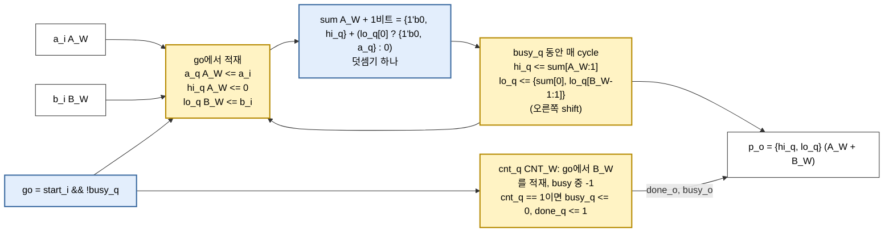

# L0 umul_seq: 순차 shift-add 곱셈기

- 원본과 확인일: 확인일 2026-11-20. `rtl/l0/umul_seq.sv`(헤더 주석과 코드), 사용처는 `rtl/l3/attn_csr.sv`, `rtl/l3/gemv_acc_csr.sv`, `rtl/l3/pim_csr.sv`, `rtl/l1/pim_ctrl.sv`의 인스턴스 선언, `docs/spec/hierarchy.md` 3.10, `docs/log.md` S4-6b.
- 상태: S4-6b에서 단독 TB(`tb/umul_seq`) 13 run 통과. 정확한 곱(TB 128비트) 대조, 경계 쌍 전부, random 10^6(A 25 x B 9), 크기 6종, 소형 전수, 부정 시험, `A_W` 65 elaboration 실패(`attn.md` 7.1). mutation 3개 검출은 agent 보고(재실행 안 함). 회귀 `./sim/run.sh all` 368 run, fails 0 [측정, 수퍼바이저 재실행]. 합성, 타이밍은 미확인.
- 왜 있는가: L3 CSR의 descriptor 범위 검사와 `pim_ctrl`의 LDW 읽기 길이가 runtime 조합 곱셈(일부 64비트 폭 표현)이었다. 호출당 한 번만 필요한 값이라, 곱셈기 대신 cycle당 multiplier 1비트씩 처리하는 순차 곱셈기로 바꾸고 대가로 호출마다 검사 cycle이 생겼다(`hierarchy.md` 3.10). 합성 시 DSP 감소와 100 MHz 타이밍 개선은 아직 [계산]/[추정]이고 합성하지 않았다.
- **파형은 그리지 않았다.** cycle 관계는 RTL의 상태 갱신 조건에서 도출한 표다.

## 1. 포트와 parameter

| 이름 | 방향 | 폭 | 내용 |
|---|---|---|---|
| `A_W` (parameter, 기본 16) | | | 피승수 폭, 1..64 (밖이면 elaboration `$error`) |
| `B_W` (parameter, 기본 8) | | | 승수 폭, 1..64 |
| `clk`, `rst_n` | in | 1 | `rst_n` active-low 비동기. control(`busy_q`, `done_q`, `cnt_q`)만 reset, datapath(`a_q`, `hi_q`, `lo_q`)는 reset 없음 |
| `start_i` | in | 1 | busy가 아닐 때(done cycle 포함) 시작. busy 중 start는 무시 |
| `a_i` | in | `A_W` | 피승수. start cycle에서만 샘플 |
| `b_i` | in | `B_W` | 승수. start cycle에서만 샘플 |
| `p_o` | out | `A_W` + `B_W` | 곱 `{hi_q, lo_q}`. done cycle부터 다음 수락된 start까지 유지 (busy 동안은 중간값) |
| `done_o` | out | 1 | 1 cycle pulse |
| `busy_o` | out | 1 | 진행 중 |

- `localparam CYCLES = B_W + 1`, `CNT_W = clog2(B_W + 1)`.
- 시뮬레이션 전용 검사: `UMUL_START`(busy 중 start), `UMUL_X`(start나 피연산자의 X/Z).

## 2. 데이터패스

- 알고리즘: `lo_q`의 최하위 비트가 1이면 `hi_q`에 `a_q`를 더하고, `{carry, hi_q, lo_q}`를 오른쪽으로 1비트 밀어낸다. 승수 비트를 LSB부터 하나씩 소비하므로 `B_W` step 뒤 `{hi_q, lo_q}` = `a x b`(정확한 곱, overflow 없음, RTL 헤더).
- 자원 [계산, 합성 안 함]: `A_W`비트 덧셈기 하나(+ carry 1비트), `a_q` + `hi_q` + `lo_q` = (2 `A_W` + `B_W`) 비트 레지스터, `CNT_W`비트 카운터, 상태 2개(`busy_q`, `done_q`). 곱셈기 자원(DSP)은 쓰지 않는 구조다.

## 3. cycle 수

시작 cycle을 c(= `start_i` = 1이고 busy가 아닌 cycle)라 한다. RTL 헤더와 코드에서 도출한 표다.

| cycle | `busy_o` | `done_o` | `p_o` |
|---|---|---|---|
| c | (이전 값) | 0 | 이전 곱 (유지) |
| c + 1 .. c + `B_W` | 1 | 0 | 중간값 (매 cycle 갱신) |
| c + `CYCLES` = c + `B_W` + 1 | 0 | 1 (1 cycle pulse) | 곱 `a x b` |
| 이후 다음 수락된 start의 c' + 1 전까지 | 0 | 0 | 곱 유지 |

- **CYCLES = `B_W` + 1**. 승수 폭 `B_W`가 시간을 정하고 피승수 폭 `A_W`는 정하지 않는다.
- done cycle(c + `CYCLES`)에는 `busy_o` = 0이라 같은 cycle에 새 start를 받을 수 있다(RTL 헤더: "including the done cycle"). 소비하는 쪽은 done cycle에 결과를 읽거나 다음 단계를 시작한다(`attn_csr`의 `u_mr`, `u_mks`, `u_mkh`가 앞 유닛의 `done_o`로 시작).

## 4. 프로젝트의 인스턴스 (RTL 선언에서 읽은 폭과 cycle)

기본 parameter(`NMAX` 1024, `ROWS_W` 16 등) 기준 `B_W`와 CYCLES. 기본값이 아닌 빌드에서는 폭이 식으로 달라진다.

| 상위 모듈 | 인스턴스 | 계산 | `A_W` x `B_W` | CYCLES | 시작 |
|---|---|---|---|---|---|
| `gemv_acc_csr` | `u_wmul` | `ROWS` x (1 + ceil(`N`/8)) | 16 x `NBW` (8) | 9 | s (CTRL 수락) |
| `pim_csr` | `u_bmul` | ceil(rows/`NB`) x ceil(n/16) | `NR_W` (15) x `NWB_W` (7) | 8 | c (CMD_PUSH) |
| `pim_csr` | `u_lmul` | rows x (1 + ceil(n/8)) | 16 x `N8B_W` (8) | 9 | c |
| `pim_ctrl` | `u_lmul` | LDW 읽기 길이 rows x (1 + ceil(n/8)) | `ROWS_W` (16) x `LB8_W` (8) | 9 (= `LDW_CYC`) | h (명령 handshake) |
| `attn_csr` (`KV_SRC` 0) | `u_mq`, `u_mp`, `u_mw`, `u_m0`, `u_mr` | `l3_attn_top.md` 3.4절 | 9 x 4, 9 x 9, 16 x 2, 16 x 2, 19 x 4 (`attn.md` 8절, 기본 `KL` 8, `NKV` 4, `TMAX` 512) | 5, 10, 3, 3, 5 | s, s, s, s, `u_mw` done |
| `attn_csr` (`KV_SRC` 1) | `u_mq`, `u_mp`, `u_msh`, `u_mth`, `u_mks`, `u_mkh` | `l3_attn_top.md` 3.4절 | 앞 네 개는 `HS_W` 또는 9, 뒤 둘은 8 | 앞 넷 `B_W` + 1, 뒤 둘 9 | s 네 개, `u_div` done 두 개 |

- `NR_W`, `NWB_W`, `N8B_W`, `LB8_W`, `NBW`는 RTL `localparam` 식(`clog2`)에서 NMAX 1024로 계산한 값이다. `pim_csr`의 판정 cycle은 두 곱 중 긴 쪽(`PCHK_CYC` = max(7, 8) + 1 = 9).
- 순차 유닛 수(`log.md` S4-6b agent 보고): `attn_csr` `umul_seq` 5개(BRAM KV) 또는 6개 + `udiv_seq` 1개(DDR KV), `gemv_acc_csr` 1, `pim_csr` 2, `pim_ctrl` 1.

## 5. 확인하지 못한 것
- 합성 결과(덧셈기 폭의 타이밍, LUT/FF 수). 위 자원은 구조에서 센 [계산]이다.
- 표 4절의 `attn_csr` `B_W`와 CYCLES는 기본 parameter 값이며, 다른 `HS_MAX`/`NKV` 빌드의 값은 식으로만 정해진다(`attn_csr.sv`의 `QB_W`, `KV_W`, `HSK_W`, `CT_W`).
