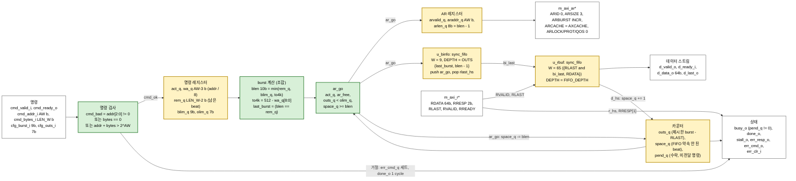
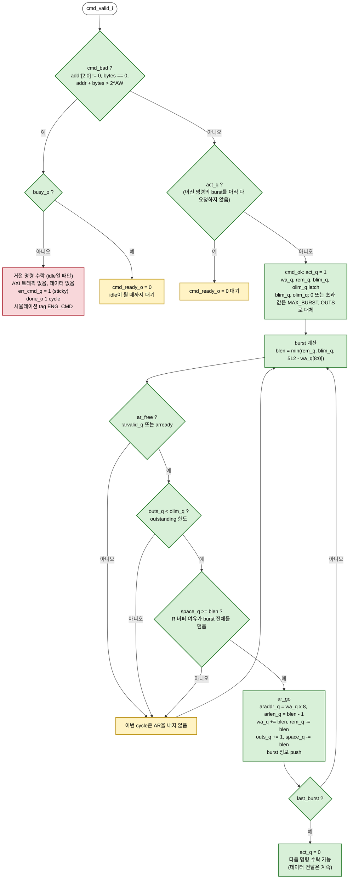
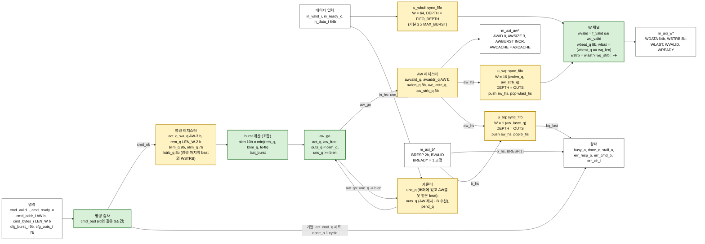
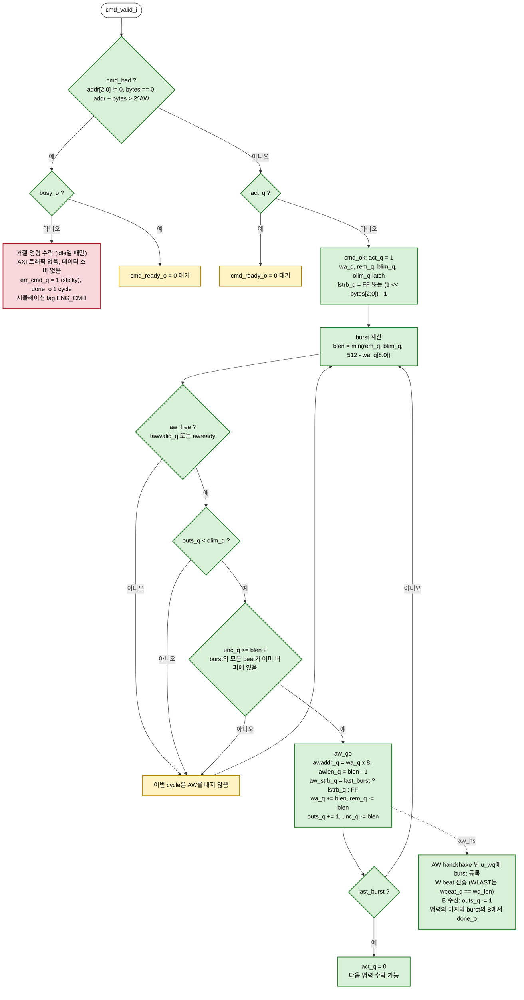

# L1 AXI engine: axi_rd_eng, axi_wr_eng

- 원본과 확인일: 확인일 2026-11-19. `rtl/l1/axi_rd_eng.sv`, `rtl/l1/axi_wr_eng.sv`, `rtl/l0/sync_fifo.sv`(FIFO 인스턴스 폭과 깊이), 스펙 `docs/spec/hierarchy.md` 3.6. 신호 이름, 폭, 조건식은 RTL에서 읽은 것이다.
- 상태: 두 모듈 모두 S4-3에서 단독 G4 통과(`log.md` S4-3: `./sim/run.sh all` 164 run, fails 0 [측정, 수퍼바이저 재실행]).
- 폭 표기: 기본 parameter(`DW` 64, `AW` 32, `LEN_W` 32, `IDW` 1, `MAX_BURST` 16, `OUTS` 4) 기준이고, 식이 있는 폭은 식을 같이 적었다. `DW`는 64만 허용(elaboration `$error`).
- 파형은 그리지 않았다. 4절의 처리율 표만 시뮬레이션 측정값이다.
- 두 engine은 AR/AW 생성부(명령, burst 계산)가 같은 구조이고, 데이터 쪽(R 버퍼 대 W 버퍼)만 다르다.

## 1. axi_rd_eng

### (a) block diagram

- `RREADY` = `u_rbuf`의 `in_ready_o`(버퍼가 차지 않음). AR을 낼 때 버퍼 여유(`space_q`)가 burst 전체를 덮는지 확인하므로, RVALID가 올 때 버퍼는 항상 비어 있다. 어기면 시뮬레이션 tag `ENG_RSTALL`.
- `RID`는 무시한다(ID 0 하나, 순서대로).
- 명령 handshake가 cycle c이면 `ARVALID`는 c + 2이다(handshake가 `act_q`를 세우고 다음 cycle에 `arvalid_q`가 등록된다. RTL 구조에서 도출, TB로 재지 않음).
- 마지막 beat의 길이 밖 byte는 메모리 내용 그대로 나가고, 소비자가 무시한다.
- `ar_free` = `!arvalid_q || m_axi_arready_i`.

### (b) control flow

규칙 요약(RTL 식에서 읽은 것):

| 항목 | 규칙 | RTL |
|---|---|---|
| burst 길이 | `blen = min(rem_q, blim_q, to4k)`. `rem_q`는 512로 포화시켜 비교. `to4k` = 4 KiB 안의 남은 8 B word 수(1..512). 시작 주소를 burst 크기에 정렬하지 않으므로 첫 burst만 4 KiB 경계에서 짧아질 수 있다 | `rem_c`, `to4k`, `blen` |
| AR 발행 | `act_q && ar_free && outs_q < olim_q && space_q >= blen` 네 조건이 모두 참인 cycle | `ar_go` |
| space 회계 | `space_q`는 reset 때 `FIFO_DEPTH`. `ar_go`에서 `blen`만큼 줄고 `d_hs`(버퍼에서 beat 하나가 나갈 때)마다 1 늘어난다 | `space_q` |
| outstanding | `outs_q`는 `ar_go`에서 +1, `rlast_hs`에서 -1. 한도는 명령 handshake 때 latch한 `olim_q` | `outs_q`, `olim_q` |
| 명령 거절 | 조건 3개(비정렬, 0 byte, 2^AW 초과) 중 하나. idle(`busy_o` = 0)일 때만 수락. 수락한 cycle에 `done_o` 1 cycle과 `err_cmd_q` 세트. 같은 cycle에 `cmd_ok`는 0이라 AXI 동작 없음 | `cmd_bad`, `cmd_ready_o` |
| 명령 대기 | `cmd_ready_o = !act_q && !(cmd_valid_i && cmd_bad && busy_o)`. 정상 명령은 `act_q`(이전 명령의 AR을 다 내기 전)에만 막히고, 이전 명령의 데이터 전달이 끝나기 전에도 수락된다 | `cmd_ready_o`, `pend_q` |
| 오류 sticky | `err_resp_q`는 `r_hs && RRESP[1]`(SLVERR 또는 DECERR)에서 세트, `err_cmd_q`는 거절 명령 handshake에서 세트. 둘 다 `err_clr_i`로 지움. **같은 cycle에 세트와 clear가 겹치면 세트가 이긴다**(코드에서 `if (세트) ... else if (err_clr_i)` 순서). 오류가 나도 데이터는 그대로 전달 | `err_resp_q`, `err_cmd_q` |
| reset | `act_q`, `arvalid_q`, `outs_q`, `space_q`, `pend_q`, sticky 오류만 `rst_n`. 주소, 길이, AR payload는 reset 없음 | |

## 2. axi_wr_eng

### (a) block diagram

- W 채널은 AW handshake가 끝난 burst(`u_wq`에 있는 것)만 보낸다. `wvalid`는 `f_valid && wq_valid`.
- `done_o` = `b_hs && bq_last`(명령의 마지막 burst의 B) 또는 거절 명령의 handshake cycle.
- `stall_o` = `in_valid_i && !in_ready_o`.
- `BID`는 무시한다.
- `u_wbuf`는 FIFO이므로 데이터가 명령보다 먼저 들어와도 기다린다(`unc_q`가 이를 센다). 호출자는 정상 명령마다 정확히 `ceil(bytes / 8)` beat를 보내야 하고, 거절된 명령에는 보내지 않는다(포트 주석).

### (b) control flow

rd와 다른 규칙(RTL 식에서 읽은 것):

| 항목 | 규칙 | RTL |
|---|---|---|
| AW 발행 조건 | `act_q && aw_free && outs_q < olim_q && unc_q >= blen`. rd의 `space_q`(R 버퍼 여유) 대신 `unc_q`(버퍼에 이미 있는 beat)가 burst를 덮어야 한다. burst 단위 store-and-forward | `aw_go` |
| `unc_q` | `in_hs`마다 +1, `aw_go`마다 `blen`만큼 -1 | `unc_q` |
| WSTRB | 기본 8'hFF. 명령의 마지막 burst의 마지막 beat만 `lstrb_q`(길이가 8의 배수면 FF, 아니면 `(1 << (bytes mod 8)) - 1`) | `lstrb_q`, `aw_strb_q`, `m_axi_wstrb_o` |
| 오류 sticky | `err_resp_q`는 `b_hs && BRESP[1]`에서 세트. `err_cmd_q`는 거절 명령 handshake. `err_clr_i`와 같은 cycle이면 세트가 이긴다(rd와 같은 코드 순서). 데이터는 그대로 기록 | `err_resp_q`, `err_cmd_q` |
| 응답 | `BREADY` = 1 고정. 요청 없는 B는 tag `ENG_BUNEXP` | `m_axi_bready_o` |
| 버퍼 크기 | 기본 `FIFO_DEPTH` = `2 x MAX_BURST`. 이보다 작으면(`MAX_BURST`까지 허용) 처리율이 떨어진다(4절) | parameter |

## 3. 두 engine이 공유하는 하위 모듈

| 인스턴스 | 모듈 | rd | wr |
|---|---|---|---|
| `u_rbuf` | `sync_fifo` W = 65, DEPTH = `FIFO_DEPTH`(기본 `MAX_BURST x OUTS` = 64) | R beat와 last 표시 | - |
| `u_binfo` | `sync_fifo` W = 9, DEPTH = `OUTS` | burst 정보 {last_burst, blen - 1} | - |
| `u_wbuf` | `sync_fifo` W = 64, DEPTH = `FIFO_DEPTH`(기본 32) | - | 입력 beat |
| `u_wq` | `sync_fifo` W = 16, DEPTH = `OUTS` | - | AW를 낸 burst의 {awlen, strb} |
| `u_bq` | `sync_fifo` W = 1, DEPTH = `OUTS` | - | burst가 명령의 마지막인지 |

`sync_fifo`는 `in_ready_o`가 `out_ready_i`에 조합으로 의존하지 않는다(가득 찬 FIFO는 같은 cycle에 pop이 있어도 push를 받지 않는다).

## 4. 처리율 [측정, 시뮬레이션 모델, 보드 값 아님]

- 조건: Questa(버전은 `log.md`에 없음), `axi_mem_slave` 모델, 64 KiB(8,192 beat) 명령 하나, 메모리 stall 없음. 첫 beat부터 마지막 beat까지의 cycle. 출처: `docs/spec/hierarchy.md` 3.6(에이전트 측정값, 이 문서에서 재측정하지 않음).
- **이 표는 시뮬레이션 모델의 값이며 보드(HP 포트) 값이 아니다.** 실제 HP 포트의 latency와 대역폭은 `docs/spec/bwtest.md` 7절의 보드 측정 전까지 모른다. 메모리 latency 항목은 모델의 설정값이다(rd: AR에서 R까지, wr: 마지막 W에서 B까지).

| engine | burst | outs | 메모리 latency | cycle | beat/cycle |
|---|---|---|---|---|---|
| rd | 16 | 1 | 1 | 9,725 | 0.842 |
| rd | 16 | 2, 4 | 1 | 8,192 | 1.000 |
| rd | 16 | 2 | 33 | 13,037 | 0.628 |
| rd | 16 | 4 | 33 | 8,192 | 1.000 |
| rd | 256 | 1 | 1 / 33 | 8,285 / 9,277 | 0.989 / 0.883 |
| rd | 256 | 2 | 33 | 8,192 | 1.000 |
| rd | 1 | 1 / 4 | 1 | 40,956 / 10,239 | 0.200 / 0.800 |
| wr | 16 | 1 | 1 | 10,236 | 0.800 |
| wr | 16 | 2, 4 | 1 | 8,192 | 1.000 |
| wr | 16 | 4 | 33 | 8,192 | 1.000 |
| wr | 16 (`FIFO_DEPTH` 16) | 4 | 1 | 9,725 | 0.842 |
| wr | 1 | 4 | 1 | 16,382 | 0.500 |

- wr의 `FIFO_DEPTH` 32 행(burst 16, outs 2 이상)은 1.000이다. `FIFO_DEPTH` 16(= `MAX_BURST`)에서 0.842로 떨어지는 것은 burst 단위로 모은 뒤 AW를 내므로 다음 burst를 채울 자리가 없기 때문이라고 스펙이 설명한다(코드의 `aw_go` 조건 `unc_q >= blen`과 일치).
- outstanding 1에서 burst 사이의 빈 cycle은 왕복 지연(AR 제시 1 + 모델 latency + 버퍼 1 + 다음 AR 판단)이라고 스펙이 적었다.
- `bw_top`(P = 1, 2)의 64 KiB RD op `CYCLES`는 8,197(8,192 beat + 5 cycle의 시작과 종료 지연, 같은 모델).
