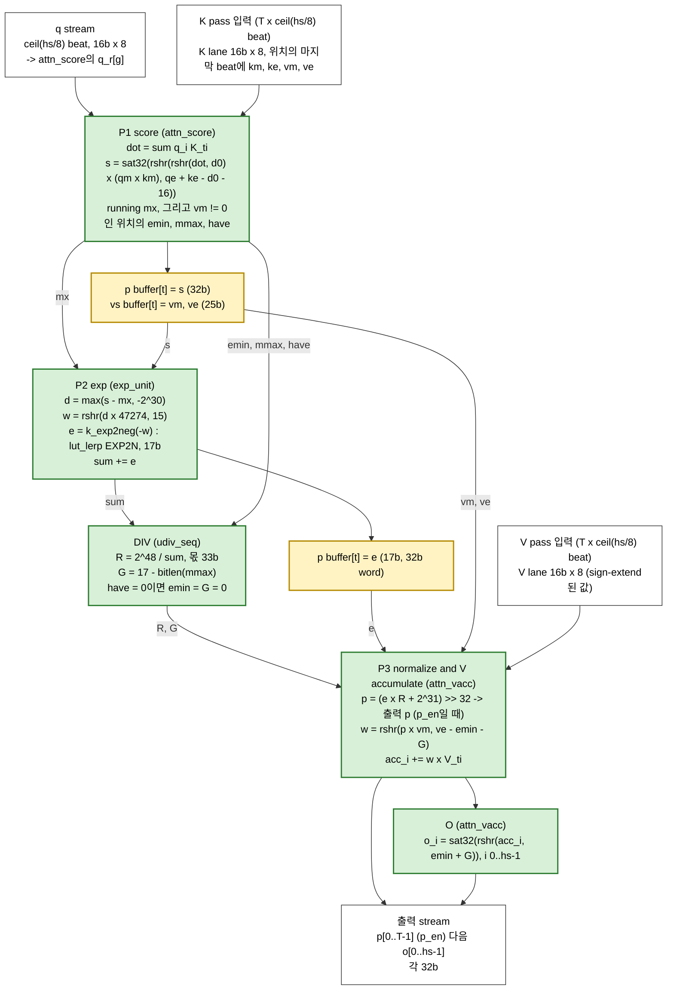
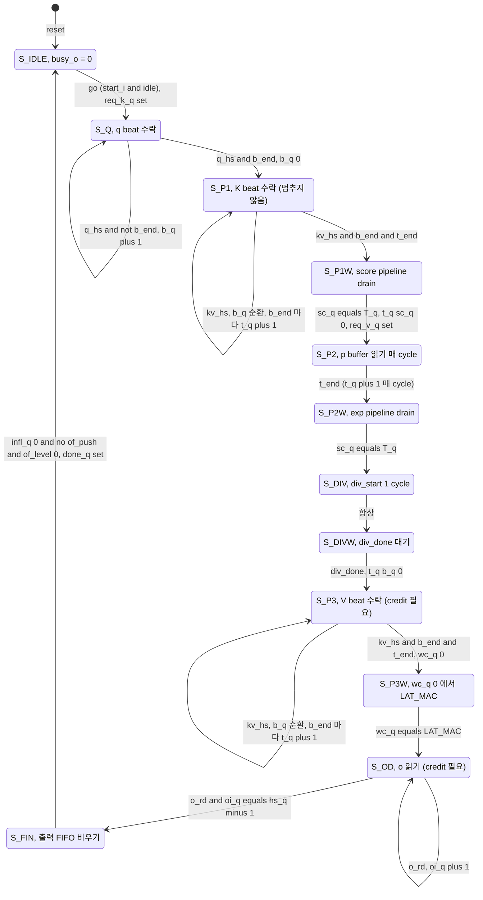

# L2 attn_core: block, data flow, control flow, cycle 식

- 원본과 확인일: 확인일 2026-11-20. `rtl/l2/attn_core.sv`(포트, FSM `st_t`, credit, 인스턴스), `rtl/l1/attn_score.sv`, `rtl/l1/exp_unit.sv`, `rtl/l0/lut_lerp.sv`, `rtl/l0/udiv_seq.sv`, `rtl/l1/attn_vacc.sv`, `rtl/pkg/llm_pkg.sv`, 알고리즘과 폭의 계획값은 `docs/spec/arch.md` 4.1, 4.3, 측정값은 `docs/log.md` S4-6과 `docs/spec/attn.md` 6절. 신호 이름, 비트폭, 전이 조건은 RTL 선언 그대로다.
- 상태: S4-6에서 단독 G4 통과(260K K_ATTN2 480 레코드, 15M 216 레코드의 p, o mismatch 0은 agent 보고, `./sim/run.sh all` 345 run fails 0은 수퍼바이저 재실행 [측정], `log.md` S4-6).
- 기준 parameter: `attn_core` 기본값 `KL` = `VL` = 8, `HS_MAX` 64, `TMAX` 512(`T_MAX`), `DOT_PIPE` 2, `SH_PIPE` 1, `RS_PIPE` 1, `LUT_PIPE` 2, `OUT_DEPTH` 16, `ACC_W` 60. 이때 `TW` = 10, `HS_W` = 7, `GB_W` = 3(`NG` = 8), `PA_W` = 9, `SUM_W` = 26, `OL_W` = 5, `CR_W` = 5. 폭은 parameter에서 식으로 정해지며, 260K 빌드는 `HS_MAX` 8이라 `HS_W`, `GB_W` 등이 작다(`attn_top`이 넘기는 값은 이 문서에서 확인하지 않았다).
- **이 문서는 RTL을 읽어서 그린 것이다. 시뮬레이션 파형이 아니고, 파형은 그리지 않았다.** cycle 식과 측정값만 `log.md`, `attn.md`의 시뮬레이션 결과를 따른다.

## 1. block diagram

```mermaid
flowchart LR
    subgraph IN["입력 포트"]
        call["call<br/>start_i, t_i 10b, hs_i 7b, kb_i 5b<br/>qm_i 17b, qe_i 8b signed, p_en_i"]
        qs["q stream<br/>q_valid_i, q_ready_o<br/>q_data_i 128b (KL x 16b)"]
        kvs["KV stream<br/>kv_valid_i, kv_ready_o, kv_data_i 128b<br/>kv_km_i, kv_vm_i 각 17b<br/>kv_ke_i, kv_ve_i 각 8b signed"]
    end

    subgraph CORE["attn_core"]
        fsm["pass FSM st_q (12 state)<br/>카운터 b_q, t_q, sc_q, oi_q, wc_q<br/>req_k_q, req_v_q<br/>설정 레지스터 T_q, hs_q, d0_q, qm_q, qe_q, pen_q"]
        score["u_score : attn_score<br/>KL 8, HS_MAX 64<br/>DOT_PIPE 2, SH_PIPE 1"]
        pbuf["u_pbuf : ram_sdp<br/>W 32, DEPTH TMAX, RD_LAT 1<br/>P1 s, P2 e"]
        vbuf["u_vbuf : ram_sdp<br/>W 25 (AM_W + E_W), DEPTH TMAX, RD_LAT 1<br/>P1 쓰기 vm, ve"]
        exp["u_exp : exp_unit<br/>RS_PIPE 1, LUT_PIPE 2"]
        sumr["sum_q 26b<br/>(e의 합)"]
        div["u_div : udiv_seq<br/>NUM_W 49, DEN_W 26, Q_W 33"]
        gr["r_q 33b, g_q 5b, emin_q 8b<br/>(DIV 상태에서 적재)"]
        vacc["u_vacc : attn_vacc<br/>VL 8, T_MAX 512, ACC_W 60"]
        ofifo["u_ofifo : sync_fifo<br/>W 34, DEPTH OUT_DEPTH 16<br/>credit infl_q"]
    end

    subgraph OUT["출력 포트"]
        os["output stream (p 다음 o)<br/>out_valid_o, out_ready_i<br/>out_data_o 32b, out_last_o, out_is_o_o"]
        kr["kvreq_valid_o, kvreq_ready_i<br/>kvreq_pass_o (0 = K, 1 = V)"]
        st["busy_o, done_o, kv_stall_o"]
    end

    call --> fsm
    qs -->|"q_hs: q_data_i, q_idx_i = b_q"| score
    kvs -->|"kv_hs 이고 st_q == S_P1<br/>K lane, km, ke, vm, ve"| score
    score -->|"s_val 32b signed, s_valid"| pbuf
    score -->|"s_vm, s_ve"| vbuf
    score -->|"mx 32b, emin 8b, mmax 17b, have"| exp
    score -->|"emin, mmax, have"| gr
    pbuf -->|"pb_rd 32b, e_in_q"| exp
    exp -->|"e_val 17b, e_valid"| pbuf
    exp --> sumr
    sumr -->|"den_i"| div
    div -->|"div_q 33b, div_done"| gr
    kvs -->|"kv_hs 이고 st_q == S_P3<br/>vv_q 128b, vfirst_q, vg_q"| vacc
    pbuf -->|"pb_rd[16:0] = b_e_i"| vacc
    vbuf -->|"vb_rd = b_vm_i, b_ve_i"| vacc
    gr -->|"r_i, emin_i, g_i"| vacc
    vacc -->|"p_val 32b, o_val 32b signed<br/>p_valid, o_valid"| ofifo
    ofifo --> os
    fsm --> kr
    fsm --> st
    fsm -->|"kv_ready_o, q_ready_o"| kvs
```

포트와 인스턴스 요약:

| 항목 | RTL 확인 내용 |
|---|---|
| 호출 입력 | `start_i`(idle일 때 수락, `go`), `t_i[TW]`, `hs_i[HS_W]`, `kb_i[5]`, `qm_i[AM_W]`(17), `qe_i[E_W]` signed(8), `p_en_i`. `go`에서 `T_q`, `hs_q`, `d0_q`, `qm_q`, `qe_q`, `pen_q`를 적재. `d0_q` = `kb_i > 8 ? 2 kb_i - 17 : 0`(kb 12 -> 7, 16 -> 15) |
| q stream | `q_ready_o` = `st_q == S_Q`. beat당 `KL x 16`비트, `q_idx_i`는 `b_q` |
| KV 요청과 stream | `kvreq_valid_o` = `req_k_q \|\| req_v_q`, `kvreq_pass_o` = `!req_k_q`. `kv_ready_o` = `S_P1` 또는 (`S_P3`이고 (`b_q != 0` 또는 `!pen_q` 또는 `credit_ok`)). `kv_stall_o` = `kv_ready_o && !kv_valid_i` |
| 출력 stream | `out_data_o[31:0]`, `out_last_o`, `out_is_o_o`는 출력 FIFO word 34비트 `{is_o, last, data[31:0]}`의 분해 |
| `done_o` | `done_q`의 1 cycle pulse. `busy_o` = `st_q != S_IDLE` (done cycle에는 이미 0) |
| `u_pbuf`, `u_vbuf` | 같은 읽기 주소 `pb_ra` = `t_q`. `u_pbuf` 쓰기 주소는 `sc_q`, `u_vbuf`는 P1에서만 `s_valid`로 쓴다 |
| glue 레지스터 | datapath(reset 없음): `T_q`, `hs_q`, `d0_q`, `qm_q`, `qe_q`, `pen_q`, `sum_q`, `g_q`, `emin_q`, `r_q`, `vfirst_q`, `vg_q`, `vv_q`. control(reset 있음): `st_q`, `b_q`, `t_q`, `sc_q`, `oi_q`, `op_q`, `pc_q`, `wc_q`, `infl_q`, `req_k_q`, `req_v_q`, `done_q`, `e_in_q`, `vb_q` |

KV source 쪽 약속(`attn_core.sv` 헤더): core가 pass를 요청하면 source가 `T x ceil(hs/KL)` beat를 위치 순서로 보낸다. K pass의 위치 마지막 beat에서만 `(km, ke, vm, ve)`를 샘플한다. V pass beat는 V lane만 싣는다. K 요청은 `go`에서, V 요청은 P1이 끝나 P2가 시작될 때(`S_P1W`에서 `sc_q == T_q`) 낸다.

## 2. data flow

head 하나의 계산. 수식은 `arch.md` 4.1(알고리즘 경계)과 RTL의 연산식이며, 폭은 아래 표에 RTL 선언 값을 적었다. 3 pass와 나눗셈이 필요한 이유(max를 먼저 구한 뒤 `exp(s - max)`, online softmax는 bit-exact 불가)는 `arch.md` 4.1.



단계별 폭 (RTL 선언, 기준 parameter. `K12V8`에서 kb 12, kb 16이면 d0 = 7, 15):

| 단계 | 값 | 폭 | 선언 위치 |
|---|---|---|---|
| P1 | 곱 합 `dsum` | `SW` = 32 + clog2(KL) = 35b signed | `attn_score.sv` |
| P1 | dot 누산 `acc_q` | `ACC_W` = `SW` + clog2(NG + 1) = 39b (`HS_MAX` 64), 36b (`HS_MAX` 8) | 같음 |
| P1 | `rshr(dot, d0)` = `r` | `R_W` = 24b signed (golden 전제 abs < 2^22, 넘으면 `L1_RANGE`) | 같음 |
| P1 | `c = qm x km` = `cB` | 34b unsigned (17b x 17b) | 같음 |
| P1 | `x_q = r x cB` | 58b signed | 같음 |
| P1 | `s` | 32b signed (`rshr_sat` IN_W 58, OUT_W 32) | 같음 |
| P2 | `d` | 33b signed, 하한 clamp -2^30 | `exp_unit.sv` |
| P2 | `prod_q = d x 47274` | 49b signed | 같음 |
| P2 | `w` | 40b signed (`rshr_sat` IN_W 49, OUT_W 40, sh 15) | 같음 |
| P2 | `u` = (uint32)(-w), `e` | u 32b, e 17b (`lut_lerp` y_o) | 같음, `lut_lerp.sv` |
| P2 | `sum_q` | `SUM_W` = 17 + clog2(TMAX) = 26b | `attn_core.sv` |
| DIV | `num_i`, `den_i`, `q_o` | 49b (= 2^48), 26b, 33b | 같음, `udiv_seq.sv` |
| P3 | `er1 = e x R` | 50b | `attn_vacc.sv` |
| P3 | `p` | 17b (32b로 확장해 출력) | 같음 |
| P3 | `pm3 = p x vm` | 34b | 같음 |
| P3 | `w4` | `W_W` = 36b signed (`rshr_sat` IN_W 35, OUT_W 36) | 같음 |
| P3 | `m5[l] = w x V` | `W_W + 16` = 52b signed (lane 8개) | 같음 |
| P3 | `acc_q[g][l]` | `ACC_W` = 60b signed (`NG` x `VL` 개) | 같음 |
| O | `o` | 32b signed (`rshr_sat` IN_W 60, OUT_W 32, sh = emin + G) | 같음 |

- 위치 순서는 모든 pass가 같다. p buffer는 P1에서 s를, P2에서 같은 위치에 e를 덮어쓴다(읽기 주소 `t_q`, 쓰기 주소 `sc_q`가 `e_valid`로 따라간다).
- 출력 word는 p 먼저, o 나중이다. `of_din`은 `p_valid`면 `{1'b0, pc_q == T_q - 1, p_val}`, 아니면 `{1'b1, op_q == hs_q - 1, o_val}`다. `p_en`이 0이면 p는 FIFO에 들어가지 않는다(`of_push = (p_valid && pen_q) || o_valid`).
- 이 표의 일부(`dot` 38b, `d x 47274` 폭의 표기 방식)는 `attn.md` 1절, `arch.md` 4.3과 다르다. 차이는 문서 말미 "RTL과 문서가 어긋난 곳"에 적었다.

## 3. control flow

state는 12개(`st_t`): `S_IDLE`, `S_Q`, `S_P1`, `S_P1W`, `S_P2`, `S_P2W`, `S_DIV`, `S_DIVW`, `S_P3`, `S_P3W`, `S_OD`, `S_FIN`. `default` 분기는 `S_IDLE`.



전이 조건 (RTL 정의):

| 항목 | 정의 |
|---|---|
| `go` | `start_i && st_q == S_IDLE`. `go`에서 설정 적재, `sum_q` clear, `attn_score`/`attn_vacc`의 `clr_i`(누산 초기화) |
| `b_end` | `b_q == nbm1`, `nbm1` = `ceil(hs_q/KL) - 1`. `b_q`는 q beat(S_Q), K beat(S_P1), V beat(S_P3)의 position 안 beat 번호 |
| `t_end` | `t_q == T_q - 1` |
| `kv_hs`, `q_hs` | `kv_valid_i && kv_ready_o`, `q_valid_i && q_ready_o` |
| `credit_ok` | `of_level + infl_q < OUT_DEPTH` |
| `issue_p` | `kv_hs && st_q == S_P3 && b_q == 0 && pen_q` (위치의 첫 V beat가 p 하나를 낸다) |
| `S_P1` / `S_P1W` | `sc_q`는 `s_valid`마다 증가. `S_P1W`는 `sc_q == T_q`(모든 score가 p buffer에 쓰임)에서 나간다 |
| `S_P2` | 매 cycle p buffer를 읽고(`pb_re`), `e_in_q`가 한 cycle 뒤 `exp_unit`에 valid. `sc_q`는 `e_valid`마다 증가. `S_P2W`는 `sc_q == T_q`에서 나간다 |
| `S_DIVW` | `udiv_seq`의 `done_o`에서 `r_q`, 나가면서 `S_DIV`에서 적재한 `g_q`, `emin_q`를 `attn_vacc`가 쓴다 |
| `S_P3W` | `wc_q`가 `LAT_MAC`(6)이 되면 `S_OD` (마지막 beat의 acc 반영 대기) |
| `S_OD` | `o_rd = (st_q == S_OD) && credit_ok`. `o_rd`가 `hs_q`번 일어나면 `S_FIN` |
| `S_FIN` 종료 | `infl_q == 0 && !of_push && of_level == 0`이면 `S_IDLE`, `done_q <= 1`(다음 cycle `done_o`) |

backpressure 규칙(RTL과 헤더 주석):

- P1, P2는 안쪽에서 멈추지 않는다(`kv_ready_o`가 `S_P1`에서 항상 1, P2는 외부 입력이 없다). KV source가 늦으면 `kv_stall_o`만 올라간다.
- P3는 위치의 첫 beat를 `credit_ok`일 때만 받는다(`p_en`이 0이면 조건 없음). `infl_q`는 `issue_p || o_rd`로 증가하고 `of_push`로 감소한다. 출력 FIFO가 넘치지 않음은 시뮬레이션 검사 `L2_OVF`로 확인한다.
- 시뮬레이션 전용 검사 tag: `L2_START`(busy 중 start), `L2_RANGE`(T, hs, kb 범위), `L2_OVF`. elaboration 검사: `KL != VL`, `TMAX` 1..4096, `OUT_DEPTH >= 4`, `SUM_W <= 29`.

## 4. cycle 식

`start_i` 수락 cycle을 0, `done_o`가 1인 cycle을 C라 하면, q와 KV beat가 매 cycle 오고 출력이 항상 받아질 때:

```
C = (T + 1) x ceil(hs/8) + T + T x ceil(hs/8) + hs + C0
C0 = 54 + DOT_PIPE + SH_PIPE + RS_PIPE + LUT_PIPE      (기본 PIPE 2/1/1/2에서 60)
```

- 확인: `tb_attn_core` STALL = 0 run의 모든 호출에서 식과 일치(`attn.md` 6.1, `log.md` S4-6, 시뮬레이션 [측정, agent 보고, 이 문서에서 재실행하지 않음]). `p_en`은 stall이 없으면 cycle에 영향이 없다.
- 항과 FSM의 대응(RTL 구조에서 읽은 것): 첫 항 `(T + 1) x ceil(hs/8)` = q 적재 `ceil(hs/8)`(`S_Q`) + K pass `T x ceil(hs/8)`(`S_P1`), `T` = `S_P2`(위치당 1 cycle), `T x ceil(hs/8)` = `S_P3`, `hs` = `S_OD`(o 읽기 1개/cycle).

`C0`의 구성 (`attn.md` 6.1의 분해. 괄호 안은 RTL에서 직접 확인되는 근거):

| 구간 | 값 | RTL에서 확인되는 부분 |
|---|---|---|
| P1 drain | `DOT_PIPE + SH_PIPE + 5` | `attn_score` `LATENCY` = `DOT_PIPE + 3 + SH_PIPE`. 나머지 2의 내역은 이 문서에서 분해하지 않았다 |
| P2 drain과 DIV | `RS_PIPE + LUT_PIPE + 3 + 33 + 2` | `exp_unit` `LATENCY` = `1 + RS_PIPE + LUT_PIPE`(기본 4), `udiv_seq` `CYCLES` = `Q_W + 1` = 34. 나머지는 분해하지 않았다 |
| P3 drain | 7 | `attn_vacc` `LAT_MAC` = 6, `S_P3W`가 `wc_q == LAT_MAC`까지 대기 |
| O drain | 4 | `attn_vacc` `LAT_O` = 2 |
| 합 | 54 + PIPE 합 | 5 + 3 + 33 + 2 + 7 + 4 = 54 (`attn.md` 값을 더한 것) |

식에 대입한 값 [계산, 이 문서에서 식에 대입, 측정 아님]. 기본 PIPE(C0 = 60):

| 구성 | 식 | T = 1 | 64 | 256 | 512 |
|---|---|---|---|---|---|
| 260K (hs 8, `ceil(hs/8)` = 1) | `3T + 69` | 72 | 261 | 837 | 1,605 |
| 15M (hs 48, `ceil(hs/8)` = 6) | `13T + 114` | 127 | 946 | 3,442 | - (T 최대 256) |

- 260K의 `3T + 69`는 `attn.md` 6.1에도 적혀 있고, `arch.md` 4.4 [추정] `3T + 80`보다 11 작다.
- 15M 열은 `attn_core` 단독 식이다. DDR KV(`kv_rd`)와 q 레코드 읽기를 포함하는 token 합은 아래 [측정] 표.

### 시뮬레이션 측정값 (시뮬레이션 모델 측정, 보드 값 아님)

조건: Questa, `axi_mem_slave` 모델, stall 없음, read와 B latency 1. `attn_top`의 ATTN op `CYCLES`를 layer마다 한 op(head 전부)로 돌려 token 하나의 layer 합을 낸 값(`attn_top.cfg`의 `*_tok` run). `p_en` = 0(표시한 행 제외). 출처 `log.md` S4-6(굵게 표시한 값)과 `attn.md` 6.2. 수치는 agent 보고이며 이 문서에서 재실행하지 않았다(수퍼바이저가 `sim/run.sh all` 345 run fails 0을 재실행으로 확인한 것은 통과 여부이고 이 cycle 값은 아님).

| 구성 | T = 1 | 8 | 64 | 128 | 256 | 512 | arch.md 4.4 [계산] |
|---|---|---|---|---|---|---|---|
| 260K, KV BRAM, H_PAR 2 | 1,760 | 2,180 | 5,540 | 9,380 | 17,060 | **32,420** | T 512에서 32,320 |
| 260K, KV BRAM, H_PAR 1 | 3,365 | 4,205 | 10,925 | 18,605 | 33,965 | **64,685** | - |
| 260K, KV BRAM, H_PAR 2, `p_en` = 1 | 1,745 | 2,198 | 5,874 | 10,032 | 18,360 | **34,983** | - |
| 15M, KV DDR, H_PAR 1 | 5,514 | - | - | 101,526 | **198,294** | - | T 256에서 196,416 |
| 15M, KV DDR, H_PAR 2 | 3,102 | - | - | 51,108 | **99,496** | - | - |

- KVW(KV_SRC 0, kv head 4개를 쓰는 op 하나): 평균 38 cycle(2,560 op), 260K token당 layer 5개 = 190 cycle. `attn_core`와 무관한 `kv_store` 쓰기 경로.
- 포함하지 않은 것: 보드의 DDR와 HP latency, ARM 쪽 비용(AXI-Lite 쓰기, cache flush와 invalidate, polling), 100 MHz 타이밍.
- 15M DDR H_PAR 1의 head당 값(`198,294 / 36 = 5,508 = 21T + 132`)과 260K H_PAR 2의 절편 분해는 `attn.md` 6.2의 추정이며 이 문서에서 다시 유도하지 않았다.

## RTL과 문서가 어긋난 곳 (판단 필요)

- `attn_score`의 dot 누산 폭: RTL은 `ACC_W` = `SW` + clog2(`NG` + 1)(`SW` = 35)라 `HS_MAX` 64에서 39비트, `HS_MAX` 8에서 36비트다. `attn.md` 1절은 "dot 38비트"라고 적었다. 위 표는 RTL 값을 썼다. 문서 쪽 수정 필요(이 작업에서는 `attn.md`를 고치지 않았다).
- `exp_unit`: RTL 곱 레지스터 `prod_q`는 49비트(RTL 헤더 주석도 49비트)이고 `arch.md` 4.3 [계산]은 "48비트"다. 위 표는 RTL 값을 썼다. 차이의 원인은 확인하지 않았다.
