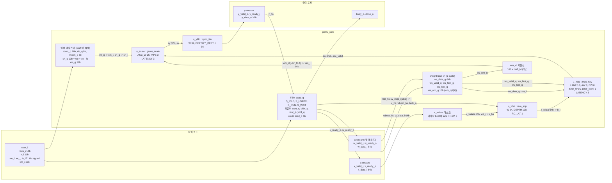
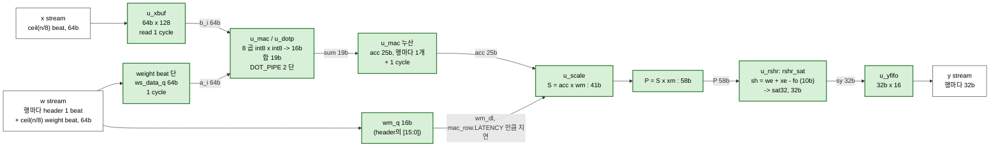
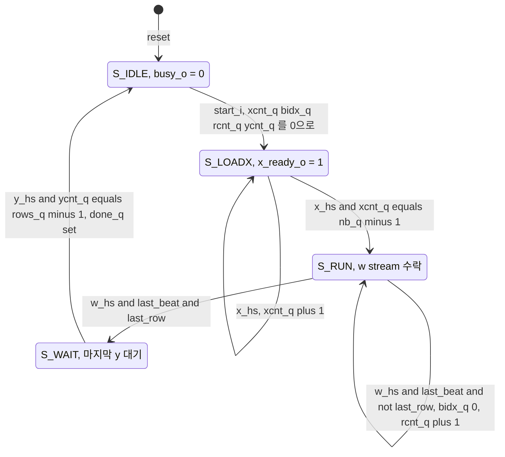

# L2 gemv_core: block, data flow, control flow, cycle 식

- 원본과 확인일: 확인일 2026-11-19. `rtl/l2/gemv_core.sv`(포트, FSM `state_t`, credit, 인스턴스), `rtl/l1/mac_row.sv`, `rtl/l1/gemv_scale.sv`, `rtl/l0/ram_sdp.sv`, `rtl/l0/sync_fifo.sv`, `rtl/pkg/llm_pkg.sv`. 신호 이름, 비트폭, 전이 조건은 RTL 선언 그대로다.
- 상태: S4-2에서 단독 G4 통과(260K K_GEMV 432 레코드 42,144행, 15M 258 레코드 299,136행, y mismatch 0, `log.md` S4-2).
- 기준 parameter: `LANES` 8, `NMAX` 1024(`N_MAX`), `ROWS_W` 16, `DOT_PIPE` 2, `SCALE_PIPE` 3, `Y_DEPTH` 16. 이때 `n_i`는 11비트(`clog2(NMAX+1)`), `nb_q`는 8비트(`clog2(NMAX/8+1)`), `ACC_W` 25, `L_PIPE` 9. 다른 parameter 값의 폭은 같은 식으로 달라진다.
- **이 문서는 RTL을 읽어서 그린 것이다. 시뮬레이션 파형이 아니고, 파형은 그리지 않았다.** cycle 수 식만 `log.md` S4-2의 시뮬레이션 확인(stall 없는 모든 호출에서 일치)을 따른다.

## 1. block diagram



포트와 인스턴스 요약:

| 항목 | RTL 확인 내용 |
|---|---|
| 입력 | `start_i`, `rows_i[ROWS_W]`, `n_i[clog2(NMAX+1)]`, `we_i`/`xe_i`/`fo_i[E_W]` signed(`E_W` 8), `xm_i[AM_W]`(17), x stream, w stream, `y_ready_i` |
| 출력 | `busy_o`(state가 `S_IDLE`이 아닐 때), `done_o`(= `done_q`, 1 cycle pulse), `x_ready_o`, `w_ready_o`, y stream |
| `u_xbuf` | `ram_sdp #(.W(64), .DEPTH(XD = NMAX/8 = 128), .RD_LAT(1))`. 쓰기 `we_i = x_hs`, 주소 `xcnt_q`. 읽기 `re_i = wbeat_hs`, 주소 `bidx_q - 1`. read-first |
| `u_mac` | `mac_row #(.LANES(8), .AW(8), .BW(8), .ACC_W(25), .N_MAX(NMAX), .DOT_PIPE(2))`. `a_i` = `ws_data_q`(가중치), `b_i` = `x_rdata`(x). 내부에 `u_dotp`(dotp) |
| `u_scale` | `gemv_scale #(.ACC_W(25), .PIPE(3))`. 내부에 `u_rshr`(rshr_sat). `sh_i` = `sh_q` |
| `u_yfifo` | `sync_fifo #(.W(32), .DEPTH(Y_DEPTH))`. `in_ready_o`는 연결만 하고 `L2_OVF` assertion에만 쓴다(credit이 넘침을 막는다) |
| glue 레지스터 | datapath(reset 없음): `rows_q`, `nb_q`, `lmask_q`, `sh_q`, `xm_q`, `wm_q`, `ws_data_q`, `ws_first_q`, `ws_last_q`, `ws_wm_q`, `wm_dl`. control(reset 있음): `state_q`, `xcnt_q`, `bidx_q`, `rcnt_q`, `ycnt_q`, `cred_q`, `done_q`, `ws_valid_q` |

## 2. data flow

한 beat = 64비트 = int8 8개(lane 0이 `[7:0]`). x stream은 `ceil(n/8)` beat, w stream은 행마다 header 1 beat + 가중치 `ceil(n/8)` beat다. header는 `[15:0]`만 쓴다(wm). y는 행마다 32비트 1개.



단별 latency (RTL의 레지스터 수에서 센 값. 기준 parameter):

| 단 | 레지스터 단 수 | 근거 |
|---|---|---|
| x buffer read, weight beat 단 | 1 | `ram_sdp` `RD_LAT` 1, `ws_*` 레지스터가 같은 cycle에 맞춰짐 |
| `mac_row` (`u_dotp` + 누산) | `DOT_PIPE + 1` = 3 | `mac_row.LATENCY`. dotp 2단(곱 뒤, adder tree 뒤) + `acc_q`/`av_q` 1단 |
| `gemv_scale` | `SCALE_PIPE` = 3 | `LATENCY = PIPE`. `acc x wm` 뒤, `S x xm` 뒤, rshr_sat 출력 |
| y FIFO 쓰기 | 1 | `sync_fifo`는 push 다음 cycle에 `out_valid_o`(`level_q != 0`) |
| `done_q` | 1 | y 마지막 수락 다음 cycle |
| 합계 `L_PIPE` | 3 + `LAT_M` + `LAT_S` = **4 + DOT_PIPE + SCALE_PIPE** = 9 | 3 = x buffer read 1 + y FIFO 1 + done 1 |

RTL 구조에서 도출한 시점(`start_i`가 1인 cycle을 0으로 두고, 모든 beat가 대기 없이 오고 `y_ready_i`가 1일 때):

- x beat는 cycle 1부터 cycle `nb`(= `ceil(n/8)`)까지 수락된다(`S_LOADX`는 cycle 1부터).
- w stream의 첫 header는 cycle `nb + 1`, 마지막 weight beat는 cycle `nb + rows x (1 + nb)`에 수락된다.
- 마지막 weight beat 수락에서 `done_o`까지가 `L_PIPE`(9) cycle이다(위 표의 합).
- 이 도출은 아래 cycle 식과 같고, 식 자체는 `log.md` S4-2에서 시뮬레이션으로 확인됐다.

## 3. control flow

state는 4개(`state_t`): `S_IDLE`, `S_LOADX`, `S_RUN`, `S_WAIT`. `default` 분기는 `S_IDLE`로 돌아간다.



전이 조건 (RTL 정의):

| 항목 | 정의 |
|---|---|
| `x_ready_o` | `state_q == S_LOADX` |
| `x_hs` | `x_valid_i && x_ready_o` |
| `w_ready_o` | `state_q == S_RUN && (bidx_q != 0 \|\| cred_q < Y_DEPTH)` |
| `w_hs`, `hdr_hs`, `wbeat_hs` | `w_valid_i && w_ready_o`, `w_hs && bidx_q == 0`, `w_hs && bidx_q != 0` |
| `last_beat` | `bidx_q == nb_q` (`bidx_q` 0 = header, 1 에서 `nb_q` = weight beat) |
| `last_row` | `rcnt_q == rows_q - 1` |
| `y_hs` | `y_valid_o && y_ready_i` |
| `S_WAIT` 종료 | `y_hs && ycnt_q == rows_q - 1`일 때 `done_q <= 1`(다음 cycle `done_o`) |

credit 규칙 (y 쪽 backpressure):

- `cred_q`는 매 cycle `cred_q + hdr_hs - y_hs`로 갱신된다. header 수락부터 y 수락까지 사이에 있는 행 수다.
- header beat(`bidx_q == 0`)는 `cred_q < Y_DEPTH`일 때만 수락한다. weight beat(`bidx_q != 0`)는 `S_RUN`이면 항상 수락 가능하다(진행 중인 행을 끝까지 흘려야 하므로).
- 그래서 y FIFO에 넣는 결과 수가 `Y_DEPTH`를 넘지 않고, 파이프라인 안에서 backpressure 없이 y FIFO가 받는다(넘침은 `L2_OVF` assertion).
- `Y_DEPTH >= (L_PIPE + 3) / 2 + 1`은 elaboration에서 검사한다(기준 9: 7 이상, 기본 16).
- x stream은 `S_LOADX`에서만, w stream은 `S_RUN`에서만 수락한다. 그 전에 valid만 올려 두는 것은 허용된다(ready 없이 대기).

시뮬레이션 전용 검사 tag: `L2_RANGE`(n, rows 범위), `L2_START`(busy 중 start), `L2_OVF`(y FIFO가 찬 상태에서 결과 도착).

## 4. cycle 식

`start_i`가 1인 cycle을 0, `done_o`가 1인 cycle을 C라 하면(모든 입력 beat가 대기 없이 오고 `y_ready_i`가 1):

```
C = ceil(n/8) + rows x (1 + ceil(n/8)) + L_PIPE
L_PIPE = 3 + mac_row.LATENCY + gemv_scale.LATENCY = 4 + DOT_PIPE + SCALE_PIPE   (기본 9)
```

- 확인: stall 없는 run의 모든 호출에서 식과 일치(`log.md` S4-2, 시뮬레이션 [측정]). 이 문서가 RTL에서 도출한 시점(2절)도 같은 식이 된다.
- token 단위 합(`L_PIPE` 제외, token의 모든 GEMV 호출에서 `ceil(n/8) + rows x (1 + ceil(n/8))`를 더한 값): 260K 36,446 cycle, 15M 1,950,260 cycle(`log.md` S4-2, `arch.md` 2.4와 같음).
- 식을 15M 분류기(rows 32000, n 288, `ceil(n/8)` 36)에 대입한 값 [계산, 이 문서에서 식에 대입]: 36 + 32000 x 37 + 9 = 1,184,045 cycle. `arch.md` 2.4의 1,184,000은 x 적재와 `L_PIPE`를 뺀 값이다.
- 식은 입력이 대기 없이 오고 `y_ready_i`가 1인 경우의 값이다. stall이 있는 run의 cycle 수는 이 문서에서 다루지 않는다(`log.md`는 stall 없는 run에서만 일치를 기록).
