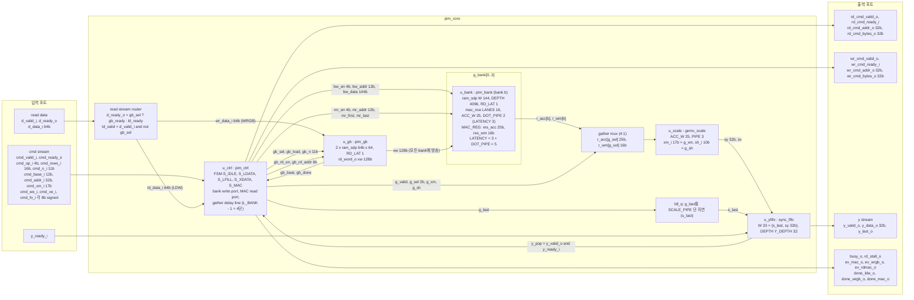
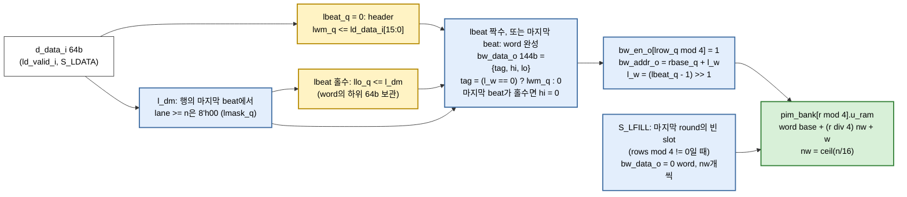
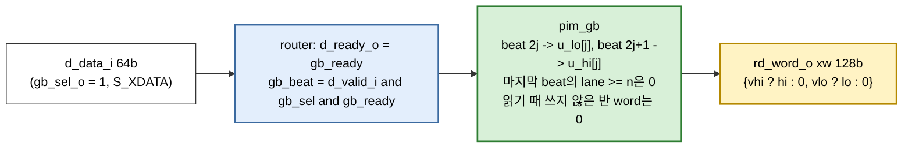
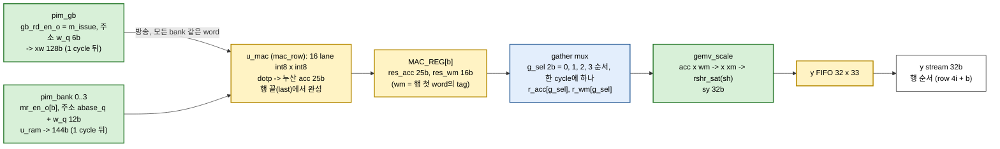
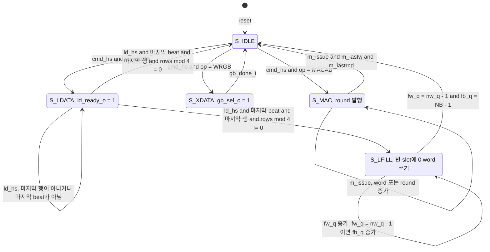
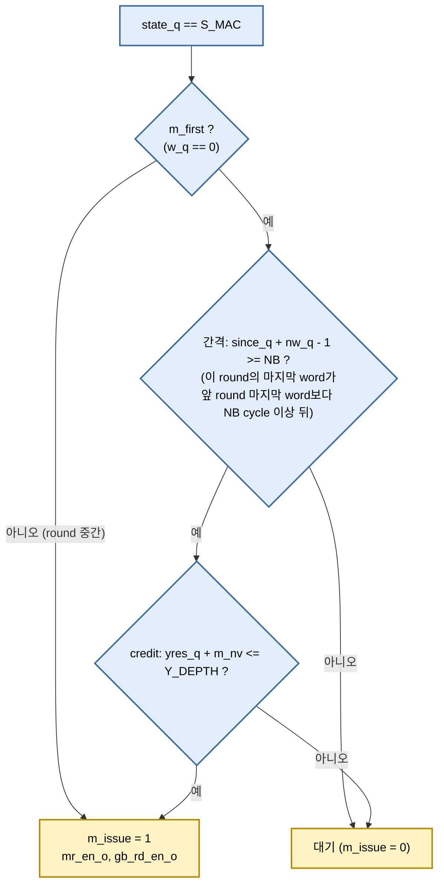
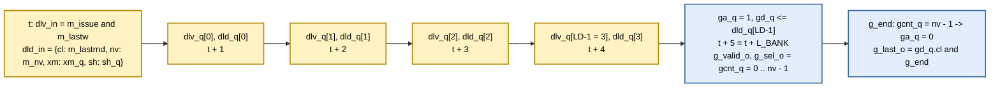

# L2 pim_core: block, data flow, control flow, cycle 식

- 원본과 확인일: 확인일 2026-11-19. `rtl/l2/pim_core.sv`(포트, 인스턴스, router, gather mux), `rtl/l1/pim_ctrl.sv`(FSM `state_t`, round 발행, gather delay line), `rtl/l1/pim_bank.sv`, `rtl/l1/pim_gb.sv`, `docs/spec/pim.md` 5, 6절. 신호 이름, 비트폭, 전이 조건은 RTL 선언 그대로다.
- 상태: S4-5에서 단독 G4 통과(260K K_GEMV 레코드 432개 42,144행 y mismatch 0, `log.md` S4-5, `./sim/run.sh all` 262 run, fails 0 [측정, 수퍼바이저 재실행]). 합성, 타이밍, 보드는 미확인.
- 기준 parameter: `NB` 4, `LB` 16, `DEPTH` 4096(bank당 word), `NMAX` 1024, `DOT_PIPE` 2, `SCALE_PIPE` 3, `Y_DEPTH` 32, `ROWS_W` 16. 이때 `AA` = 12, `NW` = 11, `GA` = 6, `BI_W` = 2, `ACC_W` = 25, `W_WORD` = 144, `L_BANK` = 5. 다른 parameter 값의 폭은 같은 식으로 달라진다.
- **이 문서는 RTL을 읽어서 그린 것이다. 시뮬레이션 파형이 아니고, 파형은 그리지 않았다.** cycle 식만 `pim.md` 6.1의 시뮬레이션 확인(stall 없는 모든 MACAB에서 일치)을 따른다.

## 1. block diagram



포트와 인스턴스 요약:

| 항목 | RTL 확인 내용 |
|---|---|
| 입력 | `cmd_*`(위 그림), `rd_cmd_ready_i`, `d_valid_i`/`d_data_i[63:0]`, `wr_cmd_ready_i`, `y_ready_i` |
| 출력 | `cmd_ready_o`, `rd_cmd_*`, `d_ready_o`, `wr_cmd_*`, y stream(`y_valid_o`, `y_data_o[31:0]`, `y_last_o`), `busy_o`(= `!idle`, `idle` = `pim_ctrl.idle_o`), `rd_stall_o`(= `d_ready_o && !d_valid_i`), 사건 pulse 6개 |
| `u_ctrl` | `pim_ctrl #(NB, LB, DEPTH, NMAX, Y_DEPTH, L_BANK, ROWS_W)`. `cmd_ready_o = (state_q == S_IDLE) && !rd_cmd_valid_o && !(cmd_op_i == OP_MACAB && wr_cmd_valid_o)` |
| `u_gb` | `pim_gb #(NMAX, LB)`. 내부 `u_lo`, `u_hi`: `ram_sdp #(W 64, DEPTH NMAX/16 = 64, RD_LAT 1)`. 읽기 latency 1(`LATENCY` 1) |
| `g_bank[b].u_bank` | `pim_bank #(LB 16, DEPTH 4096, NMAX, DOT_PIPE 2)` x `NB`. 내부 `u_ram`(ram_sdp, W = `W_WORD` 144), `u_mac`(`mac_row`, 그 안에 `dotp`). bank마다 쓰기 enable `bw_en[b]`와 읽기 enable `mr_en[b]`가 따로이고 주소, 데이터, first/last, x는 공통 |
| `u_scale` | `gemv_scale #(ACC_W 25, PIPE 3)`. 입력은 `r_acc[g_sel]`, `r_wm[g_sel]`, `g_xm`, `g_sh` |
| `u_yfifo` | `sync_fifo #(W 33, DEPTH Y_DEPTH)`. `in_ready_o`는 `PIM_YOVF` assertion에만 쓴다(credit이 넘침을 막는다) |
| 사용하지 않는 출력 | `pim_bank.res_valid_o`는 `pim_core`에서 연결하지 않는다(gather 시점은 `pim_ctrl`이 정함) |

## 2. data flow

### 2.1 LDW: 행 레코드 -> bank

행 레코드는 header 1 beat(`[15:0]` = wm) + 가중치 `nb8 = ceil(n/8)` beat(64비트 = int8 8개)다. 한 word = 144비트 = `{tag 16b, hi 64b, lo 64b}`.



- 행 r의 bank는 `lrow_q[BI_W-1:0]`(= r mod 4), word 주소는 `rbase_q + l_w`. `rbase_q`는 `lrow_q mod 4 == NB - 1`인 행의 마지막 beat에서 `nw_q`만큼 증가한다(round 하나가 끝날 때).
- 읽기 길이 `rd_cmd_bytes_o`는 `rows x (nb8 + 1) x 8` byte(`rdc_bytes_q`)다.

### 2.2 WRGB: x -> global buffer



- WRGB 명령 handshake에서 `gb_load_o = cmd_hs && op == WRGB`(n을 `gb_n_o`로 전달). 읽기 길이는 n byte. 완료는 `pim_gb.done_o`(마지막 beat handshake)로 `S_XDATA -> S_IDLE`.

### 2.3 MACAB: 방송 word + bank word -> 행 합 -> gather -> scale -> y



- 행 r(round i = r div 4, bank b = r mod 4)은 bank b 안에서 끝난다. bank 사이 reduction은 없다(BANK_ROW). 마지막 round의 행이 4개보다 적으면(rows mod 4 != 0) `mr_en_o` mask(`m_mask[b] = b < m_nv`)로 앞 `m_nv`개 bank만 읽는다.
- gather 한 cycle당 `gemv_scale`에 하나가 들어가며(`g_valid_o`, `g_sel_o`), round의 `xm`, `sh = we + xe - fo`는 gather delay line을 거쳐 같이 온다.

단별 latency (RTL의 레지스터 수에서 센 값, 기준 parameter):

| 단 | 단 수 | 근거 |
|---|---|---|
| bank RAM read | 1 | `ram_sdp` `RD_LAT` 1. global buffer read도 1이라 같은 cycle에 맞는다 |
| `mac_row` | `DOT_PIPE + 1` = 3 | `pim_bank` `LAT_M` |
| MAC_REG | 1 | `res_v_q`, `res_acc_q` |
| 합 (`L_BANK`, `pim_bank.LATENCY`) | 3 + `DOT_PIPE` = **5** | round의 마지막 word `re_i`가 cycle t이면 `res_valid_o`는 t + 5 |
| `gemv_scale` | `SCALE_PIPE` = 3 | `LATENCY = PIPE` |
| y FIFO 쓰기 | 1 | `sync_fifo`는 push 다음 cycle에 `out_valid_o` |

## 3. control flow

### 3.1 `pim_ctrl` FSM

state는 5개(`state_t`): `S_IDLE`, `S_LDATA`, `S_LFILL`, `S_XDATA`, `S_MAC`. `default` 분기는 `S_IDLE`로 돌아간다.



전이 조건 (RTL 정의):

| 항목 | 정의 |
|---|---|
| `cmd_hs` | `cmd_valid_i && cmd_ready_o` |
| `ld_hs` | `ld_valid_i && ld_ready_o`, `ld_ready_o = (state_q == S_LDATA)` |
| 행의 마지막 beat | `l_lastbeat = (lbeat_q == nb8_q)` (`lbeat_q` 0 = header, 1 .. `nb8_q` = weight beat) |
| 마지막 행 | `l_lastrow = (lrow_q == rows_q - 1)` |
| `m_issue` | `(state_q == S_MAC) && m_ok` |
| `m_lastw`, `m_lastrnd` | `w_q == nw_q - 1`, `rnd_q == nrnd_q - 1` (`nrnd_q` = ceil(rows/4)) |
| 사건 | `done_mac_o = m_issue && m_lastw && m_lastrnd`, `done_wrgb_o = (state_q == S_XDATA) && gb_done_i`, `done_ldw_o`는 LDW의 마지막 쓰기 cycle |

- 컨트롤러는 마지막 word read(MACAB), 마지막 bank 쓰기(LDW), 마지막 gb beat(WRGB) 다음 cycle에 idle이고 다음 명령을 받을 수 있다.

### 3.2 round 발행 조건 `m_ok`

round의 첫 word(`m_first = (w_q == 0)`)를 읽을 때만 조건이 있고, round 중간 word(`!m_first`)는 항상 발행한다.

```
m_ok = !m_first
       || ( (since_q + nw_q - 1 >= NB)            // 간격 조건
            && (yres_q + m_nv <= Y_DEPTH) )       // y credit 조건
```



- `since_q`: 마지막 round의 마지막 word read 이후 cycle 수(`m_issue && m_lastw`에서 1로, 이후 `NB`까지 증가해 포화). 명령 경계를 넘어 유지된다.
- `yres_q`: y FIFO에 잡아 둔 행 수. round 첫 word 발행에서 `m_nv`(그 round의 행 수)만큼 늘고 `y_pop_i`마다 1 줄어든다. y 쪽 backpressure는 이 credit으로만 처리하고 bank pipeline에는 backpressure가 없다(`PIM_YOVF`).
- 간격 조건 덕에 gather(`NB` cycle)가 끝나기 전에 다음 round 결과가 MAC_REG를 덮지 않는다(`PIM_GATHER`). `nw >= 4`면 round가 빈틈 없이 이어지고, `nw < 4`(n <= 48)면 round 하나가 4 cycle이다(`pim.md` 5절).
- 명령 수락 조건: MACAB는 앞 MACAB의 write 명령(`wr_cmd_valid_o`)이 engine에 넘어간 뒤에 받는다.

### 3.3 gather delay line

round의 마지막 word를 읽는 cycle t에 `dlv_in = m_issue && m_lastw`로 항목 `gent_t {cl, nv, xm, sh}`(`cl` = 명령의 마지막 round, `nv` = round의 행 수 3b, `xm` 17b, `sh` 10b)를 push한다.



- 단 수 `LD = L_BANK - 1` = 4. 위 cycle 표기(t + 1 .. t + 5)는 레지스터 단 수를 센 것이다. gather의 첫 cycle(t + `L_BANK`)에 bank 0의 MAC_REG가 유효하고, 이후 bank 1, 2, 3이 한 cycle씩 뒤따른다. 이것은 `pim_bank.LATENCY`(마지막 word `re_i`에서 `res_valid_o`까지)와 같은 값이어야 하는 정렬이며 RTL 주석의 정의다.
- `g_last_o`는 `gemv_scale`을 지나는 동안 `ldl_q`(`SCALE_PIPE` 단)로 같이 지연되어 y FIFO에 `{s_last, sy}`로 들어간다.

## 4. cycle 식

기호: `R` = ceil(rows/4), `nw` = ceil(n/16), `P` = max(nw, 4), `nvl` = rows - 4 (R - 1)(마지막 round의 행 수), `L_BANK` = 3 + `DOT_PIPE`, `L_S` = `SCALE_PIPE`. 명령 handshake cycle을 0, 이전 round의 마지막 word cycle을 `t_p`라 하면(`pim.md` 6.1, 시뮬레이션으로 확정):

```
t0  = max(1, t_p + 4 - (nw - 1))              // 첫 word
t_l = t0 + (R - 1) P + nw - 1                  // 마지막 word (done_mac)
C   = t_l + L_BANK + nvl + L_S                 // 마지막 y가 core 출력에 valid
```

앞 MACAB에서 충분히 떨어져 `t0 = 1`이고 `nw >= 4`, rows가 4의 배수(`nvl` = 4)이면

```
C_mac = ceil(rows/4) x ceil(n/16) + 12        (기본 PIPE)
```

상수 12의 구성(기본 parameter, `t_l`의 `+ 1`은 첫 word가 cycle 1이라 `t_l = R nw`에 이미 들어 있다):

| 항 | cycle | RTL 근거 |
|---|---|---|
| `L_BANK` | 5 | RAM read 1 + `mac_row` 3 + MAC_REG 1 (`pim_bank.LATENCY`) |
| gather | 4 | `nvl`. 마지막 round의 행 4개가 한 cycle에 하나씩 `gemv_scale`에 들어간다. y FIFO 쓰기 1단을 이 항에 묶었다(아래 참고) |
| `L_S` | 3 | `gemv_scale` `SCALE_PIPE` |
| 합 | **12** | |

- 참고: `pim.md` 6.1의 구성(read 1, mac_row 3, MAC_REG 1, scale 3, gather 4)과 같은 분해다. 다만 RTL 레지스터 수에서 따로 세면 `nvl` 항 4는 "마지막 bank(b = 3)가 gather 시작보다 3 cycle 늦음 + y FIFO 쓰기 1단"과 같은 값이다(이 분해는 RTL에서 센 것이고 `pim.md`에는 이 구분이 없다). 합 12는 시뮬레이션으로 확인된 값이다.
- 확인: `pim_core` TB(STALL = 0)가 모든 MACAB의 마지막 y cycle을 식과 비교(260K 레코드 432개 3 run, 합성 838개), `pim_ctrl` TB가 `done_mac` cycle을 같은 식으로 비교(`log.md` S4-5, `pim.md` 6.1). 식은 stall 없는 경우의 값이다.
- 컨트롤러 점유(handshake부터 다음 명령을 받을 수 있는 cycle까지): `(R - 1) P + nw + 1`(`pim.md` 6.1).
- 260K token 합 [측정, 시뮬레이션]: `sum ceil(rows/4) x ceil(n/16)` = 4,072 cycle, 컨트롤러 MACAB 점유 합 4,108(`pim.md` 6.2).
