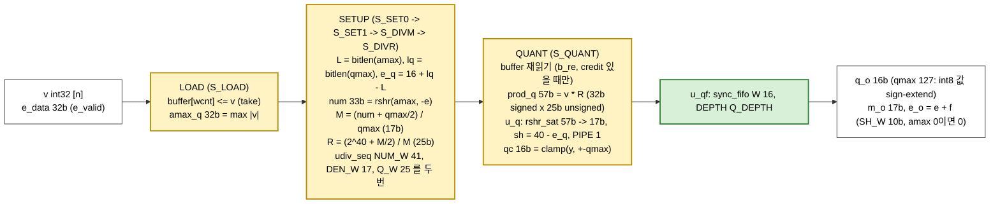
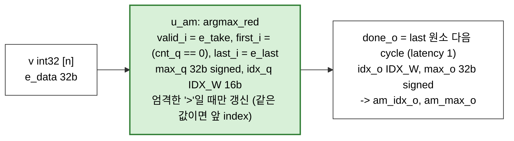
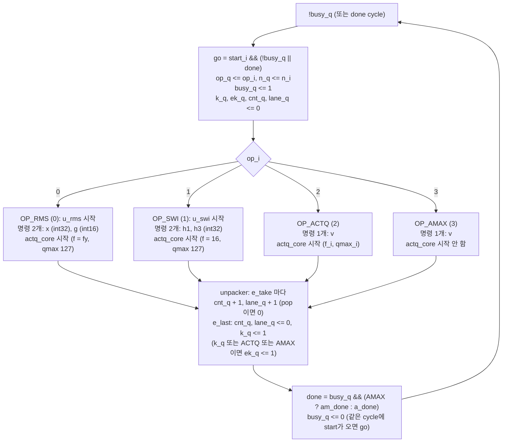
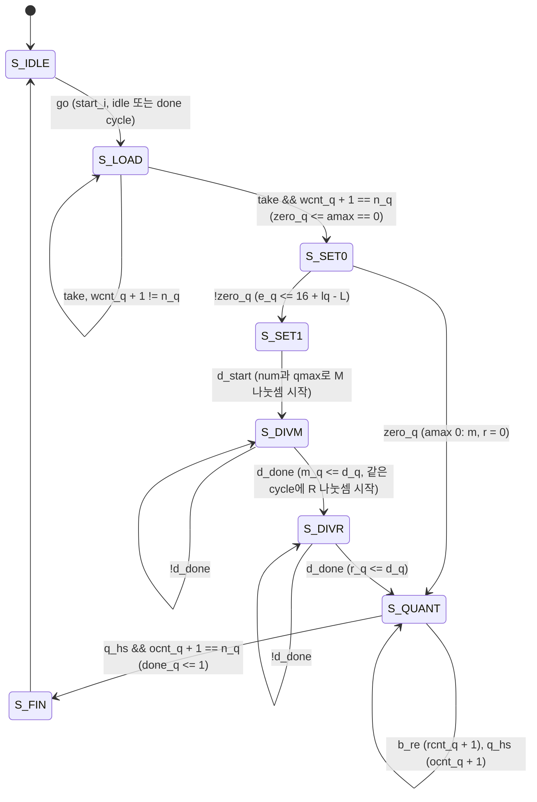
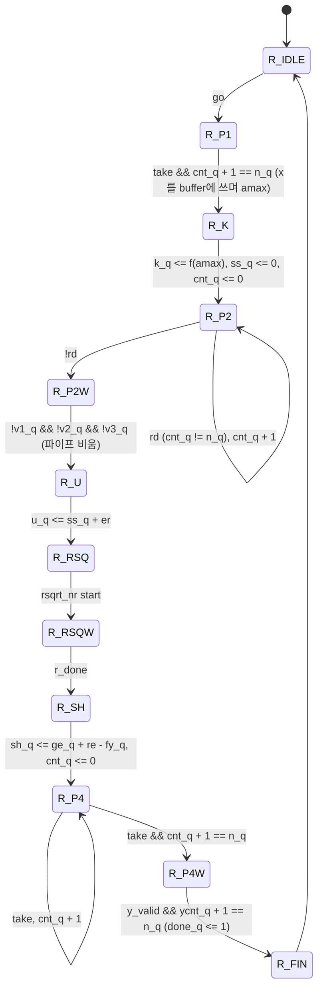
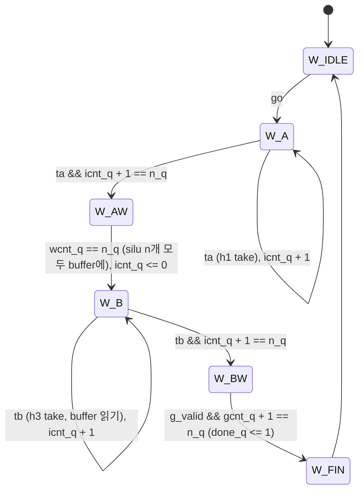

# L2 vec_core: block, data flow, control flow, cycle 식

- 원본과 확인일: 확인일 2026-11-20. `rtl/l2/vec_core.sv`(포트, unpacker, op 선택), `rtl/l1/rms_front.sv`, `rtl/l1/swi_front.sv`, `rtl/l1/actq_core.sv`, `rtl/l0/argmax_red.sv`(헤더 주석), `rtl/pkg/llm_pkg.sv`(`E_W` 8, `SH_W` 10, `AM_W` 17), 알고리즘과 구조 결정은 `docs/spec/arch.md` 5절, 측정값과 cycle 식은 `docs/spec/vec.md` 6절과 `docs/log.md` S4-7. 신호 이름, 비트폭, 전이 조건은 RTL 선언 그대로다. 충돌하면 RTL과 `vec.md`가 우선.
- 상태: S4-7에서 단독 G4 통과. `./sim/run.sh all` 424 run, fails 0 [측정, 수퍼바이저 재실행]. 2026-11-23 `d_want_o` 추가 후 회귀 491 run fails 0 [측정, 수퍼바이저 재실행, S5-4 보완]. 두 모델의 K_RMSNORM, K_SWIGLU, K_ACTQ, K_ARGMAX 레코드 전부 mismatch 0, mutation 33/35 검출(2개 동치), lint 경고 0은 agent 보고(재실행 안 함). **보드는 미실행**이고 100 MHz 타이밍, LUT 수, DSP 실제 매핑은 확인하지 않았다.
- 기준 parameter(RTL 기본값): `N_MAX` 1024, `IDX_W` 16, `LUT_PIPE` 2, `Q_DEPTH` 8. 파생 폭: `NV_W` = `IDX_W` + 1 = 17, `NW` = clog2(`N_MAX` + 1) = 11, `AW` = clog2(`N_MAX`) = 10. `rms_front`의 `SS_W` = 30 + clog2(`N_MAX`) = 40, `U_W` = `SS_W` + 1 = 41. (260K 시스템 빌드가 `vec_top`에 넘기는 `N_MAX`는 이 문서에서 확인하지 않았다. `vec.md` 8절은 N_MAX 256을 가정하는 문장이 있다.)
- **파형은 그리지 않았다.** 아래 FSM과 data flow는 RTL의 `typedef enum`, `case` 전이, 레지스터 갱신 조건에서 옮긴 것이다. cycle 식은 `vec.md` 6.1의 시뮬레이션 측정값이고, 식을 항으로 나눈 것은 RTL의 상태와 `vec.md`가 적은 항에서 맞춘 것이다(해당 표에 표시).
- **`vec_core` 자체에는 `typedef enum` FSM이 없다.** 이 모듈의 control은 `busy_q`, `op_q`, `n_q`와 unpacker(`k_q`, `ek_q`, `cnt_q`, `lane_q`)뿐이고, op별 순서는 하위 모듈의 FSM(`rms_front` 12 state, `swi_front` 6 state, `actq_core` 8 state)이 정한다. 3절은 이 구조 그대로 그렸다.

## 1. block diagram

```mermaid
flowchart LR
    subgraph IN["입력 포트"]
        call["call<br/>start_i, op_i 2b (0 RMS, 1 SWI, 2 ACTQ, 3 AMAX)<br/>n_i NV_W 17b, f_i E_W 8b signed, qmax_i 16b<br/>ge_i E_W 8b signed, epsc_i 32b"]
        beat["read beat stream<br/>d_valid_i, d_ready_o, d_want_o, d_last_i<br/>d_data_i 64b"]
    end

    subgraph CORE["vec_core"]
        ctl["call state (이 계층의 control)<br/>busy_q, op_q 2b, n_q NV_W<br/>go = start_i && (!busy_q || done)"]:::cut
        unp["unpacker<br/>k_q (명령 0/1), ek_q, cnt_q NV_W, lane_q 2b<br/>e_data 32b: int32 lane = d_data[32 lane_q[0] +: 32]<br/>int16 lane (RMSNORM g) = sign-extend d_data[16 lane_q +: 16]<br/>pop = e_take && (e_last || lane_q == (e2 ? 3 : 1))"]:::cut
        buf["u_buf: ram_sdp<br/>W 32, DEPTH N_MAX, RD_LAT 1<br/>op_q == OP_RMS ? rms_front 포트 : swi_front 포트<br/>(공유 front buffer)"]:::mod
        rms["u_rms: rms_front<br/>N_MAX, 12 state<br/>e_ready_o = P1 또는 P4"]:::mod
        swi["u_swi: swi_front<br/>N_MAX, LUT_PIPE, 6 state<br/>e_ready_o = A 또는 B"]:::mod
        mux["a_v mux (op_q)<br/>RMS: r_y 32b (r_yv)<br/>SWI: s_g 32b (s_gv)<br/>ACTQ: e_data 32b (e_valid)<br/>AMAX: valid 0"]:::logic
        aq["u_aq: actq_core<br/>N_MAX, Q_DEPTH, 8 state<br/>start_i = go && op_i != OP_AMAX<br/>f_i = (op_i == SWI) ? 16 : f_i<br/>qmax_i = (op_i == ACTQ) ? qmax_i : 127"]:::mod
        am["u_am: argmax_red<br/>IDX_W<br/>valid_i = e_take && op_q == OP_AMAX<br/>first_i = (cnt_q == 0), last_i = e_last"]:::mod
        dn["done = busy_q && (op_q == OP_AMAX ? am_done : a_done)<br/>e_ready: RMS r_ready, SWI s_ready, ACTQ a_vready, AMAX 1"]:::logic
    end

    subgraph OUT["출력 포트"]
        qo["q stream<br/>q_valid_o, q_ready_i, q_o 16b<br/>(int8 값은 sign-extend한 int16 container)"]
        sc["scale<br/>m_o AM_W 17b, e_o SH_W 10b signed<br/>scl_valid_o"]
        ar["argmax<br/>am_idx_o IDX_W 16b, am_max_o 32b signed"]
        st["busy_o, done_o (1 cycle pulse)"]
    end

    call --> ctl
    beat --> unp
    ctl -->|"op_q, n_q"| unp
    unp -->|"e_valid, e_data 32b"| rms
    unp -->|"e_valid, e_data 32b"| swi
    unp -->|"e_valid, e_data 32b (ACTQ)"| mux
    unp -->|"e_take, cnt_q, e_last, e_data (AMAX)"| am
    rms <-->|"b_we/waddr/wdata, b_re/raddr, b_rdata 32b"| buf
    swi <-->|"b_we/waddr/wdata, b_re/raddr, b_rdata 32b"| buf
    rms -->|"y_valid_o, y_o 32b"| mux
    swi -->|"g_valid_o, g_o 32b"| mux
    mux -->|"v_valid_i, v_i 32b"| aq
    aq -->|"v_ready_o"| dn
    aq --> qo
    aq --> sc
    am --> ar
    aq -->|"done_o"| dn
    am -->|"done_o"| dn
    dn -->|"d_ready_o = pop"| beat
    dn -->|"d_want_o = busy_q && !ek_q && e_ready"| beat
    dn --> st

    classDef mod fill:#d8f0d8,stroke:#2e7d32,stroke-width:2px,color:#000
    classDef logic fill:#e3eefc,stroke:#3b6aa0,stroke-width:2px,color:#000
    classDef cut fill:#fff3c4,stroke:#b58900,stroke-width:2px,color:#000
```

- 초록 = 하위 모듈 인스턴스, 파랑 = 조합 논리, 노랑 = 레지스터가 있는 control.
- 한 호출은 read engine의 명령 순서(호출자인 `vec_top`이 발행)대로 beat를 받는다: RMSNORM은 x(int32 [n]) 뒤에 g(int16 [n]), SWIGLU는 h1 뒤에 h3, ACTQ와 ARGMAX는 v 하나. unpacker가 명령 하나의 마지막 원소를 받으면 `k_q`를 1로 올리고, 마지막 명령(RMSNORM, SWIGLU은 `k_q` = 1, ACTQ와 ARGMAX는 첫 명령)이면 `ek_q`를 올려 이후 beat를 받지 않는다.
- 마지막 beat의 호출 밖 원소는 버린다(`pop`이 `e_last`에서도 선다). 원소는 cycle마다 최대 1개.
- 입력 backpressure는 `e_ready`(각 front 또는 `actq_core`의 `v_ready_o`)가 `d_ready_o`로 이어진다. **`d_ready_o`와 `d_want_o`는 다르다**(2026-11-23 S5-4 보완, RTL `vec_core.sv` 헤더 주석과 `d_ready_o = pop`, `d_want_o = busy_q && !ek_q && e_ready`): `d_ready_o`는 beat의 pop(마지막 lane의 원소를 받는 cycle)이라 `d_valid_i`가 이미 포함된 값이고, `d_want_o`는 "beat가 있으면 원소를 받을 상태"를 `d_valid_i`와 무관하게 낸다. `vec_top`이 RD_STALL(core가 read 데이터를 기다린 cycle)을 `d_want_o`로 세고, `d_ready_o`로는 셀 수 없다(`d_ready_o`와 `!d_valid`가 함께 참일 수 없음). `d_ready_o`와 cycle 수는 바뀌지 않았다. 출력 쪽은 `q_ready_i`와 `actq_core`의 q FIFO credit이 처리한다. front의 y/g 출력은 backpressure가 없다(valid만): `actq_core`가 LOAD 동안 매 cycle 받는다.
- 공유 buffer 포트 선택은 `op_q == OP_RMS ? rb_* : sb_*` 하나이고, 다른 op(ACTQ, ARGMAX)에서는 `sb_*`(swi_front의 포트, 쓰지 않음)가 선택된 채 있다. buffer는 RMSNORM이면 x, SWIGLU이면 silu를 담는다.

## 2. data flow (op별)

한 step의 `e_data`는 32비트(int32 원소 또는 sign-extend한 int16 원소)이다. 폭은 RTL 선언의 값이고, 수식은 `vec.md` 1절(golden `kern.c`와 같음)이다.

### 2.1 RMSNORM (op 0): `rms_front` -> `actq_core`

```mermaid
flowchart LR
    x["x int32 [n]<br/>e_data 32b"]:::ext
    p1["P1 (R_P1)<br/>buffer[cnt] <= x (b_we_o)<br/>amax_q 32b = max |x|<br/>ax = |x| (|-2^31| = 2^31)"]:::cut
    k["K (R_K)<br/>la = bitlen(amax_q)<br/>k_q 5b = max(la - 15, 0)<br/>ss_q <= 0"]:::cut
    p2["P2 (R_P2, R_P2W)<br/>buffer 읽기 -> u_xs: rshr_sat 32b -> 17b, sh = k_q<br/>xs 16b = clamp(xr, +-32767)<br/>m3_q 31b = xs * xs, ss_q SS_W 40b += m3_q"]:::cut
    p3["P3 (R_U, R_RSQ, R_RSQW, R_SH)<br/>er 33b = rshr(epsc_q, 2 k_q) (u_eps)<br/>u_q U_W 41b = ss_q + er<br/>u_rsq: rsqrt_nr -> rm 17b, re E_W 8b<br/>sh_q SH_W 10b = ge_q + re - fy_q"]:::cut
    p4["P4 (R_P4, R_P4W)<br/>g int16 [n] 를 e_i[15:0]로 받음 (g1_q 16b)<br/>buffer[cnt] 읽기 -> xs 16b<br/>m3_q 31b = xs * g<br/>pr4_q 48b = m3_q * rm (31b x 17b unsigned)<br/>u_y: rshr_sat 48b -> 32b, sh = sh_q, PIPE 1"]:::cut
    y["y_o 32b, y_valid_o"]:::mod
    aq["u_aq: actq_core<br/>f_i = fy (= f_i), qmax 127"]:::mod
    out["q int16 container [n] (int8 값)<br/>m_o 17b, e_o = e + fy (SH_W 10b)"]:::ext

    x --> p1 --> k --> p2 --> p3 --> p4 --> y --> aq --> out
    x -.->|"g 는 P4에서 같은 stream의 다음 n개"| p4

    classDef mod fill:#d8f0d8,stroke:#2e7d32,stroke-width:2px,color:#000
    classDef cut fill:#fff3c4,stroke:#b58900,stroke-width:2px,color:#000
    classDef ext fill:#ffffff,stroke:#333333,color:#000
```



- 수식: `k = max(bitlen(amax) - 15, 0)`, `xs = clamp(rshr(x, k), 32767)`, `ss = sum xs^2`, `u = ss + rshr(epsc, 2k)`, `(rm, re) = k_rsqrt(u)`, `sh = ge + re - fy`, `y = sat32(rshr(xs g rm, sh))`. 곱셈기 하나(16 x 16)를 P2(`xs * xs`)와 P4(`xs * g`)가 `g2_q <= p1_q ? g1_q : xs`로 공유한다. `ss`의 상한은 `N_MAX` x 2^30이다(`vec.md` 1절, 헤더 주석).
- `e_ready_o`는 P1과 P4에서만 1이다. P4에서 g[i]를 받는 cycle에 buffer의 x[i]를 읽는다(`rd = take`).
- P1에서 쓴 buffer가 P2와 P4에서 두 번 읽힌다.

### 2.2 SWIGLU (op 1): `swi_front` -> `actq_core`

```mermaid
flowchart LR
    h1["h1 int32 [n]<br/>e_data 32b"]:::ext
    a["A (W_A): h1 한 개/cycle<br/>u_sig: lut_lerp FUNC 1, PIPE = LUT_PIPE<br/>s 17b = sigmoid(h1) Q16<br/>h1_d: h1을 LUT_PIPE만큼 지연"]:::cut
    m1["pa_q 50b = h1_d * s (32b signed x 17b unsigned)"]:::cut
    silu["u_silu: rshr_sat 50b -> 32b, sh = 16, PIPE 1<br/>silu 32b = rshr(h1 s, 16)"]:::cut
    buf["W_A 동안 buffer[wcnt] <= silu (b_we_o = silu_v)<br/>W_AW: wcnt == n 까지 대기"]:::mod
    h3["h3 int32 [n]<br/>e_data 32b"]:::ext
    b["B (W_B): h3 한 개/cycle<br/>buffer[icnt] 읽기 -> silu 32b<br/>h3_q 32b"]:::cut
    m2["pb_q 64b = silu * h3<br/>pc 62b = clamp(pb_q, +-2^61)"]:::cut
    g["u_g: rshr_sat 62b -> 32b, sh = 16, PIPE 1<br/>g_o 32b = sat32(rshr(silu h3, 16)), g_valid_o"]:::mod
    aq["u_aq: actq_core<br/>f_i = 16 (K_FX), qmax 127"]:::mod
    out["q int16 container [n] (int8 값)<br/>m_o 17b, e_o = e + 16 (SH_W 10b)"]:::ext

    h1 --> a --> m1 --> silu --> buf --> b
    h3 --> b
    b --> m2 --> g --> aq --> out

    classDef mod fill:#d8f0d8,stroke:#2e7d32,stroke-width:2px,color:#000
    classDef cut fill:#fff3c4,stroke:#b58900,stroke-width:2px,color:#000
    classDef ext fill:#ffffff,stroke:#333333,color:#000
```



- 수식: `s = k_sigmoid(h1)`, `silu = rshr(h1 s, 16)`, `g = sat32(rshr(silu h3, 16))`. silu는 int32 안에 들어가고(헤더 주석: `rshr((2^31 - 1) 2^16, 16) = 2^31 - 1`), `silu h3`는 최대 2^62라 62비트로 clamp한 뒤 `rshr_sat`에 넣어도 같은 sat32 값이다(`vec.md` 1절, 시뮬레이션 TB로 확인).
- h1을 받는 동안 silu까지 계산해 buffer에 두는 단계(A)가 따로 있고, h3를 받는 단계(B)에서 buffer를 읽는다. HP 포트 하나의 read engine이 h1 명령 뒤에 h3 명령을 순서대로 보내기 때문이다(`vec.md` 6.1). 그래서 SWIGLU는 `3n`이다(A n + B n + actq QUANT n).

### 2.3 ACTQ (op 2): `actq_core` 단독 (RMSNORM, SWIGLU의 양자화 단계와 같은 모듈)



- 수식: `amax = max |v|`. amax = 0이면 모든 q = 0, scale {0, 0}. 아니면 `L = bitlen(amax)`, `e = 16 + bitlen(qmax) - L`, `num = rshr(amax, -e)`, `M = (num + qmax/2) / qmax`, `R = (2^40 + M/2) / M`, `q = clamp(rshr(v R, 40 - e), qmax)`, scale `{M, e + f}`. qmax는 127, 2047, 32767(런타임 값).
- RMSNORM과 SWIGLU는 이 모듈에 front의 y/g 스트림을 넣고 f = `fy` 또는 16, qmax = 127로 쓴다(`vec_core`의 `a_v` mux와 `f_i`, `qmax_i` 선택). 공유해도 bit-exact임을 두 모델의 K_RMSNORM, K_SWIGLU 레코드 전부에서 실행으로 확인했다(`vec.md` 1절).

### 2.4 ARGMAX (op 3): `argmax_red`



- `e_ready`는 항상 1(backpressure 없음). `actq_core`는 쓰지 않는다(`start_i = go && op_i != OP_AMAX`). 결과(index와 값)는 `done_o` cycle부터 `am_idx_o`, `am_max_o`에 있다.

## 3. control flow

### 3.1 호출과 op 선택 (`vec_core` 자체의 control)



- 동작 중 `start_i`는 무시되고 시뮬레이션 검사 `L2_START`가 선다. 그 밖의 시뮬레이션 전용 검사: `L2_CFG`(n 범위), `L2_LAST`(`d_last_i`가 명령의 마지막 beat가 아님), `L2_SEQ`(호출 밖의 beat).

### 3.2 `actq_core` FSM (`st_t`, 8 state)



- `go`는 `start_i && (st_q == S_IDLE || done_q)`이고, `go`가 서면 어느 state에서든 S_LOAD로 간다(RTL의 `if (go)`가 `case`보다 앞). `S_FIN`은 done cycle이다.
- `S_LOAD`에서 `v_ready_o = 1`(`st_q == S_LOAD`). `S_QUANT`의 `scl_q`는 첫 q부터 다음 start까지 1이라 `scl_valid_o`로 나간다.

### 3.3 `rms_front` FSM (`st_t`, 12 state)



### 3.4 `swi_front` FSM (`st_t`, 6 state)



- `go`는 front 두 개 모두 `start_i && (IDLE || done_q)`이다. `vec_core`는 `go && op_i == OP_RMS` 또는 `OP_SWI`로 해당 front의 `start_i`만 올린다.
- 이 세 FSM과 unpacker가 만드는 op별 pass 순서가 4절의 cycle 식의 항이다.

## 4. cycle 식 [측정, Questa 시뮬레이션, stall 없는 입력(beat가 매 cycle, `q_ready_i` = 1)]

기준: `start_i` 수락 cycle을 0, `done_o`가 서는 cycle을 C로 한다(`vec.md` 6.1). `tb_actq_core`, `tb_rms_front`, `tb_swi_front`, `tb_vec_core`의 `CYC = 1` run에서 두 모델의 모든 레코드와 합성 호출이 이 식과 일치했다(`vec.md` 6.1).

| op | C | 0 출력(amax 0)일 때 | 항의 구성 |
|---|---|---|---|
| RMSNORM | **4n + 87** | 4n + 34 | front 마지막 y가 start + **3n + 28**(`rms_front` 측정, `vec.md` 5절 표), 이어서 `actq_core` **n + 59**. 3n은 P1, P2, P4의 원소 pass, 28의 항: R_K 1, P2 drain 4, u 2, `rsqrt_nr` 15, sh 1, y 지연 5(P4 읽기에서 `y_valid`까지) [계산: `vec.md` 6.1이 적은 항의 합 1 + 4 + 2 + 15 + 1 + 5 = 28. 개별 항의 cycle 위치는 trace로 확인하지 않음] |
| SWIGLU | **3n + 67** | 3n + 14 | front 마지막 g가 start + **2n + 8**(`LUT_PIPE` 2, `swi_front` 측정), 이어서 `actq_core` n + 59. 2n은 A와 B의 원소 pass, 8 = silu 지연 4 + AW 1 + g 지연 3 [`vec.md` 6.1이 적은 항] |
| ACTQ | **2n + 59** | 2n + 6 | 마지막 입력 원소 t = n(원소 i가 cycle 1 + i), `actq_core` done = t + n + 59 |
| ARGMAX | **n + 1** | - | 원소 i가 cycle 1 + i, `argmax_red` latency 1 |

- `actq_core`의 **n + 59**(마지막 입력 원소 cycle t 기준 done = t + n + 59, amax != 0)는 `vec.md` 6.1이 적은 RTL의 사건 순서에서 나온다: SET0 t + 1, SET1 t + 2(첫 나눗셈 시작), 나눗셈 26 cycle씩 두 번(두 번째는 첫째의 done cycle에 시작), QUANT 첫 buffer read t + 55, 마지막 q handshake t + n + 58, done t + n + 59. 나눗셈 한 번이 26 cycle이라는 값은 `udiv_seq`의 측정 CYCLES이다(이 문서는 `udiv_seq` RTL을 읽지 않았다). 한 원소의 read에서 q handshake까지 4 cycle(buffer read, `prod_q`, `u_q`(PIPE 1), FIFO)은 RTL의 `v1_q`, `v2_q`, `y_valid`, `u_qf` 단 수와 일치한다.
- 나눗셈 두 번(약 52 cycle)이 ACTQ 상수 59의 대부분이다. n = 8(260K head 하나)이면 `2n + 59` = 75 cycle 중 나눗셈이 70%를 넘는다 [계산].
- `arch.md` 5절의 추정과 측정: ACTQ `2n + 2 x 27 + L` [추정] -> 측정 `2n + 59`, RMSNORM 약 `4n + 130` [추정] -> `4n + 87`(rsqrt가 15 cycle), SWIGLU 약 `2n + 110` [추정] -> `3n + 67`(추정은 h1과 h3를 동시에 받는다고 보았으나 HP 포트 하나라 h1을 buffer에 두는 단계 n이 따로 든다).

### token당 op별 합 [측정, Questa 시뮬레이션 모델, 보드 값 아님]

`vec_top`의 forward 순서 run(`m1_fwd`, `m2_fwd`)에서 두 모델의 덤프(K12V8, 260K 12 위치, 15M 6 위치)의 vec kernel 레코드 전부를 manifest 순서대로 `vec_top` 호출 하나씩으로 실행해 CYCLES를 위치별로 더한 값이다(stall 없는 메모리 모델, read/B latency 1, 무작위 8 B 정렬 주소). 값은 `vec_core` C가 아니라 `vec_top`의 CYCLES(검사 1 cycle과 쓰기 꼬리 포함)다(`vec.md` 6.3, `log.md` S4-7).

| 모델 | op | token당 호출 | n | token당 CYCLES(위치 평균) |
|---|---|---|---|---|
| 260K | RMSNORM | 11 | 64 | 3,993 |
| 260K | SWIGLU | 5 | 172 | 3,005 |
| 260K | ACTQ | 85 | 8 (80), 64 (5) | 8,155 |
| 260K | ARGMAX | 1 | 512 | 527 |
| 260K | 합 | 102 | | **약 15,680** |
| 15M | RMSNORM | 13 | 288 | 16,321 |
| 15M | SWIGLU | 6 | 768 | 14,386 |
| 15M | ACTQ | 114 | 48 (108), 288 (6) | 23,019 |
| 15M | ARGMAX | 1 | 32,000 | 32,015 |
| 15M | 합 | 134 | | **약 85,741** |

- 위치마다 값이 몇 cycle 다른 것(15M RMSNORM 16,315..16,321)은 TB의 무작위 OUT 주소에 따라 q 쓰기 burst의 4 KiB 분할이 달라지는 쓰기 꼬리 차이다(`vec.md` 6.3).
- 참고 확인 [계산]: `vec_top` 닫힌 식 `CYCLES = 1 + C + 11 + max(L_last, 2)`(`vec.md` 6.2, 앞 burst에 막히지 않는 경우)를 260K에 적용하면 RMSNORM n = 64(q 8 beat, L_last 8) 1 + 343 + 11 + 8 = 363, x 11 = 3,993, SWIGLU n = 172(q 22 beat = 16 + 6, L_last 6) 1 + 583 + 11 + 6 = 601, x 5 = 3,005, ACTQ n = 8(L_last 1) 1 + 75 + 11 + 2 = 89, x 80 = 7,120과 n = 64의 207 x 5 = 1,035로 합 8,155, ARGMAX n = 512는 n + 15 = 527로, 표의 260K 값과 모두 일치한다. 15M은 위치마다 쓰기 꼬리가 달라 이 계산이 평균값과 정확히 같지는 않다(RMSNORM n = 288은 1 + 1,239 + 11 + 4 = 1,255 x 13 = 16,315로 표의 최솟값과 같다).
- head별 ACTQ(n 8 또는 48)가 호출 수의 대부분이고 호출 하나가 나눗셈 두 번(약 52 cycle)으로 n = 8에서 89 cycle이다. `arch.md` 5.1은 head별 actq를 ARM에 두는 쪽을 권고했으나, ARM 호출 비용과의 비교는 보드 측정(S6) 전이라 판단하지 않았다(`vec.md` 6.3).
