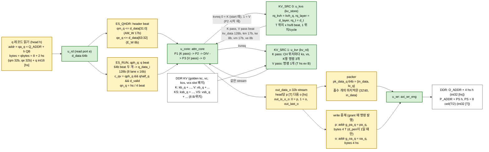
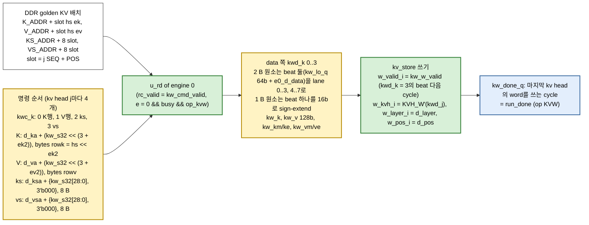
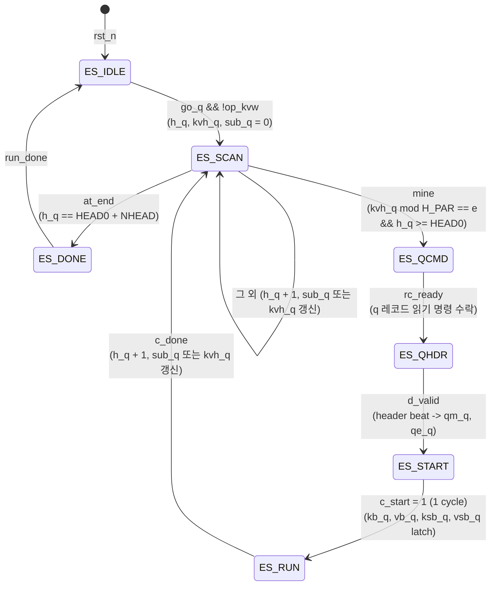

# L3 attn_top: attention IP

- 원본과 확인일: 확인일 2026-11-20(S4-6b 완료 뒤). `rtl/l3/attn_top.sv`, `rtl/l3/attn_csr.sv`, `rtl/l2/kv_store.sv`, `rtl/l2/kv_rd.sv`, `rtl/l0/umul_seq.sv`. 데이터 배치, 레지스터 맵, 실행 규칙, CYCLES 식의 원본은 `docs/spec/attn.md`(이 문서는 요약이고 충돌하면 `attn.md`와 RTL이 우선). `attn_core` 내부는 `l2_attn_core.md`, leaf는 `l0_l1_attn_leaf.md`, `umul_seq`는 `l0_umul_seq.md`.
- 상태: RTL 시뮬레이션 통과. S4-6b 재검증 후 `./sim/run.sh all` 368 run, fails 0 [측정, 수퍼바이저 재실행, `log.md` S4-6b]. mutation 42/42 검출과 lint 경고 0은 agent 보고(재실행 안 함). **보드는 미실행**이고 100 MHz 타이밍, LUT 수는 확인하지 않았다.
- 기본 parameter(RTL 기본값): `H_PAR` 2, `KV_SRC` 0, `KL` 8, `HS_MAX` 8, `TMAX` 512, `NKV` 4, `NL` 5, `KW` 12, `VW` 8, `CH` 16, `MAX_BURST` 16, `OUTS` 4, `RD_FIFO` 64(= `MAX_BURST` x `OUTS`), `WR_FIFO` 32, `OUT_DEPTH` 16, `ADDR_W` 12. 파생 폭: `HS_W` = clog2(`HS_MAX` + 1) = 4, `TW` = clog2(`TMAX` + 1) = 10, `KVH_W` = clog2(`NKV`) = 2. 15M 구성(`KV_SRC` 1)은 `HS_MAX`, `TMAX`가 다르며 폭은 같은 식으로 정해진다. `AM_W` 17, `E_W` 8은 `llm_pkg`. AXI master 주소 32비트, 데이터 64비트.
- **파형은 그리지 않았다.** 호출 timeline은 RTL의 레지스터 갱신 조건과 `attn.md` 4절에서 옮긴 cycle 정의 표이고, 순차 검사 단계는 RTL의 `umul_seq`/`udiv_seq` 시작 조건과 CYCLES 상수에서 도출했다. 시뮬레이션 trace에서 뽑은 것이 아니다.
- 이 모듈은 인스턴스, 배선, head 순서기, write 중재, KVW 경로, 종료 판정이다. 연산은 `attn_core`, descriptor 검사는 `attn_csr`, AXI 동작은 engine이 한다.

## 1. block diagram

```mermaid
flowchart LR
    ps["PS7 M_AXI_GP0<br/>AXI4-Lite (ADDR_W 12, 32b)"]:::ext
    axil["u_axil: axil_slave<br/>wr_en, wr_addr, wr_data 32b<br/>rd_en, rd_addr, rd_data 32b"]:::mod
    csr["u_csr: attn_csr<br/>start_o (cycle v = s + CHK_CYC), op_kvw_o, busy_o, done_i<br/>latched d_*: q/o/p/k/v/ks/vs addr 32b, t 16b, hs 8b,<br/>kb, vb 5b, p_en, head0, nhead, kvmul, layer, kvh0, nkvh 8b, seq, pos 16b<br/>derived: seqhs_o SQH_W 20b, ths_o TH_W 14b, kw0_o KW0_W 19b<br/>(umul_seq / udiv_seq 검사 유닛 포함)"]:::mod

    subgraph eng["engine e (e < H_PAR, generate g_eng[e])"]
        seq["head sequencer<br/>es_q (7 state), h_q 8b, kvh_q 8b, sub_q 8b<br/>qa_q, pa_q, oa_q 32b (head 주소 누적기)<br/>kof_q, vof_q, sof_q 32b (kv head offset 누적기)<br/>kb_q, vb_q, ksb_q, vsb_q 32b (DDR KV base)"]:::cut
        rd["u_rd: axi_rd_eng<br/>AW 32, LEN_W 32, FIFO_DEPTH = RD_FIFO<br/>read port e: q record, DDR KV, (e = 0) KVW 행"]:::mod
        qa["q assembler<br/>qlo_q 64b, 두 64b beat -> q_data_i 128b = {d_data, qlo_q}<br/>header beat: qm_q AM_W 17b, qe_q E_W 8b"]:::cut
        core["u_core: attn_core<br/>start_i, t_i TW, hs_i HS_W, kb_i/vb_i 5b, qm_i, qe_i, p_en_i<br/>q_data_i 128b, kv_data_i 128b + km, ke, vm, ve<br/>out_data_o 32b, out_last_o, out_is_o_o"]:::mod
        kvr["u_kvr: kv_rd (KV_SRC 1)<br/>rq_* (pass, T, hs, ths, ek2, ev2, K/V/KS/VS base 32b)<br/>rc_* 읽기 명령, d_* 읽기 data 64b"]:::mod
    end

    kvs["u_kvs: kv_store (KV_SRC 0)<br/>NKV x ram_sdp (word 210b), 읽기 포트 e = engine e<br/>쓰기 포트: w_valid_i, w_kvh_i, w_layer_i, w_pos_i,<br/>w_k_i, w_v_i 128b, w_km/ke/vm/ve"]:::mod
    kvw["KVW 경로 (read port 0 -> kv_store)<br/>kwc_j/kwc_k (명령), kwd_j/kwd_k (data),<br/>kw_slot_q KW0_W 19b"]:::cut
    arb["write 중재<br/>g_act_q, g_sel_q HP_W, wc_n_q 2b, wc_p_q<br/>g_pa_q, g_oa_q 32b<br/>낮은 engine 번호 우선, head 하나(p 다음 o)를 통째로"]:::cut
    pk["packer<br/>half_q, lo_q 32b, pk_valid_q, pk_data_q 64b<br/>32b 두 개 -> 64b beat"]:::cut
    wr["u_wr: axi_wr_eng<br/>AW 32, LEN_W 32, FIFO_DEPTH = WR_FIFO<br/>write 명령 (addr 32b, bytes 32b)"]:::mod
    hr["m_axi ar/r [e]<br/>HP read 포트 H_PAR개"]:::ext
    hw["m_axi aw/w/b<br/>HP write 포트 1개"]:::ext
    done["종료 판정<br/>attn_done = &e_done && !g_act_q && wc_n_q == 0<br/>&& !pk_valid_q && !wr_busy<br/>run_done = busy && !go_q && (op_kvw ? kw_done_q : attn_done)"]:::logic

    ps --> axil
    axil -->|"wr_en, wr_addr, wr_data"| csr
    csr -->|"rd_data"| axil
    csr -->|"start -> go_q (v + 1), d_*"| seq
    csr -->|"d_t, d_hs, d_kb, d_vb, d_pen"| core
    csr -->|"seqhs, ths (KV_SRC 1)"| kvr
    csr -->|"kw0, d_seq, d_kvh0, d_nkvh (KVW)"| kvw
    seq -->|"rc_valid, rc_addr = qa_q, rc_bytes = qbytes"| rd
    rd <--> hr
    rd -->|"d_valid, d_data 64b"| qa
    qa -->|"q_valid_i, q_data_i 128b"| core
    seq -->|"c_start (ES_START)"| core
    core -->|"kvreq_valid_o, kvreq_pass_o"| kvs
    core -->|"kvreq_valid_o, kvreq_pass_o"| kvr
    kvs -->|"kv_valid, kv_data 128b, km, ke, vm, ve"| core
    kvr -->|"kv_valid, kv_data 128b, km, ke, vm, ve"| core
    kvr -->|"rc_* (K행, ks, vs, V행 명령)"| rd
    rd -->|"d_data 64b (KV_SRC 1)"| kvr
    kvw -->|"kw_cmd_* (e = 0)"| rd
    rd -->|"e0_d_data 64b"| kvw
    kvw -->|"w_valid 등"| kvs
    core -->|"out_valid, out_data 32b, out_last, out_is_o"| arb
    seq -->|"e_pa, e_oa"| arb
    arb --> pk
    pk -->|"in_valid_i, in_data_i 64b"| wr
    arb -->|"wcmd_valid, wcmd_addr, wcmd_bytes"| wr
    wr <--> hw
    wr -->|"wr_busy"| done
    kvw -->|"kw_done_q"| done
    seq -->|"e_done"| done
    done -->|"run_done -> done_i"| csr
    rd -.->|"rd_err_ev (RRESP[1]), rd_stall_ev (core kv_stall_o의 OR)"| csr
    wr -.->|"wr_err_ev (BRESP[1]), wr_stall_ev (axi_wr_eng stall_o)"| csr

    classDef ext fill:#ffffff,stroke:#333333,color:#000
    classDef mod fill:#d8f0d8,stroke:#2e7d32,stroke-width:2px,color:#000
    classDef logic fill:#e3eefc,stroke:#3b6aa0,stroke-width:2px,color:#000
    classDef cut fill:#fff3c4,stroke:#b58900,stroke-width:2px,color:#000
```

- 초록 = 하위 모듈 인스턴스, 파랑 = 조합 논리, 노랑 = 레지스터.
- KV source는 `KV_SRC` parameter로 하나만 생성된다. `KV_SRC` 0이면 `u_kvs`(`kv_store` 1개, engine e가 읽기 포트 e), 1이면 `u_kvr`(`kv_rd`가 engine마다 1개, `g_ddr`). `KV_SRC` 1 빌드에는 KVW가 없다(op KVW는 BAD_OP, `attn_csr`).
- 읽기 포트 e의 명령 선택 우선순위(RTL `always_comb`): q 레코드 명령(`es_q == ES_QCMD`) > KVW(engine 0, `busy && op_kvw`) > `kv_rd` 명령(`KV_SRC` 1). data 쪽도 같은 순서로 `d_ready`를 정한다.
- `H_PAR`는 1, 2, 4만 허용(`$error`). `KL`은 8, `HS_MAX`는 8의 배수, `KV_SRC` 0이면 `HS_MAX >= KL`도 elaboration에서 검사한다.
- 하위 모듈의 내부 인스턴스 이름(`attn_csr`의 `u_mq`, `u_mp` 등)은 2.3절과 `l0_umul_seq.md`.

## 2. data flow

### 2.1 op ATTN: q 레코드 -> KV pass -> core -> o, p

- core의 KV 요청은 K pass를 start 때, V pass를 P2 시작 때 낸다(`attn.md` 5절). K pass beat는 위치의 마지막 beat에서 `(km, ke, vm, ve)`를 싣고, V pass beat는 V lane만 싣는다(scale은 core의 vs buffer).
- 한 head의 op는 q 읽기 -> core 한 번이다. engine은 자기 head들을 순서대로 하나씩 돌린다(3.2절 FSM).
- write 쪽: `o_ready[e]`는 grant된 engine(`g_sel_q`)에만 `pk_ready`로 주어진다. `d_pen`(FMT.p_en) = 0이면 write 명령은 o 하나다(`wc_n_q` = 1, RTL `wc_n_q <= d_pen ? 2'd2 : 2'd1`). `wcmd_valid`는 grant 때 `wc_n_q` = 2(p, o) 또는 1로 시작해 handshake마다 줄어든다.

### 2.2 op KVW: DDR의 KV slot -> kv_store (`KV_SRC` 0만)

- KVW는 `hs` = `KL` = 8만 가정한다(행 = 8 << ek byte, 시뮬레이션 검사 `L3_KVWHS`).
- 명령 쪽(`kwc_*`)과 data 쪽(`kwd_*`)은 독립 카운터이고, 명령은 engine이 받는 대로 앞서 낸다(`kwc_act && e0_cmd_ready`).

### 2.3 주소 계산: runtime 곱셈 없는 증분 누적기 (S4-6b)

RTL의 `attn_top`에서 head, kv head, KVW slot 주소는 모두 base에 stride를 더해 간다. 곱은 `attn_csr`가 호출 전에 한 번 순차 계산한 값(`seqhs_o`, `ths_o`, `kw0_o`)과 descriptor의 shift뿐이다.

| 신호 (RTL 이름) | 초기값 | 갱신 | 쓰이는 곳 |
|---|---|---|---|
| `qa_q` (engine마다 32b) | `seq_go`(= `es_q == ES_IDLE && go_q && !op_kvw`)에서 `d_qa` | `h_adv`마다 `+ qbytes` (QB = 8 + 2 hs) | q 레코드 읽기 명령 `rc_addr` |
| `pa_q` | `d_pa` | `h_adv`마다 `+ pstride` (8 ceil(T/2)) | write 중재가 grant 때 `g_pa_q`로 latch, p 명령 주소 |
| `oa_q` | `d_oa` | `h_adv`마다 `+ ostride` (4 hs) | grant 때 `g_oa_q`로 latch, o 명령 주소 |
| `kof_q`, `vof_q` | 0 | `kvh_adv`(= `h_adv` 중 `sub_q == KVMUL - 1`)마다 `+ kstride`, `+ vstride` (`d_sqh << ek2`, `d_sqh << ev2`. `d_sqh` = SEQ x hs, `attn_csr`의 `seqhs_o`) | `ES_START`에서 `kb_q = d_ka + kof_q`, `vb_q = d_va + vof_q` |
| `sof_q` | 0 | `kvh_adv`마다 `+ sstride` (8 SEQ) | `ES_START`에서 `ksb_q = d_ksa + sof_q`, `vsb_q = d_vsa + sof_q` |
| `kw_slot_q` (KVW, `KW0_W` 19b) | `go_q && op_kvw`에서 `d_kw0`(= KVH0 SEQ + POS, `attn_csr`의 `kw0_o`) | kv head의 4번째 명령(`kwc_k == 3`) handshake마다 `+ d_seq` | KVW 명령 주소 `slot << (3 + ek)` |

- `h_adv`: `(es_q == ES_SCAN && !at_end && !mine) || (es_q == ES_RUN && c_done)`. HEAD0 앞의 head와 다른 engine의 head는 SCAN에서 cycle마다 하나씩 건너뛰며(주소 누적기도 같이 증가), 자기 head는 core가 `c_done`을 낼 때 넘어간다.
- 곱 경계: `attn_csr`가 검사 중에 구한 `SEQ x hs`(KV_SRC 1), `T x hs`(KV_SRC 1, `kv_rd`의 V 길이와 마지막 K chunk 길이), `KVH0 x SEQ + POS`(KV_SRC 0). 남은 곱은 상수 곱(`KVMUL x NKV`, `kv_rd`의 `hs x CH`, `kv_store`의 `layer x SEQ`)뿐이다(`attn.md` 8절).
- `kv_rd`의 K 행 주소: chunk(CH 위치)마다 `koff_q += CH hs ek`(`kv_rd.sv`의 주석과 `koff_q`), ks/vs 주소는 `8 t0`(shift).

## 3. control flow

### 3.1 호출 timeline (CTRL 수락 s, 검사, 판정 v, 실행, 완료 e)

CTRL 쓰기가 `axil_slave`에서 수행되는 cycle을 s라 한다. 표는 `attn_csr`, `attn_top`의 레지스터 갱신 조건과 `attn.md` 4.1에서 옮긴 것이며 파형이 아니다.

| cycle | 일어나는 일 | 근거 |
|---|---|---|
| s | `acc` = start && idle && op 정상. descriptor가 latch됨(`q_addr_o` 등, 유효는 s + 1부터), `umul_seq`/`udiv_seq` 검사 유닛이 시작(`start_i(acc)`), `chk_q` <= 1, `ccnt_q` <= CHK_CYC. done_sticky clear, CYCLES/RD_STALL/WR_STALL clear(s + 1부터 0). op가 1, 2가 아니거나 op 2인데 `KV_SRC` 1이면 BAD_OP만(s에 set) | `attn_csr.sv` `acc` |
| s + 1 .. v - 1 | 검사 구간(CHK_CYC cycle). STATUS.busy = 1(s + 1부터). 이 구간의 CTRL start는 START_BUSY. 유닛의 곱이 차례로 끝남(3.3절) | `chk_q`, `idle` |
| v = s + CHK_CYC | `verdict` = `chk_q && ccnt_q == 1`. 정상이면 `start_o` = 1(cycle v), 오류면 start 없이 BAD_DESC 그리고/또는 MISALIGN set(v + 1부터 보임), STATUS.busy = 0(v + 1부터), done 없음, OPS 불변, CYCLES = CHK_CYC. v의 CTRL start도 busy라 START_BUSY(무시) | `err_set[E_BAD_DESC]`, `err_set[E_MISALIGN]` |
| v + 1 | `go_q` = 1(`attn_top`이 `start`를 1 cycle 지연), `busy_q` = 1. ATTN이면 `seq_go`로 주소 누적기 초기화, 각 engine의 `es_q`가 다음 cycle에 `ES_SCAN`. KVW이면 `kwc_act`, `kwd_act`, `kw_slot_q` 초기화 | `go_q`, `seq_go` |
| v + 1 .. e | op 실행. 순서기 FSM(3.2절), KVW의 명령/data 카운터 | `attn_top.sv` |
| e | `run_done` = `busy && !go_q && (op_kvw ? kw_done_q : attn_done)`. ATTN은 모든 engine `ES_DONE`, grant 없음, write 명령 없음, packer 비어 있음, `axi_wr_eng`가 마지막 B를 받은 첫 cycle. KVW는 마지막 kv head의 word를 `kv_store`에 쓰는 cycle. `done_sticky`, `ops_q` + 1은 e + 1부터 보임, `busy_q` 해제도 e + 1 | `attn_done`, `done_i` |

- `CYCLES` = e - s(검사 CHK_CYC 포함). `chk_q || busy_q`인 cycle을 세므로 거절된 호출은 CYCLES = CHK_CYC. op 자체(v + 1 .. e)의 cycle은 S4-6과 같다(`attn.md` 6.2).
- 오류 호출 뒤의 판단: BAD_DESC/MISALIGN은 v + 1부터 보이므로 CTRL 직후의 ERR 읽기로 판단하지 않고 STATUS.busy = 0을 기다린 뒤 done_sticky와 ERR를 본다(`attn.md` 4.4).
- CHK_CYC(RTL `localparam`): `KV_SRC` 1은 18(= `udiv_seq` 9 + `umul_seq` 9), `KV_SRC` 0은 max(`C_HEND` 10, `QB_W` + 1, `C_KVW`). 기본 BRAM 빌드(`KL` 8, `NKV` 4)에서 10.

### 3.2 head 순서기 FSM (engine마다, `es_t`)

- `at_end` = `9'(h_q) == 9'(HEAD0) + 9'(NHEAD)`. `mine`은 조합 신호(`attn_top.sv`)다.
- ES_RUN 중에 q beat(`qph_q`)가 core로 가고 core가 `kvreq`로 KV pass를 요청한다. 순서기 FSM은 core의 `c_done`만 기다린다.
- 위 `es_t` 7개 state 이름은 RTL `typedef enum`의 이름이다. `ES_QCMD`에서 `kv_rd`의 읽기 명령(`KV_SRC` 1)은 `rc_ready_i(rc_ready && es_q != ES_QCMD)`로 q 명령과 겹치지 않게 막힌다.

### 3.3 head와 engine 배정 규칙

- head h의 kv head는 `h / KVMUL`이고, RTL은 나눗셈 없이 `sub_q`(0 .. KVMUL - 1)와 `kvh_q`로 센다: head가 넘어갈 때마다 `sub_q`가 증가하고 `KVMUL - 1`에서 0으로 돌아가며 `kvh_q`가 1 증가한다.
- engine e는 `kvh_q mod H_PAR == e`이고 `h_q >= HEAD0`인 head를 h가 증가하는 순서로 맡는다(`mine`). `kv_store`의 읽기 포트 e는 `kv head j mod H_PAR == e`만 읽는다(`attn.md` 5절).
- 규칙 적용 예(`H_PAR` 2, `KVMUL` 2, `HEAD0` 0, `NHEAD` 8. 260K 구성으로 추정하나 이 값들이 260K의 실제 head 수와 같은지는 이 문서에서 확인하지 않았다):

| head h | 0 | 1 | 2 | 3 | 4 | 5 | 6 | 7 |
|---|---|---|---|---|---|---|---|---|
| kv head (`h / 2`) | 0 | 0 | 1 | 1 | 2 | 2 | 3 | 3 |
| engine (`kv head mod 2`) | 0 | 0 | 1 | 1 | 0 | 0 | 1 | 1 |

- write 중재: 출력 stream이 있는 engine(`o_valid[e]`) 중 번호가 낮은 쪽에 head 하나(p 다음 o)를 통째로 준다. grant 중(`g_act_q`)에는 다른 engine의 출력이 `pk_ready`를 못 받으므로 자기 출력 FIFO(`OUT_DEPTH`)의 credit이 찰 때까지 P3를 계속한다(`attn.md` 5절).

### 3.4 `attn_csr`의 순차 검사 단계 (RTL에서 확인되는 만큼)

모든 곱은 `umul_seq`(multiplier 1비트/cycle, 시작 cycle c에서 done은 c + B_W + 1, `l0_umul_seq.md`), 나눗셈은 `udiv_seq`(몫 1비트/cycle, CYCLES = Q_W + 1)다. 곱 유닛은 s(= `acc`)에 `a`, `b`를 레지스터 값으로 받아 시작한다(`hend_r`, `t_r`, `seq_r` 등). 두 번째 단계 유닛은 첫 단계의 `done_o` cycle에 시작한다.

`KV_SRC` 0 (BRAM 빌드, 기본 parameter에서 `QB_W` = `HSK_W` = 4, `KV_W` = 2, `CT_W` = 9):

| 유닛 (RTL 이름) | 계산 | 시작 | multiplier 폭 B_W | done |
|---|---|---|---|---|
| `u_mq` | `hend` x `hs` (q, o 범위) | s | 4 | s + 5 |
| `u_mp` | `ceil(T/2)` x `hend` (p 범위) | s | 9 | s + 10 |
| `u_mw` | `SEQ` x (`KVH0 + NKVH - 1`) (KVW 마지막 slot) | s | 2 | s + 3 |
| `u_m0` | `SEQ` x `KVH0` (`kw0_o`) | s | 2 | s + 3 |
| `u_mr` | `wslot` x `hs` (KVW 행 범위, `wslot` = `u_mw` 결과 + `pos_o` + 1) | `u_mw`의 done(s + 3) | 4 | s + 8 |

- 판정 v = s + 10은 가장 긴 `u_mp`가 정한다. ATTN의 `kvmul x NKV`는 상수 곱(조합, `nkkm`)이라 순차 유닛이 아니다. 판정 cycle에 모든 유닛이 끝나 있어야 하며, 시뮬레이션 전용 검사 `L3_CHK`가 이를 확인한다.
- 판정은 latch한 descriptor와 유닛 출력(`p_q`, `p_p`, `p_r` 등)을 받아 같은 cycle v에 낸다. ATTN이면 `a_base_ok && a_kv_ok`, KVW이면 `w_ok`.

`KV_SRC` 1 (DDR 빌드):

| 유닛 | 계산 | 시작 | B_W | done |
|---|---|---|---|---|
| `u_div` (`udiv_seq` 8/8/8) | `kvmax = (HEAD0 + NHEAD - 1) / KVMUL` | s | (Q_W 8) | s + 9 |
| `u_mq`, `u_mp` | `KV_SRC` 0과 같은 식 | s | `HS_W`, 9 | 각각 s + `HS_W` + 1, s + 10 |
| `u_msh` | `SEQ` x `hs` (`seqhs_o`) | s | `HS_W` | s + `HS_W` + 1 |
| `u_mth` | `T` x `hs` (`ths_o`) | s | `HS_W` | s + `HS_W` + 1 |
| `u_mks` | `SEQ` x `kvmax` (마지막 kv head의 slot) | `u_div`의 done(s + 9) | 8 | s + 18 |
| `u_mkh` | `SEQ hs` x `kvmax` | `u_div`의 done(s + 9) | 8 | s + 18 |

- 판정 v = s + 18 = `udiv_seq` 9 + `umul_seq` 9(`C_DDR`). `u_mks`, `u_mkh`의 done이 v와 같은 cycle이고 그 cycle에 `p_ks`, `p_kh`가 유효하다.
- 각 유닛의 시작 조건과 폭은 `attn_csr.sv`의 인스턴스 선언에서 읽었다. 위 done cycle은 `umul_seq`의 규칙(c + B_W + 1)과 `udiv_seq` CYCLES(Q_W + 1)에서 계산한 값이고, 시뮬레이션 trace로 개별 유닛의 done을 다시 확인한 것은 아니다(전체 CHK_CYC는 `attn_csr` 단독 TB가 매 cycle 참조 모델로 확인했다고 `attn.md` 7.1에 적혀 있다).

## 4. 레지스터 요약 (32비트, byte offset)

전체 표와 비트 정의, CTRL 쓰기 조건표, PS 호출 순서는 `docs/spec/attn.md` 3, 4절. 아래는 RTL `attn_csr.sv` 헤더 주석과 대조한 요약이다.

| offset | 이름 | 접근 | 내용 |
|---|---|---|---|
| 0x00 | ID | R | 0x41540001 ("AT", 버전 1) |
| 0x04 | CONFIG | R | [7:0] `FCLK_MHZ`, [10:8] `H_PAR`, [11] `KV_SRC`, [15:12] log2(`KL`) = 3, [31:16] `TMAX` |
| 0x08 | CTRL | W | bit0 start, [7:4] op(1 = ATTN, 2 = KVW). 0x11 = ATTN, 0x21 = KVW. 읽으면 0 |
| 0x0C | STATUS | R | bit0 busy(검사 중 또는 op 중), bit1 done_sticky, bit2 err_any |
| 0x10 | ERR | R/W1C | bit0 START_BUSY, 1 BAD_OP, 2 BAD_DESC, 3 MISALIGN, 4 RD_RESP, 5 WR_RESP |
| 0x14 | CYCLES | R | 마지막으로 수락된 호출의 cycle 수(e - s, 검사 포함. 거절되면 CHK_CYC) |
| 0x18, 0x1C | RD_STALL, WR_STALL | R | 같은 구간의 stall cycle |
| 0x20 | OPS | R | 끝난 op 수(ATTN + KVW) |
| 0x24, 0x28 | CONFIG2, CONFIG3 | R | `HS_MAX`, `NKV`, `NL` / `KW`, `VW`, `TMAX` (`KV_SRC` 1이면 상위 필드 0) |
| 0x40 .. 0x58 | Q_ADDR, O_ADDR, P_ADDR, K_ADDR, V_ADDR, KS_ADDR, VS_ADDR | RW | 데이터 배치(`attn.md` 2절) |
| 0x5C .. 0x78 | T, HS, FMT, HEAD, LAYER, SEQ, POS, KVH | RW | descriptor 필드 |

## 5. CYCLES (시뮬레이션 모델 측정, 보드 값 아님)

조건: Questa, `axi_mem_slave` 모델, stall 없음, read와 B latency 1. ATTN op의 CYCLES를 layer마다 한 op(head 전부)로 돌려 token(위치) 하나의 layer 합을 낸 값(`attn_top.cfg`의 `*_tok` run). 검사 구간 CHK_CYC(BRAM 빌드 10, DDR 빌드 18)가 op마다 들어 있다. `p_en` = 0(표시한 행 제외). 출처 `docs/spec/attn.md` 6.2의 S4-6b 재측정 값이고, 괄호는 S4-6 값이다. 수치는 agent 보고이며 이 문서에서 재실행하지 않았다(수퍼바이저가 `sim/run.sh all` 368 run, fails 0을 재실행으로 확인한 것은 통과 여부이고 이 cycle 값은 아니다).

| 구성 | T = 1 | 8 | 64 | 128 | 256 | 512 | arch.md 4.4 [계산] |
|---|---|---|---|---|---|---|---|
| 260K, KV BRAM, H_PAR 2 | 1,810 (1,760) | 2,230 (2,180) | 5,590 (5,540) | 9,430 (9,380) | 17,110 (17,060) | **32,470** (32,420) | T 512에서 32,320 |
| 260K, KV BRAM, H_PAR 1 | 3,415 (3,365) | 4,255 (4,205) | 10,975 (10,925) | 18,655 (18,605) | 34,015 (33,965) | 64,735 (64,685) | - |
| 260K, KV BRAM, H_PAR 2, `p_en` = 1 | 1,795 (1,745) | 2,250 (2,198) | 5,927 (5,874) | 10,090 (10,032) | 18,410 (18,360) | 35,034 (34,983) | - |
| 15M, KV DDR, H_PAR 1 | 5,622 (5,514) | - | - | 101,634 (101,526) | 198,403 (198,294) | - | T 256에서 196,416 |
| 15M, KV DDR, H_PAR 2 | 3,210 (3,102) | - | - | 51,216 (51,108) | 99,601 (99,496) | - | - |

- KVW(kv head 4개를 쓰는 op 하나): 48 cycle(S4-6 38, 검사 10 포함, 2,560 op 모두). 260K token당 layer 5개 = 240 cycle(S4-6 190). 합 97,280 -> 122,880.
- S4-6b 차이: 260K `p_en` = 0은 모든 T에서 정확히 +50(layer 5개 x CHK_CYC 10). 15M은 +108(layer 6개 x 18), T 256에서 +109, 그 외 `p_en` = 1은 +50..+58. `p_en` = 1과 15M의 정확히 일치하지 않는 부분은 op 내부의 변화가 아니라 TB의 무작위 o/p 주소가 바뀌어(AXI-Lite BFM 난수열이 polling 횟수에 따라 밀림) write burst의 4 KiB/16 beat 분할이 달라진 것이라고 agent가 판단했다(KV BRAM, `p_en` = 0에서는 주소가 cycle에 영향이 없어 정확히 +50). 호출 단위로 확인한 것은 아니다.
- 포함하지 않은 것: 보드의 DDR와 HP latency, ARM 쪽 비용(AXI-Lite 쓰기, cache flush와 invalidate, polling), 100 MHz 타이밍.
- core 한 head의 식(`attn.md` 6.1): `C = (T + 1) ceil(hs/8) + T + T ceil(hs/8) + hs + C0`, `C0` = 54 + DOT_PIPE + SH_PIPE + RS_PIPE + LUT_PIPE (기본 60). `l2_attn_core.md`의 표는 S4-6 값이다.

## 6. 확인하지 못한 것과 RTL/문서의 차이
- 보드 실측(HP 포트 latency, 대역폭, ARM 호출 비용), 100 MHz 타이밍, LUT 수, 210비트 word의 BRAM 추론.
- 15M에서 `kv_rd`의 chunk 명령 왕복이 DDR latency에 따라 얼마나 늘어나는지(latency 1 모델 값만 있음, `attn.md` 9절).
- 개별 검사 유닛의 done cycle은 RTL 구조에서 계산했고 trace로 대조하지 않았다(3.4절).
- RTL 헤더 주석과 코드의 불일치(문서 쪽 판단): `attn_csr.sv` 헤더 주석의 CONFIG3 설명은 "[31:16] SEQ_B (BRAM positions)"인데, 코드(`CONFIG3_VAL`)와 `attn.md` 3절은 [31:16] = `TMAX`다. 이 문서는 코드를 따랐다.
