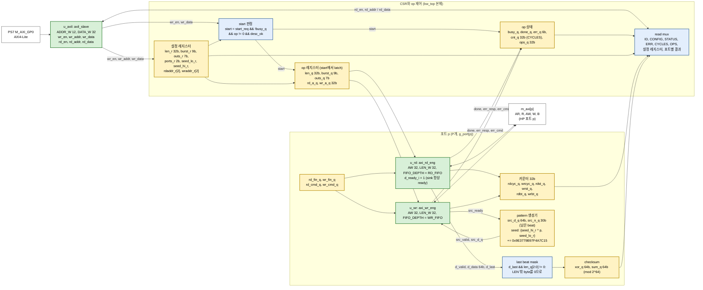
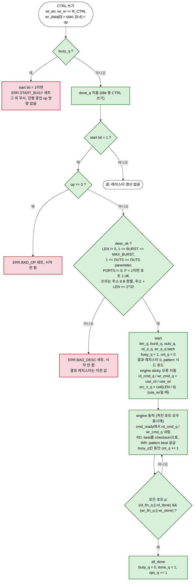

# L3 bw_top: HP 대역폭 측정 top

- 원본과 확인일: 확인일 2026-11-19. `rtl/l3/bw_top.sv`, `rtl/l1/axil_slave.sv`, `rtl/l1/axi_rd_eng.sv`, `rtl/l1/axi_wr_eng.sv`. 레지스터 맵과 시간 정의의 원본은 `docs/spec/bwtest.md`(이 문서는 요약이고 충돌하면 bwtest.md와 RTL이 우선).
- 상태: RTL 시뮬레이션 통과(`log.md` S4-3: `bw_top` 10 run 포함 `./sim/run.sh all` 164 run, fails 0 [측정, 수퍼바이저 재실행]). **보드는 미실행**이라 대역폭과 timing 값은 없다.
- 폭 표기: 기본 parameter(`P` 1, `MAX_BURST` 16, `OUTS` 4, `RD_FIFO` 64, `WR_FIFO` 32, `ADDR_W` 12). AXI master 주소는 32비트, 데이터는 64비트.
- 파형은 그리지 않았다.
- 이 모듈은 L3 control(CSR, op 순서, 카운터, checksum, pattern)이고 AXI 동작은 engine이 한다.

## 1. block diagram

- 초록 = 하위 모듈 인스턴스, 파랑 = 조합 논리, 노랑 = 레지스터.
- 두 engine의 `err_clr_i`는 `start`에 묶여 있다(op 시작 때 engine의 sticky 오류를 지움).
- `u_rd`의 `cfg_burst_i`/`cfg_outs_i`는 `burst_q`/`outs_q`, 명령은 `rd_cmd_q`, `rd_a_q`, `len_q`.
- `u_wr`의 데이터 입력은 pattern 생성기(`src_valid` = `src_n_q != 0`).
- AXI master 신호는 `[P-1:0]` packed 배열이고 포트 index가 맨 앞이다(`m_axi_*_o[p]`).
- `RD_STALL`(0x18)과 `WR_STALL`(0x1C)은 포트 0의 `rdst_q`, `wrst_q`와 같다.

## 2. op 흐름

CTRL 레지스터(0x08) 쓰기 하나가 op 하나를 시작한다. 아래는 RTL의 조건식(`start`, `desc_ok`, `all_done`, `err_set`)을 옮긴 것이다. 이 모듈에는 별도의 FSM state 레지스터가 없고 `busy_q`, `rd_fin_q`, `wr_fin_q`로 순서를 만든다.

op 종류(CTRL[5:4]): 1 = RD, 2 = WR, 3 = RW. `op_rd_w` = `op[0]`, `op_wr_w` = `op[1]`. 포트 p는 `ports_r[p]`가 켜져 있을 때만 참여한다(`use_rd`, `use_wr`).

시간 정의(`bwtest.md` 4절과 RTL 코드가 같은 것을 확인):
- `CYCLES`(`cnt_q`) = busy인 cycle 수. `RD_CYCp` = `rd_done`이 `!rd_fin_q`인 cycle의 `cnt_q + 1`, `WR_CYCp`도 같은 식(`wr_done`).
- `RD_STALLp` = `rd_stall`(`axi_rd_eng`의 `stall_o`) cycle 수, `WR_STALLp` = `wr_stall`.
- `RD_BEATSp` = R handshake 수, `WR_BEATSp` = W handshake 수.

## 3. 레지스터 요약 (32비트, byte offset)

전체 표와 비트 정의는 `docs/spec/bwtest.md` 3절. 아래는 RTL의 `localparam` 이름과 읽기 mux(`rd_data`)로 교차 확인한 요약이다. 정의되지 않은 주소(0x100 이상 포함)는 0을 읽고 쓰기는 무시, WSTRB는 무시, 응답은 항상 OKAY.

| offset | 이름 | 접근 | 내용 |
|---|---|---|---|
| 0x00 | ID | R | 0x42570001 ("BW", 버전 1) |
| 0x04 | CONFIG | R | [7:0] `FCLK_MHZ`, [11:8] `P`, [19:12] `OUTS`, [28:20] `MAX_BURST` |
| 0x08 | CTRL | W | bit0 start, [5:4] op. 읽으면 0 |
| 0x0C | STATUS | R | bit0 busy, bit1 done_sticky, bit2 err_any(ERR != 0) |
| 0x10 | ERR | R/W1C | bit0 START_BUSY, 1 BAD_OP, 2 BAD_DESC, 3 RD_RESP, 4 WR_RESP, 5 ENG_CMD (6비트). 같은 cycle의 새 오류가 clear보다 우선 |
| 0x14 | CYCLES | R | 마지막 op의 cycle 수 |
| 0x18, 0x1C | RD_STALL, WR_STALL | R | 포트 0의 값 |
| 0x20 | OPS | R | 끝난 op 수 |
| 0x40 | LEN | RW | 포트당 byte 수 |
| 0x44 | BURST | RW | [8:0], reset = `MAX_BURST` |
| 0x48 | OUTS | RW | [6:0], reset = `OUTS` |
| 0x4C | PORTS | RW | [1:0] 포트 enable mask, reset 1 |
| 0x50, 0x54 | SEED_LO, SEED_HI | RW | pattern seed |
| 0x60, 0x64 | RD_ADDR0, RD_ADDR1 | RW | read 시작 주소 |
| 0x68, 0x6C | WR_ADDR0, WR_ADDR1 | RW | write 시작 주소 |
| 0x80 + 0x20p | XOR_LO, XOR_HI, SUM_LO, SUM_HI, RD_CYC, WR_CYC, RD_STALL, WR_STALL | R | 포트 p 결과(+0x00 .. +0x1C) |
| 0xC0 + 8p, 0xC4 + 8p | RD_BEATS, WR_BEATS | R | 포트 p의 R handshake 수, W handshake 수 |

- 설정 레지스터는 op 중에도 쓸 수 있지만 진행 중인 op에는 영향이 없다(`len_q` 등이 start에서 latch).
- 시스템 연결(`bwtest.md` 1절): PS7 `M_AXI_GP0` -> interconnect -> `bw_top` CSR(0x43C00000), `m_axi[0]` -> `S_AXI_HP0`, `m_axi[1]` -> `S_AXI_HP2`(P = 2), `FCLK_CLK0` 단일 클럭(기본 100 MHz). 이 연결은 `fpga/bw/`의 Vivado Tcl로 만들어지며 이 서버에서 확인하지 않았다(`log.md` S4-3 UNVERIFIED).
