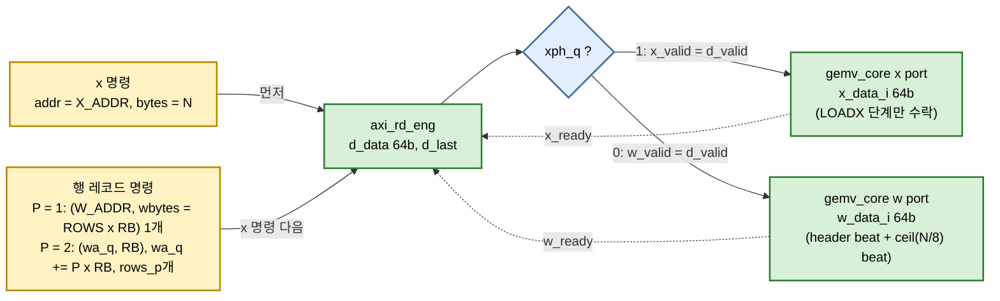
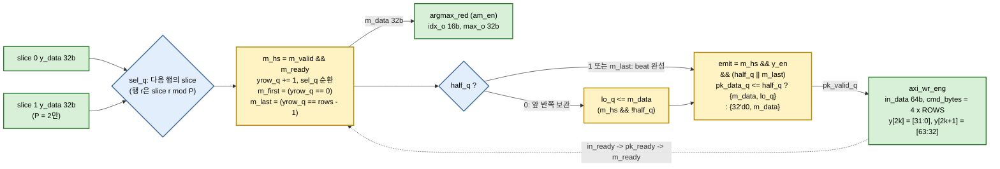
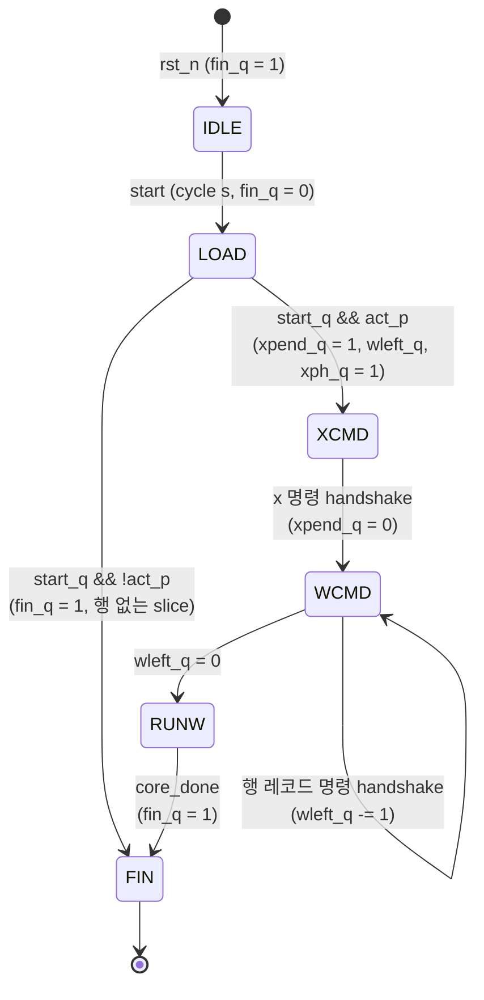
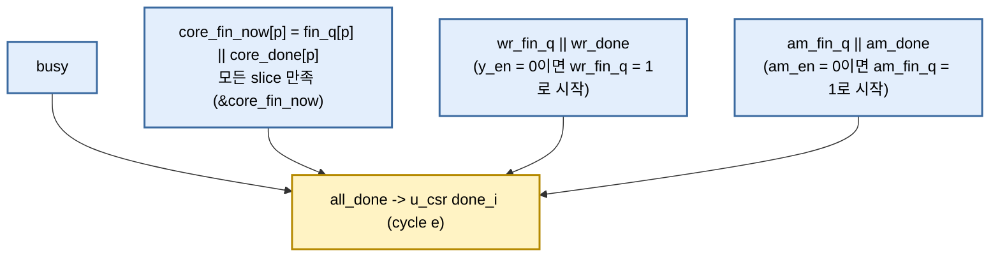

# L3 gemv_acc_top: GEMV 가속기형 IP

- 원본과 확인일: 확인일 2026-11-19. `rtl/l3/gemv_acc_top.sv`, `rtl/l3/gemv_acc_csr.sv`, `rtl/l0/argmax_red.sv`. 레지스터 맵, 호출 규칙, CYCLES 식의 원본은 `docs/spec/gemv_acc.md`(이 문서는 요약이고 충돌하면 gemv_acc.md와 RTL이 우선), 계층 관점의 고정 사항은 `docs/spec/hierarchy.md` 3.7.
- 상태: RTL 시뮬레이션 통과(`log.md` S4-4: `./sim/run.sh all` 201 run, fails 0 [측정, 수퍼바이저 재실행]). **보드는 미실행**이고 100 MHz 타이밍, LUT 수는 확인하지 않았다.
- 폭 표기: 기본 parameter(`P` 1 또는 2, `MAX_BURST` 16, `OUTS` 4, `RD_FIFO` 64, `WR_FIFO` 32, `NMAX` 1024, `ROWS_W` 16, `IDX_W` 16, `ADDR_W` 12, `DOT_PIPE` 2, `SCALE_PIPE` 3, `Y_DEPTH` 16). AXI master 주소 32비트, 데이터 64비트.
- 파형은 그리지 않았다(호출 timeline은 RTL 헤더 주석과 코드의 cycle 정의를 옮긴 표).
- 이 모듈은 인스턴스, 배선, 호출 control(명령 순서기, router, merge, packer, 종료 판정)이다. 연산은 `gemv_core`, AXI 동작은 engine이 한다.

## 1. block diagram

```mermaid
flowchart LR
    ps["PS7 M_AXI_GP0<br/>AXI4-Lite (ADDR_W 12, 32b)"]:::ext
    axil["u_axil: axil_slave<br/>wr_en, wr_addr, wr_data<br/>rd_en, rd_addr, rd_data"]:::mod
    csr["u_csr: gemv_acc_csr<br/>start_o (cycle s), busy_o, done_i<br/>latched op_*: w_addr, x_addr, y_addr 32b,<br/>rows ROWS_W 16b, n NW 11b, xm AM_W 17b,<br/>we, xe, fo E_W 8b signed, am_en, y_en, wbytes WB_W"]:::mod

    subgraph sl["slice p (p < P, generate g_slice[p])"]
        seq["명령 순서기<br/>xpend_q, wleft_q ROWS_W, wa_q 32b,<br/>xph_q, fin_q"]:::cut
        rd["u_rd: axi_rd_eng<br/>AW 32, LEN_W 32, IDW, FIFO_DEPTH = RD_FIFO<br/>cfg_burst_i, cfg_outs_i = 0 (기본 한도)"]:::mod
        rt["router<br/>x_valid = d_valid && xph_q<br/>w_valid = d_valid && !xph_q"]:::logic
        core["u_core: gemv_core<br/>LANES 8, NMAX, ROWS_W<br/>start_i = start_q && act_p<br/>x port / w port 64b, y stream 32b"]:::mod
    end

    hp_r["m_axi_ar/r[p]<br/>HP 포트 p (read 전용)"]:::ext

    mg["y merge<br/>sel_q SW, yrow_q ROWS_W<br/>m_valid, m_data 32b, m_first, m_last"]:::cut
    am["u_am: argmax_red<br/>IDX_W 16<br/>valid_i = m_hs && am_en"]:::mod
    pk["packer<br/>half_q, lo_q 32b,<br/>pk_valid_q, pk_data_q 64b"]:::cut
    wr["u_wr: axi_wr_eng<br/>AW 32, LEN_W 32, FIFO_DEPTH = WR_FIFO<br/>cmd_bytes = {rows, 2'b00}"]:::mod
    hp_w["m_axi_aw/w/b<br/>포트 0 (y 쓰기 전용)"]:::ext
    done["종료 판정<br/>all_done = busy && (&core_fin_now)<br/>&& (wr_fin_q || wr_done)<br/>&& (am_fin_q || am_done)"]:::logic

    ps --> axil
    axil -->|"wr_en, wr_addr, wr_data"| csr
    csr -->|"rd_data"| axil
    csr -->|"start, op_* (s + 1부터)"| seq
    csr -->|"op_* , start_q"| core
    seq -->|"cmd_valid, cmd_addr 32b, cmd_bytes 32b"| rd
    rd <--> hp_r
    rd -->|"d_valid, d_data 64b, d_last"| rt
    rt -->|"x_valid / w_valid, d_data"| core
    core -->|"y_valid, y_data 32b"| mg
    mg -->|"m_data 32b"| am
    mg -->|"m_data 32b"| pk
    pk -->|"in_valid, in_data 64b"| wr
    wr <--> hp_w
    am -->|"am_done, am_idx 16b, am_max 32b signed"| csr
    core -->|"core_done"| done
    wr -->|"wr_done"| done
    am -->|"am_done"| done
    done -->|"all_done -> done_i"| csr
    rd -.->|"rd_err_ev (RRESP[1]), rd_stall_ev"| csr
    wr -.->|"wr_err_ev (BRESP[1]), wr_stall_ev"| csr

    classDef ext fill:#ffffff,stroke:#333333,color:#000
    classDef mod fill:#d8f0d8,stroke:#2e7d32,stroke-width:2px,color:#000
    classDef logic fill:#e3eefc,stroke:#3b6aa0,stroke-width:2px,color:#000
    classDef cut fill:#fff3c4,stroke:#b58900,stroke-width:2px,color:#000
```

- 초록 = 하위 모듈 인스턴스, 파랑 = 조합 논리, 노랑 = 레지스터.
- `P` parameter: 1 또는 2(그 밖은 elaboration `$error`). `IDX_W >= ROWS_W`도 elaboration에서 검사한다. 이 외의 parameter는 하위 인스턴스가 검사한다.
- slice는 `generate for (p < P)`로 `u_rd`, `u_core`, 순서기를 복제한다. AXI read master 포트는 `[P-1:0]` packed 배열(`m_axi_ar*_o[p]`)이고 write master는 하나(포트 0)다.
- `u_rd`, `u_wr`의 `err_clr_i`는 `start`에 묶여 있다. `cfg_burst_i`/`cfg_outs_i`는 0이라 engine의 `MAX_BURST`/`OUTS`가 그대로 한도다.
- 행 레코드 크기 `rb = 8 (1 + ceil(N/8))` byte는 top의 조합 논리로 계산한다(폭 `NBW + 3`, `NBW = clog2(NMAX/8 + 2)`).
- 이 문서에 확인하지 않은 구조는 그리지 않았다. `axil_slave`, `axi_rd_eng`, `axi_wr_eng`, `gemv_core` 내부는 각각 `l1_axi_eng.md`, `l2_gemv_core.md`를 본다.

## 2. data flow

### 2.1 read 쪽: x와 행 레코드가 core로 가는 경로

- `xph_q`: `start_q`에서 `act_p`로 set, `d_hs && d_last && xph_q`(x 명령의 마지막 beat 수락)에서 clear. `d_ready = xph_q ? x_ready : w_ready`. 즉 x 명령의 데이터가 끝난 뒤에 오는 모든 beat는 w port로 간다.
- P = 2의 행 분배: slice p는 `rows_p = (rows + (P - 1 - p)) >> 1`행을 맡는다(행 r, r mod 2 = p). `wa_q`의 초기값은 `w_addr + (p == 0 ? 0 : rb)`이고 명령마다 `P x rb`씩 증가한다. 행이 없는 slice(`rows_p = 0`, ROWS = 1의 slice 1)는 `act_p = 0`이라 core를 시작하지 않고 `fin_q`가 바로 1이다.
- P = 1은 `wleft_q`가 1이고 `cmd_bytes = wbytes`, P = 2는 `wleft_q = rows_p`이고 `cmd_bytes = rb`.

### 2.2 y 쪽: merge, packer, write

- `m_ready = !y_en || pk_ready`: `y_en = 0`이면 merge가 기다리지 않고 y를 버린다(argmax만).
- `pk_ready = !pk_valid_q || wr_in_ready`. packer는 beat 하나를 레지스터에 두고 engine이 받으면 비운다.
- `half_q`는 `m_hs && y_en`마다 `!half_q && !m_last`로 갱신된다(홀수 ROWS의 마지막 행이면 `m_last`로 emit하고 half_q는 0으로 남는다). 이때 beat는 `{32'd0, m_data}`이고 write 명령 길이가 `4 ROWS` byte라 `axi_wr_eng`가 그 beat의 WSTRB를 0x0F로 낸다(`hierarchy.md` 3.6).
- `argmax_red`는 `valid_i = m_hs && am_en`으로 merge된 y 스트림(행 순서)을 받는다. `ARGMAX_IDX`/`ARGMAX_VAL`은 `am_done`에서 CSR이 받는다.

## 3. control flow

### 3.1 호출 timeline (RTL 헤더 주석과 코드의 cycle 정의)

CTRL 쓰기가 수행되는 cycle을 s라 한다. 표는 RTL의 레지스터 갱신 조건에서 도출한 것이며 파형을 그린 것이 아니다.

| cycle | 일어나는 일 | 근거 |
|---|---|---|
| s | `u_csr`의 `start_o` = `start` = 1. descriptor가 `op_*`로 latch됨(유효는 s + 1부터). 순서기와 종료 flag가 초기화됨: `xpend_q`, `wleft_q`, `xph_q`, `wcmd_q` = 0, `fin_q`, `wr_fin_q`, `am_fin_q` = 0. engine의 `err_clr_i` = `start` | `gemv_acc_top.sv` `if (start)` 분기 |
| s + 1 (`start_q` = 1) | `op_*`가 유효. `gemv_core`에 `start_i = start_q && act_p`. 순서기 적재: `xpend_q <= act_p`, `wleft_q <= (P == 1) ? act_p : rows_p`, `xph_q <= act_p`, `fin_q <= !act_p`. 쓰기 쪽: `wcmd_q <= y_en`, `wr_fin_q <= !y_en`, `am_fin_q <= !am_en`. merge의 `sel_q`, `yrow_q`, packer의 `half_q` 초기화. `wa_q <= w_addr + (p == 0 ? 0 : rb)` | `start_q` 분기 |
| s + 2 이후 | read 명령 제시(`cmd_valid`): x 명령, 이어서 행 레코드 명령. `axi_rd_eng`가 AR을 낸다(명령 handshake c -> ARVALID c + 2). write 명령(`wcmd_q`)은 `y_addr`, `4 ROWS`로 제시 | RTL 헤더 "read and write commands are presented from s + 2" |
| 진행 | read stream -> router -> core, y -> merge -> (argmax, packer) -> `axi_wr_eng` | 2절 |
| e | `all_done` = 1. `busy`는 s + 1 .. e. `done_sticky`와 OPS 증가는 e + 1부터 보임 | `gemv_acc.md` 3절 |

CYCLES = e - s(`u_csr`가 busy cycle을 센다).

### 3.2 명령 순서기와 read stream 단계 (slice p)

- 이 그림은 레지스터 조합(`xpend_q`, `wleft_q`, `xph_q`, `fin_q`)을 단계 이름으로 묶은 것이다. RTL에 FSM state 레지스터는 없다.
- read stream 쪽 `xph_q`는 x 명령의 마지막 beat 수락에서 내려가며 명령 순서기의 진행과 독립이다. 두 흐름은 병행해서 진행한다(x 데이터가 core로 가는 동안 행 레코드 명령도 제시될 수 있다). 그림의 단계 이름(`XCMD`, `WCMD`, `RUNW`)은 설명용이고 RTL 신호 이름이 아니다.

### 3.3 완료 조건

- 네 조건의 AND(`busy && (&core_fin_now) && (wr_fin_q || wr_done) && (am_fin_q || am_done)`)가 처음 참인 cycle이 e.
- `gemv_core`의 `done_o`는 마지막 y 수락 다음 cycle의 1 cycle pulse(`hierarchy.md` 3.5), `wr_done`은 y 쓰기 명령의 마지막 B handshake, `am_done`은 마지막 y 다음 cycle의 pulse(latency 1).

## 4. 레지스터 요약 (32비트, byte offset)

전체 표와 비트 정의, 호출 규칙(CTRL 쓰기 조건표, PS 호출 순서)은 `docs/spec/gemv_acc.md` 2절과 3절. 아래는 RTL `gemv_acc_csr.sv` 헤더 주석과 대조한 요약이다.

| offset | 이름 | 접근 | 내용 |
|---|---|---|---|
| 0x00 | ID | R | 0x47410001 ("GA", 버전 1) |
| 0x04 | CONFIG | R | [7:0] `FCLK_MHZ`, [11:8] `P`, [15:12] log2(LANES) = 3, [31:16] `NMAX` |
| 0x08 | CTRL | W | bit0 start, [7:4] op(1 = GEMV). 읽으면 0 |
| 0x0C | STATUS | R | bit0 busy, bit1 done_sticky, bit2 err_any |
| 0x10 | ERR | R/W1C | bit0 START_BUSY, 1 BAD_OP, 2 BAD_DESC, 3 MISALIGN, 4 RD_RESP, 5 WR_RESP |
| 0x14 | CYCLES | R | 마지막 호출의 cycle 수 (= e - s) |
| 0x18, 0x1C | RD_STALL, WR_STALL | R | 마지막 호출의 stall cycle |
| 0x20 | OPS | R | 끝난 호출 수 |
| 0x40 .. 0x58 | W_ADDR, X_ADDR, Y_ADDR, ROWS, N, XM, EXP | RW | descriptor (ROWS와 N은 32비트 그대로 저장) |
| 0x5C | FLAGS | RW | bit0 `argmax_en`, bit1 `y_en`, reset 0x2 |
| 0x60, 0x64 | ARGMAX_IDX, ARGMAX_VAL | R | 마지막 argmax 호출의 index와 값 |

## 5. CYCLES 식과 시뮬레이션 측정값

기호: `nb = ceil(N/8)`, `R = 1 + nb`. 조건: 메모리 stall 없음, read latency 1, B latency 1, `MAX_BURST` 16, `OUTS` 4, 기본 PIPE. 식의 유도와 P = 2 일반식은 `gemv_acc.md` 5절.

- P = 1, `y_en = 0`: `CYCLES = nb + ROWS x (1 + nb) + 15 + Xd`, `Xd = max(0, mx + 1 - nb)`(`mx` = x 명령의 burst 수. nb = 1이면 항상 1).
- P = 1, `y_en = 1`: 막힘이 없으면 `CYCLES = nb + ROWS x (1 + nb) + 19 + Xd + L_last`(`L_last` = 마지막 y 쓰기 burst의 beat 수).
- 고정 항 15(또는 19 + L_last)가 `arch.md` 2.4의 `L_dram + L_pipe`에 해당한다.

측정값 [측정, 시뮬레이션 모델(Questa, `axi_mem_slave` stall 없음 latency 1), 보드 값 아님]:

| 호출 | P | CYCLES | 근거 |
|---|---|---|---|
| 15M 분류기 32000 x 288, `y_en` = 1, `argmax_en` = 1 | 1 | 1,184,061 ~ 1,184,064 | `gemv_acc.md` 5절 |
| 같은 호출, `y_en` = 0 | 1 | 1,184,051 | 같음 |
| 15M token 하나(43 호출 합, 6 위치) | 1 | 1,951,575 ~ 1,951,644 | 같음, `log.md` S4-4 |
| 260K token 하나(36 호출 합) | 1 | 37,596 | 같음 |
| 260K token 하나(36 호출 합) | 2 | 19,597 | 같음 |

- 비교 기준(`arch.md` 2.4의 계산값, 시뮬레이션 아님): 15M token 1,950,260, 260K P = 1 36,446, P = 2 18,402. 차이는 호출당 고정 항이다(15M 약 31 cycle/호출 등).
- 분류기 `y_en = 0`의 1,184,051은 위 닫힌 식 `36 + 32000 x 37 + 15`(Xd = 0)와 같다[계산으로 확인].
- RD_STALL: stall 없는 모델에서 호출당 5(x를 기다리는 시작 구간).
- 보드의 HP latency와 대역폭 효율은 `bwtest.md` 측정 전까지 모른다. 식은 기본 parameter와 stall 없는 모델에서만 확인했다(`gemv_acc.md` 7절).

## 6. 확인하지 못한 것
- 보드 실측(HP 포트 latency, 대역폭), 100 MHz 타이밍, LUT 수.
- 다른 `DOT_PIPE`/`SCALE_PIPE`에서의 CYCLES 식(검사하지 않음).
- P = 2의 15M 전체 레코드의 stall 없는 CYCLES(stall 프로파일 1에서만 실행).
