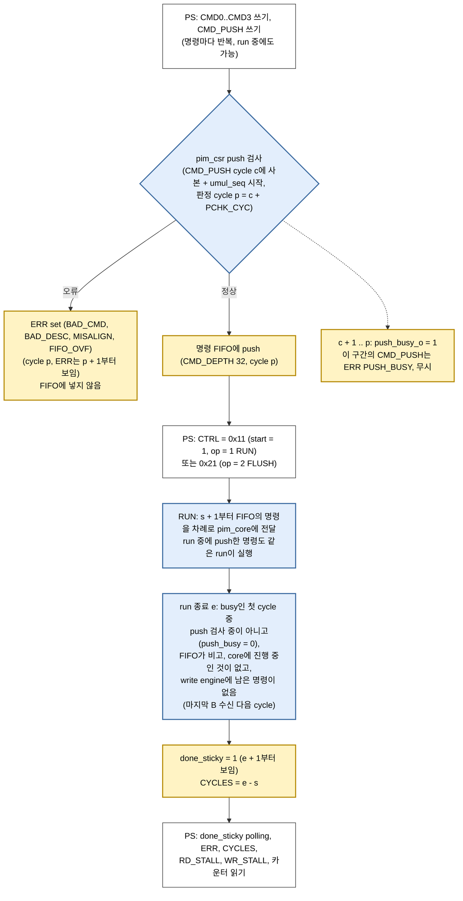

# L3 pim_top: GEMV PIM형 IP

- 원본과 확인일: 확인일 2026-11-19, S4-6b 반영 2026-11-20(push 검사, run 종료 조건, 재측정 CYCLES). `rtl/l3/pim_top.sv`, `rtl/l3/pim_csr.sv`, `rtl/l2/pim_core.sv`, `rtl/l1/pim_ctrl.sv`. 명령 형식, 레지스터 맵, 실행 규칙, cycle 식의 원본은 `docs/spec/pim.md`(이 문서는 요약이고 충돌하면 `pim.md`와 RTL이 우선). 내부 구조는 `l2_pim_core.md`.
- 상태: RTL 시뮬레이션 통과(`log.md` S4-5: `./sim/run.sh all` 262 run, fails 0 [측정, 수퍼바이저 재실행]). S4-6b에서 push 검사와 LDW 읽기 길이의 곱을 `umul_seq`로 바꾼 뒤 재통과(`./sim/run.sh all` 368 run, fails 0 [측정, 수퍼바이저 재실행]). **보드는 미실행**이고 100 MHz 타이밍, LUT 수는 확인하지 않았다.
- 기본 parameter: `NB` 4, `LB` 16, `DEPTH` 4096, `NMAX` 1024, `CMD_DEPTH` 32, `DOT_PIPE` 2, `SCALE_PIPE` 3, `Y_DEPTH` 32, `MAX_BURST` 16, `OUTS` 4, `RD_FIFO` 64, `WR_FIFO` 32, `ADDR_W` 12. AXI master 주소 32비트, 데이터 64비트.
- 파형은 그리지 않았다(실행 흐름은 RTL 헤더 주석과 코드의 조건을 옮긴 것).
- **S4-6b 변경(이 문서의 갱신 범위)**: (1) CMD_PUSH 검사가 순차 계산이 되어 판정이 push cycle c가 아니라 p = c + `PCHK_CYC`(`NMAX` 1024에서 9)에 난다. 검사 중 CMD_PUSH는 ERR bit8 PUSH_BUSY, STATUS bit3 push_busy. (2) 검사 중인 push가 있으면 run이 끝나지 않는다(`push_busy_o`가 `run_done`에 들어감). (3) `pim_ctrl`의 LDW 읽기 명령이 명령 handshake 뒤 `LDW_CYC`(= 9) cycle 늦다. MACAB, WRGB, `pim_core`, `pim_bank`는 바뀌지 않았다.
- 이 모듈은 인스턴스, 배선, 실행 제어(명령 FIFO 연결, packer, 종료 판정)다. 연산은 `pim_core`, AXI 동작은 engine이 한다.

## 1. block diagram

```mermaid
flowchart LR
    ps["PS7 M_AXI_GP0<br/>AXI4-Lite (ADDR_W 12, 32b)"]:::ext
    axil["u_axil: axil_slave<br/>wr_en, wr_addr, wr_data<br/>rd_en, rd_addr, rd_data"]:::mod
    csr["u_csr: pim_csr<br/>CMD0..CMD3 레지스터, push 검사 (u_bmul, u_lmul: umul_seq)<br/>push_o (cycle p), push_data_o 128b, push_busy_o (c + 1 .. p)<br/>start_o (cycle s), busy_o, run_flush_o, done_i<br/>ERR (bit8 PUSH_BUSY 포함), 카운터"]:::mod
    cf["u_cfifo: sync_fifo<br/>W 128, DEPTH CMD_DEPTH 32<br/>fifo_level (LV_W 6b)"]:::mod
    core["u_core: pim_core<br/>cmd_op 4b, cmd_n 11b, cmd_rows 16b,<br/>cmd_base 12b, cmd_addr 32b, cmd_xm 17b,<br/>we, xe, fo 8b<br/>d stream 64b, y stream 32b"]:::mod
    rd["u_rd: axi_rd_eng<br/>AW 32, LEN_W 32, MAX_BURST 16, OUTS 4,<br/>FIFO_DEPTH 64"]:::mod
    pk["packer<br/>half_q, lo_q 32b,<br/>pk_valid_q, pk_data_q 64b"]:::cut
    wr["u_wr: axi_wr_eng<br/>AW 32, LEN_W 32, FIFO_DEPTH 32<br/>cmd_bytes = 4 x rows"]:::mod
    hp["m_axi (HP 포트 하나)<br/>read 채널: ar/r, write 채널: aw/w/b"]:::ext
    done["종료 판정<br/>run_done = busy and not push_busy and fifo_level == 0<br/>and (run_flush or (not core_busy and not wr_busy))"]:::logic

    ps --> axil
    axil -->|"wr_en, wr_addr, wr_data"| csr
    csr -->|"rd_data"| axil
    csr -->|"push_o, push_data_o 128b"| cf
    cf -->|"fifo_valid, fifo_data 128b"| core
    core -->|"cmd_ready_o"| cf
    core -->|"rd_cmd (addr, bytes) 32b"| rd
    rd <--> hp
    rd -->|"d_valid, d_data 64b"| core
    core -->|"y_valid, y_data 32b, y_last"| pk
    pk -->|"in_valid, in_data 64b"| wr
    wr -->|"in_ready -> pk_ready -> y_ready"| core
    core -->|"wr_cmd (addr, 4 x rows)"| wr
    wr <--> hp
    core -->|"ev_mac, ev_wrgb, ev_rdmac,<br/>done_ldw, done_wrgb, done_mac"| csr
    rd -.->|"rd_err_ev (RRESP[1]), rd_stall_ev"| csr
    wr -.->|"wr_err_ev (BRESP[1]), wr_stall_ev"| csr
    core -->|"core_busy"| done
    wr -->|"wr_busy"| done
    cf -->|"fifo_level"| done
    csr -->|"push_busy_o"| done
    done -->|"run_done -> done_i"| csr
    csr -->|"start, busy, run_flush"| cf

    classDef ext fill:#ffffff,stroke:#333333,color:#000
    classDef mod fill:#d8f0d8,stroke:#2e7d32,stroke-width:2px,color:#000
    classDef logic fill:#e3eefc,stroke:#3b6aa0,stroke-width:2px,color:#000
    classDef cut fill:#fff3c4,stroke:#b58900,stroke-width:2px,color:#000
```

- 초록 = 하위 모듈 인스턴스, 파랑 = 조합 논리, 노랑 = 레지스터.
- 명령 FIFO와 core 사이: `core_cmd_valid = fifo_valid && busy && !run_flush`, `fifo_ready = busy && (run_flush || core_cmd_ready)`. FLUSH run은 core에 명령을 주지 않고 한 cycle에 하나씩 버린다.
- `u_rd`, `u_wr`의 `err_clr_i`는 `start`에 묶여 있고 `cfg_burst_i`/`cfg_outs_i`는 0이다(engine의 `MAX_BURST`/`OUTS`가 한도). 두 engine의 `err_cmd_o`는 `L3_ENGCMD` assertion(시뮬레이션 전용)에만 쓰인다.
- HP 포트 하나의 read 채널(`m_axi_ar*`, `m_axi_r*`)과 write 채널(`m_axi_aw*`, `m_axi_w*`, `m_axi_b*`)을 쓴다(`arch.md` 7.1).
- packer: y 2개를 64비트 beat 하나로 묶는다(`y[2k]` = `[31:0]`). rows가 홀수이면 명령의 마지막 beat는 y 하나(`{32'd0, y}`)이고 write 명령 길이가 `4 x rows` byte라 engine이 그 beat의 WSTRB를 0x0F로 낸다(`pim.md` 1절).

## 2. 명령 형식 요약 (`pim.md` 2절)

호스트가 CMD0..CMD3에 쓰고 CMD_PUSH에 쓰면 `pim_csr`가 검사해 명령 FIFO에 넣는다. FIFO 128비트 항목은 `{CMD3, CMD2, CMD1, CMD0}`다(`push_data_o`).

| 단어 | 비트 | 필드 | 쓰는 명령 |
|---|---|---|---|
| CMD0 | [3:0] | op: 1 = LDW, 2 = WRGB, 3 = MACAB (그 외 BAD_CMD, 4 = RDROW는 구현하지 않음) | 모두 |
| CMD0 | [15:4] | n (1 .. NMAX) | 모두 |
| CMD0 | [31:16] | rows (1 .. 65535) | LDW, MACAB |
| CMD1 | [16:0] | xm (활성 scale 가수) | MACAB |
| CMD1 | [31:17] | base (bank word 주소) | LDW, MACAB |
| CMD2 | [31:0] | DDR 주소 (LDW 행 레코드, WRGB x, MACAB y) | 모두 |
| CMD3 | [7:0], [15:8], [23:16] | we, xe, fo (각 signed 8비트) | MACAB |

| op | 이름 | 동작 | 읽는/쓰는 DDR 크기 |
|---|---|---|---|
| 1 | LDW | 행 레코드를 읽어 행 r을 bank r mod 4에 적재. 초기화 때 행렬마다 1회 | 읽기 `rows x 8 (1 + ceil(n/8))` byte |
| 2 | WRGB | x(int8 [n])를 global buffer에 적재 | 읽기 n byte |
| 3 | MACAB | `y[r] = sat32(rshr(dot8(W[r], x) x wm[r] x xm, we + xe - fo))` 후 DDR에 int32로 씀 | 쓰기 `4 x rows` byte |

push 검사(S4-6b: 판정 cycle p = c + `PCHK_CYC`, 사본에 대해. 곱 두 개 `ceil(rows/NB) x ceil(n/16)`, `rows x (1 + ceil(n/8))`를 `umul_seq`로 구함): op가 1..3이 아니면 BAD_CMD, n 또는 rows 또는 bank 범위 또는 DDR 범위(2^32) 위반이면 BAD_DESC, 주소 `[2:0] != 0`이면 MISALIGN(BAD_DESC와 독립), 정상인데 FIFO가 가득 차면 FIFO_OVF. 오류 명령은 FIFO에 넣지 않는다.

## 3. 실행 흐름

- CTRL 쓰기가 수행되는 cycle을 s라 한다. busy는 s + 1 .. e. FLUSH는 FIFO를 실행하지 않고 한 cycle에 하나씩 버리며 FIFO가 빈 첫 busy cycle이 e(CYCLES = 버린 명령 수 + 1). 빈 FIFO로 RUN하면 CYCLES = 1.
- busy 중 start = 1은 START_BUSY(op가 틀리면 BAD_OP도)로 무시된다. 조건표 전체는 `pim.md` 4.2.
- push 검사 중에 RUN을 시작하면 run은 그 명령의 판정을 기다린다(정상이면 FIFO에 들어가 같은 run이 실행, 오류면 run이 끝남. `pim.md` 4.2).
- push 규칙(`pim.md` 4.3): CMD_PUSH 사이를 `PCHK_CYC` + 1 cycle 이상 둔다. CMD0..CMD3 + CMD_PUSH 다섯 번의 AXI-Lite 쓰기는 `axil_slave`에서 최소 2 cycle 간격이라 10 cycle 이상이 되어 `NMAX` 1024에서는 자동으로 지켜진다. CMD_PUSH만 반복할 때는 STATUS.push_busy를 본다. FIFO 여유는 level + push_busy로 센다.
- PS 호출 순서(`pim.md` 4.3): 초기화 1회 LDW 36개를 push하고 RUN, token마다 x를 쓰고 flush한 뒤 WRGB/MACAB를 push(layer 하나 11개 또는 token 전체 57개)하고 RUN, polling. y는 invalidate 후 읽는다.

## 4. 레지스터 요약 (32비트, byte offset)

전체 표와 비트 정의는 `docs/spec/pim.md` 3절. 아래는 RTL `pim_csr.sv` 헤더 주석과 대조한 요약이다.

| offset | 이름 | 접근 | 내용 |
|---|---|---|---|
| 0x00 | ID | R | 0x50490001 ("PI", 버전 1) |
| 0x04 | CONFIG | R | [7:0] `FCLK_MHZ`, [11:8] NB(4), [15:12] log2(LB) = 4, [31:16] `NMAX` |
| 0x08 | CTRL | W | bit0 start, [7:4] op(1 = RUN, 2 = FLUSH). 읽으면 0 |
| 0x0C | STATUS | R | bit0 busy, bit1 done_sticky, bit2 err_any, bit3 push_busy(S4-6b), [23:8] 명령 FIFO에 있는 명령 수 |
| 0x10 | ERR | R/W1C | bit0 START_BUSY, 1 BAD_OP, 2 BAD_CMD, 3 BAD_DESC, 4 MISALIGN, 5 RD_RESP, 6 WR_RESP, 7 FIFO_OVF, 8 PUSH_BUSY(S4-6b) |
| 0x14 | CYCLES | R | 마지막 run의 cycle 수 (= e - s) |
| 0x18, 0x1C | RD_STALL, WR_STALL | R | 마지막 run의 stall cycle |
| 0x20 | OPS | R | reset 이후 끝난 명령 수 (LDW + WRGB + MACAB) |
| 0x24 | CONFIG2 | R | [15:0] DEPTH(4096), [31:16] CMD_DEPTH(32) |
| 0x40 .. 0x4C | CMD0 .. CMD3 | RW | 만들고 있는 명령 |
| 0x50 | CMD_PUSH | W | 쓰면 명령을 검사해 FIFO에 넣는다(쓴 값은 무시) |
| 0x60, 0x64, 0x68 | ST_WRGB, ST_MAC, ST_RDMAC | R | `bank_stat_t` 대응 카운터 |
| 0x6C, 0x70, 0x74 | N_LDW, N_WRGB, N_MACAB | R | 종류별 끝난 명령 수 |

## 5. 시뮬레이션 측정값

**시뮬레이션 모델(Questa, `axi_mem_slave` stall 없음, read/B latency 1)의 측정이며 보드 값이 아니다.** 출처는 `log.md` S4-5, S4-6b와 `pim.md` 6절(S4-6b 재측정, 괄호는 S4-6 값). 수치는 agent 보고이며 이 문서에서 재실행하지 않았다. 조건: 260K, token 하나(12 위치의 값 범위), 기본 parameter. TB는 push 검사가 끝난 뒤 RUN한다(`pim.md` 4.3).

| 항목 | 값 | 비고 |
|---|---|---|
| token당 MAC cycle (`sum ceil(rows/4) x ceil(n/16)`) | 4,072 | `arch.md` 3.4의 계산값과 같음 |
| 컨트롤러 MACAB 점유 합 | 4,108 | 4,072 + MACAB 36회 x 1 |
| `pim_top` CYCLES, token 하나를 한 run(57 명령) | 4,499 ~ 4,506 (4,501 ~ 4,506) | 차이는 TB 무작위 y 주소(`pim.md` 7절). MACAB/WRGB 경로는 바뀌지 않음 |
| 같은 것, layer마다 한 run(6 run) | 4,663 ~ 4,676 (4,658 ~ 4,676) | run 시작/종료 오버헤드가 run마다 붙음 |
| 같은 것, 레코드마다 WRGB + MACAB 한 run(36 run) | 약 6,950 | S4-6b 뒤의 값은 `pim.md` 6.2에 같은 값으로 적혀 있음 |
| 초기 적재 LDW 36개 한 run | 36,629 (36,305) | 행 레코드 288,704 B, 초기화 1회. S4-6b: LDW마다 `LDW_CYC` 9 = +324 |
| MAC 외 고정 항(token 한 run) | 432 / token (S4-5 값) | x 적재와 MACAB 1 cycle, 종료의 y 쓰기 꼬리 |
| 가속기형 P = 1 (`gemv_acc_top`, 같은 260K, 같은 메모리 모델) | 37,903 ~ 37,938 (37,596) | `l3_gemv_acc_top.md` 5절 |
| 가속기형 대비 비율, token 한 run | 8.41 ~ 8.43배 | [계산] 37,903 / 4,506과 37,938 / 4,499. 두 범위의 끝값으로 낸 상하한이며 위치별로 짝지은 비는 아님 |
| 가속기형 대비 비율, layer마다 run | 8.11 ~ 8.14배 | [계산] 37,903 / 4,676과 37,938 / 4,663. 같은 방식 |
| MAC cycle만 비교한 값 [계산] | 36,446 / 4,072 = 8.95배 | `arch.md` 3.4, 측정 아님 |

- S4-6b의 영향: token 한 run의 CYCLES는 MACAB/WRGB 경로가 바뀌지 않아 S4-6과 같은 범위(차이는 TB 무작위 y 주소)이고, LDW run은 +324, 가속기형은 호출마다 `C_CHK` 9가 붙어 token(36 호출)이 +324 안팎이다. 비율은 약 8.4배로 유지된다(`log.md` S4-6b).
- 포함되지 않은 것(미측정): 보드의 HP latency와 대역폭 효율, ARM의 명령 push 비용(57회 x AXI-Lite 5회 쓰기), 100 MHz 타이밍, 보드 end-to-end 시간.
- `pim_top`은 NB = 4만 실행했다(NB 2/8은 `pim_ctrl` 단독 TB).

## 6. 확인하지 못한 것
- 보드 실측(HP 포트 latency, 대역폭, 호출 비용), 100 MHz 타이밍, LUT 수.
- bank의 tag 16비트가 BRAM parity 비트로 추론되는지(Vivado 추론 미확인, `arch.md` D6).
- 다른 `DOT_PIPE`/`SCALE_PIPE`에서의 `pim_top` 실행(TB는 PIPE 3종의 CYCLES 식 일치를 확인했다고 `pim.md` 7절에 기록, 이 문서에서 재확인하지 않음).
