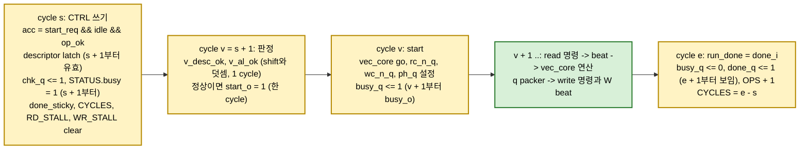

# L3 vec_top: 벡터 IP (RMSNORM, SWIGLU, ACTQ, ARGMAX)

- 원본과 확인일: 확인일 2026-11-20(S4-7 완료 뒤). `rtl/l3/vec_top.sv`(포트, 인스턴스, read/write 명령 순서기, packer, 종료 판정), `rtl/l3/vec_csr.sv`(레지스터, descriptor 검사, 호출 상태). 데이터 배치, 레지스터 맵, 실행 규칙, CYCLES 식의 원본은 `docs/spec/vec.md`(이 문서는 요약이고 충돌하면 `vec.md`와 RTL이 우선). `vec_core` 내부는 `l2_vec_core.md`, leaf는 `l0_l1_vec_leaf.md`. 측정값은 `docs/log.md` S4-7.
- 상태: RTL 시뮬레이션 통과. `./sim/run.sh all` 424 run, fails 0 [측정, 수퍼바이저 재실행, `log.md` S4-7]. `vec_top` 12 run, `vec_csr` 6 run(`vec.md` 7절). 두 모델 forward 순서 전 레코드(260K 1,224 호출, 15M 804 호출)와 합성 1,500 호출에서 mismatch 0, mutation 35개 중 33개 검출(2개 동치), lint 경고 0은 agent 보고(재실행 안 함). **보드는 미실행**이고 100 MHz 타이밍, LUT 수는 확인하지 않았다.
- S5-4 보완(2026-11-23): RD_STALL 계수 수정(`vec_core.d_want_o` 추가, `rd_stall_ev` 식 변경)을 1, 2절에 반영했다. 수정 뒤 회귀 `./sim/run.sh all` 491 run, fails 0 [측정, 수퍼바이저 재실행, `log.md` 2026-11-23 S5-4 보완]. 위 상태 줄의 424 run은 S4-7 시점 값이다.
- 기본 parameter(RTL 기본값): `N_MAX` 1024, `IDX_W` 16, `LUT_PIPE` 2, `Q_DEPTH` 8, `MAX_BURST` 16, `OUTS` 4, `RD_FIFO` 64(= `MAX_BURST` x `OUTS`), `WR_FIFO` 32(= 2 x `MAX_BURST`), `IDW` 1, `FCLK_MHZ` 100, `ADDR_W` 12. 파생 폭: `NV_W` = `IDX_W` + 1 = 17.
- **파형은 그리지 않았다.** 호출 timeline은 RTL의 레지스터 갱신 조건과 `vec.md` 4절, 6.2절에서 옮긴 cycle 정의 표이고, 시뮬레이션 trace에서 뽑은 것이 아니다. `CYCLES`와 닫힌 식은 `vec.md` 6.2의 시뮬레이션 측정(TB의 `top_cyc` 모델과 일치)이다.
- 이 모듈은 인스턴스, 배선, 읽기와 쓰기 명령 순서기, packer, 종료 판정이다. 연산은 `vec_core`, 레지스터와 descriptor 검사는 `vec_csr`, AXI 동작은 engine이 한다. HP 포트 하나(read master 1, write master 1)를 쓴다.

## 1. block diagram

```mermaid
flowchart LR
    ps["PS7 M_AXI_GP0<br/>AXI4-Lite (ADDR_W 12, 32b)"]:::ext
    axil["u_axil: axil_slave<br/>ADDR_W, DATA_W 32<br/>wr_en, wr_addr, wr_data 32b<br/>rd_en, rd_addr, rd_data 32b"]:::mod
    csr["u_csr: vec_csr<br/>start_o (cycle v = s + 1), busy_o, done_i<br/>latched: op_o 2b, in0/in1/out/scl 32b, n_o NV_W 17b,<br/>qmax_o 16b, f_o, ge_o E_W 8b signed, epsc_o 32b<br/>입력: am_valid/idx IDX_W/val 32b, rd_err, wr_err, rd_stall, wr_stall"]:::mod
    bc["byte 수 (shift만, 곱셈 없음)<br/>n32 = 32'(d_n), q16 = (op == ACTQ && qmax != 127)<br/>b_in0 = n32 << 2<br/>b_in1 = RMS ? n32 << 1 : n32 << 2<br/>b_out = AMAX ? 4 : q16 ? n32 << 1 : n32"]:::logic
    rseq["read 명령 순서기<br/>rc_n_q 2b (남은 명령), rc_k_q (0 IN0, 1 IN1)<br/>start: rc_n_q <= (RMS 또는 SWI) ? 2 : 1<br/>rc_addr = rc_k_q ? d_in1 : d_in0"]:::cut
    rd["u_rd: axi_rd_eng<br/>AW 32, LEN_W 32, MAX_BURST, OUTS, FIFO_DEPTH = RD_FIFO<br/>cmd_addr 32b, cmd_bytes 32b<br/>d_data 64b, d_valid, d_ready, d_last<br/>busy_o -> rd_busy (u_rd.busy_o 사용), stall_o 미연결"]:::mod
    core["u_core: vec_core<br/>start_i = start, op_i, n_i, f_i, qmax_i, ge_i, epsc_i<br/>beat 입력 d_data 64b<br/>q_valid/q_ready/q 16b, m 17b, e SH_W 10b, scl_valid<br/>am_idx IDX_W, am_max 32b, busy, done (c_done)"]:::mod
    wseq["write 명령 순서기<br/>wc_n_q 2b, wc_k_q (0 OUT, 1 SCL)<br/>start: wc_n_q <= AMAX ? 1 : 2<br/>wc_addr = wc_k_q ? d_scl : d_out<br/>wc_bytes = wc_k_q ? 8 : b_out"]:::cut
    pk["packer<br/>ph_q 2b: PK_Q, PK_S, PK_A, PK_D<br/>acc_q 64b, lane_q 3b, qc_q NV_W<br/>pk_valid_q, pk_data_q 64b<br/>q: int8 8개 또는 int16 4개/beat (마지막 beat 부분)<br/>PK_S: {32'(e), 32'(m)}, PK_A: {32'd0, 32'(am_idx)}"]:::cut
    wr["u_wr: axi_wr_eng<br/>AW 32, LEN_W 32, MAX_BURST, OUTS, FIFO_DEPTH = WR_FIFO<br/>cmd_addr 32b, cmd_bytes 32b<br/>in_data 64b, in_valid, in_ready"]:::mod
    hr["m_axi ar/r<br/>HP read 포트"]:::ext
    hw["m_axi aw/w/b<br/>HP write 포트"]:::ext
    stallc["rd_stall_ev<br/>= rd_busy && d_want && !d_valid"]:::logic
    done["종료 판정 (run_done)<br/>busy && !start && cd_q && ph_q == PK_D<br/>&& !pk_valid_q && wc_n_q == 0 && rc_n_q == 0 && !wr_busy<br/>am_valid = run_done && op == OP_AMAX"]:::logic

    ps --> axil
    axil -->|"wr_en, wr_addr, wr_data"| csr
    csr -->|"rd_data"| axil
    csr -->|"d_op, d_n, d_qmax"| bc
    csr -->|"d_in0, d_in1, d_out, d_scl"| rseq
    csr -->|"start"| rseq
    csr -->|"start"| wseq
    bc -->|"b_in0, b_in1"| rseq
    bc -->|"b_out"| wseq
    rseq -->|"rc_valid, rc_addr, rc_bytes"| rd
    rd <--> hr
    rd -->|"d_valid, d_data 64b, d_last"| core
    core -->|"d_ready = pop"| rd
    core -->|"d_want (valid와 무관)"| stallc
    rd -->|"rd_busy (u_rd.busy_o), d_valid"| stallc
    csr -->|"start, d_op, d_n, d_f, d_qmax, d_ge, d_epsc"| core
    core -->|"q_valid, q 16b"| pk
    pk -->|"q_ready"| core
    core -->|"m, e, scl_valid, am_idx, c_done"| pk
    core -->|"am_idx, am_max"| csr
    wseq -->|"wc_valid, wc_addr, wc_bytes"| wr
    pk -->|"in_valid_i = pk_valid_q, in_data_i = pk_data_q 64b"| wr
    wr -->|"in_ready_o"| pk
    wr <--> hw
    wr -->|"wr_busy"| done
    pk --> done
    core -->|"c_done -> cd_q"| done
    done -->|"run_done -> done_i"| csr
    done -->|"am_valid"| csr
    rd -.->|"rd_err_ev (RRESP[1] handshake)"| csr
    stallc -.->|"rd_stall_ev"| csr
    wr -.->|"wr_err_ev (BRESP[1] handshake), wr_stall_ev"| csr

    classDef ext fill:#ffffff,stroke:#333333,color:#000
    classDef mod fill:#d8f0d8,stroke:#2e7d32,stroke-width:2px,color:#000
    classDef logic fill:#e3eefc,stroke:#3b6aa0,stroke-width:2px,color:#000
    classDef cut fill:#fff3c4,stroke:#b58900,stroke-width:2px,color:#000
```

- 초록 = 하위 모듈 인스턴스, 파랑 = 조합 논리, 노랑 = 레지스터가 있는 control.
- 인스턴스 이름은 RTL의 선언 그대로: `u_axil`, `u_csr`, `u_rd`, `u_core`, `u_wr`.
- 출력 packer의 phase(`ph_q`): `PK_Q`(q 값을 모음, `q_ready = busy && ph_q == PK_Q && pk_ready`), `PK_S`(q가 끝난 뒤 scale beat를 `scl_valid`일 때 내보냄), `PK_A`(ARGMAX: `cd_q` 뒤 idx beat), `PK_D`(끝). reset 상태는 `PK_D`. `start`에서 ARGMAX면 `PK_A`, 아니면 `PK_Q`.
- q 값 하나는 int8(qmax 127)이면 beat의 8-bit lane 8개, int16(ACTQ qmax 2047/32767)이면 16-bit lane 4개에 `acc_q`로 모은다(`emit_q`는 마지막 q 또는 lane이 찼을 때). 마지막 beat는 일부 lane만 유효하고 write engine이 WSTRB로 가린다(`vec.md` 5절, 2절).
- 쓰기 순서는 q(또는 ARGMAX의 idx) 다음 scale이다. ARGMAX는 `OUT_ADDR`에 int32 idx 하나(4 B)만 쓰고 scale은 쓰지 않는다(`wc_n_q` = 1).
- 시뮬레이션 전용 검사: `L3_ENGCMD`(engine이 명령을 거절함), `L3_SEQ`(호출 밖의 q).

## 2. 호출 timeline (cycle 정의 표, 파형 아님)

s = CTRL 쓰기 cycle(수락), v = s + 1(판정, `CHK_CYC` = 1), e = op 종료 cycle. 정상 호출 기준(`vec.md` 4.1, 4.3, 6.2, RTL).

| cycle | 사건 | 근거 |
|---|---|---|
| s | `CTRL` 쓰기(`start` = 1, op 1..4)가 idle(검사 중도 op 중도 아니거나 e)에서 수락된다. descriptor를 latch하고 `chk_q` <= 1 | `vec_csr`의 `acc`, `chk_q <= acc` |
| s + 1 = v | 판정. descriptor 정상이고 정렬이 맞으면 `start_o` = 1(한 cycle). 오류면 `ERR`의 BAD_DESC 그리고/또는 MISALIGN이 서고(v + 1부터 보임) start하지 않으며 STATUS.busy가 v + 1부터 0, done 없음, OPS 불변, CYCLES = 1 | `vec_csr`의 `verdict`, `start_o`, `err_set`, `vec.md` 4.1 |
| v | `start_o`로 `vec_core`가 시작(`go`), read 순서기가 `rc_n_q` <= 2(RMSNORM, SWIGLU) 또는 1, write 순서기가 `wc_n_q` <= 2 또는 1(ARGMAX), packer가 `ph_q` 설정 | `vec_top`의 `if (start)` 세 곳 |
| v + 1 .. | `rc_valid`가 서고 read engine이 IN0, IN1을 읽고 `vec_core`가 `d_ready_o = pop`으로 beat를 받는다. `vec_core`의 C cycle은 v가 0 | `vec.md` 6.2: D = s + 1 + C |
| D = s + 1 + C | `vec_core`의 `done_o`(`c_done`). 다음 cycle에 `cd_q` = 1 | `vec_top`의 `cd_q` |
| ... | q burst의 W beat, 마지막으로 scale beat(또는 ARGMAX는 idx beat), 마지막 B | `vec.md` 6.2 |
| e | `run_done`: `vec_core` done을 봤고(`cd_q`), `ph_q == PK_D`, packer가 모든 beat를 넘겼고(`!pk_valid_q`), `wc_n_q == 0`, `rc_n_q == 0`, `axi_wr_eng`가 idle(마지막 B를 받음)인 첫 cycle. `done_i`로 `vec_csr`가 `done_sticky`와 OPS를 갱신 | `vec_top`의 `run_done`, `vec.md` 4.3 |

- 진행 중인 호출 중에 `CTRL`에 start를 쓰면 `START_BUSY`(op가 틀리면 BAD_OP도)로 무시된다. `done` cycle(e)의 `CTRL`은 새 호출로 수락된다(`idle = ... || done_i`). op가 1..4가 아니면 BAD_OP만 서고 `done_sticky`는 그대로(`vec.md` 4.1 표).
- `STATUS.busy`는 `chk_q || busy_q`라 s + 1부터 e까지 1이다. `CYCLES`는 `chk_q || busy_q`인 cycle마다 증가해 e - s다(검사 1 cycle 포함). `RD_STALL`은 같은 구간에서 `rd_stall_ev = rd_busy && d_want && !d_valid`(`rd_busy` = `u_rd.busy_o`, `d_want` = `vec_core.d_want_o`, core가 원소를 받을 수 있는데 read beat가 없는 cycle)의 수다. `u_rd.stall_o`는 연결하지 않았다: 그 식은 `busy && d_ready && !d_valid`인데 `vec_core.d_ready_o`가 beat의 pop이라 `d_valid`를 포함해 구조상 항상 0이었다(2026-11-23 S5-4 보완에서 수정, `vec.md` 3절 주). latency 1 메모리 모델(stall 없음)에서 op당 4 [측정, 시뮬레이션, `vec.md` 3절, `CYC=1` run]. `WR_STALL`은 `axi_wr_eng`의 `stall_o`(packer의 beat를 write engine이 받지 못함)인 cycle 수다.

## 3. 레지스터 요약 (32비트, offset은 byte)

전체 비트 정의와 접근 규칙은 `docs/spec/vec.md` 3절이 원본이다. 아래는 RTL(`vec_csr.sv` 헤더 주석과 `localparam`)에서 확인한 이름과 offset만 요약했다.

| offset | 이름 | 접근 | 내용(요약) |
|---|---|---|---|
| 0x00 | ID | R | 0x56450001("VE", 버전 1) |
| 0x04 | CONFIG | R | [7:0] FCLK_MHZ, [15:8] IDX_W, [31:16] N_MAX |
| 0x08 | CTRL | W | bit0 start, [7:4] op(1 RMSNORM, 2 SWIGLU, 3 ACTQ, 4 ARGMAX). 읽으면 0 |
| 0x0C | STATUS | R | bit0 busy(검사 중 또는 op 중), bit1 done_sticky, bit2 err_any |
| 0x10 | ERR | R/W1C | bit0 START_BUSY, bit1 BAD_OP, bit2 BAD_DESC, bit3 MISALIGN, bit4 RD_RESP, bit5 WR_RESP |
| 0x14 | CYCLES | R | 마지막으로 수락된 호출의 e - s |
| 0x18 | RD_STALL | R | 같은 구간의 read 대기 cycle 수 |
| 0x1C | WR_STALL | R | 같은 구간의 write 막힘 cycle 수 |
| 0x20 | OPS | R | reset 이후 끝난 op 수 |
| 0x24 | ARGMAX_IDX | R | 마지막 ARGMAX의 index |
| 0x28 | ARGMAX_VAL | R | 그 최댓값(int32) |
| 0x40 | IN0_ADDR | RW | x / h1 / v(int32 [N]) |
| 0x44 | IN1_ADDR | RW | RMSNORM g(int16 [N]), SWIGLU h3(int32 [N]) |
| 0x48 | OUT_ADDR | RW | q(int8 [N], ACTQ qmax 2047/32767은 int16 [N]) 또는 idx(int32) |
| 0x4C | SCL_ADDR | RW | scale {int32 m, int32 e}(8 B). ARGMAX는 쓰지 않음 |
| 0x50 | N | RW | 32비트 그대로 저장. 유효 1..N_MAX, ARGMAX 1..2^IDX_W |
| 0x54 | FMT | RW | [15:0] qmax, [16] mode(1 MANT), [27:24] sb. reset 0x0801007F |
| 0x58 | EXP | RW | [7:0] f(signed), [15:8] ge(signed) |
| 0x5C | EPSC | RW | RMSNORM epsc(int32, >= 0) |

- 모든 주소는 8 B 정렬(MISALIGN). 정의되지 않은 주소는 0을 읽고 쓰기는 무시한다.
- descriptor 검사(1 cycle): N 범위, mode 1(ARGMAX 외), ACTQ qmax in {127, 2047, 32767}, SWIGLU sb 8, RMSNORM epsc >= 0, 각 버퍼 [addr, addr + 바이트 수)가 2^32 이하, MISALIGN은 쓰는 주소의 [2:0]. 바이트 수는 shift와 덧셈(`vec_csr`의 `in0_end` 등 36비트 덧셈)이다(`vec.md` 4.2).

## 4. CYCLES 닫힌 식 [측정, Questa 시뮬레이션 모델, 보드 값 아님]

조건: 메모리 stall 없음, read/B latency 1, `MAX_BURST` 16, `OUTS` 4(`vec.md` 6.2). C는 `vec_core`의 cycle 식(RMSNORM 4n + 87, SWIGLU 3n + 67, ACTQ 2n + 59, ARGMAX n + 1, `l2_vec_core.md` 4절).

- ARGMAX: **CYCLES = C + 14 = n + 15**.
- RMSNORM, SWIGLU, ACTQ: q 값 i가 packer에 들어가는 cycle은 D - n + i. q beat j는 h_j = D - n + min(P j + P - 1, n - 1)에 완성된다(P = 8 / qb 값, int8 8, int16 4). q 쓰기 명령은 `OUT_ADDR`에서 16 beat와 4 KiB 경계로 burst k(L_k beat)로 나뉘고, burst k의 W는 ws_k = max(h_(k의 마지막 beat) + 10, we_(k-1) + 1)부터 we_k = ws_k + L_k - 1까지다. scale beat의 W는 ws = max(D + 11, we_last + 1), 종료 e = ws + 2. **CYCLES = e - s**.
  - 앞 burst에 막히지 않는 보통의 경우 닫힌 식: **CYCLES = 1 + C + 11 + max(L_last, 2)**(L_last = q의 마지막 burst beat 수). 막히는 예: 마지막 q burst가 1~3 beat이고 바로 앞 16 beat burst의 W가 아직 나가는 중이면 +3..+13(측정 사례).
  - 이 모델은 `tb_vec_top`의 `top_cyc`가 호출마다 계산해 CYCLES와 비교한다(`CYC=1` run: 두 모델 forward 전 레코드와 합성 1,500 호출, 모두 일치, `vec.md` 6.2).
- 호출 하나의 값(260K 기본 호출, 위 식 적용 [계산]): RMSNORM n = 64 363, SWIGLU n = 172 601, ACTQ n = 8 89, ARGMAX n = 512 527. token당 합은 `l2_vec_core.md` 4절의 표(260K 약 15,680, 15M 약 85,741, 측정)와 일치한다. 두 값 모두 시뮬레이션 모델이고 보드의 HP latency, ARM 호출 비용은 포함되지 않았다.
