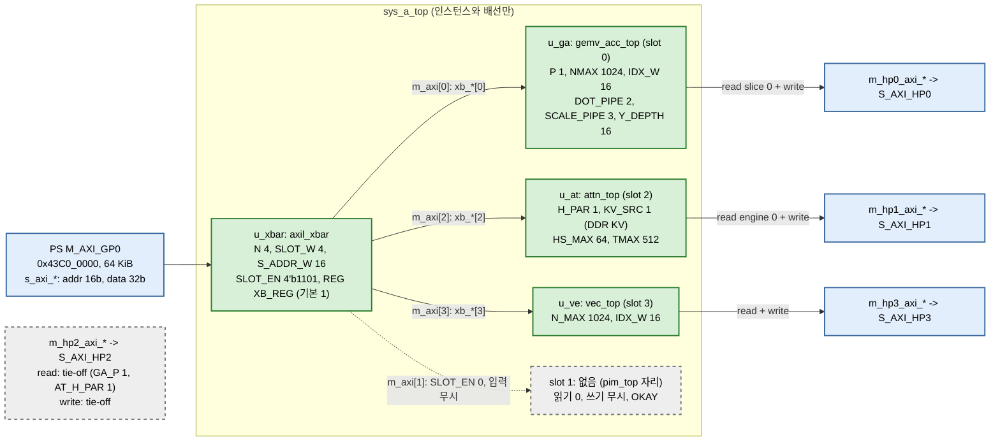
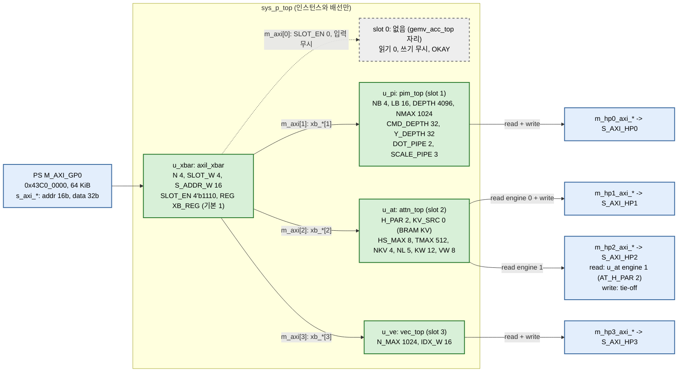
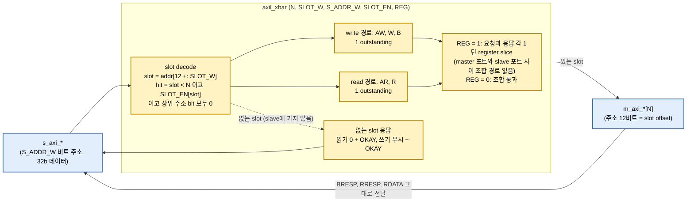

# L4 시스템 top: `sys_a_top`, `sys_p_top`, `axil_xbar`

- 원본과 확인일: 확인일 2026-11-23(S5-2 완료 뒤). `rtl/l4/axil_xbar.sv`, `rtl/l4/sys_a_top.sv`, `rtl/l4/sys_p_top.sv`의 헤더 주석, parameter 선언, 인스턴스 선언, HP 배선(`assign`)을 읽어 확인했다. 주소 맵, slot 표, latency의 원본은 `docs/spec/system.md` 1.3, 1.4, 1.7절, 계층 요약은 `docs/spec/hierarchy.md` 3.12절이다(충돌하면 RTL과 `system.md`가 우선).
- 상태: RTL 시뮬레이션 smoke 통과. `./sim/run.sh all` 465 run, fails 0(기존 424 + `axil_xbar` 30 + `sys_a_top` 6 + `sys_p_top` 5) [측정, 수퍼바이저 재실행, `log.md` S5-2]. xbar mutation 8/8, top 배선 mutation 9/9 검출, lint 경고 0은 agent 보고(재실행 안 함). **보드는 미실행**이고 합성, 100 MHz 타이밍, LUT 수는 확인하지 않았다. 실제 GP0 왕복 시간은 [미측정].
- smoke의 범위(`log.md` S5-2): slot별 ID/CONFIG 대조, 빈 slot 읽기 0, IP마다 호출 하나를 golden(DPI)과 대조, 호출마다 burst가 나간 HP 포트 집합 검사. HP 포트마다 독립 메모리 모델이라 두 HP 포트가 같은 버퍼를 보는 시험(IP 사이 kernel 연쇄, forward)은 아직 하지 않았다(S5-3 이후).
- **파형은 그리지 않았다.** latency 표는 `system.md` 1.7절에 기록된 Questa 측정값(TB slave 모델)이고 RTL 헤더의 정의와 대조했다.

## 1. block diagram

### 1.1 공통 구조

두 top은 `axil_xbar` 하나와 IP 3개의 인스턴스, 배선, 쓰지 않는 채널의 상수 tie-off만 갖는다(로직 없음). 포트 목록은 두 빌드가 같다(block design shell 하나로 두 빌드를 받기 위함).

- 클럭과 리셋: `clk`, `rst_n` 하나를 xbar와 IP 3개에 그대로 준다(CDC 없음).
- 레지스터 쪽 포트: `s_axi_<ch>_<i|o>`(AXI4-Lite, 주소 `S_ADDR_W` = 16비트, 데이터 32비트). `<ch>`는 `awaddr`, `awprot`, `awvalid`, `awready`, `wdata`, `wstrb`, `wvalid`, `wready`, `bresp`, `bvalid`, `bready`, `araddr`, `arprot`, `arvalid`, `arready`, `rdata`, `rresp`, `rvalid`, `rready`.
- HP 쪽 포트: `m_hp<k>_axi_<ch>_<i|o>`(k = 0..3, AXI4 master, 데이터 64비트, ID `IDW` = 1비트, 주소 32비트). `<ch>`는 AW(`awid`, `awaddr`, `awlen`, `awsize`, `awburst`, `awlock`, `awcache`, `awprot`, `awqos`, `awvalid`, `awready`), W(`wdata`, `wstrb`, `wlast`, `wvalid`, `wready`), B(`bid`, `bresp`, `bvalid`, `bready`), AR(`ar*`, AW와 같은 필드), R(`rid`, `rdata`, `rresp`, `rlast`, `rvalid`, `rready`). 접미사 `_o`/`_i`는 이 모듈 기준 방향이다.
- 쓰지 않는 채널 묶음: VALID 0, `RREADY`/`BREADY` 1, 그 밖의 출력 0(RTL의 `g_hp2_off` 분기와 HP2의 write 쪽 `assign`에서 확인).
- 내부 신호 이름 규칙: xbar의 slot 쪽 배열 `xb_*[slot]`, IP별 HP 쪽 묶음 `ga_*`, `pi_*`, `at_*`, `ve_*`(read 채널은 `[P-1:0]` 또는 `[H_PAR-1:0]` 배열, write 채널은 스칼라).
- 인스턴스 이름: `u_xbar`(`axil_xbar`), `u_ga`(`gemv_acc_top`), `u_pi`(`pim_top`), `u_at`(`attn_top`), `u_ve`(`vec_top`). 각 IP의 `ADDR_W`는 12로 고정해 연결한다.
- parameter 이름 규칙: 공통 `S_ADDR_W`, `XB_REG`, `IDW`, `MAX_BURST`, `OUTS`, `FCLK_MHZ`. IP별 접두사 `GA_*`(gemv_acc), `PI_*`(pim), `AT_*`(attn), `VE_*`(vec)로 IP parameter를 그대로 내보낸다.

### 1.2 빌드 A (`sys_a_top`): 15M 주 대상, 260K도 실행 가능

- 위 그림은 기본 parameter 구성이다. HP2 read 채널은 parameter로 바뀐다(RTL의 `g_hp2_ga`, `g_hp2_at`, `g_hp2_off`):
  - `GA_P` 2(빌드 A2): `u_ga`의 slice 1 read가 HP2.
  - `AT_H_PAR` 2(변형 A'): `u_at`의 engine 1 read가 HP2.
  - 둘 다 아니면(기본) tie-off. `GA_P` 2와 `AT_H_PAR` 2를 동시에 주면 elaboration에서 실패한다(`g_bad_hp2`). `GA_P`, `AT_H_PAR`는 각각 1 또는 2만 허용.
- A2와 A'는 elaboration과 lint만 했고 시뮬레이션하지 않았다(`log.md` S5-2 한계).

### 1.3 빌드 P (`sys_p_top`): 260K

- `AT_H_PAR` 1이면 HP2 read는 tie-off(`g_hp2_off`). `AT_KV_SRC` 1이면 변형 PD(KV를 DDR로)이고 배선은 같다(RTL 헤더 주석).
- 기본 `VE_N_MAX`는 1024다(`system.md` 결정 O7). 256 구성은 RTL 기본값이 아니다.

### 1.4 HP 포트 배정 표

| 포트 | 빌드 A: read / write | 빌드 P: read / write |
|---|---|---|
| HP0 | `u_ga` slice 0 / `u_ga` | `u_pi` / `u_pi` |
| HP1 | `u_at` engine 0 / `u_at` | `u_at` engine 0 / `u_at` |
| HP2 | `GA_P` 2면 `u_ga` slice 1, `AT_H_PAR` 2면 `u_at` engine 1, 기본은 tie-off / tie-off | `AT_H_PAR` 2(기본)면 `u_at` engine 1, 1이면 tie-off / tie-off |
| HP3 | `u_ve` / `u_ve` | `u_ve` / `u_ve` |

- HP 포트 하나의 read 채널과 write 채널은 독립이라 서로 다른 IP가 나눠 쓸 수 있는 구조지만(배선만), 현재 배정에서 그런 포트는 없다.
- 각 HP 포트 앞의 interconnect(AXI4 -> AXI3 변환, ID 폭 맞춤)는 Vivado block design의 몫이고 RTL top에는 없다(`system.md` 1.3절. Tcl은 S5-5에서 만들 예정이며 아직 없다).
- HP0/HP1과 HP2/HP3이 DDR 컨트롤러 포트를 공유하는지는 [미확인]이다(`system.md` 1.3절).

## 2. `axil_xbar`: GP0 -> IP CSR slot

### 2.1 구조

### 2.2 규칙 (RTL 헤더와 `system.md` 1.7절, `hierarchy.md` 3.12절)

| 항목 | 내용 |
|---|---|
| parameter | `N` 기본 4(1..2^`SLOT_W`), `SLOT_W` 기본 4(1..4), `S_ADDR_W` 기본 16(12 + `SLOT_W`..32), `SLOT_EN`[15:0](bit k = slot k 있음, N 이상의 bit는 0), `REG` 기본 1(0 또는 1). 잘못된 값은 elaboration 실패(`g_bad_slot_w`, `g_bad_n`, `g_bad_addr_w`, `g_bad_reg`, `g_bad_en`) |
| slave 포트 | `s_axi_<ch>_i` 또는 `_o`, 주소 `S_ADDR_W` 비트, 데이터 32비트 |
| master 포트 | `m_axi_<ch>_i` 또는 `_o` (각 [N]), 주소 12비트(slot offset), 데이터 32비트, 응답 입력은 packed 배열 |
| slot decode | slot = `addr[12 +: SLOT_W]`. slave에는 `addr[11:0]`만 간다. slot >= N, `SLOT_EN` 0인 slot, `addr[S_ADDR_W-1:12+SLOT_W]` != 0(범위 밖)은 "없는 slot" |
| 없는 slot | slave에 가지 않는다. 읽기는 0과 OKAY, 쓰기는 무시하고 OKAY. 그래서 SW가 모든 slot의 ID를 읽어 빌드 구성을 알 수 있다(빈 slot이 DECERR이면 bare-metal에서 data abort) |
| 있는 slot | `BRESP`/`RRESP`/`RDATA`를 그대로 전달한다. IP는 항상 OKAY지만 xbar는 SLVERR/DECERR도 통과시킨다. `WSTRB`, `AxPROT`도 그대로 전달 |
| outstanding | write(AW, W, B)와 read(AR, R) 경로는 서로 독립. 경로마다 1 outstanding: 다음 AW/W(AR)는 앞 트랜잭션의 master 쪽 B(R) handshake 뒤에만 받는다. AW와 W는 어느 순서, 어느 간격으로 와도 된다 |
| register slice | `REG` = 1(기본, 시스템 top의 `XB_REG` 기본값): 모든 출력이 flip-flop 또는 상수. `localparam LAT_REQ = REG`, `LAT_RSP = REG` |
| 시뮬레이션 검사 | `ifndef SYNTHESIS`, tag `L4_XB_AW`, `L4_XB_W`, `L4_XB_AR`(master VALID/payload가 READY 전에 바뀜), `L4_XB_B`, `L4_XB_R`(slave 응답이 READY 전에 바뀜), `L4_XB_UNEXP`(요청 없는 slave 응답) |

### 2.3 latency 표 [측정, Questa 시뮬레이션, TB slave 모델]

조건: TB slave 모델은 READY 항상 1이고 요청 handshake 다음 cycle에 응답한다(`system.md` 1.7절). IP의 `axil_slave`(요청 handshake c -> 응답 VALID c + 2)를 붙이면 그 지연이 더해진다. 100 MHz 타이밍과 보드의 GP0 왕복 시간은 [미측정].

| 경우 | `REG` = 1 (기본) | `REG` = 0 |
|---|---|---|
| 단일 읽기 (AR handshake -> master RVALID) | 3 cycle | 1 cycle |
| 단일 쓰기 (마지막 AW/W handshake -> BVALID) | 3 cycle | 1 cycle |
| back-to-back 주기, 있는 slot 읽기 | 4 cycle | 2 cycle |
| back-to-back 주기, 있는 slot 쓰기 | 4 cycle | 3 cycle (W가 AW 다음 cycle) |
| back-to-back 주기, 없는 slot 읽기 / 쓰기 | 2 / 2 cycle | 2 / 3 cycle |

- back-to-back 주기는 master가 응답 다음 cycle에 다음 요청을 내는 경우다.
- 정의(RTL 헤더, `system.md` 1.7절의 문장): `REG` = 1에서 slave AWVALID = master AW handshake + 1, slave WVALID = max(AW, W handshake) + 1, slave ARVALID = AR handshake + 1, master BVALID/RVALID = slave B/R handshake + 1. 없는 slot은 BVALID = max(AW, W handshake) + 1, RVALID = AR handshake + 1. `REG` = 0은 AW/AR의 VALID, READY와 B/R를 같은 cycle에 통과시키고 W는 AW handshake 뒤에만 받는다(없는 slot: BVALID = W handshake + 1, RVALID = AR handshake + 1).

## 3. 주소 맵

### 3.1 PL 레지스터 (GP0)

GP0 segment `0x43C0_0000`, 64 KiB. slot = `addr[15:12]`, slot당 4 KiB(IP의 `ADDR_W` 12). slot 번호는 빌드와 무관하게 IP 종류에 고정이다.

| 주소 | slot | IP (인스턴스) | ID 레지스터(0x00) | 빌드 A (`SLOT_EN` 4'b1101) | 빌드 P (`SLOT_EN` 4'b1110) |
|---|---|---|---|---|---|
| 0x43C0_0000 | 0 | `gemv_acc_top` (`u_ga`) | 0x4741_0001 ("GA") | 있음 | 없음 |
| 0x43C0_1000 | 1 | `pim_top` (`u_pi`) | 0x5049_0001 ("PI") | 없음 | 있음 |
| 0x43C0_2000 | 2 | `attn_top` (`u_at`) | 0x4154_0001 ("AT") | 있음 (KV_SRC 1) | 있음 (KV_SRC 0) |
| 0x43C0_3000 | 3 | `vec_top` (`u_ve`) | 0x5645_0001 ("VE") | 있음 | 있음 |
| 0x43C0_4000 ~ 0x43C0_FFFF | 4..15 | 없음 | 0 (읽기) | 없음 | 없음 |

CONFIG 레지스터 값(기본 parameter, TB로 확인한 값, `system.md` 1.7절 slot 표):

| slot | 빌드 A | 빌드 P |
|---|---|---|
| 0 `u_ga` | CONFIG 0x0400_3164 (A2: 0x0400_3264) | 없음(0) |
| 1 `u_pi` | 없음(0) | CONFIG 0x0400_4464, CONFIG2 0x0020_1000 |
| 2 `u_at` | CONFIG 0x0200_3964, CONFIG2 0x0000_0040, CONFIG3 0 | CONFIG 0x0200_3264, CONFIG2 0x0005_0408, CONFIG3 0x0200_080C (변형 PD: 0x0200_3A64, 0x0000_0008, 0) |
| 3 `u_ve` | CONFIG 0x0400_1064 | CONFIG 0x0400_1064 |

### 3.2 DDR (HP와 ARM이 공유, 물리 주소 = HP 주소) 참고

`system.md` 1.4절의 계획 배치다(baseline의 `bcfg.h` 배치를 그대로). 이 문서의 RTL 확인 범위 밖이며 HP의 DDR segment가 이 범위를 덮는지는 Vivado의 주소 배정 결과로 확인해야 한다 [미확인].

| 영역 | 주소 | 비고 |
|---|---|---|
| 프로그램(코드, 데이터, 스택) | 0x0010_0000 ~ (상한 255 MiB) | IP 접근 없음 |
| 15M checkpoint, tokenizer | 0x1000_0000, 0x1400_0000 | IP 접근 없음 |
| arena(모델 메모리) | 0x1800_0000 ~ (상한 639 MiB) | IP가 접근하는 모든 버퍼는 arena 안 |

## 4. 하위 문서

- IP별 상세: `l3_gemv_acc_top.md`, `l3_pim_top.md`, `l3_attn_top.md`, `l3_vec_top.md`. 통합 개요: `system_overview.md`. SW 쪽: `sw_executor.md`.
