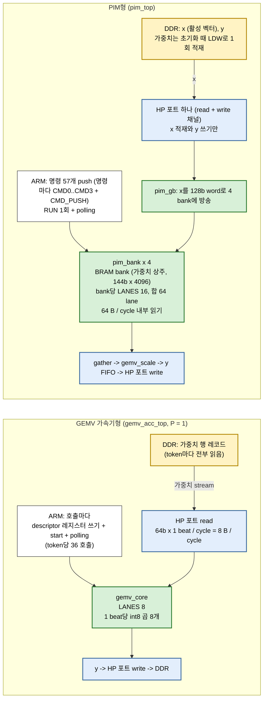

# GEMV 가속기형 대 PIM형 비교 (260K)

- 원본과 확인일: 확인일 2026-11-19, 수치는 S4-6b 재측정 값으로 2026-11-20 갱신. `docs/spec/arch.md` 2, 3, 8절, `docs/spec/gemv_acc.md`, `docs/spec/pim.md`, `docs/log.md` S4-4, S4-5, S4-6b, RTL `rtl/l3/gemv_acc_top.sv`, `rtl/l3/pim_top.sv`, `rtl/l2/pim_core.sv`. 구조의 세부는 `l3_gemv_acc_top.md`, `l3_pim_top.md`, `l2_pim_core.md`.
- cycle 수는 **시뮬레이션 모델(Questa, `axi_mem_slave` stall 없음, read/B latency 1)의 [측정]이고 보드 값이 아니다.** 곱셈기와 BRAM은 구조에서 센 **[계산]**, 합성하지 않았다.
- 비교 대상: 같은 260K 모델의 token 한 개(GEMV 36개 호출, `gemv_acc` P = 1 대 `pim_top` token 한 run).
- S4-6b 반영: 두 IP 모두 호출/명령 검사가 순차 계산이 되어 검사 cycle이 붙었다(가속기형은 호출마다 9 cycle, PIM형은 명령 push 검사 9 cycle과 LDW 읽기 명령 9 cycle). 아래 cycle 값은 S4-6b 재측정(괄호는 S4-6 값)이고 수치는 agent 보고(`docs/spec/gemv_acc.md` 5절, `docs/spec/pim.md` 6.2). 수퍼바이저가 재실행으로 확인한 것은 `./sim/run.sh all` 368 run, fails 0(통과 여부)이다.

## 1. 구조 비교 그림

- 가속기형의 한도는 HP 포트 하나의 대역폭이다. int8 가중치 1 B당 MAC 1회이므로 포트당 8 lane이면 포트가 포화되고 lane을 더 두어도 늘지 않는다(`arch.md` 2.3).
- PIM형은 가중치를 BRAM bank 안에 두고 bank 옆에서 계산하므로 token마다 가중치를 DDR에서 읽지 않는다. 한도는 lane 수(곱셈기)다. 가중치는 초기화 때 LDW로 한 번 DDR에서 bank로 옮긴다(36,629 cycle [측정, 시뮬레이션], S4-6 36,305, `pim.md` 6.2).

## 2. 비교 표

| 항목 | 가속기형 (`gemv_acc_top` P = 1) | PIM형 (`pim_top`, NB 4 x LB 16) | 근거와 구분 |
|---|---|---|---|
| 가중치 위치 | DDR (token마다 읽음) | BRAM bank (초기화 때 LDW 1회) | `arch.md` 2.1, 3.1 |
| 가중치 읽는 대역폭 한도 | HP 포트 64비트/cycle = 8 B/cycle (이론 0.8 GB/s @100 MHz) | bank 4 x 16 B/cycle = 64 B/cycle (6.4 GB/s @100 MHz) | [계산] `arch.md` 2.3, 3.5. 보드 실측 아님 |
| MAC lane 수 | 8 (`gemv_core` `LANES` 8) | 64 (4 bank x `LB` 16) | RTL parameter |
| token당 cycle (260K) | 37,903 ~ 37,938 (S4-6 37,596) | 4,499 ~ 4,506 (token 한 run), 4,663 ~ 4,676 (layer마다 run) (S4-6 4,501 ~ 4,506, 4,658 ~ 4,676) | [측정, 시뮬레이션] `gemv_acc.md` 5절, `pim.md` 6.2 |
| token당 cycle, 호출 오버헤드 제외 | 36,446 | 4,072 (MAC cycle) | [계산] `arch.md` 2.4, 3.4. 4,072는 시뮬레이션 합(`pim.md` 6.2)과도 같음 |
| 비율 (가속기형 / PIM형) | 1 | 8.41 ~ 8.43배(token 한 run), 8.11 ~ 8.14배(layer마다 run) | [계산] 위 [측정] 범위의 끝값으로 낸 상하한(37,903 / 4,506, 37,938 / 4,499 등. 위치별로 짝지은 비는 아님). S4-6은 8.35배, 8.05배. MAC cycle만: 8.95배 [계산] |
| 곱셈기 수 | 11 (lane 8 + `gemv_scale` 3) | 67 (lane 64 + `gemv_scale` 3) | [계산, 합성 안 함] `arch.md` 8절. int8 곱을 LUT로 두면 PIM형 DSP는 3개(Vivado 판단, 미확인) |
| BRAM36 | 0 ~ 1 (FIFO) | 64 (가중치 bank) + 소량(FIFO, buffer) | [계산, 합성 안 함]. bank 64개는 tag 16비트가 parity에 들어간다는 전제(Vivado 추론 미확인) |
| 호출 흐름 | token당 36 호출. 호출마다 descriptor 쓰기와 start, polling. CTRL 수락 뒤 검사 9 cycle(S4-6b) | 명령 57개 push(token 전체, 명령마다 push 검사 9 cycle) 후 RUN 1회 | `log.md` S4-4, S4-5, S4-6b. 호출당 레지스터 쓰기 수는 `arch.md` 2.1의 스펙값(7~9개), PIM형은 명령당 5회(CMD0..3 + PUSH) |
| ARM 호출 비용 | 미측정 | 미측정 (push 57회 x AXI-Lite 5회 쓰기가 들어감) | `pim.md` 9절. 명령 FIFO가 이 비용을 없애지는 않는다 |
| 보드 end-to-end 시간 | 미측정 | 미측정 | 보드 미실행. HP latency 반영 안 됨 |

- 표의 cycle은 두 IP를 같은 메모리 모델에서 돌린 값이라 서로 비교할 수 있지만, 보드의 HP latency, DDR 대역폭 효율, ARM의 호출 비용이 빠져 있다. 보드에서 가속비가 이 비율을 유지한다고 말할 수 없다.
- 자원은 PIM형 시스템 전체(attention, vec 포함)에서 BRAM36 126/140으로 가장 빡빡하다(`arch.md` 8절 [계산]).

## 3. 공개 PIM 구조와의 대응 (요약)

`arch.md` 3.5의 표를 줄인 것이다(공개 구조의 정보는 `survey/survey.md` 6.1 기준, 이 문서에서 다시 확인하지 않았다).

| 요소 | 공개 PIM (GDDR6-AiM, HBM-PIM) | 이 설계 | 같음/다름 |
|---|---|---|---|
| 연산기 위치 | DRAM bank마다 PU(AiM: 16 MAC) | BRAM bank마다 16 lane MAC | 같음 |
| bank 수 | die당 16 (AiM) | 4 | 다름 (용량이 작아 bank를 넓게) |
| 벡터 방송과 전 bank 명령 | global buffer + `WRGB`, `MACAB` | `pim_gb` + `WRGB`, `MACAB`(lock-step) | 같음 |
| 결과 | `MAC_REG` + `RDMAC` | bank별 MAC_REG -> gather (RDMAC 없이 자동 drain) | 같음(RDMAC 없음) |
| 숫자 | BF16 (AiM), FP16 (HBM-PIM) | int8 x int8, int32 누산, 행 가수 scale | 다름 |
| 메모리 timing | ACT/PRE/refresh, row buffer | BRAM 1 cycle read | 다름 (`scope.md` 비범위) |
| 호스트 명령 | ISR 패킷 | AXI-Lite 명령 FIFO | 같은 계층, 단순화 |

- 위 대응은 구조 비유이고 성능 비교가 아니다. 공개 구조의 수치와 이 설계의 시뮬레이션 수치를 비교하지 않았다.
