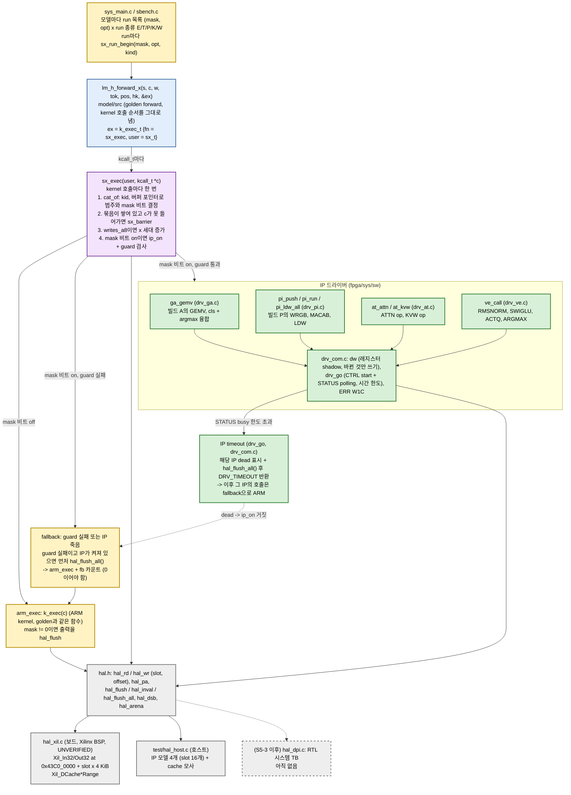
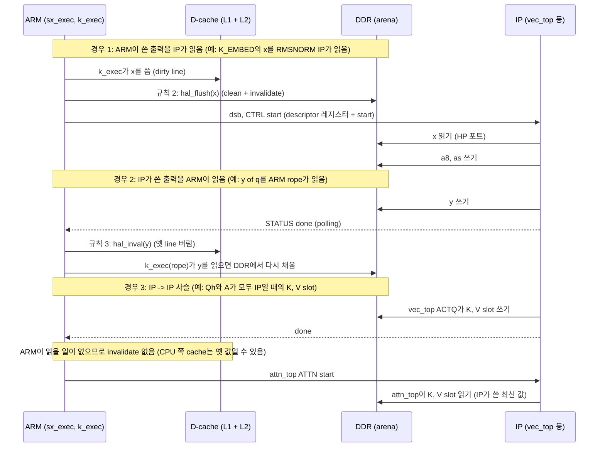
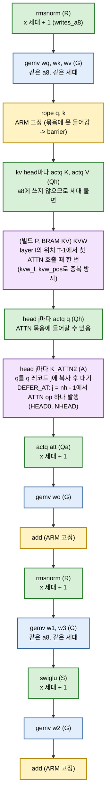
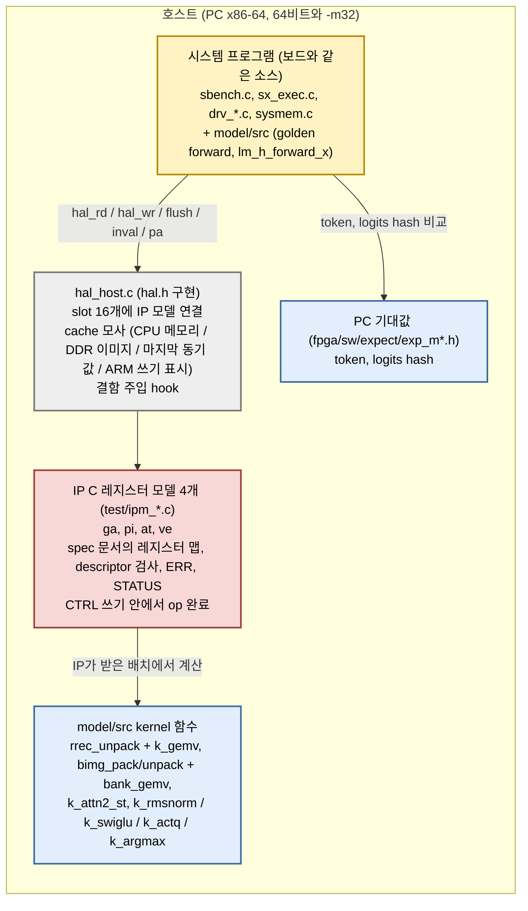

# 시스템 SW: 실행기 `sx_exec`, 오프로드 mask, cache 규칙, 호스트 검증

- 원본과 확인일: 확인일 2026-11-23(S5-2 완료 뒤). 2026-11-26 갱신: S5-4와 후속 검증 완료 뒤 guard fallback과 timeout의 전체 flush를 반영(나머지 절은 다시 대조하지 않음). `fpga/sys/sw/sx.h`, `sx_exec.c`, `hal.h`, `scfg.h`, `sbench.c`(호출 위치만), `fpga/sys/README.md`를 읽어 확인했다. 설계 원본은 `docs/spec/system.md` 2절(SW 구조), 3.1절(호스트 검증)이고 충돌하면 코드와 `system.md`가 우선이다.
- 상태: 호스트(PC x86-64)에서 spec 기반 IP 모델로 통과. 시스템 호스트 테스트 `SYSHOST items=36 fail=0`, `make test` TOTAL 16,686,497 항목 mismatch 0 [측정, 수퍼바이저 재실행, `log.md` S5-1]. 684 run의 세부 수치(token, logits hash, KCMP 2,029,960 호출, COH, fallback, IPERR 모두 0)와 결함 주입 12종 검출은 agent 보고(재실행한 테스트의 내부 수치, 개별 확인 안 함). **ARM 컴파일, Xilinx API, 보드 실행은 한 번도 하지 않았다**(`hal_xil.c`는 stub 헤더 문법 검사만).
- (S5-1 시점의 서술. S5-3/S5-4에서 같은 SW가 DPI로 RTL 시스템 top을 구동해 forward를 통과함, `sys_tb.md`.) 호스트의 IP 모델은 spec 문서로 쓴 C 모델이고 RTL이 아니다(5절). RTL과의 대조는 S5-3, S5-4의 시스템 TB에서 한다.

## 1. SW 구조도

- 호출 위치(`sbench.c`): `lm_h_forward_x`를 호출하고(114행), 그 앞에서 run P의 hook이 `sx_need_barrier`로 barrier가 필요한지 보고 `sx_barrier`를 부르며(96, 99행), forward가 끝난 뒤 `sx_barrier`를 한 번 더 부른다(117행).
- `lm_h_forward_x`에 실행기 포인터를 주지 않으면(`NULL`) 기존 `lm_h_forward`와 결과가 bit 단위로 같다(`model/src/llm.h` 주석).
- 호출 방식: `kcall_t`(kid, `prm`, 버퍼 `b[]`)를 받아 `cat_of`가 분류한다. `K_GEMV`는 `b[0]`(가중치 포인터)로 행렬 표(`smat_t`)를 찾고, `K_ACTQ`는 출력 `b[1]`이 `a8`이면 Qa, 아니면 Qh로 본다.
- ARM에 항상 남는 kernel: `K_EMBED`, `K_ROPE`, `K_ADD`(mask 비트 없음).
- `K_ATTN`(`K_ATTN2`가 아닌 것)은 mask 비트 A로 분류되지만 `guard`에서 거절되어 ARM으로 간다(`sx_exec.c`의 `guard`).
- IP가 하나도 없는 slot은 사용 불가로 처리: `ip_on`은 mask, 모델별 사용 가능 여부(`avail`), IP가 죽지 않았는지(`dead`, timeout 뒤)를 본다. 사용 가능하지 않은 비트를 요구하는 (mask, opt)는 run하지 않고 `SKIP`을 찍는다(fallback이 아님).

## 2. 오프로드 mask와 opt 비트

### 2.1 mask 8비트 (`scfg.h`의 `MB_*`, `system.md` 2.2절)

| 비트 | 값 | 이름 | kernel (`kcall_t`) | 빌드 A의 IP | 빌드 P의 IP |
|---|---|---|---|---|---|
| 0 | 0x01 | `MB_G` | `K_GEMV` (q, k, v, o, w1, w3, w2) | `gemv_acc_top` | `pim_top` |
| 1 | 0x02 | `MB_C` | `K_GEMV` (cls, 분류기) | `gemv_acc_top` | `pim_top` |
| 2 | 0x04 | `MB_A` | `K_ATTN2` (head마다) | `attn_top` (DDR KV) | `attn_top` (BRAM KV, + KVW) |
| 3 | 0x08 | `MB_R` | `K_RMSNORM` | `vec_top` | `vec_top` |
| 4 | 0x10 | `MB_S` | `K_SWIGLU` | `vec_top` | `vec_top` |
| 5 | 0x20 | `MB_QH` | `K_ACTQ` (K, V cache, q head: n = hs) | `vec_top` | `vec_top` |
| 6 | 0x40 | `MB_QA` | `K_ACTQ` (attention 출력: n = D) | `vec_top` | `vec_top` |
| 7 | 0x80 | `MB_M` | `K_ARGMAX` | `vec_top`, 또는 C와 함께 켜고 `FUSE_AM`이면 `gemv_acc_top`의 argmax 융합(별도 IP 호출 없음) | `vec_top` |

- `MB_ALL` = 0xFF. mask는 run마다 하나이고 한 bitstream 안에서 런타임에 바꾼다. 기본 run 목록 `SYS_MASK_LIST`는 `system.md` 4.1절의 18개 (mask, opt) 조합이다(`scfg.h`).
- 모델이나 빌드가 지원하지 않는 비트는 `avail`에서 빠진다. 예: 15M을 빌드 P에서 돌리면 PIM(237,312 word > 4,096)과 BRAM KV(hs 48 > KL 8) 때문에 G, C, A를 못 쓴다(`README.md`).

### 2.2 opt 비트 (`scfg.h`의 `OPT_*`)

| 비트 | 값 | 이름 | 의미 | 기본 |
|---|---|---|---|---|
| 0 | 0x01 | `OPT_DEFER_AT` | attention head 호출을 모아 layer당 ATTN op 하나로 냄(HEAD0, NHEAD) | 켜짐 |
| 1 | 0x02 | `OPT_PIM_BATCH` | x 주소와 x 세대가 같은 연속 `K_GEMV`의 MACAB을 쌓아 두었다가 RUN 한 번으로 냄 | 꺼짐 |
| 2 | 0x04 | `OPT_WRGB_SKIP` | x(`a8`)의 주소와 세대가 마지막 WRGB와 같으면 WRGB 생략 | 켜짐 |
| 3 | 0x08 | `OPT_FUSE_AM` | 빌드 A에서 cls + argmax를 `gemv_acc_top`에서 융합 | 켜짐 |
| 4 | 0x10 | `OPT_COH_STRICT` | IP 시작 전 출력 범위도 flush(디버그용, 불변식 확인) | 꺼짐 |

- `OPT_DEFAULT` = `OPT_DEFER_AT | OPT_WRGB_SKIP | OPT_FUSE_AM`. 한 항목은 `MO(mask, opt)` = `mask | opt << 8`.
- run 종류(`sx.h`의 `RK_*`): E(end-to-end, 계측 없음), T(위치별 token + logits hash), P(kernel별 시간 분해 probe), K(IP 출력을 `k_exec` 그림자 계산과 원소 단위 비교), W(warm start: 위치 0..S-2를 mask 0으로 돌리고 전체 flush, BRAM KV면 `sx_kv_sync`, 위치 S-1만 mask로).

### 2.3 보호 조건 (`guard`, IP의 BAD_DESC 규칙과 같거나 더 좁게)

| 대상 | 조건 (`sx_exec.c`의 `guard`에서 확인) |
|---|---|
| GEMV (G, C) | 행렬이 표에 있고 `ok`, gs = n(`P[2] == P[1]`), n <= NMAX, rows <= 65535, xm(`P[4]`) 0..2^17 - 1, `P[3]`, `P[5]`, `P[6]`이 signed 8비트. 빌드 P면 bank base >= 0 |
| ATTN (A) | `K_ATTN2`이고 포인터에서 head 배치 계산이 됨, kb, vb in {8, 12, 16}이고 모델과 같음, hs가 모델과 같고 8의 배수, hs <= HS_MAX, T <= TMAX, T <= seq, `P[6]` = 8(exp_bits), 첫 위치 0(창 없음), kv head = j / KVMUL, j < 64. BRAM KV면 hs <= KL, kb <= KW, vb <= VW, layer < NL, kv head < NKV |
| RMSNORM | mode = MANT, n <= N_MAX, f/ge 필드가 signed 8비트, epsc >= 0 |
| SWIGLU | mode = MANT, sig_bits = 8, n <= N_MAX |
| ACTQ | mode = MANT, qmax in {127, 2047, 32767}, n <= N_MAX, f가 signed 8비트 |
| ARGMAX | n <= 2^IDX_W (IDX_W >= 31이면 무조건 통과) |

- 실패하면 ARM `k_exec`로 실행하고 `fb`로 센다. K12V8 두 모델에서는 0이어야 하고 0이 아니면 run FAIL이다(`README.md`).

## 3. cache 일관성 규칙

ACP를 쓰지 않으므로 ARM이 유지한다(`system.md` 2.2절, `arch.md` 7.1). 동작 근거는 `sx_exec.c`의 `flush_out`, `inv`, `arm_exec`, `need_inv_*`와 각 `*_call`이다. Xilinx cache 함수의 실제 동작(L1 + L2 PL310, 부분 line)은 [미확인]이다.

### 3.1 규칙 표

| # | 규칙 | 구현 위치 |
|---|---|---|
| 1 | run 시작과 초기화 끝에 전체 flush(`hal_flush_all`). 행 레코드, 가중치, g 배열이 DDR에 있게 한다 | `sbench.c`, `README.md` |
| 2 | 생산자 flush: mask != 0인 run에서 ARM이 실행한 kernel의 출력 버퍼(`kbuf_t.out`)를 실행 직후 `hal_flush`. 드라이버가 만든 q 레코드, ARGMAX index도 같다 | `arm_exec` -> `flush_out` |
| 3 | 소비자 invalidate: IP 호출이 끝난 뒤, 그 출력을 ARM이 이 run에서 읽을 때만 출력 범위를 `hal_inval` | `need_inv_y`, `need_inv_a8`, 각 `*_call`의 `inv` |
| 4 | IP 시작 전에 출력 범위를 flush할 필요 없음: 규칙 1, 2로 IP가 쓰는 범위에는 dirty line이 없다. `OPT_COH_STRICT`는 이 불변식이 깨졌는지 보는 디버그 옵션 | `README.md` |
| 6 | 전체 flush로 다시 맞추는 경우(`hal_flush_all`): (a) IP가 timeout된 직후(`drv_go`, 그 IP의 이후 호출이 ARM에서 돌며 소비자 규칙 때문에 invalidate하지 않은 IP 출력을 읽음), (b) mask 비트가 켜져 있고 IP도 살아 있는데 guard가 실패해 한 호출만 ARM으로 가는 때(`sx_exec`, 그 호출의 입력을 만든 생산자들이 소비자 = IP로 보고 invalidate를 생략했을 수 있음). ARM이 쓴 line은 규칙 2로 이미 clean이므로 write-back은 없다는 것이 코드 주석의 근거. IP가 이미 dead라 fallback하는 호출에서는 timeout 때 flush했으므로 다시 부르지 않음(`if (ip_on(x, bit))`). 2026-11-25 S5-4 후속에서 (b)를 추가(vec N_MAX 128 구성의 `pn_fb` run에서 `arm_rd_stale` 20건과 token, hash 2 위치 불일치가 났던 SW 버그의 수정) | `sx_exec.c`의 `sx_exec`, `drv_com.c`의 `drv_go` |
| 5 | CTRL 쓰기 전에 `hal_dsb`(flush 함수 끝에 있다고 보나 [미확인], 드라이버가 명시적으로 넣는다) | `hal.h` 주석 |

### 3.2 소비자 invalidate 조건 (IP 출력별, `README.md`와 `need_inv_*`)

| IP 출력 | invalidate하는 경우 |
|---|---|
| y of q, k, o, w2 | 항상 (ARM의 rope, add가 읽음) |
| y of v | Qh가 ARM일 때 (또는 run K) |
| y of w1, w3 | S가 ARM일 때 (또는 run K) |
| y of cls (logits) | run T/P/K(hash)이거나 ARGMAX를 ARM이 할 때(`FUSE_AM`으로 융합되면 제외) |
| `as`, `qh`, `qhs` | 항상 (`fwd_h.c`가 다음 descriptor를 만들며 읽고, q 레코드 복사가 읽음) |
| `a8` | 다음 GEMV가 ARM일 때(final rmsnorm 뒤는 C, 그 밖은 G를 본다) |
| K, V cache slot | A가 ARM일 때 |
| `att` | Qa가 ARM일 때 |
| ARGMAX index | 레지스터에서 읽어 ARM이 `s->argmax[0]`에 쓰고 그 4 B를 flush |
| run K | 모든 IP 출력을 invalidate (그림자 계산이 읽음) |

### 3.3 sequence diagram: ARM 출력 -> IP, IP 출력 -> ARM

- 경우 3에서 CPU cache가 옛 값인 상태는 의도된 것이다(소비자가 IP이면 규칙 3이 invalidate하지 않는다). 그래서 호스트 cache 모사는 검사를 읽는 쪽별로 나눴다(5.2절).
- 같은 cache line을 IP 출력과 ARM 데이터가 나눠 쓰는 경우도 규칙 2 때문에 그 line은 clean이라 invalidate가 ARM 데이터를 잃지 않는다는 것이 설계 근거이다. cache line 크기 32 B는 이 작업에서 출처를 열지 않았다 [미확인].
- `Xil_DCacheFlushRange`가 clean + invalidate인지, `dsb`가 그 안에 들어 있는지는 [미확인]이고 `hal_xil.c`는 UNVERIFIED다.

## 4. 한 layer의 kernel 호출 순서와 묶음

호출 순서는 `docs/diagrams/system_overview.md` 3절(`fwd_h.c`에서 확인)과 같다. 아래 표는 그 순서에서 `sx_exec`의 `joins`, `attn_call`, `pim_gemv`, `ga_call`, `vec_call`이 호출을 어떻게 다루는지를 코드에서 확인한 만큼만 적었다. 어느 호출이 몇 번째 IP 호출이 되는지는 모델 설정(head 수, KV head 수)에 따르며 이 표는 개수를 세지 않는다.

### 4.1 묶음 규칙 (`joins`, `sx_barrier`)

| 쌓이는 것 | 켜는 조건 | 들어갈 수 있는 호출 | 그 밖의 호출이 오면 |
|---|---|---|---|
| ATTN 묶음 (`at_n` > 0) | `OPT_DEFER_AT`, A on | `K_ATTN2`(같은 layer, 같은 T, 다음 head 순서는 `attn_call`이 확인, 어긋나면 먼저 flush), q head `K_ACTQ`(`b[1]` = `qh`) | barrier: `attn_flush`가 먼저 실행되고 완료를 기다림 |
| PIM 묶음 (`pi_n` > 0) | `OPT_PIM_BATCH`, 빌드 P, G 또는 C on | IP로 가는 `K_GEMV`로 x 주소(`hal_pa(b[2])`)와 x 세대가 같은 것 | barrier: `pim_flush`가 RUN 한 번으로 실행하고 완료를 기다림 |

- barrier 규칙은 "미뤄 둔 호출의 출력을 읽는 호출은 반드시 barrier를 거친다"를 보장하도록 쓰여 있어서 forward 순서의 세부 지식에 기대지 않는다(`system.md` 2.2절).
- forward 끝: `sbench.c`가 `lm_h_forward_x` 호출 뒤에 `sx_barrier`를 한 번 더 부른다(117행).
- `PIM_BATCH`가 꺼져 있으면(기본) `pim_gemv`는 push 직후 `pim_flush`를 불러 호출마다 RUN한다.
- 빌드 A(`gemv_acc_top`)의 GEMV는 `ga_call`이 호출마다 바로 실행하며 묶음이 없다.

### 4.2 layer 안의 호출과 처리 (빌드와 opt에 따라 갈리는 곳을 표시)

### 4.3 코드에서 확인되는 묶음과 생략

| 항목 | 내용 | 근거 |
|---|---|---|
| 지연 실행(ATTN) | head j의 `K_ATTN2`는 q를 q 레코드 j에 복사하고 대기. `OPT_DEFER_AT`이면 j = nh - 1에서 ATTN op 하나를 냄. 꺼져 있으면 head마다 바로 냄. head 사이의 q head ACTQ는 묶음에 들어갈 수 있어 barrier를 일으키지 않음 | `attn_call`, `joins` |
| barrier | ATTN 대기 중에 q head ACTQ와 `K_ATTN2` 외의 호출(예: `actq att`)이 오면 그 전에 `attn_flush`. 위 순서에서는 마지막 head 뒤에 이미 발행돼 있어 `actq att` 앞에서 추가 barrier는 생기지 않음(코드 구조상. 실행 trace로 세지는 않음) | `joins`, `attn_call` |
| WRGB 생략 | 빌드 P에서 같은 x 주소와 같은 세대면 WRGB를 push하지 않음(`OPT_WRGB_SKIP`). 세대는 a8에 쓰는 모든 호출(`K_RMSNORM`, `K_SWIGLU`, `K_ACTQ`(att), ARM이든 IP든)이 올림. 이 순서에서 같은 a8을 연달아 읽는 GEMV는 wq, wk, wv와 w1, w3다 | `pim_gemv`, `writes_a8`, `sx_exec` |
| PIM 묶음 | `OPT_PIM_BATCH`이면 같은 x의 MACAB들이 한 RUN. 중간에 ARM 호출(rope, add)이나 다른 x의 GEMV가 오면 barrier. FIFO가 가득 차면(`DRV_FULL`) 쌓인 것을 먼저 실행하고 다시 push, 최대 `SX_MAXB` = 8 | `pim_gemv`, `joins`, `sx.h` |
| KVW 발행 시점 | KV_SRC 0(빌드 P)에서 layer l의 첫 `K_ATTN2` 호출(head 0) 때, 그 head를 큐에 넣기 전에 `at_kvw(l, T-1)`을 발행. 같은 (layer, 위치)에서는 다시 안 냄. 실패하면 `kvw_l`을 -1로 되돌려 다음 호출에서 재발행. ATTN op는 마지막 head에서 나가므로 KVW가 먼저 나간다. KV_SRC 1(빌드 A)은 KVW 없음 | `attn_call` |
| BRAM KV warm start | run W는 `sx_kv_sync(upto)`로 지난 위치의 KVW를 몰아서 냄. ATTN을 켠 일반 run은 위치 0부터 돈다 | `README.md`, `system.md` 2.2절 |
| cls와 argmax 융합 | 빌드 A, `OPT_FUSE_AM`, C와 M 모두 on이면 cls GEMV에 argmax_en을 켜고(`fused` = 1), 뒤따르는 `K_ARGMAX`는 IP를 부르지 않고 카운트만 함(run K에서는 비교) | `ga_call`, `vec_call` |
| 실패 처리 | IP op가 `DRV_ERR` 또는 `DRV_TIMEOUT`이면 해당 호출을 ARM `redo`로 계산. ATTN은 head별 q 사본(`qsave`)으로 다시 계산. timeout이면 `drv_go`가 이미 `hal_flush_all()`을 부른 상태. guard 실패 fallback은 IP가 켜져 있을 때 `hal_flush_all()` 뒤 `arm_exec`(규칙 6) | `attn_flush`, `pim_flush`, `redo` |

- ACTQ를 IP로 보내는지 ARM에 두는지는 mask 비트 Qh, Qa로 run마다 정한다(`arch.md` 5.1은 ARM 유지 권고, 보드 측정 전이라 결정 근거 없음).

## 5. 호스트 검증 구조와 한계

### 5.1 구조

- IP 모델은 CYCLES를 spec 문서의 닫힌 식(gemv_acc 5절, vec 6.2절), 닫힌 식이 없는 PIM 여러 명령 run, attention op, `gemv_acc` P = 2는 문서의 식과 측정 직선으로 만든 추정으로 채운다. 호스트 로그의 `pl` 값은 측정값이 아니고 `call`이 음수가 될 수 있다(`README.md`). 호스트 시간은 PC 시간이다.
- IP 모델의 결과는 드라이버가 만든 배치(행 레코드, bank base, q 레코드, layer base, KVW 시점)에서 계산되므로 배치 변환이 틀리면 결과가 틀린다.
- 검사 조합(`README.md` 2절): mask/opt 21개 x run E/T/P/K/W, 260K 빌드 A와 P 전 위치(512), 15M 빌드 A 24 위치와 일부 전 위치(256), 15M 빌드 P 24 위치(사용 가능한 7개, 나머지 SKIP), `-m32`(260K 64 위치, 15M 16 위치와 mask 0/ff 전 위치). 줄인 범위는 `log.md` S5-1의 "줄인 것"에 있다.

### 5.2 cache 모사의 오류 종류 (`hal_coh_t.kind`)

| kind | 뜻 |
|---|---|
| `ip_rd_dirty` | IP가 ARM이 쓰고 flush하지 않은 byte를 읽음 (생산자 flush 누락) |
| `arm_rd_stale` | ARM이 IP가 쓰고 invalidate하지 않은 byte를 읽음 (소비자 invalidate 누락) |
| `ip_wr_dirty` | IP가 ARM이 쓰고 flush하지 않은 byte가 있는 line에 씀 (규칙 4 위반) |
| `flush_clobber` | flush가 IP가 쓴 byte를 ARM이 쓰지 않은 채로 덮음 |
| `inval_discard` | invalidate가 flush하지 않은 ARM byte를 버림 |

- 전체 flush가 이전 run의 IP 데이터를 덮는 것은 오류가 아니라 `old`로 센다. 모든 line이 늘 cache에 있다고 보는 보수적 모델이고, 범위 끝의 부분 line invalidate는 flush로 처리한다(BSP 동작은 [미확인]).

### 5.3 결함 주입 (호스트 테스트, `README.md` 2절 표, agent 보고)

| 결함 | 기대 증거 |
|---|---|
| (1) 생산자 flush 누락 | `COH kind=ip_rd_dirty` |
| (2) 소비자 invalidate 누락 | `COH kind=arm_rd_stale` |
| (3) q 레코드 qm/qe 순서 | `KCMP k=attn mis>0` |
| (4) DDR KV layer base 한 layer 어긋남 | `KCMP k=attn mis>0` |
| (5) PIM bank base 겹침 | `KCMP k=gemv_q mis>0` |
| (6) 세대가 바뀌었는데 WRGB 생략 | `KCMP k=gemv_* mis>0` |
| (7) barrier 규칙 위반 | token 불일치 |
| (8) IP가 RD_RESP를 냄 | `IPERR kind=err` |
| (9) IP가 끝나지 않음 | `IPERR kind=timeout`, 그 IP를 끄고 ARM으로 |
| (10) 보호 조건 우회 | `IPERR err=0x4` (BAD_DESC) |
| (추가) 레지스터 순서 | FAIL |

### 5.4 한계

- **IP 모델은 RTL이 아니다.** 통과는 SW의 흐름, 배치 변환, 일관성 규칙, 로그 형식이 spec 문서와 맞는다는 것만 보인다. RTL과 spec이 다르면 이 검증으로는 드러나지 않는다. RTL 대조는 S5-3, S5-4(시스템 TB)의 몫이다(S5-3, S5-4는 2026-11-23 완료).
- cache 모사는 모델이다. 실제 Cortex-A9 L1과 PL310 L2의 동작, 부분 line 처리, 쓰기 버퍼, `dsb` 효과는 보드에서만 확인된다 [미확인].
- agent가 spec에 가정으로 정하고 RTL을 보지 않은 항목(`log.md` S5-1): vec RMSNORM의 fx, attention q 레코드의 kb = 8 container, 응답 오류 때 STATUS의 done과 err 동시 표시, ARGMAX의 OUT_ADDR, 닫힌 CYCLES 식이 없는 경우의 추정. S5-3/S5-4에서 RTL과 대조해 확정한다.
- 이 서버에서 한 번도 실행하지 않은 것: ARM 컴파일, `hal_xil.c`의 Xilinx API, 보드 polling 한도와 실제 PL 시간의 관계, 빈 slot이 0과 OKAY를 내는 것의 보드 동작(RTL에서는 `l4_sys_top.md` 2절대로 확인).
