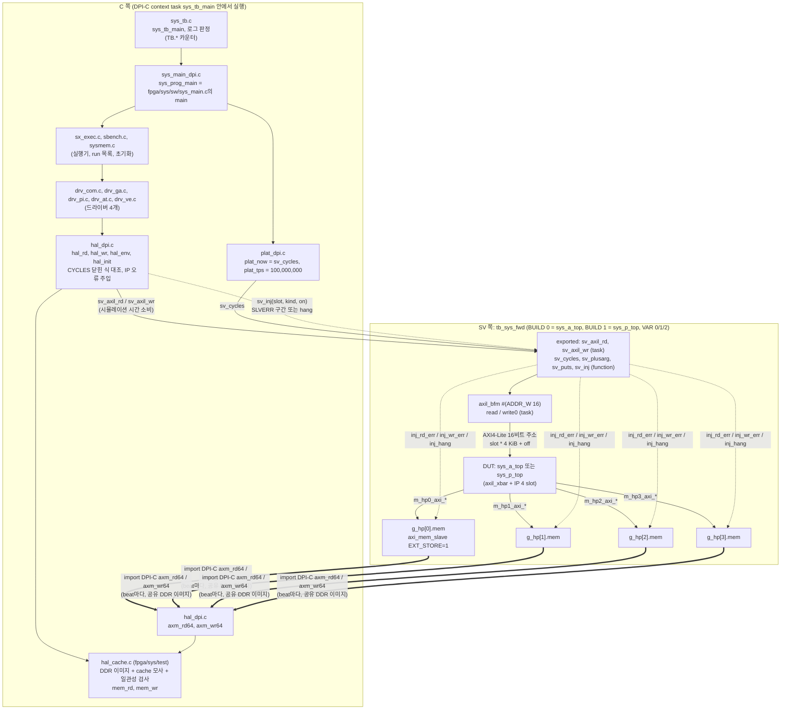
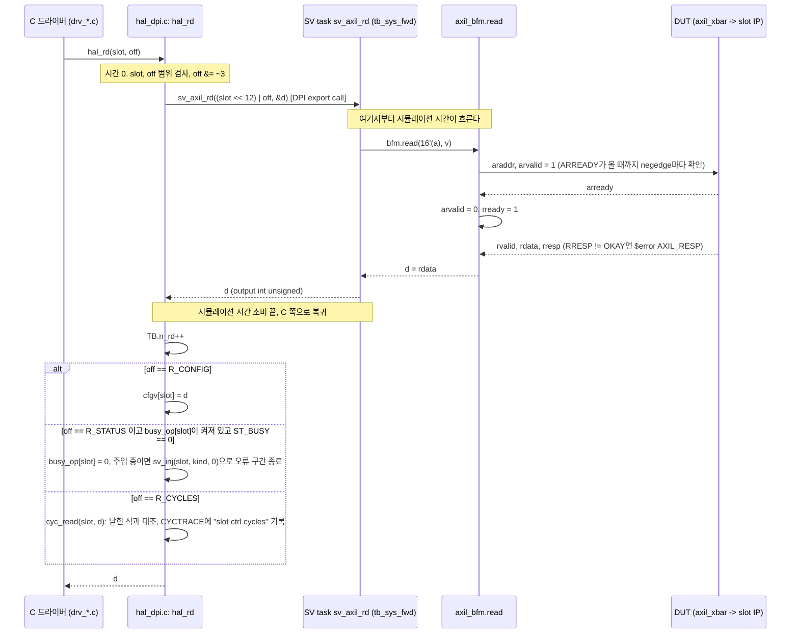

# 시스템 TB (S5-3/S5-4): C 프로그램이 RTL top을 구동하는 구조

- 원본과 확인일: 2026-11-26(3절 run 목록은 이 날짜의 `sys_fwd.cfg` 40 run, `sys_smoke.cfg` 2 run에 맞춤. 1, 2절의 구조 그림은 2026-11-23에 읽은 소스 기준이며 이번에 다시 대조하지 않았다). 소스 `tb/sys_top/tb_sys_fwd.sv`, `hal_dpi.c`, `plat_dpi.c`, `sys_tb.c`, `sys_main_dpi.c`, `tb/common/axil_bfm.sv`, `tb/common/axi_mem_slave.sv`, 회귀 설정 `sim/tests/sys_smoke.cfg`, `sys_fwd.cfg`, 설명 `docs/spec/system.md` 3.2절, `docs/spec/hierarchy.md` 3.13절, 결과 `docs/log.md`(2026-11-23 S5-3, S5-4, 2026-11-26 S5-4 후속).
- 이 그림은 소스에서 읽은 구조이고, 시뮬레이션 trace에서 뽑은 파형이 아니다. 2절의 시간 표시는 `axil_bfm.read`의 코드 순서이며 cycle 수는 적지 않았다(측정하지 않음).
- 결과(`log.md`, [측정, 수퍼바이저 재실행]): `./sim/run.sh all` 515 run, fails 0(2026-11-26 S5-4 후속 뒤. 2026-11-23의 491 run에서 24 run 추가. 그중 `sys_fwd.cfg` 쪽은 24 -> 40으로 16 run이고 나머지 8 run은 시스템 TB 밖의 cfg이며 이 문서에서 세지 않았다). 합성, timing, 보드는 미확인.

## 1. block diagram

`fpga/sys/sw`의 실행기와 드라이버는 수정 없이 컴파일해 그대로 쓰고, 바뀐 것은 hal.h와 plat.h를 구현하는 계층(`hal_dpi.c`, `plat_dpi.c`)이다. DDR 이미지는 C 쪽에 하나만 있고 HP 포트 4개의 memory model이 beat마다 DPI로 그것을 읽고 쓴다.

- 흐름: `tb_sys_fwd`의 initial 블록이 reset 해제 뒤 `sys_tb_main(rc)`를 부른다. 프로그램은 C에서 도는 동안 레지스터 접근마다 SV exported task로 내려가 시뮬레이션 시간을 쓴다. ARM 쪽 일(`k_exec`, cache 모사, 로그)은 시뮬레이션 시간 0이라 `RUN ticks`는 PL 시간과 AXI-Lite 시간만 담는다(`system.md` 3.2).
- 공유 메모리: HP 포트 4개가 서로 다른 IP에 연결돼 있어도 DDR 이미지는 하나다. 그래서 vec이 HP3으로 쓴 값을 gemv_acc(또는 pim, HP0)와 attn(HP1, P에서 HP2도)이 읽는 연쇄가 TB에서 실제로 성립하고, IP 쪽 일관성 검사(`ip_rd_dirty`, `ip_wr_dirty`)가 RTL의 beat마다 돈다.
- 판정은 두 곳이다. C 쪽(`sys_tb.c`): slot ID/CONFIG, CHECK의 `tok_mis`, `hash_mis`, `kmis`, `coh`, `fb`, `iperr`, CYCLES 닫힌 식. SV 쪽: memory model의 프로토콜 tag 전부와 끝의 `check_idle`, 마지막 줄 `TB_RESULT: PASS|FAIL`(`rc == 0 && viol == 0`). hang을 건 포트는 idle 검사에서 뺀다(`hung[k]`).
- HP 포트별 IP(`tb_sys_fwd.sv`의 `ports_of`, 오류 주입 대상 포트 선택용): slot 0(gemv_acc) HP0, A2에서는 HP2도. slot 1(pim) HP0. slot 2(attn) 빌드 A는 HP1, 빌드 P는 HP1과 HP2. slot 3(vec) HP3.

## 2. `hal_rd` 한 번의 sequence

`hal_rd(slot, off)`가 레지스터 하나를 읽는 동안. 시뮬레이션 시간이 흐르는 구간은 `sv_axil_rd` 안(`axil_bfm.read`)뿐이다.

- `hal_wr`는 같은 구조이고 `sv_axil_wr` -> `bfm.write0`을 부른다. `CTRL` start 비트(`v & 1`)가 오면 시작 전에 주입 횟수를 세어(`++inj_cnt == inj_op`) `sv_inj(slot, kind, 1)`을 부르고, 쓰기 뒤에 `op_rg`로 레지스터를 복사하고 `busy_op = 1`로 둔다.
- `axil_bfm`은 `+MAXD`(AXI-Lite 간격, 기본 0)만큼 랜덤 간격을 둔다. 대기 한도를 넘으면 `$fatal` `AXIL_TIMEOUT`.
- 이 task의 cycle 수(xbar 3 cycle 등)는 `log.md` S5-2의 측정값이지 이 그림에서 새로 잰 값이 아니다.

## 3. run 목록 (`sim/tests/sys_fwd.cfg` 40 run, `sys_smoke.cfg` 2 run)

모든 run은 같은 `tb_sys_fwd`이고 `-gBUILD`(0 = A, 1 = P), `-gVAR`(1 = A2 또는 PD, 2 = XB_REG 0, 3 = PV: 빌드 P의 vec N_MAX 256), `-gVE_N_MAX`(pn_fb만 128), `-sv_seed`(vsim 옵션, 4 run), plusarg(`+SX_MODELS`, `+SX_STEPS`, `+SX_LIST`, `+SX_RUNS`, `+EXP_CHECKS`)만 다르다. run 종류 글자: P 분해(CYCLES 포함), K kernel 비교(IP 호출마다 ARM kernel과 비교), W warm start(앞 위치를 ARM에서 돌려 KV를 채운 뒤 마지막 위치만 IP). 모델 1 = 260K, 2 = 15M. mask의 비트 정의는 `system.md` 4.1절.

### 3.1 smoke (`sys_smoke.cfg`, S5-3)
| run | 빌드 | 내용 |
|---|---|---|
| `q_a` | A | 260K 위치 0 mask ff, run P와 K. slot 탐지(ID/CONFIG 대조), CHECK 2 |
| `q_p` | P | 위와 같음 |

### 3.2 forward (`sys_fwd.cfg`, S5-4)
| run | 빌드 | 모델, 위치 | mask 목록 / run | 내용 |
|---|---|---|---|---|
| `p_full` | P | 260K 0..3 | ff / P, K | 초기화 LDW와 위치 0..3. token, hash, KCMP, CYCLES |
| `p_warm` | P | 260K 0..510 ARM, 511 | ff / W | KVW 동기 뒤 T 512 한 위치 |
| `p_single` | P | 260K 0..1 | 비트 8개 각각 / P, K | mask 비트 단독 |
| `p_masks` | P | 260K 0..1 | 0, 3, 82, 7, f8, df / P, K | mask 조합 |
| `p_opt` | P | 260K 0..1 | ff:0c, ff:0f, ff:09, ff:1d, 3:0f / P, K | opt 변형(DEFER_AT 0, PIM_BATCH 1, WRGB_SKIP 0, COH_STRICT, G+C PIM_BATCH) |
| `p_xb0` | P (VAR 2, XB_REG 0, `+MAXD=2`) | 260K 0..1 | ff / K | register slice 끔, AXI-Lite 간격 |
| `pd_m1` | PD (VAR 1, KV_SRC 1) | 260K 0..1 | ff, 4 / P, K | attention KV를 DDR로 |
| `a_m1` | A | 260K 0..3 | ff, 3 / P, K | DDR KV attention hs 8 on HS_MAX 64 |
| `a_m1_single` | A | 260K 0..1 | 비트 각각, 82, ff:05 / P, K | mask 비트 단독, FUSE_AM 0 |
| `a_m1_warm` | A | 260K 0..510 ARM, 511 | ff / W | |
| `a_xb0` | A (VAR 2) | 260K 0..1 | ff / K | |
| `a2_m1` | A2 (VAR 1, GA_P 2) | 260K 0..1 | ff, 3 / P, K | gemv_acc slice 1이 HP2 |
| `a_m2` | A | 15M 0..3 | ff / P | `+DDR_CK`, `+DDR_TK` 이미지 필요 |
| `a_m2_k` | A | 15M 0..1 | ff / K | |
| `a_m2_warm` | A | 15M 0..254 ARM, 255 | ff / W | |
| `a_err_rd` | A | 260K 0..1 | ff / P | gemv_acc(slot 0) SLVERR 읽기, 기대 IPERR 1 (err) |
| `a_err_wr` | A | 260K 0..1 | ff / P | vec(slot 3) SLVERR 쓰기, 기대 IPERR 1 (err) |
| `a_err_hang` | A | 260K 0..1 | ff / P | attn(slot 2) 응답 없음, 기대 IPERR 1 (timeout), `+EXP_FB=1000` |
| `p_err_rd` | P | 260K 0..1 | ff / P | pim(slot 1) SLVERR 읽기 |
| `p_err_wr` | P | 260K 0..1 | ff / P | attn(slot 2) SLVERR 쓰기 |
| `p_err_hang` | P | 260K 0..1 | ff / P | vec(slot 3) timeout, `+EXP_FB=1000` |
| `p_stall` | P (`+PROF=2`, `+MAXD=1`) | 260K 0..1 | ff / P, K | stall run. HP 4개 모두 AR/AW/W/R/B 50 % stall, R latency 1~60, B 1~40 |
| `a_stall` | A (`+PROF=3`) | 260K 0..1 | ff / P, K | stall run. 포트마다 다른 profile(HP0 stall 1's, HP1 2's, HP2 30 % / R 5~40 / B 1~10, HP3 10 % / R 1~80 / B 1~60) |
| `a_m2_stall` | A (`+PROF=1`) | 15M 0 | ff / P | stall run. HP 4개 모두 20 % stall, R latency 1~30, B 1~20. 15M 이미지 필요 |

#### 3.2.1 S5-4 후속 추가 run 16개 (2026-11-25, `sys_fwd.cfg` 머리 주석 "S5-4 follow-up")
| run | 빌드 | 모델, 위치 | mask 목록 / run | 내용 |
|---|---|---|---|---|
| `pv_m1` | PV (BUILD 1, VAR 3, vec N_MAX 256) | 260K 0..1 | ff, f8 / P, K | 260K의 모든 vec op가 guard `n <= N_MAX`를 통과(fallback 0, 프로그램이 읽은 vec CONFIG = 256) |
| `pn_fb` | P에 vec N_MAX 128(`-gVE_N_MAX=128`, 계획된 빌드 아님) | 260K 0..1 | ff / P, K | guard가 SWIGLU(n 172 > 128)를 vec이 켜진 채 ARM으로 보냄. 2 위치에서 fallback 정확히 20(`+EXP_FB=20 +EXP_FB_EXACT=1`). token, hash, K 비교, COH 0 |
| `pv_stall` | PV (`+PROF=2`) | 260K 0..1 | ff / P, K | 변형 빌드 PV의 stall run |
| `a_err_rd_st` | A (`+PROF=1`) | 260K 0..1 | ff / P | `a_err_rd`와 같은 주입(gemv_acc slot 0 SLVERR 읽기)을 memory stall 아래에서 |
| `a_err_wr_st` | A (`+PROF=2`) | 260K 0..1 | ff / P | `a_err_wr`(vec slot 3 SLVERR 쓰기)를 stall 아래에서 |
| `a_err_hang_st` | A (`+PROF=3`) | 260K 0..1 | ff / P | `a_err_hang`(attn slot 2 응답 없음, timeout, `+EXP_FB=1000`)을 stall 아래에서 |
| `p_err_rd_st` | P (`+PROF=3`) | 260K 0..1 | ff / P | `p_err_rd`(pim slot 1 SLVERR 읽기)를 stall 아래에서 |
| `p_err_wr_st` | P (`+PROF=1`) | 260K 0..1 | ff / P | `p_err_wr`(attn slot 2 SLVERR 쓰기)를 stall 아래에서 |
| `p_err_hang_st` | P (`+PROF=2`) | 260K 0..1 | ff / P | `p_err_hang`(vec slot 3 timeout, `+EXP_FB=1000`)을 stall 아래에서 |
| `a2_stall` | A2 (VAR 1, `+PROF=1`) | 260K 0..1 | ff, 3 / P, K | 변형 빌드 stall run |
| `pd_stall` | PD (VAR 1, `+PROF=2`) | 260K 0..1 | ff, 4 / P, K | 변형 빌드 stall run |
| `p_xb0_stall` | P (VAR 2 XB_REG 0, `+PROF=3`, `+MAXD=2`) | 260K 0..1 | ff / P, K | 변형 빌드 stall run |
| `p_stall_sv2`, `p_stall_sv3` | P | 260K 0..1 | ff / P, K | `p_stall`(`+PROF=2`, `+MAXD=1`, `+SEED=51`)과 같고 `-sv_seed 2` 또는 3 |
| `a_stall_sv2` | A | 260K 0..1 | ff / P, K | `a_stall`(`+PROF=3`, `+SEED=52`)과 같고 `-sv_seed 2` |
| `a2_stall_sv2` | A2 | 260K 0..1 | ff, 3 / P, K | `a2_stall`(`+PROF=1`, `+SEED=71`)과 같고 `-sv_seed 2` |

- 위 표는 15행이지만 `p_stall_sv2`, `p_stall_sv3`를 한 행에 묶었으므로 run 수는 16(= 40 - 24)이다. 마지막 4개(sv)는 memory model의 random 패턴만 바꾸고 `+SEED`와 검사는 기본 run과 같다. `+SEED`는 HP memory model thread를 다시 seed하지 않으므로 `-sv_seed`가 필요했다(cfg 머리 주석).
- 오류 주입 6개(`*_err_*_st`)의 `+TB_IPFAULT_SLOT`, `+TB_IPFAULT_OP`, `+EXP_IPERR_*`는 stall 없는 짝과 같은 값이고 `+SEED`와 `+PROF`만 다르다(cfg 확인). 로그 항목(agent 보고)상 stall 아래 오류 주입은 주입한 IPERR 1건만 나왔다.

- 정상 run의 통과 조건: 프로그램이 slot 표로 기대 빌드(`+EXP_BUILD`)를 찾고, 모든 CHECK의 `tok_mis`, `hash_mis`, `kmis`, `coh` 0, (주입 없으면) `fb`, `iperr` 0, `RESULT PASS`, gemv_acc(P = 1)와 vec 모든 op의 CYCLES == 닫힌 식, memory model 프로토콜 tag 0, 끝에 idle.
- 오류 주입 run: 주입한 IPERR만 기대(`+EXP_IPERR_IP`, `+EXP_IPERR_KIND`)하고 token, hash, K 비교, COH는 여전히 0. 프로그램 RESULT는 FAIL이 정상(`sys_fwd.cfg` 머리 주석).
- `sys_fwd.cfg`의 15M run 3개는 `data/third_party/models/`의 `stories15M.bin`, `tokenizer.bin`이 있어야 돈다(cfg `NEED`).
- `+PROF=<n>`(`tb_sys_fwd.sv` 머리 주석, 2026-11-23 S5-4 보완): HP memory model 4개에 random backpressure와 latency를 건다(`axi_mem_slave`의 `cfg_stall`/`cfg_lat`). 0(기본) stall 없음 latency 1, 1 = AR/AW/W/R/B 20 % stall에 R latency 1~30, B 1~20, 2 = 50 %에 R 1~60, B 1~40, 3 = 포트마다 다름. `PROF` != 0이면 C 쪽(`hal_dpi.c`)이 같은 값을 읽어 CYCLES 닫힌 식을 **하한**으로 검사하고(`CYC_LOW`), 모든 op에서 RD_STALL, WR_STALL <= CYCLES(`ST_BAD`)를 확인하며, HP3 R stall이 있었으면 vec RD_STALL 합 > 0(`VE_RDST`)을 요구한다. 끝에 `AXI_MEM_STALL`(채널별 stall)과 `SYSTB STALL` 줄이 찍힌다. stall run 3개 모두 token, logits hash, K 비교, COH, fallback, IPERR, AXI 위반 0(`log.md`). stall run의 RUN ticks/token [측정, 시뮬레이션, TB random 모델, 보드 값 아님]: p_stall 43,613(stall 없음 31,688), a_stall 85,953(63,819), a_m2_stall 2,514,750(2,021,290).
- 결과(`log.md`, [측정, 수퍼바이저 재실행]): 2026-11-26 기준 위 40 run을 포함한 전체 회귀 515 run, fails 0(2026-11-23 시점은 24 run 포함 491 run). `pn_fb` 로그: fallback 20(run마다 10), tok_mis 0, hash_mis 0, coh 0. 2026-11-23 시점의 15M 위치 0..3 run의 로그에서 `tok_mis` 0, `hash_mis` 0, `coh` 0, `fb` 0, `iperr` 0, CYCLES 식 대조 704건 불일치 0.
- 2026-11-23 S5-4 보완의 미확인 항목 중 stall 아래 오류 주입 조합, 변형 빌드(A2, PD, XB_REG 0)의 stall run, 메모리 모델 seed, gemv_acc WR_STALL이 0인 이유는 2026-11-26 S5-4 후속에서 다뤘다(3.2.1절의 run. WR_STALL 0은 write buffer 32 beat가 차야 하는데 y 생산이 beat당 9~74 cycle이라 구조상 정상, agent 보고). PROF 0 run은 모두 메모리 latency 1, stall 없음.
- 아직 미확인(`log.md` 2026-11-26): 실행기의 8비트 q 레코드 변환을 시스템 수준에서 실행하지 못함(프로그램 형식이 K12V8 고정), guard fallback은 vec만 실행(gemv, pim, attention guard는 같은 수정이 적용되나 실행 증거 없음), 호스트 테스트에 guard fallback 뒤 데이터 검사 없음, N_MAX 256의 합성 결과, timeout 뒤 PL reset 경로와 보드 동작 전부.
