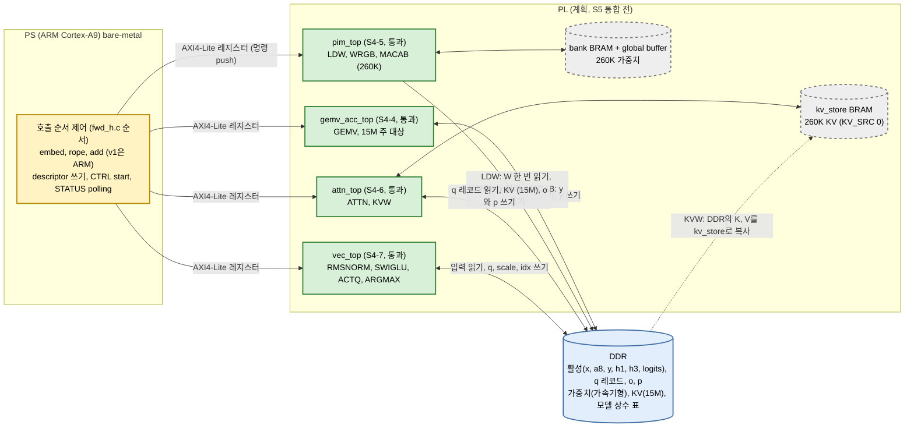

# 시스템 개요: 통과한 L3 IP 4종과 token 한 개의 흐름

- 원본과 확인일: 확인일 2026-11-20(S4-7 완료 뒤). kernel 호출 순서는 `model/src/fwd_h.c`의 `lm_h_forward`를 읽어 확인했다(golden이자 SW baseline). IP의 op와 데이터 배치는 `docs/spec/gemv_acc.md` 1절, `docs/spec/pim.md` 1~2절, `docs/spec/attn.md` 2절, `docs/spec/vec.md` 1~2절, ARM에 남기는 kernel은 `docs/spec/arch.md` 5.5절, HP 포트 배분은 `arch.md` 7절(초안)이다. 수치는 `docs/log.md` S4-4~S4-7 항목에서 가져왔다.
- **이 문서의 시스템 통합(L4 `sys_p_top`, `sys_a_top`)은 계획(S5)이다.** RTL이 없고, 이 문서의 연결 그림은 각 IP의 단독 인터페이스를 이어 놓은 개념도다. 아직 어떤 시스템 빌드도 시뮬레이션되지 않았다.
- **cycle 값은 모두 Questa 시뮬레이션 모델의 값이다**(`axi_mem_slave`, stall 없음, read/B latency 1, 100 MHz 타이밍 미확인). 보드 값이 아니고 HP 포트의 실제 latency와 대역폭, ARM 호출 비용, 캐시 flush 비용은 들어 있지 않다. 합계는 [계산]이다.
- 통과한 L3 IP 4종: `gemv_acc_top`(S4-4), `pim_top`(S4-5), `attn_top`(S4-6, S4-6b), `vec_top`(S4-7). 회귀 `./sim/run.sh all` 424 run, fails 0 [측정, 수퍼바이저 재실행].

## 1. 통과한 IP 4종

| IP | op | 하는 일 | 데이터 위치 | 대상 | 근거 |
|---|---|---|---|---|---|
| `gemv_acc_top` | GEMV | `y[r] = sat32(rshr(dot8(W[r], x) xm wm[r], we + xe - fo))`, 선택적으로 y의 argmax(분류기 융합, `y_en` = 0이면 y를 쓰지 않음) | W(행 레코드), x(int8), y(int32)가 모두 DDR. IP가 HP 포트로 직접 읽고 씀 | 15M 주 대상, 260K는 비교용 | `gemv_acc.md` 1절 |
| `pim_top` | LDW, WRGB, MACAB | 같은 GEMV 식. W는 초기화 때 `LDW`로 DDR에서 bank에 한 번 적재, x는 `WRGB`로 global buffer에 적재 | W: bank BRAM(4 bank). x: global buffer. y: DDR | 260K | `pim.md` 1~2절 |
| `attn_top` | ATTN, KVW | head 하나의 attention(P1 score, P2 exp와 합, 나눗셈, P3 V 누산, O). `p_en`이면 p도 씀. KVW는 KV를 kv_store에 씀 | q 레코드: DDR. KV: `KV_SRC` 0이면 kv_store(BRAM, 260K), 1이면 DDR(15M). o, p: DDR | 260K(BRAM KV), 15M(DDR KV) | `attn.md` 2절 |
| `vec_top` | RMSNORM, SWIGLU, ACTQ, ARGMAX | 4 kernel(`vec.md` 1절). `actq_core`는 RMSNORM, SWIGLU, ACTQ가 공유 | 입력(x, g, h1, h3, v), 출력(q, scale, idx) 모두 DDR | 두 모델 | `vec.md` 1~2절 |

- IP는 모두 AXI4-Lite slave(레지스터 `ID`, `CONFIG`, `CTRL`, `STATUS`, `ERR`, `CYCLES`, `RD_STALL`, `WR_STALL`, `OPS` 틀이 공통)와 HP 포트용 AXI4 read/write master를 가진다(`gemv_acc_top`은 slice P개의 read master, 나머지는 각 1개). 호출은 PS가 descriptor 레지스터를 쓰고 `CTRL`로 start, `STATUS` polling이다.
- ARM에 남기는 kernel(v1): embed, rope, add(`arch.md` 5.5: PC 비중 합 0.5% 이하, `measure.md` 7절). head별 ACTQ를 `vec_top`에 보낼지 ARM에 둘지는 S5에서 정한다(`arch.md` 5.1은 ARM 유지를 권고, `vec.md` 6.3은 ARM 호출 비용과의 비교를 보드 측정 전이라 판단하지 않음).

## 2. 계획(S5): 시스템 구성 개념도

- 초록 = RTL 시뮬레이션을 통과한 IP(S4), 노랑 = ARM, 파랑 = DDR, 회색 점선 = IP 내부 BRAM.
- 한 시스템에서 gemv 쪽은 하나만 쓴다: 260K PIM형 시스템(`sys_p_top`)은 `pim_top` + `attn_top` + `vec_top`, 15M 가속기형 시스템(`sys_a_top`)은 `gemv_acc_top` + `attn_top` + `vec_top`(`hierarchy.md` 1절 L4). 이 그림은 두 구성을 겹쳐 그렸다.
- HP 포트 배분은 `arch.md` 7절의 초안이다: 가속기형 시스템은 `gemv_acc_top` HP0, `attn_top` HP1, `vec_top` HP3. PIM형 시스템은 트래픽이 작아 HP 하나를 interconnect로 공유. 이 배분과 DDR 포트 독립성은 [미확인]이다.
- 같은 HP 포트에서 여러 IP가 동시에 요구하는지는 이 그림에서 정하지 않았다(forward가 순차라 한 번에 한 IP만 일한다고 보는 것이 `arch.md` D10의 전제).

## 3. token 한 개의 layer 흐름 (`fwd_h.c` 기준)

`lm_h_forward`의 호출 순서를 그대로 옮겼다(코드에서 확인한 것만). 상자의 IP 이름은 어느 IP가 그 kernel을 실행할 수 있는지(`vec.md`, `attn.md`, `pim.md`, `gemv_acc.md`의 op)이고, 어느 호출을 실제로 오프로드할지는 S5에서 정한다.

```mermaid
flowchart TD
    emb["K_EMBED (cls 행 하나, x = int32 [D])<br/>ARM (v1)"]:::arm
    subgraph LAYER["layer l = 0 .. n_layers - 1"]
        rn1["rmsnorm(x, ra[l]) -> a8, as<br/>vec_top RMSNORM"]:::vec
        qkv["gemv wq -> q, gemv wk -> k, gemv wv -> v<br/>(같은 a8, as)<br/>gemv_acc_top GEMV 또는 pim_top MACAB"]:::gemv
        rope["rope(q), rope(k)<br/>ARM (v1)"]:::arm
        kvq["kv head j마다: actq(kr, hs), actq(v, hs)<br/>-> kc, kcs, vc, vcs (KV cache에 쓰기)<br/>vec_top ACTQ (ARM 유지도 가능, S5 결정)"]:::vec
        kvw["(260K, KV_SRC 0) KVW: DDR의 K, V를 kv_store에 복사<br/>attn_top KVW"]:::attn
        hq["head j마다 (n_heads개): actq(qr + j hs, hs) -> qh, qhs<br/>vec_top ACTQ (ARM 유지도 가능, S5 결정)"]:::vec
        at["head j마다: K_ATTN2 (또는 K_ATTN)<br/>(Tw, hs, kbit, vbit; qh, kc, kcs, vc, vcs, elut) -> p, att + j hs<br/>attn_top ATTN"]:::attn
        aq["actq(att, D, qmax 127) -> a8, as<br/>vec_top ACTQ"]:::vec
        wo["gemv wo -> y<br/>gemv_acc_top GEMV 또는 pim_top MACAB"]:::gemv
        add1["add(x, y) -> x2, x와 x2 교환<br/>ARM (v1)"]:::arm
        rn2["rmsnorm(x, rf[l]) -> a8, as<br/>vec_top RMSNORM"]:::vec
        w13["gemv w1 -> h1, gemv w3 -> h3<br/>gemv_acc_top GEMV 또는 pim_top MACAB"]:::gemv
        swi["K_SWIGLU(h1, h3, H, sig_bits, slut) -> a8, as<br/>vec_top SWIGLU"]:::vec
        w2["gemv w2 -> y<br/>gemv_acc_top GEMV 또는 pim_top MACAB"]:::gemv
        add2["add(x, y) -> x2, x와 x2 교환<br/>ARM (v1)"]:::arm
    end
    rnf["rmsnorm(x, rfin) -> a8, as<br/>vec_top RMSNORM"]:::vec
    cls["gemv cls -> logits int32 [vocab]<br/>gemv_acc_top GEMV 또는 pim_top MACAB"]:::gemv
    am["K_ARGMAX(logits, vocab) -> argmax<br/>vec_top ARGMAX (15M은 gemv_acc의 argmax 융합으로 대체 가능)"]:::vec

    emb --> rn1 --> qkv --> rope --> kvq --> kvw --> hq --> at --> aq --> wo --> add1 --> rn2 --> w13 --> swi --> w2 --> add2
    add2 -->|"다음 layer"| rn1
    add2 -->|"마지막 layer 뒤"| rnf --> cls --> am

    classDef vec fill:#d8f0d8,stroke:#2e7d32,stroke-width:2px,color:#000
    classDef gemv fill:#e3eefc,stroke:#3b6aa0,stroke-width:2px,color:#000
    classDef attn fill:#f3e3fc,stroke:#7a3ba0,stroke-width:2px,color:#000
    classDef arm fill:#fff3c4,stroke:#b58900,stroke-width:2px,color:#000
```

- 색: 초록 = `vec_top`, 파랑 = GEMV(`gemv_acc_top` 또는 `pim_top`), 보라 = `attn_top`, 노랑 = ARM.
- 코드에서 확인한 순서: embed -> (layer마다) rmsnorm -> gemv wq, wk, wv -> rope q, k -> (kv head마다) actq k, actq v -> (head마다) actq q, attention -> actq att -> gemv wo -> add -> rmsnorm -> gemv w1, w3 -> swiglu -> gemv w2 -> add -> (마지막) rmsnorm -> gemv cls -> argmax. 위 그림의 순서와 호출 이름(`rmsnorm`, `gemv`, `actq`, `rope`, `add`, `K_ATTN2`/`K_ATTN`, `K_SWIGLU`, `K_ARGMAX`)은 `fwd_h.c`의 코드와 같다.
- `fwd_h.c`에는 KVW가 없다(golden은 KV cache가 DDR 상의 `kc`, `vc`, `kcs`, `vcs` 배열). `kvw` 상자는 `attn_top`이 `KV_SRC` 0일 때 KV를 kv_store로 옮기는 op이고, 같은 golden 배치를 읽는다(`attn.md` 2절, `log.md` S4-6의 "위치마다 layer 0..4에 KVW 후 ATTN"). 순서(kv actq 뒤, attention 앞)는 그 데이터 의존에서 온 것이지 `fwd_h.c`에서 읽은 것이 아니다.
- 호출 수 확인: 260K 한 token의 호출 수는 `vec.md` 6.3의 표와 `fwd_h.c`의 구조가 맞는다 [계산]: RMSNORM 2 x 5 + 1 = 11, SWIGLU 5, ACTQ (kv head 4 x 2 + head 8 + att 1) x 5 = 85, ARGMAX 1(layer 5개, `attn_top`의 `NL` 기본값 5, `NKV` 4, head 8은 `vec.md`의 ACTQ n = 8(80회), 64(5회)와 맞춘 값이고 모델 설정 파일은 이 문서에서 열지 않았다). GEMV는 layer마다 7(wq, wk, wv, wo, w1, w3, w2, `pim.md` 2절의 "MACAB 7회"와 같음) + 분류기 1.

## 4. token당 cycle 표 [측정, Questa 시뮬레이션 모델, 보드 값 아님]

조건: 모든 IP가 `axi_mem_slave` 모델(stall 없음, read/B latency 1), 기본 parameter, 100 MHz 타이밍 미확인. 시스템 통합과 ARM 연산은 포함하지 않는다. attention은 위치 T에 따라 커지므로 표의 값은 각 모델의 **최대 위치**(260K T 512, 15M T 256) 값이다. GEMV와 vec는 위치와 거의 무관하다(vec는 위치 평균, `vec.md` 6.3).

| IP | op | 260K (PIM형 시스템) | 260K (가속기형, 비교) | 15M (가속기형 시스템) | 출처 |
|---|---|---|---|---|---|
| `pim_top` | token의 MACAB 전체(57 명령 한 run) | 4,499~4,506 | - | - | `log.md` S4-6b(S4-5 값 4,501~4,506이 "변화 없음") |
| `pim_top` | 초기 적재 LDW 36개(1회) | 36,629 (token당이 아님) | - | - | `log.md` S4-6b |
| `gemv_acc_top` | token의 GEMV 전체 | - | P = 1 37,903~37,938 | 1,951,992 | `log.md` S4-6b(P 조건은 log에 적히지 않음. S4-4 값 15M 1,951,575~1,951,644, 260K P = 1 37,596, P = 2 19,597) |
| `attn_top` | ATTN token당 | H_PAR 2, T 512, BRAM KV: 32,470 | 같은 값 | DDR KV, T 256: H_PAR 1 198,403, H_PAR 2 99,496 | `log.md` S4-6b(32,470, 198,403), S4-6(H_PAR 2의 99,496과 260K H_PAR 1의 64,685는 S4-6b 재측정 전 값) |
| `attn_top` | KVW token당 | 190 | 190 | - | `log.md` S4-6 |
| `vec_top` | RMSNORM | 3,993 | 3,993 | 16,321 | `vec.md` 6.3 |
| `vec_top` | SWIGLU | 3,005 | 3,005 | 14,386 | `vec.md` 6.3 |
| `vec_top` | ACTQ (260K 85 호출, 15M 114 호출) | 8,155 | 8,155 | 23,019 | `vec.md` 6.3 |
| `vec_top` | ARGMAX | 527 | 527 | 32,015 | `vec.md` 6.3 |
| `vec_top` | 합 | 약 15,680 | 약 15,680 | 약 85,741 | `log.md` S4-7 |

합계 [계산, 위 값의 단순 합. ARM 연산(embed, rope, add), ACTQ 중 ARM에 남기는 것, KVW 190, 호출 오버헤드, 데이터 이동, HP latency 제외]:

| 구성 | GEMV | attention | vec | 합 | 비중(GEMV / attention / vec) |
|---|---|---|---|---|---|
| 260K PIM형, T 512 | 약 4,500 | 32,470 | 약 15,680 | 약 52,650 | 약 9% / 62% / 30% |
| 260K 가속기형 P = 1, T 512 | 37,903~37,938 | 32,470 | 약 15,680 | 86,053~86,088 | 약 44% / 38% / 18% |
| 15M 가속기형(attention H_PAR 1), T 256 | 1,951,992 | 198,403 | 약 85,741 | 약 2,236,136 | 약 87% / 9% / 4% |

- 비중은 합 대비 [계산]이고 반올림했다. 합은 위 표 값에서 직접 더했다(예: 260K PIM형 4,500 + 32,470 + 15,680 = 52,650, GEMV 약 4,500은 4,499~4,506의 근삿값).
- 같은 값 비교: 260K에서 가속기형 P = 1 대비 PIM형의 GEMV cycle은 약 8.4배 적다(`log.md` S4-6b: 약 8.4배 유지, 시뮬레이션 모델). 합 기준으로는 attention과 vec가 같이 있어 약 1.6배(86,053~86,088 대 52,650)다 [계산].
- 관찰(`log.md` S4-7의 오케스트레이터 관찰): GEMV를 PIM으로 줄이면 260K의 병목이 attention(T 512에서 약 32,500)과 양자화(vec 약 15,700)로 옮겨 간다. head별 ACTQ를 attention 앞단에 융합하는 것은 S5의 검토 대상이다(`arch.md` 5.1의 권고와 같은 방향).
- 이 표는 시뮬레이션 모델의 합이다. 시스템의 end-to-end 시간은 S5 통합과 S6 보드 측정 뒤에 추정과 실측을 구분해 적는다(Amdahl 추정과 실측 비교는 `project-flow.md`의 시스템 프로젝트 방식).
