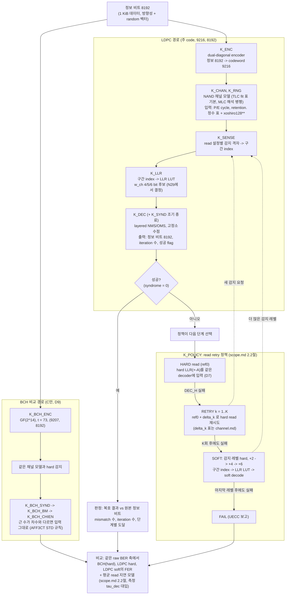
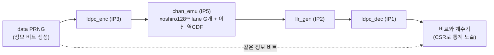
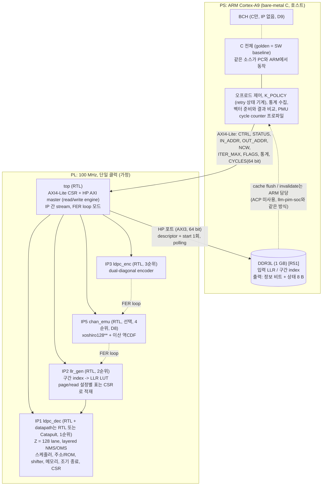

# 시스템 구조 (계획): nand-ecc-subsystem

**이 문서의 그림은 모두 "계획"이다(구현 전, N1 스펙 기준).** RTL, C 코드, 시뮬레이션이 아직 없다. 구현이 G4(golden 대비 mismatch 0)를 통과하면 실제 구현에 맞춰 갱신한다(`visual-docs.md`). 신호 이름과 비트폭, latency는 확정되지 않았다.

- 작성일: 2026-11-26. 근거: `docs/spec/scope.md`(1~5절, 10절 결정), `docs/spec/code.md`, `docs/spec/channel.md`(이름만 인용), `docs/plan.md`.
- 표기는 `scope.md`를 따른다. **[계산]** 스크립트나 식으로 구한 값(합성, 시뮬레이션, 보드 결과가 아님). **[추정]** 가정이나 판단이 들어간 값. **미확인** 출처나 근거를 확인하지 못한 것. 이 문서에 측정값은 없다.
- 전제(`scope.md` 머리말): Zybo Z7-20(XC7Z020: LUT 53,200, BRAM36 140, DSP 220), PL 100 MHz 단일 클럭 가정, PS(Cortex-A9)가 호스트. 합성 전이라 자원 수치는 확정이 아니다.

## 1. 시스템 data flow (계획)

### 1.1 read 경로와 retry 루프, BCH 비교 경로

C 전체 구성(`scope.md` 2절)의 kernel 경계를 따른 흐름이다. 굵은 이름은 프로파일 단위 kernel(`K_*`)이고, 값은 `scope.md`의 형식(C 전체 구성, 3절, `code.md`)에서 가져왔다. retry와 soft 단계의 상태 기계는 `scope.md` 2.2절이다. BCH 경로는 C 비교용이며 IP로 만들지 않는다(결정 D9).

- 감지 단계마다 `K_SENSE`로 돌아가는 점선이 read retry 루프다(`scope.md` 2.2절의 상태 기계). 이 그림은 흐름의 윤곽이고, 단계별 iteration 상한과 K, delta_k 값은 확정되지 않았다(정책 parameter, `channel.md` 4.2절 참조).
- 지연 모델: `tau_total = tau_hd-sen + tau_hd-xfer + tau_dec + P_hd-fail * (tau_sd-sen + tau_sd-xfer + tau_dec)`는 문헌 식([R7] 식(1))을 retry 단계까지 확장한 합이다. 감지와 전송 시간은 문헌 값(25nm MLC)을 쓰고 그 사실을 명시한다. `tau_dec`은 측정값(C 단독, ARM, PL)을 넣는다(`scope.md` 2.2절).
- 외부 기준 code(CCSDS C2 (8176, 7156), IEEE 802.3an (2048, 1723))는 golden 검증용이고 이 흐름에는 들어가지 않는다(`scope.md` 1절, 6.1절).

### 1.2 FER loop 모드 (PL 채널 에뮬레이터, 결정 D8)

DDR 경로 없이 PL 안에서 한 바퀴 도는 측정 도구 모드다(`scope.md` 5.1절). D8 결정에 따라 IP1이 G4를 통과한 뒤 착수한다(순서상 IP1 단독 G6 다음). 이 모드는 실제 SSD read 경로(workload A)가 아니라 FER 깊이용 측정 도구(workload B)이며 Amdahl 분석에서 따로 분리한다(`scope.md` 5.3절, 7절).

- 구조는 계획(`scope.md` 5.1절)이고 bit-exact 확인은 C replay(같은 seed)로 한다. 1e5 codeword 구간의 codeword별 checksum과 실패 index 목록 비교까지이며 긴 실행은 계수만 쓴다(`scope.md` 5.1절 검증 서술).
- 처리량 [계산, `s1calc.txt` 5절, 100 MHz 가정, 합성 전]: 평균 iteration 2에서 86,806 codeword/s, 5에서 71,124, 10에서 36,088 codeword/s(lane G 8, 10 iteration은 G 4~16 구간). `scope.md` 5.1절 표를 그대로 옮겼다.

## 2. IP 분할 후보와 PS/PL 경계 (계획)

근거: `scope.md` 4절(IP 목록 4.1, 데이터 경로 4.2, IP1 인터페이스 4.3, 메모리 4.4), 5절. 아래의 "각 kernel이 PS에 남는가 PL로 가는가"는 `scope.md` 4.1절의 IP 목록과 7절의 오프로드 순서에서 읽은 대응이며, 표기하지 않은 kernel(`K_SENSE`, `K_POLICY`, BCH, 채널 모델)의 배치는 `scope.md`가 따로 정하지 않았다. 그 부분은 아래에 "PS(C)"로 그렸지만 [추정]이다.

### 2.1 IP 목록 (scope.md 4.1절)

| IP | 기능 | 방식 | 순서 | 자원 [추정] |
|---|---|---|---|---|
| IP1 `ldpc_dec` | layered NMS/OMS, Z = 128 lane, 메모리, shifter, 조기 종료, 통계 | 스케줄러·주소/ROM·shifter·메모리·ET·CSR·AXI는 RTL. lane datapath(CNU/VNU)는 RTL 먼저, 같은 포트의 Catapult 버전으로 QoR 비교(선택, D4) | 1 | LUT 20k~28k(shifter 8.2k + lane 10~15k + control 2~5k), BRAM36 42, DSP 0 (합성 전, 근거 약함) |
| IP2 `llr_gen` | 감지 구간 index -> LLR LUT | RTL, IP1 입력단에 붙임 | 2 | LUT 1k 미만 |
| IP3 `ldpc_enc` | dual-diagonal encoder | RTL | 3 | 약 2k LUT |
| IP5 `chan_emu` (선택) | xoshiro128** lane + 이산 역CDF | RTL | 4 (D8) | G = 8 lane 약 3k~5k LUT, BRAM36 4 |
| top | AXI4-Lite CSR, HP AXI master, IP 간 stream, FER loop 모드 | RTL | 함께 | - |
| BCH | - | C만 (D9) | - | - |

- 시스템 합 [추정, 합성 전]: LUT 27k~40k(53,200의 51~75%), BRAM36 47~50. LUT가 빠듯하면 IP1의 P = 64가 첫 대안이다. 결정 D1(`scope.md` 10절 결정)은 LUT 추정이 합성 전 값이므로 N4 첫 모듈에서 구조 기준으로 다시 계산하고, 사용자 Vivado 리포트 전에는 확정 수치로 쓰지 않으며, lane 수를 parameter로 줄일 수 있게 설계한다고 정했다.
- 데이터 경로는 AXI DMA + AXI-Stream이 아니라 자체 HP AXI master로 정했다(D5, `scope.md` 4.2절). 근거는 서버에서 전 경로를 Questa로 검증할 수 있다는 점(DMA IP 모델은 Vivado가 생성해야 해 이 서버에서 검증 불가), 호출 비용, llm-pim-soc의 `axi_rd_eng`/`axi_wr_eng` 설계 재사용이다.

### 2.2 IP1 입출력과 메모리 (scope.md 4.3, 4.4절)

| 항목 | 내용 |
|---|---|
| DDR 입력 형식 0 | codeword당 LLR 9216 B(int8, w_ch bit 부호 확장), 연속 배치 (v1, D6) |
| DDR 입력 형식 1 (`llr_gen` 경유) | 구간 index 4 bit x 16개/beat -> 576 beat/codeword [계산]. IP2 단계에서 추가(D6) |
| DDR 출력 | codeword당 정보 비트 1024 B + 상태 8 B(iteration 수, 성공 flag, syndrome 결과) |
| golden 비교 단위 | codeword별 (출력 비트, iteration 수, 성공 flag). 내부 dump(layer별 APP)는 RTL TB에서만 |
| APP 메모리 (ping-pong 2 codeword) | 1024 bit x 144, BRAM36 15 ((w_m, w_a) = (6, 8), [계산]) |
| R 메모리 (edge별, v1) | 768 bit x 273, BRAM36 11 [계산] |
| Q 버퍼 | 1152 bit x 35(겹침 시 70 deep), BRAM36 16 [계산] |
| BRAM 합 | 15 + 11 + 16 = 42 / 140 [계산] |

- CN 메시지 압축 저장(R 압축, BRAM36 2 + FF 16,384)은 v2 실험이다(D2).

### 2.3 kernel 대응 (PS와 PL, 계획)

`scope.md` 7절의 오프로드 순서(IP1 단독 -> +IP2 -> +IP3 -> FER loop(+IP5))와 4.1절의 IP 기능에서 읽은 대응이다. 프로파일에서 시간 비중이 큰 쪽이 먼저 오프로드된다는 것이 방식이고, 비중은 N3에서 ARM으로 재서 정한다. 아래 시간 비중과 가속비는 측정 전이다.

| kernel (`scope.md` 2절) | N2 이후 PS(C) | 오프로드 대상 IP | 비고 |
|---|---|---|---|
| K_DEC (+ K_SYND) | baseline | IP1 | 1순위. ARM 단독은 [추정] 5~10 ms/codeword(10 iteration), IP1은 [계산] 2,771 cycle(10 iteration) = 27.7 us(100 MHz). 단독 가속비 [추정] 약 180~360배(N3 프로파일로 대체) |
| K_LLR | baseline | IP2 | 2순위 |
| K_ENC | baseline | IP3 | 3순위. FER loop에 필요 |
| K_CHAN, K_RNG, K_SENSE | baseline | IP5(FER loop 모드에서만) | 4순위, 선택. workload B(FER 시뮬레이션) 전용, read 경로(workload A)에는 없음 |
| K_POLICY | PS 유지 | 없음 [추정] | 상태 기계가 작음(`scope.md` 2절 "작음") |
| BCH 4종 | PS 유지 | 없음 | C 비교용만(D9) |

## 3. 열린 항목과 한계

- 이 문서는 구현 전 그림이다. IP 경계의 포트, 타이밍, latency, valid/ready 여부는 `docs/spec/hierarchy.md`(N4 전에 고정)가 원본이 되며 아직 없다.
- 자원, throughput, 가속비는 모두 [계산] 또는 [추정]이고 합성, 시뮬레이션, 보드 측정이 아니다. 특히 IP1의 LUT 20k~28k와 시스템 합 27k~40k는 근거가 약한 [추정]이다(`scope.md` 4.5절).
- 주 code의 FER, 최소 거리, trapping set은 미확인이다(N2에서 처음 측정). girth 6은 조건부 수용(결정 C3).
- "PS가 K_POLICY를 유지"와 "K_SENSE가 IP5 쪽에 속함"은 `scope.md`가 명시하지 않아 이 문서에서 정리한 [추정]이다.
- HP 포트 실효 대역폭은 미측정이다(`scope.md` 8절). llm-pim-soc의 대역폭 측정 결과를 재사용할 계획이다.
