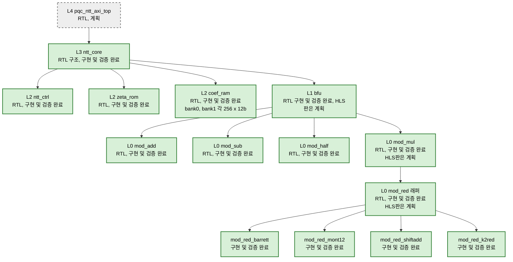
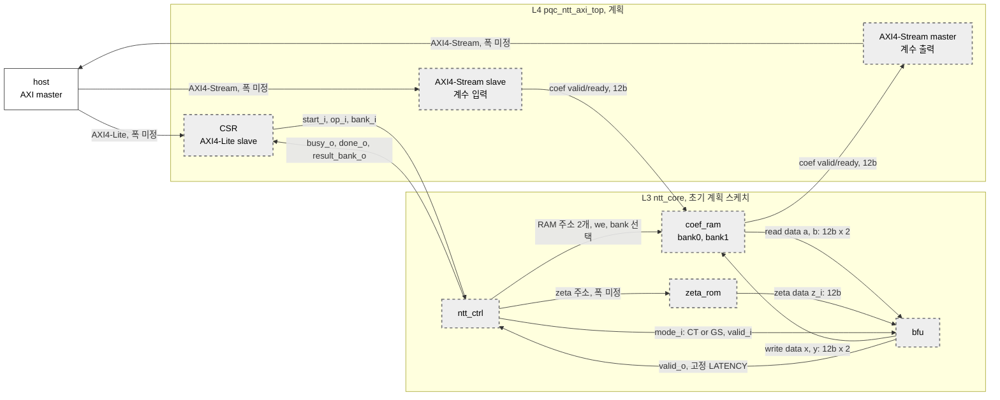
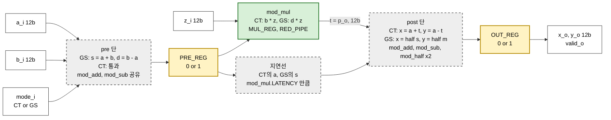
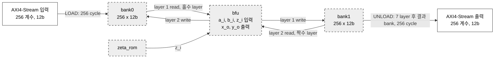

# 계층 block diagram (L4 에서 L0)

- 원본 파일과 확인일: 확인일 2026-11-16. L3 `ntt_core` 항목만 2026-11-17에 RTL과 대조해 갱신했다.
  - L0 (구현 완료): `rtl/l0/mod_add.sv`, `mod_sub.sv`, `mod_half.sv`, `mod_red.sv`, `mod_red_barrett.sv`, `mod_red_mont12.sv`, `mod_red_shiftadd.sv`, `mod_red_k2red.sv`, `mod_mul.sv`, `rtl/pkg/mlkem_pkg.sv`
  - L3 (구현 완료, 2026-11-17 추가): `rtl/l3/ntt_core.sv`. 그림과 RTL 대조는 [l3_ntt_core.md](l3_ntt_core.md).
  - L1 `bfu`와 L2 3개 모듈은 통과 상태로 표시했다(2026-11-17). L2 `ntt_ctrl`은 [l2_ntt_ctrl.md](l2_ntt_ctrl.md)에 있다. L4는 계획 표시 유지(검증 전).
  - 아래 "계획" 서술 중 L1 이상: `docs/spec/hierarchy.md`(트리, L0 포트)와 `docs/spec/arch.md`(L1 이상 구조)가 원본이다.
- 구분 표기:
  - 구현 및 검증 완료 = 실선 테두리, 초록 계열 (L0 의 `mod_add`, `mod_sub`, `mod_half`, `mod_red` 4종, `mod_mul`).
  - 계획 = 점선 테두리, 회색 계열. 스펙(`arch.md`) 기준이며 RTL로 확인하지 않은 구조다.
- 이 문서의 계획 블록 정보는 스펙에서 가져왔다. 스펙에 없는 폭(AXI 데이터 폭, ROM 주소 폭, CSR 맵)은 "미정"으로 두었다.

## 1. 인스턴스 트리와 현재 상태

| 블록 | 계층 | 구현 방식 | 상태 | 근거 |
|---|---|---|---|---|
| `pqc_ntt_axi_top` | L4 | RTL | 계획 | hierarchy.md |
| `ntt_core` | L3 | RTL (구조) | 구현 및 검증 완료 (P3-3, 2026-11-17) | `rtl/l3/ntt_core.sv` 존재, 검증 결과는 `docs/log.md` P3-3. 구조와 data flow는 [l3_ntt_core.md](l3_ntt_core.md) |
| `ntt_ctrl`, `zeta_rom`, `coef_ram` | L2 | RTL | 구현 및 검증 완료 | hierarchy.md |
| `bfu` | L1 | RTL + HLS | RTL 구현 및 검증 완료, HLS판은 계획 | hierarchy.md, arch.md |
| `mod_add`, `mod_sub`, `mod_half` | L0 | RTL | 구현 및 검증 완료 | `rtl/l0/*.sv` 존재, 검증 완료는 오케스트레이터 지시 |
| `mod_red` 4종 변형 및 래퍼 | L0 | RTL (HLS판 계획) | 구현 및 검증 완료 | 위와 같음 |
| `mod_mul` | L0 | RTL (HLS판 계획) | 구현 및 검증 완료 | 위와 같음 |

`mod_red` 변형 4종은 `mod_red` 래퍼가 `ALGO` parameter 로 하나만 인스턴스한다(그림에서는 4개가 모두 그려졌지만 elaboration 후에는 1개만 남는다).

## 2. L4 에서 L2 까지 주요 인터페이스 (계획, arch.md 기준)

L4 와 L3 의 외부 인터페이스는 P5 에서 확정된다(arch.md "CSR과 스트림은 P5에서 확정"). 확정된 것은 `ntt_core` 로컬 인터페이스뿐이며 그림의 AXI 쪽 폭은 미정이다.

> 갱신 메모 (2026-11-17): 위 그림은 P1 시점의 계획 스케치이며 L3 구현 뒤에도 그대로 둔다. RTL과 다른 점: (1) `bfu` 의 `valid_o` 는 `ntt_ctrl` 에 연결되지 않는다(시뮬레이션 assertion 에만 쓴다). (2) RAM 과 `bfu` 사이에 operand 레지스터, 임시 레지스터, mux 로 된 datapath glue 가 있다. (3) zeta ROM 주소는 7b(`ROM_AW`)다. RTL 기준의 연결은 [l3_ntt_core.md](l3_ntt_core.md) 1절이 기준이다.

| 인터페이스 | 폭 | 출처 |
|---|---|---|
| 계수 | 12b (`COEF_W`), canonical [0, 3329) | mlkem_pkg.sv, arch.md |
| `coef_ram` 구성 | TDP RAM 2개, 각 256 x 12b | arch.md |
| `bfu` 입력 `a_i`, `b_i`, `z_i` | 각 12b, `valid_i`, `mode_i`(CT=0, GS=1) | arch.md, mlkem_pkg.sv |
| `bfu` 출력 `x_o`, `y_o` | 각 12b, `valid_o` | arch.md |
| `ntt_core` 로컬 (RTL 확인, 2026-11-17) | `start_i`, `op_i`(`OP_LOAD`, `OP_NTT`, `OP_INTT`, `OP_BASEMUL`, `OP_UNLOAD`, `ntt_l2_pkg.sv`), `bank_i`, `busy_o`, `done_o`, `result_bank_o` | arch.md |
| RAM 주소 폭, zeta ROM 깊이와 주소 폭, ROM 데이터 폭 | 스펙에 없음 (미정) | 확인 필요: 구현 시 확정 |
| AXI4-Lite 레지스터 맵, AXI4-Stream 데이터 폭 | 스펙에 없음 (P5 에서 확정) | arch.md |

## 3. L1 `bfu` 와 L0 의 연결 (계획, arch.md "bfu 파이프라인" 기준)

L0 모듈 자체는 구현 완료이지만 `bfu` 의 배선은 계획이다. 파이프라인 절단 위치는 `bfu` 한 곳에서 관리하고 하위 L0 의 `PIPE` 는 0 으로 둔다(arch.md).

- `LATENCY = PRE_REG + MUL_REG + RED_PIPE + OUT_REG` (CT, GS 동일, arch.md).
- 그림의 `mod_mul` 만 구현 완료 블록이다. 나머지 박스(`pre`, `지연선`, `post`)는 L1 `bfu` 에 속하며 계획이다.
- z 와 mode 는 데이터와 같은 지연을 따라간다(arch.md). 그림에서는 생략했다.

## 4. 데이터 흐름: LOAD 에서 UNLOAD 까지 (계획, arch.md 기준)

NTT/INTT 는 7 layer 이며 layer 마다 입력 bank 와 출력 bank 를 맞바꾼다. 7 은 홀수이므로 결과는 입력 bank 의 반대 bank 에 놓인다(arch.md). basemul 은 결과가 bank0 에 놓인다. 아래 그림은 LOAD 를 bank0 로 한 NTT 한 번의 경로다.

| 단계 | 내용 | 근사 cycle (arch.md, 설계 목표가 아니라 구조에서 나온 값, 측정 전) |
|---|---|---|
| LOAD | 스트림 256 계수를 지정 bank 에 기록 | 256 |
| NTT, INTT | 7 layer x 128 butterfly, layer 경계마다 `bfu` LATENCY 만큼 대기 | 7 * (128 + L) |
| BASEMUL | 128 쌍, 쌍당 5 op (S = 1) 또는 7 op (S != 1) | 128 * ops * (L + 1) 이하 |
| UNLOAD | 결과 bank 에서 스트림으로 출력 | 256 |

`L` 은 `bfu` 의 `LATENCY` 다. 위 cycle 수는 스펙의 근사식이며 시뮬레이션으로 측정한 값이 아니다.
