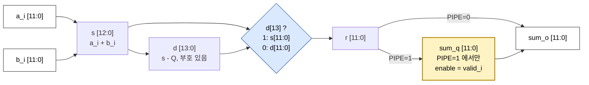
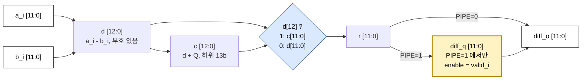
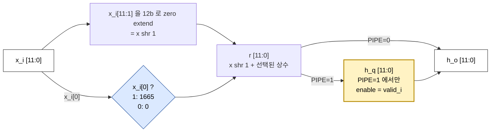
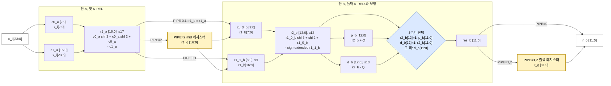
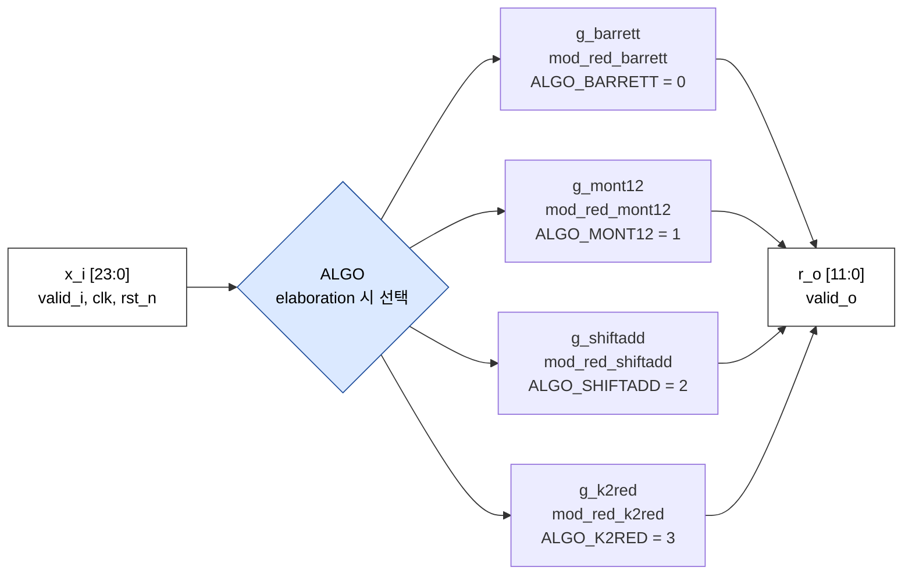
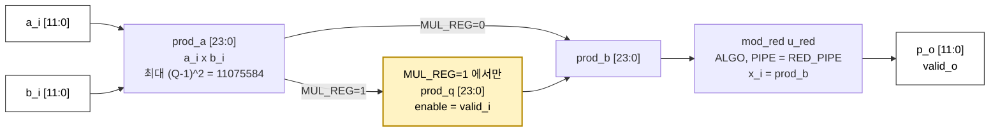

# L0 모듈별 data flow

- 원본 RTL 파일과 확인일: 확인일 2026-11-16. `rtl/l0/mod_add.sv`, `mod_sub.sv`, `mod_half.sv`, `mod_red.sv`, `mod_red_barrett.sv`, `mod_red_mont12.sv`, `mod_red_shiftadd.sv`, `mod_red_k2red.sv`, `mod_mul.sv`, `rtl/pkg/mlkem_pkg.sv`. RTL 이 원본이며 신호 이름과 비트폭은 RTL 선언 그대로다.
- 이 문서의 모든 블록은 **구현 및 검증 완료**된 L0 모듈이다(검증 완료는 오케스트레이터 지시 기준). 계획 단계 블록(L1 이상)은 `00_hierarchy.md` 를 본다.
- golden model 함수는 `model/include/mlkem_modarith.h` 의 함수 이름이다. RTL 중간 신호와 golden model 지역 변수가 1:1 로 이름이 같은지는 확인하지 않았다(RTL 주석이 "step by step, same widths" 라고 적었다). 표에는 함수 이름만 적는다.

## 표기 규칙

- 노드 라벨의 첫 줄은 신호 이름과 비트폭 `name [msb:0]`, 둘째 줄부터 연산. 부호 있는 값은 `s` 접두(예: `s14`)로 RTL 주석을 따른다.
- 노란색 노드 = 레지스터 절단 위치(`PIPE` 값에 따라 존재). 파란색 노드 = 조건부 선택(mux). 흰색 노드 = 포트.
- `shl n` 은 n 비트 왼쪽 shift, `{a, k'b0}` 연결은 `a shl k` 로 풀어 썼다.
- 모든 L0 모듈 공통: data 레지스터는 reset 이 없고 해당 단의 valid 로 enable, valid 레지스터는 `rst_n`(비동기 assert)으로 reset.
- `PIPE` 는 elaboration parameter 다. 그림의 `PIPE=...` 간선은 구성별 경로이며 한 인스턴스에서는 하나만 살아 있다.
- 입력 정의역 검사는 `ifndef SYNTHESIS` 의 simulation assertion 이며 그림에서는 생략했다.

## 1. mod_add

`sum_o = (a_i + b_i) mod Q`, 조건부 감산 1회. `LATENCY = PIPE`, `PIPE` 는 0..1 (`L0_PIPE_MAX`).

valid 경로: `valid_i` 에서 `PIPE=0` 이면 `valid_o` 로 직결, `PIPE=1` 이면 `valid_q`(reset 있음) 1단.

| 신호 | 비트폭 | 범위 (RTL 주석) | golden model |
|---|---|---|---|
| `a_i`, `b_i` | 12 | [0, Q) | `mod_add_hw` |
| `s` | 13 | 최대 2Q-2 = 6656 | `mod_add_hw` |
| `d` | 14 (2의 보수) | [-3329, 3327] | `mod_add_hw` |
| `r`, `sum_o` | 12 | [0, Q) | `mod_add_hw` |

## 2. mod_sub

`diff_o = (a_i - b_i) mod Q`, 조건부 가산 1회. `LATENCY = PIPE`, `PIPE` 는 0..1.

| 신호 | 비트폭 | 범위 (RTL 주석) | golden model |
|---|---|---|---|
| `a_i`, `b_i` | 12 | [0, Q) | `mod_sub_hw` |
| `d` | 13 (2의 보수) | [-3328, 3328] | `mod_sub_hw` |
| `c` | 13 | d < 0 일 때만 사용, 그때 [1, Q) | `mod_sub_hw` |
| `r`, `diff_o` | 12 | [0, Q) | `mod_sub_hw` |

## 3. mod_half

`h_o = x_i * 2^-1 mod Q`, 가산 1회, 보정 없음. `Q_INV2 = (Q+1)/2 = 1665`. `LATENCY = PIPE`, `PIPE` 는 0..1.

| 신호 | 비트폭 | 범위 (RTL 주석) | golden model |
|---|---|---|---|
| `x_i` | 12 | [0, Q) | `mod_half` |
| `r`, `h_o` | 12 | [0, Q), carry 없음. 최대는 x = 3327 에서 1663 + 1665 = 3328 | `mod_half` |
| 성질 | | 2 * `h_o` mod Q == `x_i` | `mod_half_ref` (비교 기준) |

## 4. mod_red_barrett

`r_o = x_i mod Q`, `k = 24`, `M = floor(2^24 / Q) = 5039`. 입력 정의역 [0, 2^24). 표기 규칙은 4개 변형 공통이며 "단 A" 는 mid 레지스터 앞, "단 B" 는 뒤다.

```mermaid
flowchart LR
    x["x_i [23:0]"]:::io
    subgraph SA["단 A, 광폭 상수 곱"]
        xm["xm_a [36:0]<br/>x_i x M, M = 5039<br/>연산자 * 로 기술"]
        qa["qhat_a [12:0]<br/>xm_a[36:24]"]
    end
    mid["PIPE=2 mid 레지스터<br/>qhat_q [12:0]<br/>xlo_q [13:0]"]:::cut
    subgraph SB["단 B, 나머지와 보정"]
        qq["qq_b [13:0]<br/>qhat_b shl 11 + shl 10<br/>+ shl 8 + qhat_b"]
        rb["r_b [13:0]<br/>xlo_b - qq_b<br/>0 le r_b lt 2Q"]
        db["d_b [13:0]<br/>r_b - Q, 부호 있음"]
        mx{"d_b[13] ?<br/>1: r_b[11:0]<br/>0: d_b[11:0]"}:::mux
        res["res_b [11:0]"]
    end
    out["PIPE=1,2 출력 레지스터<br/>r_q [11:0]"]:::cut
    o["r_o [11:0]"]:::io

    x --> xm
    xm --> qa
    qa -->|"PIPE=2"| mid
    qa -->|"PIPE 0,1: 직결"| qq
    x -->|"PIPE 0,1: xlo_b = x_i[13:0]"| rb
    mid -->|"xlo_b = xlo_q"| rb
    mid -->|"qhat_b = qhat_q"| qq
    qq --> rb
    rb --> db
    rb --> mx
    db --> mx
    mx --> res
    res -->|"PIPE=0"| o
    res -->|"PIPE=1,2"| out
    out --> o

    classDef io fill:#ffffff,stroke:#333333,color:#000
    classDef mux fill:#dbe9ff,stroke:#1f4e9c,color:#000
    classDef cut fill:#fff3c4,stroke:#b58900,stroke-width:2px,color:#000
```

PIPE=2 에서 `xlo_q` 는 `x_i[13:0]` 을 mid 레지스터에 담아 `xlo_b` 로 B 단에 전달한다. PIPE 0, 1 에서는 `xlo_b = x_i[13:0]` 이 직결이다. 그림에서 `r_b` 로 들어오는 `x_i` 간선과 mid 간선은 한 구성에서 하나만 살아 있다.

| 신호 | 비트폭 | 범위 (RTL 주석) | golden model |
|---|---|---|---|
| `x_i` | 24 | [0, 2^24) | `barrett_reduce` |
| `xm_a` | 37 | 주석에 범위 없음 | `barrett_reduce` |
| `qhat_a`, `qhat_b` | 13 | 최대 5038, floor(x/Q) 또는 floor(x/Q) - 1 | `barrett_reduce` |
| `xlo_b` | 14 | x mod 2^14 | `barrett_reduce` |
| `qq_b` | 14 | (qhat * Q) mod 2^14, 하위 14b 만 | `barrett_reduce` |
| `r_b` | 14 | [0, 2Q) | `barrett_reduce` |
| `d_b` | 14 (부호 있음) | r_b - Q | `barrett_reduce` |
| `res_b`, `r_o` | 12 | [0, Q) | `barrett_reduce` |

## 5. mod_red_mont12

`r_o = x_i * 2^-12 mod Q`, `R = 2^12`, `769 = Q^-1 mod 2^12`. 입력 정의역 [0, Q * 2^12) = [0, 13635584). 출력은 스케일 S = 2^-12 (= 2704 mod Q)를 갖는다.

```mermaid
flowchart LR
    x["x_i [23:0]"]:::io
    subgraph SA["단 A, 몫 digit t"]
        xl["xl_a [11:0]<br/>x_i[11:0]"]
        xq["xl_qinv_a [11:0]<br/>xl_a + xl_a shl 8<br/>+ xl_a shl 9, mod 2^12"]
        ta["t_a [11:0]<br/>0 - xl_qinv_a"]
    end
    mid["PIPE=2 mid 레지스터<br/>t_q [11:0]<br/>x_q [23:0]"]:::cut
    subgraph SB["단 B, x + t Q 를 R 로 나눔"]
        tq["tq_b [23:0]<br/>t_b shl 11 + shl 10<br/>+ shl 8 + t_b"]
        sb["s_b [24:0]<br/>x_b + tq_b"]
        ub["u_b [12:0]<br/>s_b[24:12], 0 le u_b lt 2Q"]
        db["d_b [13:0]<br/>u_b - Q, 부호 있음"]
        mx{"d_b[13] ?<br/>1: u_b[11:0]<br/>0: d_b[11:0]"}:::mux
        res["res_b [11:0]"]
    end
    out["PIPE=1,2 출력 레지스터<br/>r_q [11:0]"]:::cut
    o["r_o [11:0]"]:::io

    x --> xl
    xl --> xq
    xq --> ta
    ta -->|"PIPE=2"| mid
    x -->|"PIPE=2: x_q 로 저장"| mid
    ta -->|"PIPE 0,1: t_b = t_a"| tq
    x -->|"PIPE 0,1: x_b = x_i"| sb
    mid --> tq
    mid --> sb
    tq --> sb
    sb --> ub
    ub --> db
    ub --> mx
    db --> mx
    mx --> res
    res -->|"PIPE=0"| o
    res -->|"PIPE=1,2"| out
    out --> o

    classDef io fill:#ffffff,stroke:#333333,color:#000
    classDef mux fill:#dbe9ff,stroke:#1f4e9c,color:#000
    classDef cut fill:#fff3c4,stroke:#b58900,stroke-width:2px,color:#000
```

| 신호 | 비트폭 | 범위 (RTL 주석) | golden model |
|---|---|---|---|
| `x_i`, `x_b` | 24 | [0, Q * 2^12) | `mont12_reduce` |
| `xl_a` | 12 | x mod 2^12 | `mont12_reduce` |
| `xl_qinv_a` | 12 | xl * 769 mod 2^12 (RTL 은 3입력 합을 mod 2^12 로 계산, golden 폭 선언 없음) | `mont12_reduce` |
| `t_a`, `t_b` | 12 | xl * q' mod 2^12, q' = -Q^-1 = 3327 | `mont12_reduce` |
| `tq_b` | 24 | t * Q | `mont12_reduce` |
| `s_b` | 25 | x + t * Q, 하위 12b 는 0 | `mont12_reduce` |
| `u_b` | 13 | [0, 2Q) | `mont12_reduce` |
| `d_b` | 14 (부호 있음) | u - Q | `mont12_reduce` |
| `res_b`, `r_o` | 12 | [0, Q) | `mont12_reduce` |

## 6. mod_red_shiftadd

`r_o = x_i mod Q`. Q = 3329 에서 `2^12 = 2^9 + 2^8 - 1 (mod Q)` 이므로 한 번의 fold 는 `y = h * 2^12 + l` 을 `(h shl 9) + (h shl 8) - h + l` 로 바꾼다. 곱셈기 없음. 입력 정의역 [0, 2^24).

```mermaid
flowchart LR
    x["x_i [23:0]"]:::io
    subgraph SA["단 A, fold 1 에서 3"]
        f1["fold 1<br/>h1_a [11:0] = x_i[23:12]<br/>y1_a [21:0]"]
        f2["fold 2<br/>h2_a [9:0] = y1_a[21:12]<br/>y2_a [19:0]"]
        f3["fold 3<br/>h3_a [7:0] = y2_a[19:12]<br/>y3_a [16:0]"]
    end
    mid["PIPE=2 mid 레지스터<br/>y3_q [16:0]"]:::cut
    subgraph SB["단 B, fold 4 에서 5 와 3분기 선택"]
        f4["fold 4<br/>h4_b [4:0] = y3_b[16:12]<br/>y4_b [14:0]"]
        f5["fold 5<br/>h5_b [2:0] = y4_b[14:12]<br/>y5_b [13:0], 값 less than 3Q"]
        d1["d1_b [14:0]<br/>y5_b - Q, s15"]
        d2["d2_b [14:0]<br/>y5_b - 2Q, s15"]
        mx{"3:1 선택<br/>d2_b 부호 0: d2_b[11:0]<br/>d1_b 부호 0: d1_b[11:0]<br/>그 외: y5_b[11:0]"}:::mux
        res["res_b [11:0]"]
    end
    out["PIPE=1,2 출력 레지스터<br/>r_q [11:0]"]:::cut
    o["r_o [11:0]"]:::io

    x --> f1
    f1 --> f2
    f2 --> f3
    f3 -->|"PIPE=2"| mid
    f3 -->|"PIPE 0,1: 직결"| f4
    mid --> f4
    f4 --> f5
    f5 --> d1
    f5 --> d2
    f5 --> mx
    d1 --> mx
    d2 --> mx
    mx --> res
    res -->|"PIPE=0"| o
    res -->|"PIPE=1,2"| out
    out --> o

    classDef io fill:#ffffff,stroke:#333333,color:#000
    classDef mux fill:#dbe9ff,stroke:#1f4e9c,color:#000
    classDef cut fill:#fff3c4,stroke:#b58900,stroke-width:2px,color:#000
```

각 fold 의 하위 부분은 `l = 이전 y 의 [11:0]`(fold 1 은 `x_i[11:0]`)이며, 합은 출력 폭 modulo 로 계산한다(RTL 주석: 실제 값이 그 폭에 들어가므로 정확).

| 신호 | 비트폭 | 범위 (RTL 주석) | golden model |
|---|---|---|---|
| `x_i` | 24 | [0, 2^24) | `shiftadd_reduce` |
| `h1_a`, `h2_a`, `h3_a`, `h4_b`, `h5_b` | 12, 10, 8, 5, 3 | 주석에 범위 없음 | `shiftadd_reduce` |
| `y1_a`, `y2_a`, `y3_a`, `y4_b`, `y5_b` | 22, 20, 17, 15, 14 | `y5_b` 는 3Q 미만 | `shiftadd_reduce` |
| `d1_b`, `d2_b` | 15 (부호 있음) | y5 - Q, y5 - 2Q | `shiftadd_reduce` |
| `res_b`, `r_o` | 12 | [0, Q) | `shiftadd_reduce` |

## 7. mod_red_k2red

`r_o = 169 * x_i mod Q`. Q = 13 * 2^8 + 1 이므로 K-RED(C) = 13 * (C mod 2^8) - (C shr 8) 이 13 * C 와 합동이고, 두 번 적용하면 169 * C 다. 곱셈기 없음. 입력 정의역 [0, 2^24).

| 신호 | 비트폭 | 범위 (RTL 주석) | golden model |
|---|---|---|---|
| `x_i` | 24 | [0, 2^24) | `k2red_reduce` |
| `c0_a` | 8 | x[7:0] | `k2red_reduce` |
| `c1_a` | 16 | x shr 8 | `k2red_reduce` |
| `r1_a`, `r1_b` | 17 (부호 있음) | [-65535, 3315] | `k2red_reduce` |
| `r1_0_b` | 8 | r1[7:0] | `k2red_reduce` |
| `r1_1_b` | 9 (부호 있음) | [-256, 12] (r1 산술 shift 8) | `k2red_reduce` |
| `r2_b` | 13 (부호 있음) | [-12, 3571] | `k2red_reduce` |
| `p_b` | 13 | r2 + Q, r2 < 0 일 때 사용 | `k2red_reduce` |
| `d_b` | 13 (부호 있음) | r2 - Q | `k2red_reduce` |
| `res_b`, `r_o` | 12 | [0, Q), 출력 = 169 * x mod Q | `k2red_reduce` |

## 8. mod_red 래퍼

로직이 없는 래퍼다. `ALGO` 로 변형 하나만 인스턴스하고 포트를 `.*` 로 연결한다. 잘못된 `ALGO` 는 elaboration 에서 실패한다. 모든 변형이 `LATENCY = PIPE` 이며 래퍼도 같다. `PIPE` 는 0..2 (`MOD_RED_PIPE_MAX`).

| ALGO | 인스턴스 | 출력 | 입력 정의역 | golden model (DPI) |
|---|---|---|---|---|
| `ALGO_BARRETT` | `u_red`, `mod_red_barrett` | x mod Q | [0, 2^24) | `barrett_reduce` (`mlkem_dpi_barrett_reduce`) |
| `ALGO_MONT12` | `u_red`, `mod_red_mont12` | x * 2^-12 mod Q | [0, Q * 2^12) | `mont12_reduce` (`mlkem_dpi_mont12_reduce`) |
| `ALGO_SHIFTADD` | `u_red`, `mod_red_shiftadd` | x mod Q | [0, 2^24) | `shiftadd_reduce` (`mlkem_dpi_shiftadd_reduce`) |
| `ALGO_K2RED` | `u_red`, `mod_red_k2red` | 169 * x mod Q | [0, 2^24) | `k2red_reduce` (`mlkem_dpi_k2red_reduce`) |

래퍼는 스케일 S 를 제거하지 않는다. 보정은 ROM 사전 보정과 basemul K2 op 의 몫이다(`mod_red.sv` 주석, arch.md).

## 9. mod_mul

`p_o = a_i * b_i * S mod Q`. 곱셈기는 `*` 로 기술해 합성 도구에 맡긴다. `LATENCY = MUL_REG + RED_PIPE` (0..3). `MUL_REG` 는 0..1, `RED_PIPE` 는 0..2.

valid 경로: `valid_i` 는 `MUL_REG=1` 이면 `valid_q`(reset 있음) 1단을 거쳐 `valid_b` 로 `mod_red` 의 `valid_i` 에 연결되고, `MUL_REG=0` 이면 `valid_b = valid_i`. 이후 `mod_red` 의 `RED_PIPE` 단만큼 더 지연되어 `valid_o` 가 된다.

| 구성 | MUL_REG | RED_PIPE | LATENCY | 레지스터 위치 |
|---|---|---|---|---|
| 조합 | 0 | 0 | 0 | 없음 |
| 곱 뒤 | 1 | 0 | 1 | `prod_q` (24b) |
| 출력 | 0 | 1 | 1 | `mod_red` 출력 레지스터 |
| 곱 뒤 + 출력 | 1 | 1 | 2 | `prod_q`, `mod_red` 출력 |
| red mid + 출력 | 0 | 2 | 2 | `mod_red` mid, 출력 |
| 전부 | 1 | 2 | 3 | `prod_q`, `mod_red` mid, 출력 |

| 신호 | 비트폭 | 범위 (RTL 주석) | golden model |
|---|---|---|---|
| `a_i`, `b_i` | 12 | [0, Q) | `mul12x12` 의 입력 |
| `prod_a`, `prod_b` | 24 | 최대 (Q-1)^2 = 11,075,584, 2^24 와 Q * 2^12 = 13,635,584 미만 | `mul12x12` |
| `p_o` | 12 | [0, Q) | `mod_mul_barrett`, `mod_mul_mont12`, `mod_mul_shiftadd`, `mod_mul_k2red` (DPI 는 `mlkem_dpi_<algo>_reduce(a * b)`) |

## 10. reduction 변형 비교

수치 지표(면적, 주파수, 지연)는 이 문서에 쓰지 않는다. 측정 전이며 RTL 구조에서 읽은 항목만 적는다. 상수 곱 열의 "`*`" 는 RTL 이 곱셈 연산자로 쓴 곳이고, "shift-add" 는 RTL 이 shift 와 덧셈으로 명시한 곳이다.

| 항목 | BARRETT | MONT12 | SHIFTADD | K2RED |
|---|---|---|---|---|
| 출력 | x mod Q | x * 2^-12 mod Q | x mod Q | 169 * x mod Q |
| 스케일 S | 1 | 2^-12 (2704) | 1 | 169 |
| 입력 정의역 | [0, 2^24) | [0, Q * 2^12) | [0, 2^24) | [0, 2^24) |
| 상수 곱 처리 | `x_i * 5039` 는 `*` (37b). `qhat * Q` 는 4항 shift-add (14b) | `xl * 769` 는 3항 shift-add (12b). `t * Q` 는 4항 shift-add (24b). `*` 없음 | 상수 곱 없음. fold 마다 4항 add/sub (h shl 9, h shl 8, -h, l) | 상수 곱 없음. `13 * c` 를 3항 shift-add 로 기술하고 감산과 합쳐 4항 add/sub (17b, 13b) |
| 직렬 단계 구성 | 광폭 곱 -> `qhat` 추출 -> `qq_b` shift-add -> 감산 `r_b` -> 감산 `d_b` -> 2:1 선택 | `xl` -> shift-add -> 부정 -> `t` -> `tq_b` shift-add -> 가산 `s_b` -> 감산 `d_b` -> 2:1 선택 | fold 5단 직렬 -> 병렬 감산 2개 (Q, 2Q) -> 3:1 선택 | K-RED 1 -> K-RED 2 -> 병렬 가감산 (r2 + Q, r2 - Q) -> 3:1 선택 |
| 보정 선택 | `d_b` 부호로 `r_b` 또는 `d_b` | `d_b` 부호로 `u_b` 또는 `d_b` | `d2_b`, `d1_b` 부호로 3분기 | `r2_b` 부호, `d_b` 부호로 3분기 |
| PIPE=1 절단 | 출력 레지스터 `r_q` 1개 | 같음 | 같음 | 같음 |
| PIPE=2 mid 절단 위치 | `qhat_a` 뒤: `qhat_q` [12:0], `xlo_q` [13:0] | `t_a` 뒤: `t_q` [11:0], `x_q` [23:0] | fold 3 뒤: `y3_q` [16:0] | K-RED 1 뒤: `r1_q` [16:0] |
| mid 레지스터 비트 수 | 27 | 36 | 17 | 17 |
| golden 함수 | `barrett_reduce` | `mont12_reduce` | `shiftadd_reduce` | `k2red_reduce` |

- mid 레지스터 비트 수는 위 표의 신호 폭을 더한 값이다(13+14, 12+24, 17, 17). `valid_q` 1비트는 제외.
- 4개 변형 모두 `LATENCY = PIPE`, `PIPE` 0..2. 출력 레지스터는 PIPE 1, 2 에 존재.
- 비교는 구조 항목에 한정한다. 어느 변형이 작거나 빠르다는 주장은 합성 측정 후에만 쓴다.
