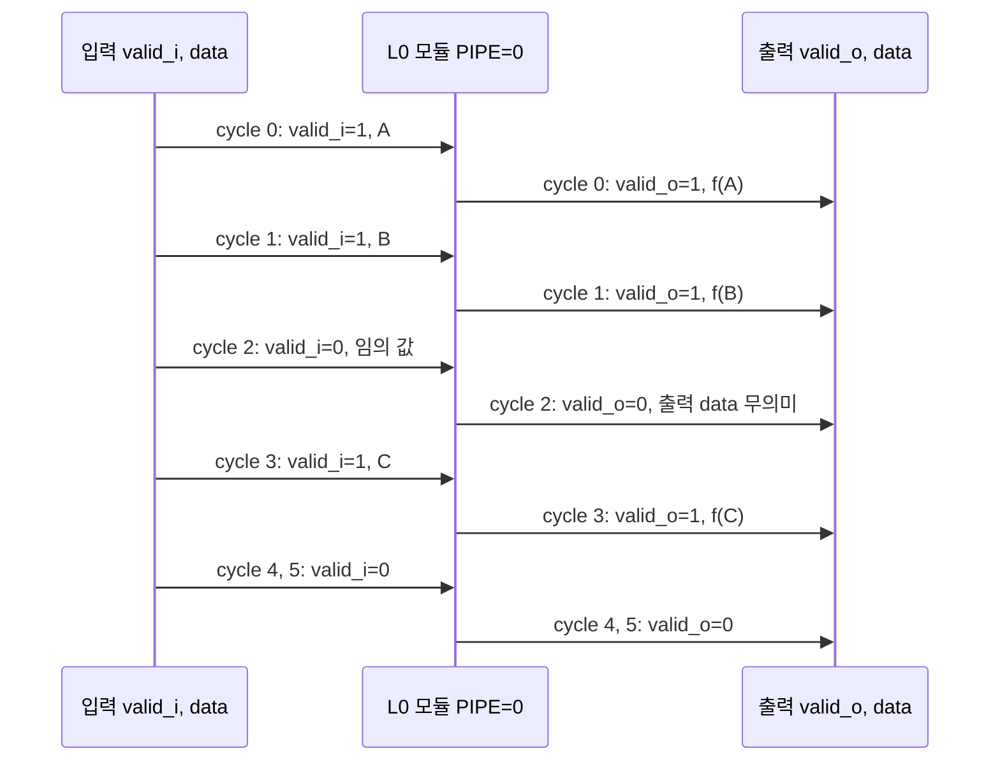
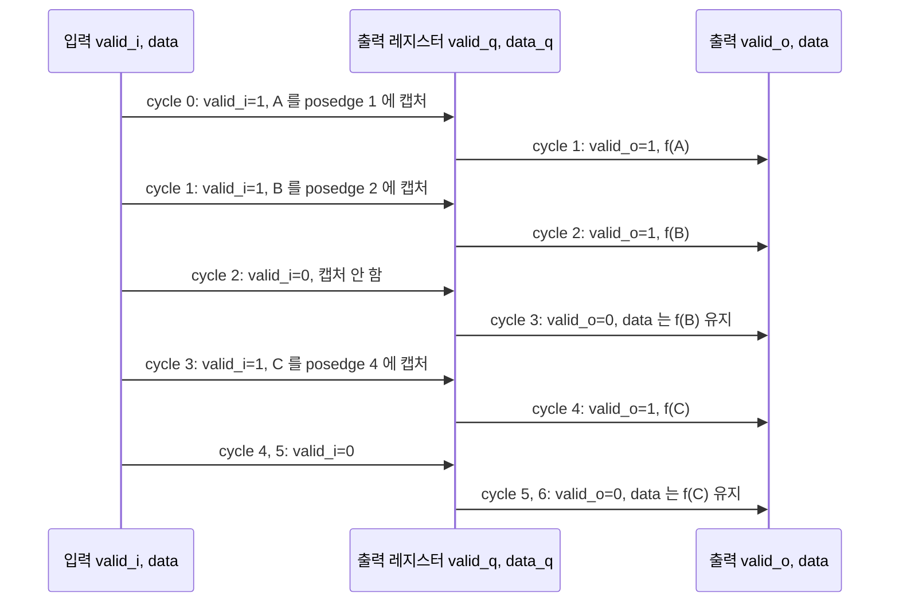
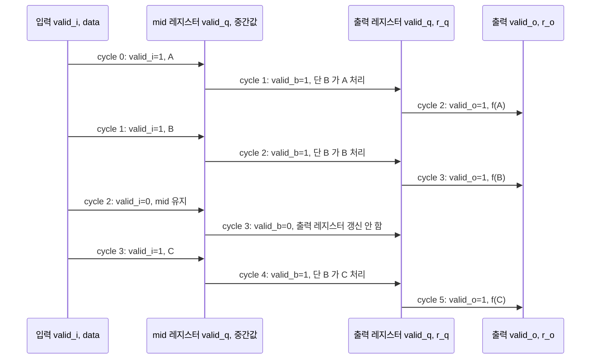

# L0 valid / latency 타이밍

- 원본 RTL 파일과 확인일: 확인일 2026-11-16. `rtl/l0/mod_add.sv`, `mod_sub.sv`, `mod_half.sv`, `mod_red.sv`, `mod_red_barrett.sv`, `mod_red_mont12.sv`, `mod_red_shiftadd.sv`, `mod_red_k2red.sv`, `mod_mul.sv`. 대상 블록은 전부 **구현 및 검증 완료** L0 모듈이다. L1 이상(계획)은 다루지 않는다.
- **이 문서는 RTL 구조에서 도출한 것이다. 시뮬레이션 파형을 캡처한 것이 아니다.** 아래 입력 시퀀스(A, B, C 와 gap 위치)는 설명용 예시이며 TB 의 자극이 아니다. RTL 에서 직접 읽히지 않는 부분은 "추정"이라고 표시했다.

## 1. RTL 에서 읽은 규칙

| 규칙 | 근거 (RTL) |
|---|---|
| `valid_o` 는 `valid_i` 를 `LATENCY` cycle 지연한 것이다 | 각 모듈 헤더 주석, `valid_q` 레지스터 체인 |
| `LATENCY = PIPE` (`mod_add`, `mod_sub`, `mod_half`, `mod_red`, `mod_red_*` 4종) | `localparam int LATENCY = PIPE` |
| `mod_mul` 은 `LATENCY = MUL_REG + RED_PIPE` | `mod_mul.sv` |
| `PIPE = 0` 은 순수 조합. `valid_o = valid_i`, 출력 data 는 입력 data 의 조합 함수 | `g_comb` 의 `assign` |
| `valid` 레지스터는 `rst_n` 으로 비동기 reset, reset 값 0 | `always_ff @(posedge clk or negedge rst_n)` |
| data 레지스터는 reset 이 없고 해당 단의 valid 가 1 일 때만 갱신 | `if (valid_i) ..._q <= ...` (mid 단은 `valid_i`, 출력 단은 `valid_b`) |
| 결과: valid 가 0 인 cycle 에서 `PIPE >= 1` 의 출력 data 는 직전 유효 값을 유지한다. 이 값에 의존하면 안 된다 | 위 enable 구조에서 도출 |
| backpressure 없음. stall 입력 포트가 없다 | 포트 목록 |

## 2. cycle 표기

cycle k 는 posedge k 와 posedge k+1 사이 구간이다. cycle k 에 인가된 입력은 posedge k+1 에 첫 레지스터에 캡처되고 그 출력은 cycle k+1 부터 보인다. 조합 경로(`PIPE=0`)는 같은 cycle 에 출력이 보인다.

예시 입력(설명용): cycle 0 에 A, cycle 1 에 B, cycle 2 는 gap (`valid_i = 0`), cycle 3 에 C, 이후 gap. `f(X)` 는 해당 모듈이 X 에 대해 내는 결과(`mod_add` 면 두 입력의 모듈러 합 등)다.

## 3. PIPE = 0 (조합)

| cycle | 0 | 1 | 2 | 3 | 4 | 5 |
|---|---|---|---|---|---|---|
| `valid_i` | 1 | 1 | 0 | 1 | 0 | 0 |
| 입력 data | A | B | 임의 | C | 임의 | 임의 |
| `valid_o` | 1 | 1 | 0 | 1 | 0 | 0 |
| 출력 data | f(A) | f(B) | 무의미 | f(C) | 무의미 | 무의미 |

gap 의 출력 data 는 입력의 조합 함수이므로 입력이 바뀌면 같은 cycle 에 바뀐다. `valid_o = 0` 이면 무시한다.

## 4. PIPE = 1 (출력 레지스터 1단)

해당: `mod_add`, `mod_sub`, `mod_half`, `mod_red` 와 4개 변형. `mod_mul` 은 `MUL_REG + RED_PIPE = 1` 인 두 구성이며 레지스터 위치만 다르다(6절).

| cycle | 0 | 1 | 2 | 3 | 4 | 5 | 6 |
|---|---|---|---|---|---|---|---|
| `valid_i` | 1 | 1 | 0 | 1 | 0 | 0 | 0 |
| 입력 data | A | B | 임의 | C | 임의 | 임의 | 임의 |
| `valid_o` | 0 (추정) | 1 | 1 | 0 | 1 | 0 | 0 |
| 출력 data | 무의미 | f(A) | f(B) | f(B) 유지, 무의미 | f(C) | f(C) 유지, 무의미 | f(C) 유지, 무의미 |

입력의 gap 은 출력에서 같은 간격의 gap 으로 1 cycle 뒤에 나타난다. valid 패턴이 통째로 시프트되며 압축되지 않는다. cycle 0 의 `valid_o = 0` 은 reset 해제 후 이전 입력이 없다는 가정에 따른 추정이다.

## 5. PIPE = 2 (mid 레지스터 + 출력 레지스터, `mod_red` 4개 변형만)

mid 레지스터는 `valid_i` 로 enable, 출력 레지스터는 mid 단의 `valid_b`(= mid 의 `valid_q`)로 enable 된다. mid 에 담기는 신호는 변형마다 다르다(`l0_modules.md` 10절).

| cycle | 0 | 1 | 2 | 3 | 4 | 5 | 6 |
|---|---|---|---|---|---|---|---|
| `valid_i` | 1 | 1 | 0 | 1 | 0 | 0 | 0 |
| 입력 data | A | B | 임의 | C | 임의 | 임의 | 임의 |
| mid `valid_b` | 0 (추정) | 1 | 1 | 0 | 1 | 0 | 0 |
| `valid_o` | 0 (추정) | 0 (추정) | 1 | 1 | 0 | 1 | 0 |
| 출력 data | 무의미 | 무의미 | f(A) | f(B) | f(B) 유지, 무의미 | f(C) | f(C) 유지, 무의미 |

`valid_o` 는 `valid_i`(1 1 0 1)를 2 cycle 지연한 패턴이다. 출력 레지스터의 data 는 mid 의 valid 가 1 일 때만 갱신되므로 gap 에서 유지된다.

## 6. mod_mul 의 LATENCY (= MUL_REG + RED_PIPE)

| MUL_REG | RED_PIPE | LATENCY | `valid_o` 의 지연 경로 |
|---|---|---|---|
| 0 | 0 | 0 | 조합 |
| 1 | 0 | 1 | 곱 레지스터 `prod_q` 의 `valid_q` 1단. 이후 `mod_red` 는 조합 |
| 0 | 1 | 1 | `mod_red` 출력 레지스터 1단. 곱은 조합 |
| 1 | 1 | 2 | 곱 레지스터 + `mod_red` 출력 레지스터 |
| 0 | 2 | 2 | `mod_red` mid + 출력 |
| 1 | 2 | 3 | 곱 레지스터 + `mod_red` mid + 출력 |

같은 LATENCY 라도 레지스터 위치가 달라 한 cycle 안에 들어가는 조합 구간이 다르다(곱셈기 + reduction 이 한 cycle 인지, 곱셈기만인지). `mod_mul` 은 모든 레지스터가 3절 내지 5절과 같은 enable 규칙(valid 로 enable, valid 는 reset)을 쓰므로 gap 응답은 단 수만큼 시프트된 같은 패턴이다. 이 결론은 RTL 구조에서 도출한 것이고 `mod_mul` 의 gap 파형은 별도로 그리지 않았다.

## 7. 확인하지 못한 것

- 실제 TB 시뮬레이션 파형은 확인하지 않았다.
- reset 직후 첫 cycle 의 `valid_o` 값(표의 "추정")은 reset 해제와 이전 입력 없음을 가정한 것이다.
- reset 중 `valid_i = 1` 이 들어오는 경우는 그리지 않았다(RTL 상 `rst_n = 0` 동안 `valid_q = 0`).
