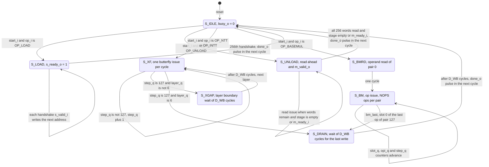
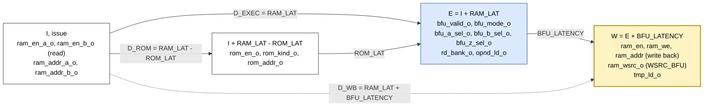

# L2 ntt_ctrl control flow와 issue/exec/write 타이밍

- 원본 RTL 파일과 확인일: 확인일 2026-11-17. `rtl/l2/ntt_ctrl.sv`(FSM `state_e`, 전이 `always_comb`, 머리 주석의 타이밍 표), `rtl/l2/ntt_l2_pkg.sv`(op, select enum). RTL 이 원본이며 state 이름, 신호 이름, 전이 조건은 RTL 선언 그대로다.
- **이 문서는 RTL 구조에서 도출한 것이다. 시뮬레이션 파형이 아니다.** 시뮬레이션 검증 결과(`sim/l2_ntt_ctrl/`)는 이 문서의 근거가 아니며, 그림은 RTL 을 읽어서 그렸다.
- 대상은 구현 및 검증 완료(P3-2, 검증 범위는 `docs/log.md` 참조)된 L2 `ntt_ctrl` 이다. 표기 규칙은 `l0_modules.md` 를 따른다: 노드와 신호 이름은 RTL 식별자 그대로, 라벨은 큰따옴표.
- 이 문서에는 수치(cycle 수)를 쓰지 않는다. 실측 cycle 수와 식은 `docs/spec/arch.md` 의 "L2 결과 반영" 절에 있다.

## 1. op 단위 control flow (FSM)

RTL 의 `state_e` 는 8개다: `S_IDLE`, `S_LOAD`, `S_UNLOAD`, `S_XF`, `S_XGAP`, `S_BMRD`, `S_BM`, `S_DRAIN`. 아래 그림의 state 는 이 8개뿐이다.

- `S_IDLE` 에서 `start_i` 가 1 이고 `op_i` 가 `OP_LOAD`, `OP_NTT`, `OP_INTT`, `OP_BASEMUL`, `OP_UNLOAD` 중 하나일 때만 op 를 수락한다. 다른 encoding 이면 수락하지 않고 `S_IDLE` 에 머문다(simulation assertion `L2_CTRL_OP`).
- 수락 시 `S_XF`(`OP_NTT`, `OP_INTT`), `S_BMRD`(`OP_BASEMUL`), `S_LOAD`, `S_UNLOAD` 로 간다.
- `done` 은 state 가 아니다. RTL 에 `done` state 는 없고, op 가 끝나며 `S_IDLE` 로 돌아가는 전이에서 `done_d = 1` 이 되어 `done_q` 가 다음 cycle(`S_IDLE` 의 첫 cycle)에 1 cycle `done_o` pulse 로 나온다. 그 cycle 에 `start_i` 도 수락된다(`S_IDLE` 이므로).
- `D_WB = RAM_LAT + BFU_LATENCY`. `S_XGAP` 과 `S_DRAIN` 은 각각 `D_WB` cycle 머문다(`wait_d = D_WB` 로 적재, `wait_q` 를 1씩 줄여 `wait_q == 1` 에서 나감).
- `S_BM` 안의 op 반복(`opi_q`)과 pair 반복(`step_q`), slot(`slot_q`)은 별도 state 가 아니라 `S_BM` 안의 counter 다. 그림에서는 self-loop 와 주석으로 표현했다.

RTL 에서 확인한 전이 조건(`ntt_ctrl.sv` 의 FSM `always_comb`):

| 전이 | RTL 조건 |
|---|---|
| `S_IDLE` 에서 나감 | `start_i && op_i inside {OP_LOAD, OP_NTT, OP_INTT, OP_BASEMUL, OP_UNLOAD}`. op 에 따라 `OP_LOAD` -> `S_LOAD`, `OP_UNLOAD` -> `S_UNLOAD`, `OP_BASEMUL` -> `S_BMRD`, 그 외(NTT, INTT) -> `S_XF` |
| `S_LOAD` -> `S_IDLE` | `ld_we && cnt_q == N_COEF - 1`. `ld_we = (state_q == S_LOAD) && s_valid_i`. 전이 때 `done_d = 1`, `result_bank_d = bank_q` |
| `S_UNLOAD` -> `S_IDLE` | `cnt_q == N_COEF && (!ovld_q \|\| m_ready_i)`. 전이 때 `done_d = 1`, `result_bank_d = bank_q` |
| `S_UNLOAD` 의 read issue | `ul_rd = (state_q == S_UNLOAD) && (cnt_q != N_COEF) && (!ovld_q \|\| m_ready_i)`. `ul_rd` 일 때 `cnt_q + 1`, `ovld_q = 1` |
| `S_XF` -> `S_XGAP` | `layer_end` (`step_q == N_PAIR - 1`) 이고 `layer_q != N_LAYER - 1`. `wait_d = D_WB`, `layer_q + 1`, `mask_q` 갱신 |
| `S_XF` -> `S_DRAIN` | `layer_end` 이고 `layer_q == N_LAYER - 1`. `wait_d = D_WB` |
| `S_XGAP` -> `S_XF` | `wait_q == 1` (`D_WB` cycle 후) |
| `S_BMRD` -> `S_BM` | 무조건 1 cycle |
| `S_BM` 내부 counter | `slot_q == SLOT - 1` 이면 `slot_q = 0` 이고 `opi_q == BM_NOPS - 1` 일 때 `opi_q = 0`, `step_q + 1`, 아니면 `opi_q + 1` |
| `S_BM` -> `S_DRAIN` | `bm_last = bm_op_now && opi_q == BM_NOPS - 1 && step_q == N_PAIR - 1` (`bm_op_now = slot_q == 0`). `wait_d = D_WB` |
| `S_DRAIN` -> `S_IDLE` | `wait_q == 1`. `done_d = 1`, `result_bank_d = (op_q == OP_BASEMUL) ? 0 : ~bank_q` |

상수: `N_COEF = 256`, `N_PAIR = 128`, `N_LAYER = 7`, `SLOT = BFU_LATENCY + 1`, `BM_NOPS = basemul_nops(ALGO)`(`ALGO_BARRETT`, `ALGO_SHIFTADD` 는 5, 나머지는 7). 정의는 `ntt_l2_pkg.sv` 와 `ntt_ctrl.sv`.

### 이 그림에 그리지 않은 것

- `done` state: RTL 에 없다(위 설명의 pulse 로만 존재).
- `S_XF` 의 layer 별 주소 패턴(`xf_addr0`, `xf_addr1`, `mask_q`), zeta 주소 증감: 전이가 아니라 `S_XF` 안의 datapath 계산이다.
- `S_BM` 안의 pair 다음 operand read 선행(`bm_rd_next`): state 전이가 아니라 출력 동작이다. 타이밍은 2절의 표를 본다.
- 임의의 op 에서 다른 op 로의 직접 전이(예: `S_DRAIN` 에서 바로 다음 op 의 state): RTL 에 없다. 항상 `S_IDLE` 을 거친다.
- reset 이외의 error 또는 abort 경로: RTL 에 없다.

## 2. issue / exec / write 타이밍

NTT, INTT, BASEMUL 의 모든 RAM, ROM, bfu 동작은 issue cycle `I` 에서 만들어져 고정 지연선을 지난다(`ex_dl`, `rom_dl`, `wb_dl`). 지연은 `D_EXEC = RAM_LAT`, `D_ROM = RAM_LAT - ROM_LAT`, `D_WB = RAM_LAT + BFU_LATENCY` 이다. `RAM_LAT` 은 1 만 지원한다(elaboration `$error`).

- `I`: RAM read 발행(issue stage).
- `I + RAM_LAT - ROM_LAT`: `zeta_rom` read 발행(`ROM_LAT = RAM_LAT` 이면 `I` 와 같은 cycle).
- `E = I + RAM_LAT`: RAM read data, ROM data, bfu 입력이 한 cycle 에 만난다.
- `W = E + BFU_LATENCY`: bfu 출력이 RAM 에 write 되거나 `R0`, `R1` 에 적재된다.

각 cycle 에 유효한 신호(`ntt_ctrl.sv` 머리 주석의 출력 표와 지연선 정의에서 옮김):

| cycle | 유효한 신호 | 의미 (`ntt_core` 가 하는 일) |
|---|---|---|
| `I` | `ram_en_a_o[k]`, `ram_en_b_o[k]`, `ram_addr_a_o[k]`, `ram_addr_b_o[k]` (read, `ram_we_*_o = 0`) | bank `k` 의 port A, B 에서 read. NTT/INTT 는 한 bank 의 두 port, BASEMUL operand read 는 두 bank 모두(`iss_rd_all`) |
| `I + RAM_LAT - ROM_LAT` | `rom_en_o`, `rom_kind_o`, `rom_addr_o` | `zeta_rom` read. `rom_kind_o` 는 `ROM_ZETA`, `ROM_GAMMA`, `ROM_K2` |
| `E` | `bfu_valid_o`, `bfu_mode_o`, `bfu_a_sel_o`, `bfu_b_sel_o`, `bfu_z_sel_o`, `rd_bank_o` | bfu 입력. `bfu_mode_o` 는 `MODE_CT`(NTT, BASEMUL) 또는 `MODE_GS`(INTT) |
| `E` | `opnd_ld_o` | BASEMUL pair 의 operand 적재: `A0 <= bank0 rdata_a`, `A1 <= bank0 rdata_b`, `B0 <= bank1 rdata_a`, `B1 <= bank1 rdata_b` |
| `W` | `ram_en_a_o[k]`, `ram_we_a_o[k]`, `ram_addr_a_o[k]` (port A write, 데이터 bfu `x_o`), `ram_en_b_o[k]`, `ram_we_b_o[k]`, `ram_addr_b_o[k]` (port B write, 데이터 bfu `y_o`) | write back. 주소는 `wb_dl` 이 들고 온 `addr0`, `addr1` |
| `W` | `tmp_ld_o[j]` | `Rj <= bfu x_o` (`j = 0, 1`) |

- BASEMUL 의 `ram_we_a_o` 는 destination 이 `DST_C0`, `DST_C1` 인 op 의 `W` 에서만 1 이다(`iss_wb.a_v`). `DST_R0`, `DST_R1` 인 op 는 `tmp_ld_o` 만 낸다.
- LOAD, UNLOAD 는 지연선을 쓰지 않는다. LOAD 는 handshake cycle 에 `ram_en_a_o`, `ram_we_a_o`, `ram_wsrc_o = WSRC_STREAM` 이고, UNLOAD 는 read 발행 cycle 에 `ram_en_a_o`, 다음 cycle 에 `m_valid_o` 와 `rd_bank_o`(= `bank_q`)가 유효하다.
- layer 경계: layer `l + 1` 의 첫 read 는 layer `l` 의 마지막 write 바로 다음 cycle 에 발행된다(`S_XGAP` 의 `D_WB` cycle 동안 issue 가 없다).
- select 신호는 해당 valid 가 0 인 동안 don't-care 이며, 지연선 reset 값으로 구동된다(reset 뒤 X 가 아니다).

### 이 그림에 그리지 않은 것

- 특정 `BFU_LATENCY`, `ROM_LAT` 값에서의 cycle 번호가 찍힌 파형: 수치 예시는 시뮬레이션 trace 가 아니면 추정이므로 넣지 않았다.
- BASEMUL 에서 op 가 `SLOT = BFU_LATENCY + 1` cycle 마다 issue 되는 시간축: 지연선 구조만 그렸고 op 간격은 위 표의 문장으로만 적었다(RTL 헤더: "Ops are issued every SLOT = BFU_LATENCY + 1 cycles").
- `coef_ram` 과 `bfu` 내부 지연: `E` 에서 bfu 입력이 유효하다는 것까지만 그렸고 bfu 내부 구조는 `00_hierarchy.md` 와 `rtl/l1/bfu.sv` 를 본다.
- Mermaid 문법은 실제 Mermaid 파서로 검사하지 않았고 GitHub 렌더링도 확인하지 않았다(`l0_modules.md` 와 같은 한계).
