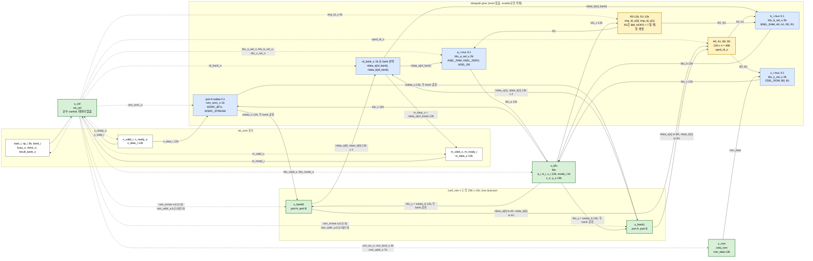
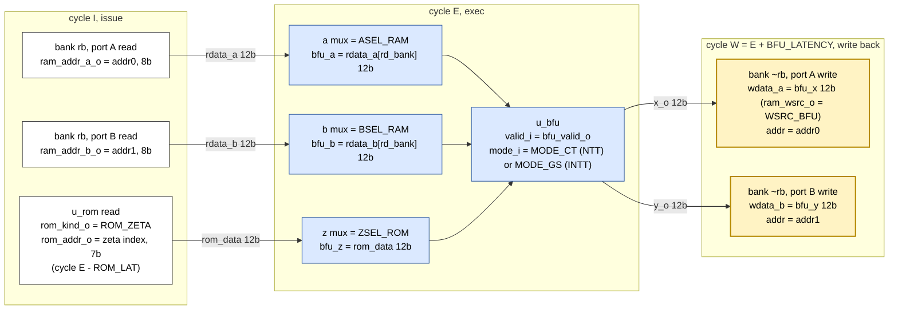
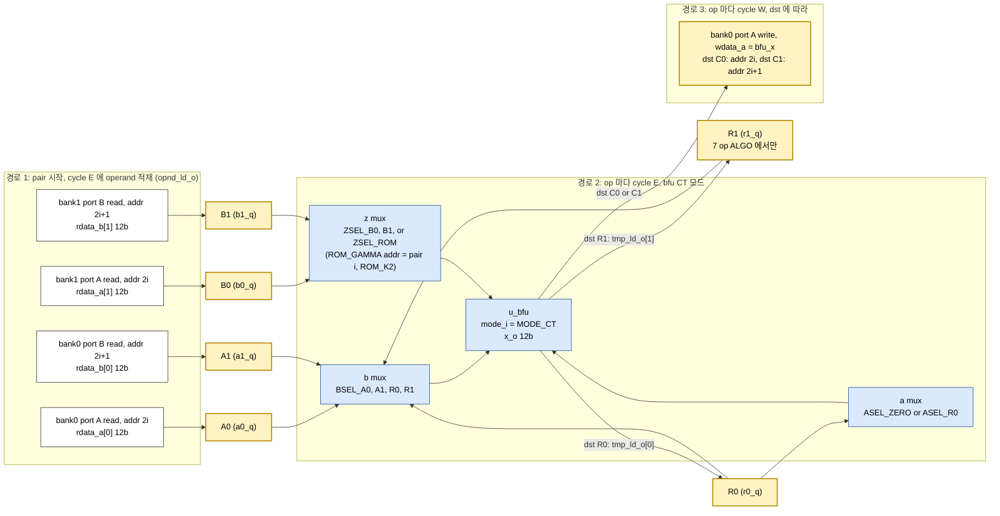
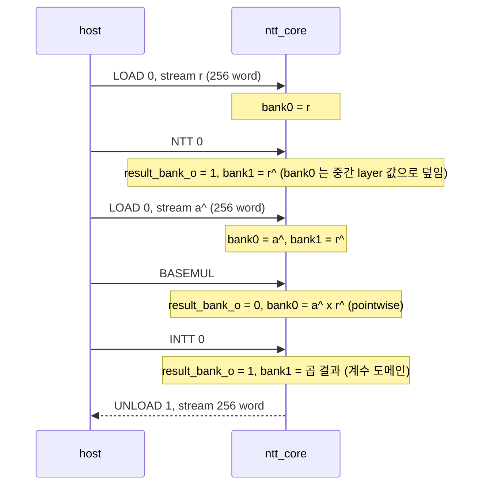
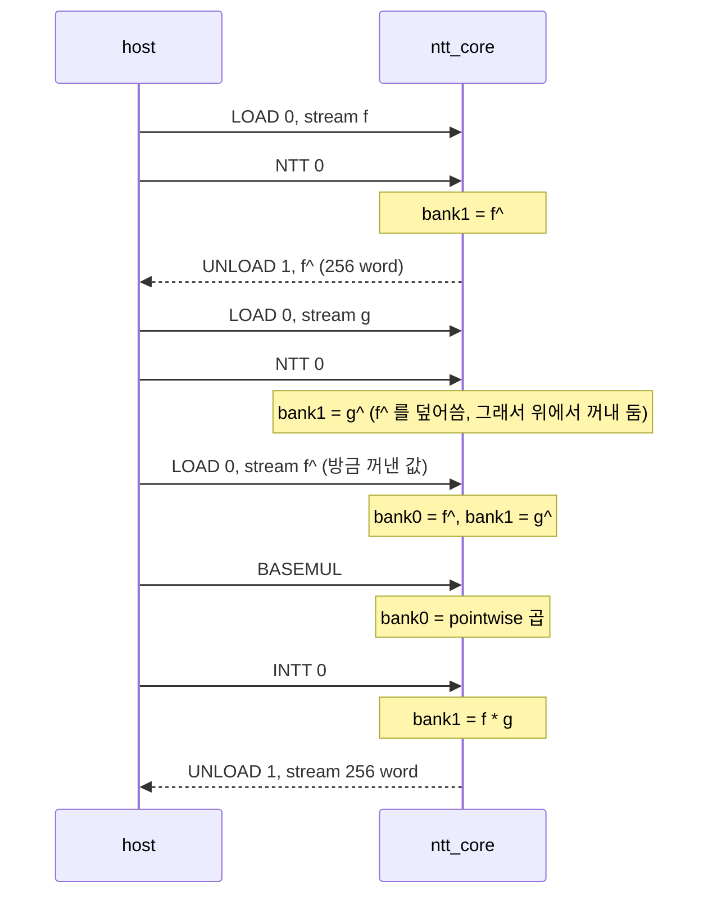

# L3 ntt_core 구조, data flow, 다항식 곱 op 순서

- 원본 RTL 파일과 확인일: 확인일 2026-11-17. `rtl/l3/ntt_core.sv`(머리 주석, 인스턴스, glue 코드), `rtl/l2/ntt_ctrl.sv`(머리 주석, basemul program 함수 `bm_op`, issue stage), `rtl/l2/ntt_l2_pkg.sv`(op, select enum, 상수), `rtl/pkg/mlkem_pkg.sv`(`mode_e`). RTL 이 원본이며 인스턴스 이름, 신호 이름, 선택 값은 RTL 선언 그대로다.
- **이 문서는 RTL 구조에서 도출한 것이다. 시뮬레이션 파형이 아니다.** 시뮬레이션 검증 결과(`sim/l3_*`)는 이 문서의 근거가 아니다. 그림은 RTL 을 읽어서 그렸다.
- 대상은 구현 및 검증 완료(P3-3, 검증 범위는 `docs/log.md` 참조)된 L3 `ntt_core` 다. 표기 규칙은 `l0_modules.md`, `l2_ntt_ctrl.md` 를 따른다: 노드와 신호 이름은 RTL 식별자 그대로, 라벨은 큰따옴표.
- 4절의 op 순서는 `arch.md` "L3 결과 반영"과 `tb/l3/tb_ntt_core.sv` 머리 주석(product chain)에 적힌 순서다. 4절 끝에 cycle 수를 적었고, 그 수치는 `arch.md` 와 `log.md` 에서 옮긴 것이며 이 문서가 새로 측정한 값이 아니다.
- 폭 표기: `COEF_W = 12`, `RAM_AW = 8`(`N_COEF = 256`), `ROM_AW = 7`(`ROM_DEPTH = 128`). 정의는 `ntt_l2_pkg.sv`, `mlkem_pkg.sv`.

## 1. block diagram: 인스턴스와 glue

`ntt_core` 는 `u_ctrl`(`ntt_ctrl`), `u_bank0`, `u_bank1`(`coef_ram`), `u_rom`(`zeta_rom`), `u_bfu`(`bfu`) 5개 인스턴스와 이 계층의 datapath glue(레지스터 `a0_q`, `a1_q`, `b0_q`, `b1_q`, `r0_q`, `r1_q`, mux)로 이뤄진다. 그림의 `A0`, `A1`, `B0`, `B1`, `R0`, `R1` 은 각각 RTL 의 `a0_q`, `a1_q`, `b0_q`, `b1_q`, `r0_q`, `r1_q` 다. 제어 신호는 `u_ctrl` 이 만들고 선은 점선으로 그렸다. 데이터 신호는 실선이다.

그림을 읽는 법과 RTL 대응:

| 항목 | RTL 근거 |
|---|---|
| bank 두 개가 `wdata_a`(`ram_wsrc` 로 선택), `wdata_b = bfu_y` 를 공유하고 어느 bank 가 쓰는지는 `ntt_ctrl` 의 per-bank `en`/`we` 가 정한다 | `ntt_core.sv`: `assign wdata_a = (ram_wsrc == WSRC_STREAM) ? s_data_i : bfu_x;`, `assign wdata_b = bfu_y;`, 두 `coef_ram` 의 `wdata_a_i`, `wdata_b_i` 가 같은 신호 |
| `m_data_o = rdata_a[rd_bank]`. UNLOAD 중 `rd_bank_o = bank_q`(bank 선택 2:1) | `ntt_core.sv` 의 `assign m_data_o = rdata_a[rd_bank];`, `ntt_ctrl.sv` 의 `rd_bank_o` |
| `A0 <= rdata_a[0]`, `A1 <= rdata_b[0]`, `B0 <= rdata_a[1]`, `B1 <= rdata_b[1]`, 적재 조건 `opnd_ld` | `ntt_core.sv` 의 첫 `always_ff` |
| `R0 <= bfu_x`(`tmp_ld[0]`), `R1 <= bfu_x`(`tmp_ld[1]`). `BM_NOPS > 5`(MONT12, K2RED) 일 때만 `r1_q` 레지스터가 생기고, 5 op ALGO(BARRETT, SHIFTADD) 에서는 `r1_q = '0` | `ntt_core.sv` 의 `g_r1`, `g_no_r1` |
| `u_bfu` 의 `valid_o`(`bfu_vo`)는 `ntt_ctrl` 에 연결되지 않는다. 시뮬레이션 전용 assertion `L3_WB` 에서만 쓴다 | `ntt_core.sv` 의 `.valid_o (bfu_vo)`, `ifndef SYNTHESIS` 블록. 그림에서는 생략 |
| `ntt_ctrl` 의 `BFU_LATENCY`, `ROM_LAT`, `RAM_LAT` 는 parameter 로 받지 않고 `ntt_core` 가 하위 모듈의 `LATENCY` 와 같은 식으로 계산해 넘긴다. 시뮬레이션에서 하위 `LATENCY` 와 대조(elaboration `$error`, 합성에서는 검사 없음) | `ntt_core.sv` 의 `localparam`, `g_bad_*_lat` |

select 값(`ntt_l2_pkg.sv`):

| mux | 선택 신호 | 값 |
|---|---|---|
| bfu `a_i` 3:1 | `bfu_a_sel_o` (`a_sel_e`, 2b) | `ASEL_RAM = 0`, `ASEL_ZERO = 1`, `ASEL_R0 = 2` |
| bfu `b_i` 5:1 | `bfu_b_sel_o` (`b_sel_e`, 3b) | `BSEL_RAM = 0`, `BSEL_A0 = 1`, `BSEL_A1 = 2`, `BSEL_R0 = 3`, `BSEL_R1 = 4` |
| bfu `z_i` 3:1 | `bfu_z_sel_o` (`z_sel_e`, 2b) | `ZSEL_ROM = 0`, `ZSEL_B0 = 1`, `ZSEL_B1 = 2` |
| port A wdata 2:1 | `ram_wsrc_o` (`wsrc_e`, 1b) | `WSRC_BFU = 0`(bfu `x_o`), `WSRC_STREAM = 1`(`s_data_i`) |
| `bfu mode_i` | `bfu_mode_o` (`mode_e`, 1b) | `MODE_CT = 0`, `MODE_GS = 1` |
| `zeta_rom` read | `rom_kind_o` (`rom_kind_e`, 2b) | `ROM_ZETA = 0`, `ROM_GAMMA = 1`, `ROM_K2 = 2` |

`a_i` mux 의 `ASEL_RAM` 입력과 `b_i` mux 의 `BSEL_RAM` 입력은 각각 `rdata_a[rd_bank]`, `rdata_b[rd_bank]` 이며, bank 를 고르는 2:1 선택(`rd_bank_o`)이 mux 앞에 한 단 더 있다(그림의 `rb` 박스). 합성에서 이 선택이 어떻게 구현되는지는 확인하지 않았다.

## 2. data flow: NTT / INTT butterfly 하나

`OP_NTT`, `OP_INTT` 의 한 butterfly(`S_XF` 의 한 step)가 지나는 경로다. layer `l`(0..6)에서 읽는 bank 는 `rb = bank_i ^ l[0]`, 쓰는 bank 는 `~rb` 다(`iss_rd_bank = bank_q ^ layer_q[0]`, `iss_wb.bank = ~(bank_q ^ layer_q[0])`). 읽기 주소는 port A 가 `addr0`, port B 가 `addr1`이고 write 도 같은 주소로 돌아간다(`wb.addr0`, `wb.addr1`). 시간 표기 `I`, `E`, `W` 는 `ntt_ctrl.sv` 머리 주석의 정의다(`E = I + RAM_LAT`, `W = E + BFU_LATENCY`).

- 한 layer 는 128 butterfly 를 연속 cycle 에 issue 한다. 같은 layer 안에서 read 하는 bank 와 write 하는 bank 가 다르므로 한 cycle 에 같은 bank 를 읽고 쓰지 않는다(`ntt_ctrl.sv` 머리 주석). 7 layer 는 홀수이므로 결과는 입력 bank 의 반대 bank 에 있다(`result_bank_o = ~bank_i`). 입력 bank 에는 중간 layer 의 값이 남아 이후 쓸 수 없다(`ntt_core.sv` 머리 주석: "the contents of the input bank are overwritten by intermediate layers").
- bfu 입력에서 `x_o`, `y_o` 가 CT 와 GS 에서 각각 무엇인지는 `docs/spec/arch.md` 와 `00_hierarchy.md` 3절을 본다. 이 그림은 `ntt_core` 의 배선만 그렸다.

## 3. data flow: basemul

`OP_BASEMUL` 은 pair `i`(0..127) 하나를 5 op(`BM_NOPS = 5`, `ALGO_BARRETT`, `ALGO_SHIFTADD`) 또는 7 op(`ALGO_MONT12`, `ALGO_K2RED`)로 처리한다. bfu 는 항상 `MODE_CT` 이고 `x_o` 만 쓴다. pair 의 시작에서 operand 4개를 레지스터에 한 번에 적재하고(`opnd_ld_o`, 경로 1), 이후 op 마다 operand 는 레지스터에서, 중간 결과는 `R0`, `R1` 에서 돌아 나오며, 최종 결과 `C0`, `C1` 는 bank0 port A 에 쓴다(경로 3). RAM 을 op 마다 다시 읽지 않는다(`ntt_ctrl.sv` 머리 주석과 `arch.md` "basemul 데이터패스 요구": c0 를 쓴 뒤 a0 를 읽는 RAW hazard 때문).

micro-op program(`ntt_ctrl.sv` 의 `bm_op`. 수식 열은 같은 함수의 주석). bfu 입력 `(a, b, z)` 에 대해 `CT(a, b, z)` 는 `a + b * z` 형태의 CT butterfly 의 `x_o` 이며 스케일 보정의 의미는 `arch.md` "basemul 시퀀스"를 본다.

5 op (`BM_NOPS = 5`, S = 1: `ALGO_BARRETT`, `ALGO_SHIFTADD`):

| op | a 선택 | b 선택 | z 선택 | dst | 수식 (RTL 주석) |
|---|---|---|---|---|---|
| 0 | `ASEL_ZERO` | `BSEL_A1` | `ZS_B1` (= `ZSEL_B1`) | `DST_R0` | `t = a1 b1` |
| 1 | `ASEL_ZERO` | `BSEL_R0` | `ZS_GAMMA` (= `ZSEL_ROM`, `ROM_GAMMA`) | `DST_R0` | `p = t gamma` |
| 2 | `ASEL_R0` | `BSEL_A0` | `ZS_B0` (= `ZSEL_B0`) | `DST_C0` | `c0 = p + a0 b0` |
| 3 | `ASEL_ZERO` | `BSEL_A0` | `ZS_B1` | `DST_R0` | `u = a0 b1` |
| 4 | `ASEL_R0` | `BSEL_A1` | `ZS_B0` | `DST_C1` | `c1 = u + a1 b0` |

7 op (`BM_NOPS = 7`, S != 1: `ALGO_MONT12`, `ALGO_K2RED`):

| op | a 선택 | b 선택 | z 선택 | dst | 수식 (RTL 주석) |
|---|---|---|---|---|---|
| 0 | `ASEL_ZERO` | `BSEL_A1` | `ZS_B1` | `DST_R0` | `t = a1 b1 S` |
| 1 | `ASEL_ZERO` | `BSEL_R0` | `ZS_GAMMA` (`ROM_GAMMA`, gamma2) | `DST_R0` | `p = t gamma2` |
| 2 | `ASEL_ZERO` | `BSEL_A0` | `ZS_B0` | `DST_R1` | `v = a0 b0 S` |
| 3 | `ASEL_R0` | `BSEL_R1` | `ZS_K2` (`ROM_K2`) | `DST_C0` | `c0 = p + v K2` |
| 4 | `ASEL_ZERO` | `BSEL_A0` | `ZS_B1` | `DST_R0` | `u = a0 b1 S` |
| 5 | `ASEL_R0` | `BSEL_A1` | `ZS_B0` | `DST_R0` | `w = u + a1 b0 S` |
| 6 | `ASEL_ZERO` | `BSEL_R0` | `ZS_K2` | `DST_C1` | `c1 = w K2` |

- `ZS_*` 는 `ntt_ctrl.sv` 내부의 z 출처 enum 이고 `ntt_core` 가 보는 값은 `bfu_z_sel_o`(`ZS_B0` -> `ZSEL_B0`, `ZS_B1` -> `ZSEL_B1`, 나머지 -> `ZSEL_ROM`)다. `rom_kind_o` 는 `ZS_K2` 이면 `ROM_K2`(주소 0), 아니면 `ROM_GAMMA`(주소 = pair index `step_q`)다.
- `dst` 가 `DST_C0`, `DST_C1` 인 op 만 bank0 port A write(`ram_we_a_o`)를 내고, `DST_R0`, `DST_R1` 인 op 는 `tmp_ld_o` 만 낸다. 어느 쪽이든 write 시점은 그 op 의 `W` 다.
- op 는 `SLOT = BFU_LATENCY + 1` cycle 마다 issue 하고 다음 pair 의 operand read 는 직전 pair 의 마지막 op 근처에서 미리 발행된다. 이 시간축은 그리지 않았다(`l2_ntt_ctrl.md` 와 같은 사유: 시뮬레이션 trace 가 아닌 수치 예시는 추정).

## 4. 다항식 곱 두 가지 op 순서 (sequence diagram)

bank 가 2개이고 NTT/INTT 가 두 bank 를 모두 쓰므로(2절), 계수 도메인 피연산자 두 개를 IP 안에서 연달아 NTT 하면 두 번째 NTT 가 첫 결과를 덮어쓴다. 결정과 근거는 `docs/spec/arch.md` "L3 결과 반영". 아래 두 순서는 그 문서와 `tb/l3/tb_ntt_core.sv` 머리 주석(product chain)에 적힌 것이다. 그림의 bank 내용 주석은 `ntt_ctrl.sv` 의 `result_bank_o` 규칙(NTT/INTT 는 `~bank_i`, BASEMUL 은 bank0, LOAD/UNLOAD 는 `bank_i`)에서 도출했다. `op` 이름 뒤 숫자는 `bank_i` 다.

### 4.1 한쪽이 이미 NTT 도메인인 경우 (왕복 없음)

ML-KEM 에서 공개키와 비밀키는 NTT 도메인으로 보관하는 것이 일반적인 경우다(`arch.md`). `r` 은 계수 도메인, `a^` 는 NTT 도메인 피연산자다.

### 4.2 둘 다 계수 도메인인 경우 (호스트 왕복 1회)

`f`, `g` 가 계수 도메인이다. 첫 NTT 결과 `f^` 를 호스트로 꺼냈다가 BASEMUL 직전에 bank0 에 다시 넣는다. (`tb_ntt_core.sv` 는 `g^` 도 선택적으로 UNLOAD 해서 확인하지만, 곱에 필요한 순서는 아래와 같다.)

수치(옮긴 값, 이 문서가 새로 측정하지 않았다):

- 왕복의 추가 비용: UNLOAD 258 + LOAD 257 = 515 cycle(`arch.md` "L3 결과 반영", stall 없을 때).
- 4.2 순서의 체인 전체: `ALGO_BARRETT`, `BFU_LATENCY = 0` 에서 4642 cycle(`arch.md`, `log.md` 에 실측으로 기재. 이 문서는 시뮬레이션 로그를 직접 확인하지 않았다).
- 같은 4.2 순서에 `arch.md` L2 절의 op별 값(`L = 0`, `n = 5`: LOAD 257, NTT 904, INTT 904, BASEMUL 643, UNLOAD 258)을 대입하면 LOAD 3회, NTT 2회와 INTT 1회, UNLOAD 2회, BASEMUL 1회이므로 257 x 3 + 904 x 3 + 258 x 2 + 643 = 4642 로 `log.md` 값과 같다(산술 확인일 뿐 체인 시뮬레이션이 아니다).
- 세 번째 bank 또는 NTT 결과 bank 선택은 v2 후보로만 남겼다(면적 256 x 12b RAM 1개 대 515 cycle).

## 5. 이 문서에서 확인하지 못한 것

- Mermaid 문법은 실제 Mermaid 파서로 검사하지 않았고 GitHub 나 Notion 렌더링도 확인하지 않았다(환경에 파서가 없음). `flowchart` 의 subgraph 안 노드와 밖 노드 사이 선이 많아 렌더링 레이아웃이 복잡할 수 있다.
- 합성에서 `ntt_core` 의 mux 와 bank 선택이 어떤 구조가 되는지는 확인하지 않았다(합성 안 함).
- 특정 `BFU_LATENCY`, `ROM_LAT` 값에서 cycle 번호가 찍힌 파형은 그리지 않았다(trace 가 아니면 추정이므로).
- `bfu` 내부 구조와 CT/GS 의 `x_o`, `y_o` 수식은 이 문서 범위 밖이다(`00_hierarchy.md` 3절, `rtl/l1/bfu.sv`).
